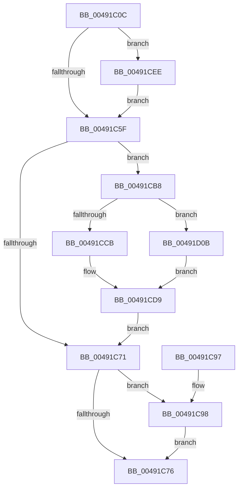

# WmipWriteWnodeToObject

- RVA: `0x00491C0C`–`0x00491D20` (길이 `276` bytes)
- VA: `0x0000000140491C0C`
- 실행 섹션: `.text`
- PDB 이름 있음: `예`; PDB Function 태그: `아니요`
- unwind 정보 RVA: `0x000B2EB4`
- 디코드: `81`개 명령, `276/276` bytes 표시
- 미해석 바이트: `0` (있으면 어셈블리에 `.byte`로 보존)

> 이 문서는 커널 이미지의 기계어와 PDB 기호를 분석해 생성했습니다. 4번과 5번은 함수 원형과 자료형을 바이너리 사용 방식에서 추정한 C 해석이며 원본 소스 복구 결과는 아닙니다.

## 1. Dependencies

- 직접 호출 지점: **6**; 고유 호출 대상: **6**
- 직접 호출자로 확인된 함수: **1**
- RIP 상대 이미지 참조: **1**

### Outgoing calls
- `0x00491C4B` → [KeAcquireInStackQueuedSpinLock](../27/KeAcquireInStackQueuedSpinLock_function_002757A0.md) (function, `0x002757A0`)
- `0x00491C64` → [KeReleaseInStackQueuedSpinLock](../34/KeReleaseInStackQueuedSpinLock_function_00342CE0.md) (function, `0x00342CE0`)
- `0x00491CAF` → [WmipQueueNotification](../../page/A6/WmipQueueNotification_function_00A6D684.md) (function, `0x00A6D684`)
- `0x00491CD1` → [memcpy](../6C/memcpy_function_006C6840.md) (function, `0x006C6840`)
- `0x00491CE7` → [IofCompleteRequest](../29/IofCompleteRequest_function_0029B5C0.md) (function, `0x0029B5C0`)
- `0x00491CF1` → [WmipClearIrpObjectList](WmipClearIrpObjectList_function_00491D28.md) (function, `0x00491D28`)

### Direct callers
- [WmipProcessEvent](../../page/9D/WmipProcessEvent_function_009DFA40.md) at `0x009DFB94`

### Static image references
- `0x00491C38` → RVA `0x00EFFC20` (`.data`; read)

## 2. Other-region calls and transfers

- 다른 실행 섹션으로 향하는 call: **1**
  - `0x00491CAF` → [WmipQueueNotification](../../page/A6/WmipQueueNotification_function_00A6D684.md) (`.text` → `PAGE`)
- 별도 외부 분기/꼬리 이동을 확인하지 못했습니다.

## 3. Assembly (complete function range)

```asm
00491C0C  4C 8B DC                        mov r11, rsp
00491C0F  49 89 5B 08                     mov qword ptr [r11 + 8], rbx
00491C13  49 89 6B 10                     mov qword ptr [r11 + 0x10], rbp
00491C17  49 89 73 18                     mov qword ptr [r11 + 0x18], rsi
00491C1B  49 89 7B 20                     mov qword ptr [r11 + 0x20], rdi
00491C1F  41 54                           push r12
00491C21  41 56                           push r14
00491C23  41 57                           push r15
00491C25  48 83 EC 40                     sub rsp, 0x40
00491C29  0F 57 C0                        xorps xmm0, xmm0
00491C2C  4C 8B F2                        mov r14, rdx
00491C2F  4C 8B F9                        mov r15, rcx
00491C32  49 8D 53 C8                     lea rdx, [r11 - 0x38]
00491C36  33 C0                           xor eax, eax
00491C38  48 8D 0D E1 DF A6 00            lea rcx, [rip + 0xa6dfe1]
00491C3F  0F 11 44 24 20                  movups xmmword ptr [rsp + 0x20], xmm0
00491C44  49 89 43 D8                     mov qword ptr [r11 - 0x28], rax
00491C48  45 8A E0                        mov r12b, r8b
00491C4B  E8 50 3B DE FF                  call 0x1402757a0
00491C50  49 8B 5F 48                     mov rbx, qword ptr [r15 + 0x48]
00491C54  33 FF                           xor edi, edi
00491C56  48 85 DB                        test rbx, rbx
00491C59  0F 85 8F 00 00 00               jne 0x140491cee
00491C5F  48 8D 4C 24 20                  lea rcx, [rsp + 0x20]
00491C64  E8 77 10 EB FF                  call 0x140342ce0
00491C69  40 B5 01                        mov bpl, 1
00491C6C  48 85 DB                        test rbx, rbx
00491C6F  75 47                           jne 0x140491cb8
00491C71  40 84 ED                        test bpl, bpl
00491C74  75 22                           jne 0x140491c98
00491C76  48 8B 5C 24 60                  mov rbx, qword ptr [rsp + 0x60]
00491C7B  8B C7                           mov eax, edi
00491C7D  48 8B 7C 24 78                  mov rdi, qword ptr [rsp + 0x78]
00491C82  48 8B 6C 24 68                  mov rbp, qword ptr [rsp + 0x68]
00491C87  48 8B 74 24 70                  mov rsi, qword ptr [rsp + 0x70]
00491C8C  48 83 C4 40                     add rsp, 0x40
00491C90  41 5F                           pop r15
00491C92  41 5E                           pop r14
00491C94  41 5C                           pop r12
00491C96  C3                              ret
00491C97  CC                              int3
00491C98  41 F6 DC                        neg r12b
00491C9B  4D 8B C6                        mov r8, r14
00491C9E  49 8B CF                        mov rcx, r15
00491CA1  48 1B D2                        sbb rdx, rdx
00491CA4  48 83 E2 E0                     and rdx, 0xffffffffffffffe0
00491CA8  48 83 EA 80                     sub rdx, -0x80
00491CAC  49 03 D7                        add rdx, r15
00491CAF  E8 D0 B9 5D 00                  call 0x140a6d684
00491CB4  8B F8                           mov edi, eax
00491CB6  EB BE                           jmp 0x140491c76
00491CB8  48 8B 83 B8 00 00 00            mov rax, qword ptr [rbx + 0xb8]
00491CBF  41 8B 36                        mov esi, dword ptr [r14]
00491CC2  48 8B 4B 18                     mov rcx, qword ptr [rbx + 0x18]
00491CC6  3B 70 08                        cmp esi, dword ptr [rax + 8]
00491CC9  77 40                           ja 0x140491d0b
00491CCB  44 8B C6                        mov r8d, esi
00491CCE  49 8B D6                        mov rdx, r14
00491CD1  E8 6A 4B 23 00                  call 0x1406c6840
00491CD6  40 8A EF                        mov bpl, dil
00491CD9  8B C6                           mov eax, esi
00491CDB  33 D2                           xor edx, edx
00491CDD  48 8B CB                        mov rcx, rbx
00491CE0  48 89 43 38                     mov qword ptr [rbx + 0x38], rax
00491CE4  89 7B 30                        mov dword ptr [rbx + 0x30], edi
00491CE7  E8 D4 98 E0 FF                  call 0x14029b5c0
00491CEC  EB 83                           jmp 0x140491c71
00491CEE  48 8B CB                        mov rcx, rbx
00491CF1  E8 32 00 00 00                  call 0x140491d28
00491CF6  48 8B C7                        mov rax, rdi
00491CF9  48 87 43 68                     xchg qword ptr [rbx + 0x68], rax
00491CFD  48 F7 D8                        neg rax
00491D00  48 1B C0                        sbb rax, rax
00491D03  48 23 D8                        and rbx, rax
00491D06  E9 54 FF FF FF                  jmp 0x140491c5f
00491D0B  B8 38 00 00 00                  mov eax, 0x38
00491D10  89 71 30                        mov dword ptr [rcx + 0x30], esi
00491D13  89 01                           mov dword ptr [rcx], eax
00491D15  8B F0                           mov esi, eax
00491D17  C7 41 2C 20 00 00 00            mov dword ptr [rcx + 0x2c], 0x20
00491D1E  EB B9                           jmp 0x140491cd9
```

## 4. C-style interpretation (structured pseudocode)

```c
__int64 __fastcall WmipWriteWnodeToObject(__int64 a1, __int64 a2, unsigned __int8 a3)
{
    __int64 result;
    __int64 v_r12;
    __int64 v_rbx;
    __int64 v_rdi;
    __int64 v_rsp;
    unsigned __int64 v_stack_m38;
    unsigned __int64 v_stack_p10;
    unsigned __int64 v_stack_p18;
    unsigned __int64 v_stack_p20;
    unsigned __int64 v_stack_p8;

    *(unsigned __int64 *)(v_rsp + 8) = v_rbx;
    *(unsigned __int64 *)(v_rsp + 16) = v_rbp;
    *(unsigned __int64 *)(v_rsp + 24) = v_rsi;
    *(unsigned __int64 *)(v_rsp + 32) = v_rdi;
    v_rsp = (v_rsp) - (64);
    result = 0;
    v_stack_m38 = v_xmm0;
    *(unsigned __int64 *)(v_rsp - 40) = 0;
    result = KeAcquireInStackQueuedSpinLock(v_rip + 10936289, v_rsp - 56, a3, a4);
    v_rdi = 0;
    if (*(unsigned __int64 *)(a1 + 72) != 0) goto loc_00491CEE;
loc_00491C5F:
    result = KeReleaseInStackQueuedSpinLock(v_stack_m38, v_rsp - 56, a3, a4);
    if (*(unsigned __int64 *)(a1 + 72) != 0) goto loc_00491CB8;
loc_00491C71:
    if (1 != 0) goto loc_00491C98;
loc_00491C76:
    v_rsp = (v_rsp) + (64);
    return 0;
loc_00491C98:
    v_r12 = (unsigned __int8)(-(a3));
    a2 = (v_rsp - 56) & (-32);
    a2 = (a2) - (-128);
    a2 = (a2) + (a1);
    result = WmipQueueNotification(a1, a2, a2, a4);
    goto loc_00491C76;
loc_00491CB8:
    if (((unsigned int)((unsigned int)(*(unsigned int *)(a2)))) > (*(unsigned int *)(*(unsigned __int64 *)(v_stack_p8 + 184) + 8))) goto loc_00491D0B;
    result = memcpy(*(unsigned __int64 *)(v_stack_p8 + 24), a2, (unsigned int)((unsigned int)((unsigned int)(*(unsigned int *)(a2)))), a4);
loc_00491CD9:
    a2 = 0;
    *(unsigned __int64 *)(v_stack_p8 + 56) = (unsigned int)((unsigned int)((unsigned int)(*(unsigned int *)(a2))));
    *(unsigned int *)(v_stack_p8 + 48) = (unsigned int)((unsigned int)((unsigned int)(result)));
    result = IofCompleteRequest(v_stack_p8, a2, (unsigned int)((unsigned int)((unsigned int)(*(unsigned int *)(a2)))), a4);
    goto loc_00491C71;
loc_00491CEE:
    result = WmipClearIrpObjectList(v_stack_p8, a2, (unsigned int)((unsigned int)((unsigned int)(*(unsigned int *)(a2)))), a4);
    result = -((unsigned int)((unsigned int)(result)));
    v_rbx = (v_stack_p8) & (result);
    goto loc_00491C5F;
loc_00491D0B:
    *(unsigned int *)(v_stack_p8 + 48) = (unsigned int)((unsigned int)(*(unsigned int *)(a2)));
    *(unsigned int *)(v_stack_p8) = 56;
    *(unsigned int *)(v_stack_p8 + 44) = 32;
    goto loc_00491CD9;
}
```

## 5. (Beta) C Style

```c
int64_t WmipWriteWnodeToObject(void *Arg1, void *Arg2, uint8_t Arg3)
{
    uint8_t *arg1 = (uint8_t *)Arg1;
    uint8_t *arg2 = (uint8_t *)Arg2;

    int64_t result;
    int64_t local_r12;
    int64_t local_rbx;
    int64_t local_rdi;
    int64_t local_rsp;
    uint64_t v_stack_m38;
    uint64_t v_stack_p10;
    uint64_t v_stack_p18;
    uint64_t v_stack_p20;
    uint64_t v_stack_p8;

    *(uint64_t *)(local_rsp + 0x8) = local_rbx;
    *(uint64_t *)(local_rsp + 0x10) = local_rbp;
    *(uint64_t *)(local_rsp + 0x18) = local_rsi;
    *(uint64_t *)(local_rsp + 0x20) = local_rdi;
    local_rsp = (local_rsp) - (64);
    result = 0;
    v_stack_m38 = v_xmm0;
    *(uint64_t *)(local_rsp - 0x28) = 0;
    result = KeAcquireInStackQueuedSpinLock(v_rip + 10936289, local_rsp - 56, Arg3, a4);
    local_rdi = 0;
    if (*(uint64_t *)(arg1 + 0x48) != 0) goto loc_00491CEE;
loc_00491C5F:
    result = KeReleaseInStackQueuedSpinLock(v_stack_m38, local_rsp - 56, Arg3, a4);
    if (*(uint64_t *)(arg1 + 0x48) != 0) goto loc_00491CB8;
loc_00491C71:
    if (1 != 0) goto loc_00491C98;
loc_00491C76:
    local_rsp = (local_rsp) + (64);
    return 0;
loc_00491C98:
    local_r12 = (uint8_t)(-(Arg3));
    Arg2 = (local_rsp - 56) & (-32);
    Arg2 = (Arg2) - (-128);
    Arg2 = (Arg2) + (Arg1);
    result = WmipQueueNotification(Arg1, Arg2, Arg2, a4);
    goto loc_00491C76;
loc_00491CB8:
    if (((uint32_t)((uint32_t)(*(uint32_t *)(arg2)))) > (*(uint32_t *)(*(uint64_t *)(v_stack_p8 + 0xB8) + 0x8))) goto loc_00491D0B;
    result = memcpy(*(uint64_t *)(v_stack_p8 + 0x18), Arg2, (uint32_t)((uint32_t)((uint32_t)(*(uint32_t *)(arg2)))), a4);
loc_00491CD9:
    Arg2 = 0;
    *(uint64_t *)(v_stack_p8 + 0x38) = (uint32_t)((uint32_t)((uint32_t)(*(uint32_t *)(arg2))));
    *(uint32_t *)(v_stack_p8 + 0x30) = (uint32_t)((uint32_t)((uint32_t)(result)));
    result = IofCompleteRequest(v_stack_p8, Arg2, (uint32_t)((uint32_t)((uint32_t)(*(uint32_t *)(arg2)))), a4);
    goto loc_00491C71;
loc_00491CEE:
    result = WmipClearIrpObjectList(v_stack_p8, Arg2, (uint32_t)((uint32_t)((uint32_t)(*(uint32_t *)(arg2)))), a4);
    result = -((uint32_t)((uint32_t)(result)));
    local_rbx = (v_stack_p8) & (result);
    goto loc_00491C5F;
loc_00491D0B:
    *(uint32_t *)(v_stack_p8 + 0x30) = (uint32_t)((uint32_t)(*(uint32_t *)(arg2)));
    *(uint32_t *)(v_stack_p8) = 56;
    *(uint32_t *)(v_stack_p8 + 0x2C) = 32;
    goto loc_00491CD9;
}
```

### 관측된 메모리 오프셋

구조체 형식이 확인되지 않은 접근은 인자 기준의 오프셋으로만 기록했습니다.

| 기준 인자 | 오프셋 표현 | 폭 (bit) | 접근 |
|---|---:|---:|---|
| `Arg1` | `+ 0x48` | `64` | `R` |
| `Arg2` | `+ 0x0` | `32` | `R` |

## 6. Execution-region graph

[열기: 2D/3D 그래프와 함수 탐색 컨트롤 패널](../../../control-panel.html?section=text&rva=0x00491C0C&view=graph)

- 2D 그래프는 위에서 아래로 흐르고, 3D 그래프는 빈 공간을 드래그해 회전합니다. Shift+드래그는 이동, 휠은 확대·축소, 함수 노드 선택은 대상 보고서 이동입니다.

### Static fallback


