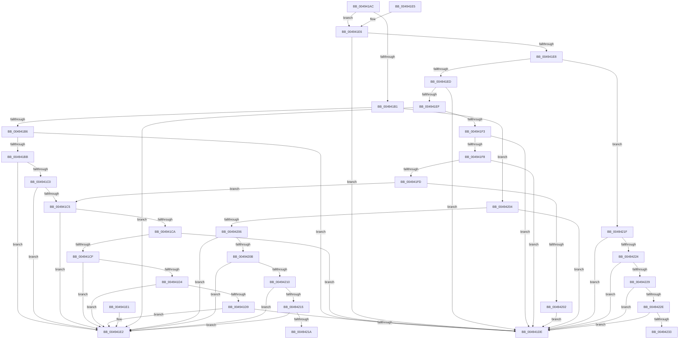

# _CmDevicePropertyWrite

- RVA: `0x004941AC`–`0x00494238` (길이 `140` bytes)
- VA: `0x00000001404941AC`
- 실행 섹션: `.text`
- PDB 이름 있음: `예`; PDB Function 태그: `예`
- unwind 정보 RVA: `0x000DB714`
- 디코드: `58`개 명령, `140/140` bytes 표시
- 미해석 바이트: `0` (있으면 어셈블리에 `.byte`로 보존)

> 이 문서는 커널 이미지의 기계어와 PDB 기호를 분석해 생성했습니다. 4번과 5번은 함수 원형과 자료형을 바이너리 사용 방식에서 추정한 C 해석이며 원본 소스 복구 결과는 아닙니다.

## 1. Dependencies

- 직접 호출 지점: **0**; 고유 호출 대상: **0**
- 직접 호출자로 확인된 함수: **2**
- RIP 상대 이미지 참조: **0**

### Outgoing calls
- 직접 디코드된 call 명령이 없습니다.

### Direct callers
- [_CmSetDeviceRegPropWorker](../../page/8F/_CmSetDeviceRegPropWorker_function_008FD804.md) at `0x008FD8A3`
- [_CmIsDeviceRegPropWritable](../../page/A6/_CmIsDeviceRegPropWritable_function_00A6B360.md) at `0x00A6B3A3`

### Static image references
- 디코드된 RIP-relative 메모리 참조가 없습니다.

## 2. Other-region calls and transfers

- 다른 실행 섹션으로 향하는 call: **0**
- call이 아닌 외부 분기/꼬리 이동: **2**
  - `0x0049421A` → `0x006F736C` (`tail-transfer`)
  - `0x00494233` → `0x006F736C` (`tail-transfer`)

## 3. Assembly (complete function range)

```asm
004941AC  83 FA 13                        cmp edx, 0x13
004941AF  7E 35                           jle 0x1404941e6
004941B1  83 FA 1D                        cmp edx, 0x1d
004941B4  7E 4E                           jle 0x140494204
004941B6  83 EA 1E                        sub edx, 0x1e
004941B9  74 23                           je 0x1404941de
004941BB  83 EA 01                        sub edx, 1
004941BE  74 22                           je 0x1404941e2
004941C0  83 EA 01                        sub edx, 1
004941C3  74 1D                           je 0x1404941e2
004941C5  83 EA 01                        sub edx, 1
004941C8  74 18                           je 0x1404941e2
004941CA  83 EA 01                        sub edx, 1
004941CD  74 0F                           je 0x1404941de
004941CF  83 EA 01                        sub edx, 1
004941D2  74 0E                           je 0x1404941e2
004941D4  83 EA 01                        sub edx, 1
004941D7  74 09                           je 0x1404941e2
004941D9  83 FA 01                        cmp edx, 1
004941DC  75 04                           jne 0x1404941e2
004941DE  B0 01                           mov al, 1
004941E0  C3                              ret
004941E1  CC                              int3
004941E2  32 C0                           xor al, al
004941E4  C3                              ret
004941E5  CC                              int3
004941E6  74 F6                           je 0x1404941de
004941E8  83 FA 09                        cmp edx, 9
004941EB  7F 32                           jg 0x14049421f
004941ED  74 EF                           je 0x1404941de
004941EF  85 D2                           test edx, edx
004941F1  74 EF                           je 0x1404941e2
004941F3  83 EA 01                        sub edx, 1
004941F6  74 E6                           je 0x1404941de
004941F8  83 EA 01                        sub edx, 1
004941FB  74 E1                           je 0x1404941de
004941FD  83 EA 01                        sub edx, 1
00494200  75 C3                           jne 0x1404941c5
00494202  EB DA                           jmp 0x1404941de
00494204  74 D8                           je 0x1404941de
00494206  83 EA 14                        sub edx, 0x14
00494209  74 D7                           je 0x1404941e2
0049420B  83 EA 01                        sub edx, 1
0049420E  74 D2                           je 0x1404941e2
00494210  83 EA 01                        sub edx, 1
00494213  74 CD                           je 0x1404941e2
00494215  83 EA 01                        sub edx, 1
00494218  74 C8                           je 0x1404941e2
0049421A  E9 4D 31 26 00                  jmp 0x1406f736c
0049421F  83 EA 0A                        sub edx, 0xa
00494222  74 BA                           je 0x1404941de
00494224  83 EA 01                        sub edx, 1
00494227  74 B5                           je 0x1404941de
00494229  83 EA 01                        sub edx, 1
0049422C  74 B0                           je 0x1404941de
0049422E  83 EA 01                        sub edx, 1
00494231  74 AB                           je 0x1404941de
00494233  E9 34 31 26 00                  jmp 0x1406f736c
```

## 4. C-style interpretation (structured pseudocode)

```c
__int64 __fastcall _CmDevicePropertyWrite(__int64 a1, int a2)
{
    __int64 result;

    if (a2 <= 19) goto loc_004941E6;
    if (a2 <= 29) goto loc_00494204;
    a2 = (unsigned int)((a2) - (30));
    if (condition_is_equal) goto loc_004941DE;
    a2 = (unsigned int)((a2) - (1));
    if (condition_is_equal) goto loc_004941E2;
    a2 = (unsigned int)((a2) - (1));
    if (condition_is_equal) goto loc_004941E2;
loc_004941C5:
    a2 = (unsigned int)((a2) - (1));
    if (condition_is_equal) goto loc_004941E2;
    a2 = (unsigned int)((a2) - (1));
    if (condition_is_equal) goto loc_004941DE;
    a2 = (unsigned int)((a2) - (1));
    if (condition_is_equal) goto loc_004941E2;
    a2 = (unsigned int)((a2) - (1));
    if (condition_is_equal) goto loc_004941E2;
    if (a2 != 1) goto loc_004941E2;
loc_004941DE:
    return 1;
loc_004941E2:
    result = 0;
    return result;
loc_004941E6:
    if (condition_is_equal) goto loc_004941DE;
    if (a2 > 9) goto loc_0049421F;
    if (a2 == 9) goto loc_004941DE;
    if (a2 == 0) goto loc_004941E2;
    a2 = (unsigned int)((a2) - (1));
    if (condition_is_equal) goto loc_004941DE;
    a2 = (unsigned int)((a2) - (1));
    if (condition_is_equal) goto loc_004941DE;
    a2 = (unsigned int)((a2) - (1));
    if (condition_is_not_equal) goto loc_004941C5;
    goto loc_004941DE;
loc_00494204:
    if (condition_is_equal) goto loc_004941DE;
    a2 = (unsigned int)((a2) - (20));
    if (condition_is_equal) goto loc_004941E2;
    a2 = (unsigned int)((a2) - (1));
    if (condition_is_equal) goto loc_004941E2;
    a2 = (unsigned int)((a2) - (1));
    if (condition_is_equal) goto loc_004941E2;
    a2 = (unsigned int)((a2) - (1));
    if (condition_is_equal) goto loc_004941E2;
loc_0049421F:
    a2 = (unsigned int)((a2) - (10));
    if (condition_is_equal) goto loc_004941DE;
    a2 = (unsigned int)((a2) - (1));
    if (condition_is_equal) goto loc_004941DE;
    a2 = (unsigned int)((a2) - (1));
    if (condition_is_equal) goto loc_004941DE;
    a2 = (unsigned int)((a2) - (1));
    if (condition_is_equal) goto loc_004941DE;
}
```

## 5. (Beta) C Style

```c
int64_t _CmDevicePropertyWrite(int64_t Arg1, int32_t Arg2)
{
    int64_t result;

    if (Arg2 <= 19) goto loc_004941E6;
    if (Arg2 <= 29) goto loc_00494204;
    Arg2 = (uint32_t)((Arg2) - (30));
    if (condition_is_equal) goto loc_004941DE;
    Arg2 = (uint32_t)((Arg2) - (1));
    if (condition_is_equal) goto loc_004941E2;
    Arg2 = (uint32_t)((Arg2) - (1));
    if (condition_is_equal) goto loc_004941E2;
loc_004941C5:
    Arg2 = (uint32_t)((Arg2) - (1));
    if (condition_is_equal) goto loc_004941E2;
    Arg2 = (uint32_t)((Arg2) - (1));
    if (condition_is_equal) goto loc_004941DE;
    Arg2 = (uint32_t)((Arg2) - (1));
    if (condition_is_equal) goto loc_004941E2;
    Arg2 = (uint32_t)((Arg2) - (1));
    if (condition_is_equal) goto loc_004941E2;
    if (Arg2 != 1) goto loc_004941E2;
loc_004941DE:
    return 1;
loc_004941E2:
    result = 0;
    return result;
loc_004941E6:
    if (condition_is_equal) goto loc_004941DE;
    if (Arg2 > 9) goto loc_0049421F;
    if (Arg2 == 9) goto loc_004941DE;
    if (Arg2 == 0) goto loc_004941E2;
    Arg2 = (uint32_t)((Arg2) - (1));
    if (condition_is_equal) goto loc_004941DE;
    Arg2 = (uint32_t)((Arg2) - (1));
    if (condition_is_equal) goto loc_004941DE;
    Arg2 = (uint32_t)((Arg2) - (1));
    if (condition_is_not_equal) goto loc_004941C5;
    goto loc_004941DE;
loc_00494204:
    if (condition_is_equal) goto loc_004941DE;
    Arg2 = (uint32_t)((Arg2) - (20));
    if (condition_is_equal) goto loc_004941E2;
    Arg2 = (uint32_t)((Arg2) - (1));
    if (condition_is_equal) goto loc_004941E2;
    Arg2 = (uint32_t)((Arg2) - (1));
    if (condition_is_equal) goto loc_004941E2;
    Arg2 = (uint32_t)((Arg2) - (1));
    if (condition_is_equal) goto loc_004941E2;
loc_0049421F:
    Arg2 = (uint32_t)((Arg2) - (10));
    if (condition_is_equal) goto loc_004941DE;
    Arg2 = (uint32_t)((Arg2) - (1));
    if (condition_is_equal) goto loc_004941DE;
    Arg2 = (uint32_t)((Arg2) - (1));
    if (condition_is_equal) goto loc_004941DE;
    Arg2 = (uint32_t)((Arg2) - (1));
    if (condition_is_equal) goto loc_004941DE;
}
```

## 6. Execution-region graph

[열기: 2D/3D 그래프와 함수 탐색 컨트롤 패널](../../../control-panel.html?section=text&rva=0x004941AC&view=graph)

- 2D 그래프는 위에서 아래로 흐르고, 3D 그래프는 빈 공간을 드래그해 회전합니다. Shift+드래그는 이동, 휠은 확대·축소, 함수 노드 선택은 대상 보고서 이동입니다.

### Static fallback


