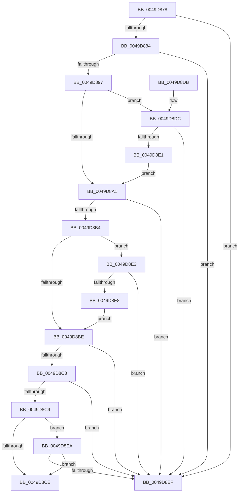

# gsl::copy&lt;unsigned char const ,-1,unsigned char,-1&gt;

- RVA: `0x0049D878`–`0x0049D8F5` (길이 `125` bytes)
- VA: `0x000000014049D878`
- 실행 섹션: `.text`
- PDB 이름 있음: `예`; PDB Function 태그: `아니요`
- unwind 정보 RVA: `0x0006886C`
- 디코드: `41`개 명령, `125/125` bytes 표시
- 미해석 바이트: `0` (있으면 어셈블리에 `.byte`로 보존)

> 이 문서는 커널 이미지의 기계어와 PDB 기호를 분석해 생성했습니다. 4번과 5번은 함수 원형과 자료형을 바이너리 사용 방식에서 추정한 C 해석이며 원본 소스 복구 결과는 아닙니다.

## 1. Dependencies

- 직접 호출 지점: **2**; 고유 호출 대상: **2**
- 직접 호출자로 확인된 함수: **1**
- RIP 상대 이미지 참조: **0**

### Outgoing calls
- `0x0049D8D1` → [memcpy](../6C/memcpy_function_006C6840.md) (function, `0x006C6840`)
- `0x0049D8EF` → [gsl::details::terminate](../4F/gsl_details_terminate_function_004F9AA0.md) (function, `0x004F9AA0`)

### Direct callers
- [RtlCreateFunctionOverrideFixupInfo](../../page/94/RtlCreateFunctionOverrideFixupInfo_function_00943034.md) at `0x0094311E`

### Static image references
- 디코드된 RIP-relative 메모리 참조가 없습니다.

## 2. Other-region calls and transfers

- 다른 실행 섹션으로 향하는 call: **0**
- 별도 외부 분기/꼬리 이동을 확인하지 못했습니다.

## 3. Assembly (complete function range)

```asm
0049D878  48 83 EC 38                     sub rsp, 0x38
0049D87C  48 8B 01                        mov rax, qword ptr [rcx]
0049D87F  48 39 02                        cmp qword ptr [rdx], rax
0049D882  72 6B                           jb 0x14049d8ef
0049D884  0F 28 01                        movaps xmm0, xmmword ptr [rcx]
0049D887  66 49 0F 7E C0                  movq r8, xmm0
0049D88C  0F 29 44 24 20                  movaps xmmword ptr [rsp + 0x20], xmm0
0049D891  49 83 F8 FF                     cmp r8, -1
0049D895  74 58                           je 0x14049d8ef
0049D897  4C 8B 54 24 28                  mov r10, qword ptr [rsp + 0x28]
0049D89C  4D 85 D2                        test r10, r10
0049D89F  74 3B                           je 0x14049d8dc
0049D8A1  0F 28 02                        movaps xmm0, xmmword ptr [rdx]
0049D8A4  66 49 0F 7E C1                  movq r9, xmm0
0049D8A9  0F 29 44 24 20                  movaps xmmword ptr [rsp + 0x20], xmm0
0049D8AE  49 83 F9 FF                     cmp r9, -1
0049D8B2  74 3B                           je 0x14049d8ef
0049D8B4  48 8B 4C 24 28                  mov rcx, qword ptr [rsp + 0x28]
0049D8B9  48 85 C9                        test rcx, rcx
0049D8BC  74 25                           je 0x14049d8e3
0049D8BE  49 3B C1                        cmp rax, r9
0049D8C1  77 2C                           ja 0x14049d8ef
0049D8C3  48 83 F8 FF                     cmp rax, -1
0049D8C7  74 26                           je 0x14049d8ef
0049D8C9  48 85 C9                        test rcx, rcx
0049D8CC  74 1C                           je 0x14049d8ea
0049D8CE  49 8B D2                        mov rdx, r10
0049D8D1  E8 6A 8F 22 00                  call 0x1406c6840
0049D8D6  48 83 C4 38                     add rsp, 0x38
0049D8DA  C3                              ret
0049D8DB  CC                              int3
0049D8DC  4D 85 C0                        test r8, r8
0049D8DF  75 0E                           jne 0x14049d8ef
0049D8E1  EB BE                           jmp 0x14049d8a1
0049D8E3  4D 85 C9                        test r9, r9
0049D8E6  75 07                           jne 0x14049d8ef
0049D8E8  EB D4                           jmp 0x14049d8be
0049D8EA  48 85 C0                        test rax, rax
0049D8ED  74 DF                           je 0x14049d8ce
0049D8EF  E8 AC C1 05 00                  call 0x1404f9aa0
0049D8F4  CC                              int3
```

## 4. C-style interpretation (structured pseudocode)

```c
__int64 __fastcall gsl__copy_unsigned_char_const___1_unsigned_char__1_(__int64 a1, __int64 a2)
{
    __int64 result;
    __int64 v_rsp;
    unsigned __int64 v_stack_m10;
    unsigned __int64 v_stack_m18;

    v_rsp = (v_rsp) - (56);
    if ((*(unsigned __int64 *)(a2)) < (*(unsigned __int64 *)(a1))) goto loc_0049D8EF;
    v_stack_m18 = v_xmm0;
    if (a3 == -1) goto loc_0049D8EF;
    if (v_stack_m10 == 0) goto loc_0049D8DC;
loc_0049D8A1:
    v_stack_m18 = v_xmm0;
    if (a4 == -1) goto loc_0049D8EF;
    if (v_stack_m10 == 0) goto loc_0049D8E3;
loc_0049D8BE:
    if ((*(unsigned __int64 *)(a1)) > a4) goto loc_0049D8EF;
    if ((*(unsigned __int64 *)(a1)) == -1) goto loc_0049D8EF;
    if (v_stack_m10 == 0) goto loc_0049D8EA;
loc_0049D8CE:
    result = memcpy(v_stack_m10, v_stack_m10, a3, a4);
    v_rsp = (v_rsp) + (56);
    return result;
loc_0049D8DC:
    if (a3 != 0) goto loc_0049D8EF;
    goto loc_0049D8A1;
loc_0049D8E3:
    if (a4 != 0) goto loc_0049D8EF;
    goto loc_0049D8BE;
loc_0049D8EA:
    if (result == 0) goto loc_0049D8CE;
loc_0049D8EF:
    result = gsl__details__terminate(v_stack_m10, v_stack_m10, a3, a4);
    return result;
}
```

## 5. (Beta) C Style

```c
int64_t gsl__copy_unsigned_char_const___1_unsigned_char__1_(void *Arg1, void *Arg2)
{
    uint8_t *arg1 = (uint8_t *)Arg1;
    uint8_t *arg2 = (uint8_t *)Arg2;

    int64_t result;
    int64_t local_rsp;
    uint64_t v_stack_m10;
    uint64_t v_stack_m18;

    local_rsp = (local_rsp) - (56);
    if ((*(uint64_t *)(arg2)) < (*(uint64_t *)(arg1))) goto loc_0049D8EF;
    v_stack_m18 = v_xmm0;
    if (a3 == -1) goto loc_0049D8EF;
    if (v_stack_m10 == 0) goto loc_0049D8DC;
loc_0049D8A1:
    v_stack_m18 = v_xmm0;
    if (a4 == -1) goto loc_0049D8EF;
    if (v_stack_m10 == 0) goto loc_0049D8E3;
loc_0049D8BE:
    if ((*(uint64_t *)(arg1)) > a4) goto loc_0049D8EF;
    if ((*(uint64_t *)(arg1)) == -1) goto loc_0049D8EF;
    if (v_stack_m10 == 0) goto loc_0049D8EA;
loc_0049D8CE:
    result = memcpy(v_stack_m10, v_stack_m10, a3, a4);
    local_rsp = (local_rsp) + (56);
    return result;
loc_0049D8DC:
    if (a3 != 0) goto loc_0049D8EF;
    goto loc_0049D8A1;
loc_0049D8E3:
    if (a4 != 0) goto loc_0049D8EF;
    goto loc_0049D8BE;
loc_0049D8EA:
    if (result == 0) goto loc_0049D8CE;
loc_0049D8EF:
    result = gsl__details__terminate(v_stack_m10, v_stack_m10, a3, a4);
    return result;
}
```

### 관측된 메모리 오프셋

구조체 형식이 확인되지 않은 접근은 인자 기준의 오프셋으로만 기록했습니다.

| 기준 인자 | 오프셋 표현 | 폭 (bit) | 접근 |
|---|---:|---:|---|
| `Arg1` | `+ 0x0` | `64` | `R` |
| `Arg1` | `+ 0x0` | `128` | `R` |
| `Arg2` | `+ 0x0` | `64` | `R` |
| `Arg2` | `+ 0x0` | `128` | `R` |

## 6. Execution-region graph

[열기: 2D/3D 그래프와 함수 탐색 컨트롤 패널](../../../control-panel.html?section=text&rva=0x0049D878&view=graph)

- 2D 그래프는 위에서 아래로 흐르고, 3D 그래프는 빈 공간을 드래그해 회전합니다. Shift+드래그는 이동, 휠은 확대·축소, 함수 노드 선택은 대상 보고서 이동입니다.

### Static fallback


