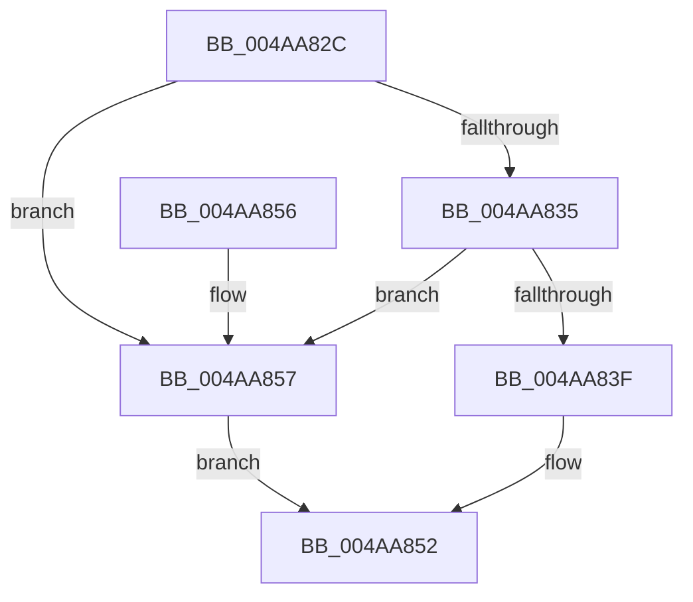

# AdtpLookupKnownPrivilegeNameQuickly

- RVA: `0x004AA82C`–`0x004AA85F` (길이 `51` bytes)
- VA: `0x00000001404AA82C`
- 실행 섹션: `.text`
- PDB 이름 있음: `예`; PDB Function 태그: `아니요`
- unwind 정보 RVA: `0x000DB714`
- 디코드: `16`개 명령, `51/51` bytes 표시
- 미해석 바이트: `0` (있으면 어셈블리에 `.byte`로 보존)

> 이 문서는 커널 이미지의 기계어와 PDB 기호를 분석해 생성했습니다. 4번과 5번은 함수 원형과 자료형을 바이너리 사용 방식에서 추정한 C 해석이며 원본 소스 복구 결과는 아닙니다.

## 1. Dependencies

- 직접 호출 지점: **0**; 고유 호출 대상: **0**
- 직접 호출자로 확인된 함수: **1**
- RIP 상대 이미지 참조: **1**

### Outgoing calls
- 직접 디코드된 call 명령이 없습니다.

### Direct callers
- [AdtpBuildPrivilegeAuditString](../../page/A6/AdtpBuildPrivilegeAuditString_function_00A62AE8.md) at `0x00A62BDE`

### Static image references
- `0x004AA843` → RVA `0x00EF0A40` (`.data`; read)

## 2. Other-region calls and transfers

- 다른 실행 섹션으로 향하는 call: **0**
- 별도 외부 분기/꼬리 이동을 확인하지 못했습니다.

## 3. Assembly (complete function range)

```asm
004AA82C  45 33 C0                        xor r8d, r8d
004AA82F  44 39 41 04                     cmp dword ptr [rcx + 4], r8d
004AA833  75 22                           jne 0x1404aa857
004AA835  8B 01                           mov eax, dword ptr [rcx]
004AA837  83 C0 FE                        add eax, -2
004AA83A  83 F8 22                        cmp eax, 0x22
004AA83D  77 18                           ja 0x1404aa857
004AA83F  48 8D 0C 40                     lea rcx, [rax + rax*2]
004AA843  48 8D 05 F6 61 A4 00            lea rax, [rip + 0xa461f6]
004AA84A  0F 10 04 C8                     movups xmm0, xmmword ptr [rax + rcx*8]
004AA84E  F3 0F 7F 02                     movdqu xmmword ptr [rdx], xmm0
004AA852  41 8B C0                        mov eax, r8d
004AA855  C3                              ret
004AA856  CC                              int3
004AA857  41 B8 60 00 00 C0               mov r8d, 0xc0000060
004AA85D  EB F3                           jmp 0x1404aa852
```

## 4. C-style interpretation (structured pseudocode)

```c
__int64 __fastcall AdtpLookupKnownPrivilegeNameQuickly(__int64 a1, __int64 a2, int a3)
{
    __int64 result;

    a3 = 0;
    if ((*(unsigned int *)(a1 + 4)) != 0) goto loc_004AA857;
    result = (unsigned int)(((unsigned int)(*(unsigned int *)(a1))) + (-2));
    if (((unsigned int)(result)) > 34) goto loc_004AA857;
    *(unsigned __int64 *)(a2) = v_xmm0;
loc_004AA852:
    return 0;
loc_004AA857:
    goto loc_004AA852;
}
```

## 5. (Beta) C Style

```c
int64_t AdtpLookupKnownPrivilegeNameQuickly(void *Arg1, void *Arg2, int32_t Arg3)
{
    uint8_t *arg1 = (uint8_t *)Arg1;
    uint8_t *arg2 = (uint8_t *)Arg2;

    int64_t result;

    Arg3 = 0;
    if ((*(uint32_t *)(arg1 + 0x4)) != 0) goto loc_004AA857;
    result = (uint32_t)(((uint32_t)(*(uint32_t *)(arg1))) + (-2));
    if (((uint32_t)(result)) > 34) goto loc_004AA857;
    *(uint64_t *)(arg2) = v_xmm0;
loc_004AA852:
    return 0;
loc_004AA857:
    goto loc_004AA852;
}
```

### 관측된 메모리 오프셋

구조체 형식이 확인되지 않은 접근은 인자 기준의 오프셋으로만 기록했습니다.

| 기준 인자 | 오프셋 표현 | 폭 (bit) | 접근 |
|---|---:|---:|---|
| `Arg1` | `+ 0x0` | `32` | `R` |
| `Arg1` | `+ 0x4` | `32` | `R` |
| `Arg2` | `+ 0x0` | `128` | `W` |

## 6. Execution-region graph

[열기: 2D/3D 그래프와 함수 탐색 컨트롤 패널](../../../control-panel.html?section=text&rva=0x004AA82C&view=graph)

- 2D 그래프는 위에서 아래로 흐르고, 3D 그래프는 빈 공간을 드래그해 회전합니다. Shift+드래그는 이동, 휠은 확대·축소, 함수 노드 선택은 대상 보고서 이동입니다.

### Static fallback


