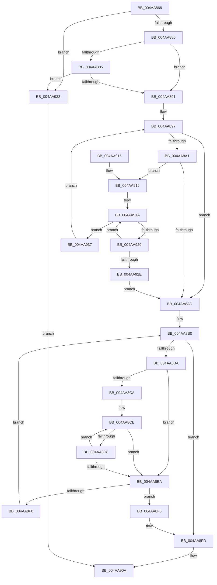

# AslpFileStringTokenize

- RVA: `0x004AA868`–`0x004AA940` (길이 `216` bytes)
- VA: `0x00000001404AA868`
- 실행 섹션: `.text`
- PDB 이름 있음: `예`; PDB Function 태그: `아니요`
- unwind 정보 RVA: `0x000B7CD4`
- 디코드: `61`개 명령, `216/216` bytes 표시
- 미해석 바이트: `0` (있으면 어셈블리에 `.byte`로 보존)

> 이 문서는 커널 이미지의 기계어와 PDB 기호를 분석해 생성했습니다. 4번과 5번은 함수 원형과 자료형을 바이너리 사용 방식에서 추정한 C 해석이며 원본 소스 복구 결과는 아닙니다.

## 1. Dependencies

- 직접 호출 지점: **0**; 고유 호출 대상: **0**
- 직접 호출자로 확인된 함수: **1**
- RIP 상대 이미지 참조: **1**

### Outgoing calls
- 직접 디코드된 call 명령이 없습니다.

### Direct callers
- [AslpFileVerQueryBlock](../../page/AF/AslpFileVerQueryBlock_function_00AF9694.md) at `0x00AF9782`
- [AslpFileVerQueryBlock](../../page/AF/AslpFileVerQueryBlock_function_00AF9694.md) at `0x00AF9846`

### Static image references
- `0x004AA891` → RVA `0x0001BD80` (`.rdata`; read)

## 2. Other-region calls and transfers

- 다른 실행 섹션으로 향하는 call: **0**
- 별도 외부 분기/꼬리 이동을 확인하지 못했습니다.

## 3. Assembly (complete function range)

```asm
004AA868  48 89 5C 24 08                  mov qword ptr [rsp + 8], rbx
004AA86D  48 89 7C 24 10                  mov qword ptr [rsp + 0x10], rdi
004AA872  33 D2                           xor edx, edx
004AA874  49 8B D8                        mov rbx, r8
004AA877  4D 85 C0                        test r8, r8
004AA87A  0F 84 B3 00 00 00               je 0x1404aa933
004AA880  48 85 C9                        test rcx, rcx
004AA883  75 0C                           jne 0x1404aa891
004AA885  49 8B 08                        mov rcx, qword ptr [r8]
004AA888  48 85 C9                        test rcx, rcx
004AA88B  0F 84 A2 00 00 00               je 0x1404aa933
004AA891  8B 05 E9 14 B7 FF               mov eax, dword ptr [rip - 0x48eb17]
004AA897  44 0F B7 01                     movzx r8d, word ptr [rcx]
004AA89B  66 45 85 C0                     test r8w, r8w
004AA89F  74 0C                           je 0x1404aa8ad
004AA8A1  4C 8D 15 D8 14 B7 FF            lea r10, [rip - 0x48eb28]
004AA8A8  66 85 C0                        test ax, ax
004AA8AB  75 69                           jne 0x1404aa916
004AA8AD  4C 8B D9                        mov r11, rcx
004AA8B0  44 0F B7 11                     movzx r10d, word ptr [rcx]
004AA8B4  66 45 85 D2                     test r10w, r10w
004AA8B8  74 43                           je 0x1404aa8fd
004AA8BA  48 8D 3D BF 14 B7 FF            lea rdi, [rip - 0x48eb41]
004AA8C1  44 0F B7 C0                     movzx r8d, ax
004AA8C5  66 85 C0                        test ax, ax
004AA8C8  74 20                           je 0x1404aa8ea
004AA8CA  44 0F B7 C8                     movzx r9d, ax
004AA8CE  45 0F B7 C1                     movzx r8d, r9w
004AA8D2  66 45 3B CA                     cmp r9w, r10w
004AA8D6  74 12                           je 0x1404aa8ea
004AA8D8  48 83 C7 02                     add rdi, 2
004AA8DC  44 0F B7 07                     movzx r8d, word ptr [rdi]
004AA8E0  45 0F B7 C8                     movzx r9d, r8w
004AA8E4  66 45 85 C0                     test r8w, r8w
004AA8E8  75 E4                           jne 0x1404aa8ce
004AA8EA  66 45 85 C0                     test r8w, r8w
004AA8EE  75 06                           jne 0x1404aa8f6
004AA8F0  48 83 C1 02                     add rcx, 2
004AA8F4  EB BA                           jmp 0x1404aa8b0
004AA8F6  66 89 11                        mov word ptr [rcx], dx
004AA8F9  48 83 C1 02                     add rcx, 2
004AA8FD  49 3B CB                        cmp rcx, r11
004AA900  48 89 0B                        mov qword ptr [rbx], rcx
004AA903  49 0F 45 D3                     cmovne rdx, r11
004AA907  48 8B C2                        mov rax, rdx
004AA90A  48 8B 5C 24 08                  mov rbx, qword ptr [rsp + 8]
004AA90F  48 8B 7C 24 10                  mov rdi, qword ptr [rsp + 0x10]
004AA914  C3                              ret
004AA915  CC                              int3
004AA916  44 0F B7 C8                     movzx r9d, ax
004AA91A  66 45 3B C8                     cmp r9w, r8w
004AA91E  74 17                           je 0x1404aa937
004AA920  49 83 C2 02                     add r10, 2
004AA924  45 0F B7 0A                     movzx r9d, word ptr [r10]
004AA928  66 45 85 C9                     test r9w, r9w
004AA92C  75 EC                           jne 0x1404aa91a
004AA92E  E9 7A FF FF FF                  jmp 0x1404aa8ad
004AA933  33 C0                           xor eax, eax
004AA935  EB D3                           jmp 0x1404aa90a
004AA937  48 83 C1 02                     add rcx, 2
004AA93B  E9 57 FF FF FF                  jmp 0x1404aa897
```

## 4. C-style interpretation (structured pseudocode)

```c
__int64 __fastcall AslpFileStringTokenize(__int64 a1, int a2, __int64 a3)
{
    __int64 result;
    __int64 v_r10;
    __int64 v_rdi;
    unsigned __int64 v_stack_p10;
    unsigned __int64 v_stack_p8;

    v_stack_p8 = v_rbx;
    v_stack_p10 = v_rdi;
    a2 = 0;
    if (a3 == 0) goto loc_004AA933;
    if (a1 != 0) goto loc_004AA891;
    if (*(unsigned __int64 *)(a3) == 0) goto loc_004AA933;
loc_004AA891:
loc_004AA897:
    if ((unsigned __int16)(*(unsigned __int16 *)(*(unsigned __int64 *)(a3))) == 0) goto loc_004AA8AD;
    if ((unsigned __int16)((unsigned int)(*(unsigned int *)(v_rip - 4778775))) != 0) goto loc_004AA916;
loc_004AA8AD:
loc_004AA8B0:
    if ((unsigned __int16)(*(unsigned __int16 *)(*(unsigned __int64 *)(a3))) == 0) goto loc_004AA8FD;
    if ((unsigned __int16)((unsigned int)(*(unsigned int *)(v_rip - 4778775))) == 0) goto loc_004AA8EA;
loc_004AA8CE:
    if (((unsigned __int16)((unsigned __int16)((unsigned int)(*(unsigned int *)(v_rip - 4778775))))) == ((unsigned __int16)(*(unsigned __int16 *)(*(unsigned __int64 *)(a3))))) goto loc_004AA8EA;
    v_rdi = (v_rip - 4778817) + (2);
    if ((unsigned __int16)(*(unsigned __int16 *)(v_rdi)) != 0) goto loc_004AA8CE;
loc_004AA8EA:
    if ((unsigned __int16)(*(unsigned __int16 *)(v_rdi)) != 0) goto loc_004AA8F6;
    a1 = (*(unsigned __int64 *)(a3)) + (2);
    goto loc_004AA8B0;
loc_004AA8F6:
    *(unsigned __int16 *)(a1) = 0;
    a1 = (a1) + (2);
loc_004AA8FD:
    *(unsigned __int64 *)(a3) = a1;
    if (a1 != (*(unsigned __int64 *)(a3))) { a2 = *(unsigned __int64 *)(a3); }
loc_004AA90A:
    return a2;
loc_004AA916:
loc_004AA91A:
    if (((unsigned __int16)((unsigned __int16)(a2))) == ((unsigned __int16)(*(unsigned __int16 *)(v_rdi)))) goto loc_004AA937;
    v_r10 = (*(unsigned __int16 *)(*(unsigned __int64 *)(a3))) + (2);
    if ((unsigned __int16)(*(unsigned __int16 *)(v_r10)) != 0) goto loc_004AA91A;
    goto loc_004AA8AD;
loc_004AA933:
    result = 0;
    goto loc_004AA90A;
loc_004AA937:
    a1 = (a1) + (2);
    goto loc_004AA897;
}
```

## 5. (Beta) C Style

```c
int64_t AslpFileStringTokenize(int64_t Arg1, int32_t Arg2, void *Arg3)
{
    uint8_t *arg3 = (uint8_t *)Arg3;

    int64_t result;
    int64_t local_r10;
    int64_t local_rdi;
    uint64_t v_stack_p10;
    uint64_t v_stack_p8;

    v_stack_p8 = local_rbx;
    v_stack_p10 = local_rdi;
    Arg2 = 0;
    if (Arg3 == NULL) goto loc_004AA933;
    if (Arg1 != 0) goto loc_004AA891;
    if (*(uint64_t *)(arg3) == 0) goto loc_004AA933;
loc_004AA891:
loc_004AA897:
    if ((uint16_t)(*(uint16_t *)(*(uint64_t *)(arg3))) == 0) goto loc_004AA8AD;
    if ((uint16_t)((uint32_t)(*(uint32_t *)(v_rip - 0x48EB17))) != 0) goto loc_004AA916;
loc_004AA8AD:
loc_004AA8B0:
    if ((uint16_t)(*(uint16_t *)(*(uint64_t *)(arg3))) == 0) goto loc_004AA8FD;
    if ((uint16_t)((uint32_t)(*(uint32_t *)(v_rip - 0x48EB17))) == 0) goto loc_004AA8EA;
loc_004AA8CE:
    if (((uint16_t)((uint16_t)((uint32_t)(*(uint32_t *)(v_rip - 0x48EB17))))) == ((uint16_t)(*(uint16_t *)(*(uint64_t *)(arg3))))) goto loc_004AA8EA;
    local_rdi = (v_rip - 4778817) + (2);
    if ((uint16_t)(*(uint16_t *)(local_rdi)) != 0) goto loc_004AA8CE;
loc_004AA8EA:
    if ((uint16_t)(*(uint16_t *)(local_rdi)) != 0) goto loc_004AA8F6;
    Arg1 = (*(uint64_t *)(arg3)) + (2);
    goto loc_004AA8B0;
loc_004AA8F6:
    *(uint16_t *)(Arg1) = 0;
    Arg1 = (Arg1) + (2);
loc_004AA8FD:
    *(uint64_t *)(arg3) = Arg1;
    if (Arg1 != (*(uint64_t *)(arg3))) { Arg2 = *(uint64_t *)(arg3); }
loc_004AA90A:
    return Arg2;
loc_004AA916:
loc_004AA91A:
    if (((uint16_t)((uint16_t)(Arg2))) == ((uint16_t)(*(uint16_t *)(local_rdi)))) goto loc_004AA937;
    local_r10 = (*(uint16_t *)(*(uint64_t *)(arg3))) + (2);
    if ((uint16_t)(*(uint16_t *)(local_r10)) != 0) goto loc_004AA91A;
    goto loc_004AA8AD;
loc_004AA933:
    result = 0;
    goto loc_004AA90A;
loc_004AA937:
    Arg1 = (Arg1) + (2);
    goto loc_004AA897;
}
```

### 관측된 메모리 오프셋

구조체 형식이 확인되지 않은 접근은 인자 기준의 오프셋으로만 기록했습니다.

| 기준 인자 | 오프셋 표현 | 폭 (bit) | 접근 |
|---|---:|---:|---|
| `Arg3` | `+ 0x0` | `64` | `W` |

## 6. Execution-region graph

[열기: 2D/3D 그래프와 함수 탐색 컨트롤 패널](../../../control-panel.html?section=text&rva=0x004AA868&view=graph)

- 2D 그래프는 위에서 아래로 흐르고, 3D 그래프는 빈 공간을 드래그해 회전합니다. Shift+드래그는 이동, 휠은 확대·축소, 함수 노드 선택은 대상 보고서 이동입니다.

### Static fallback


