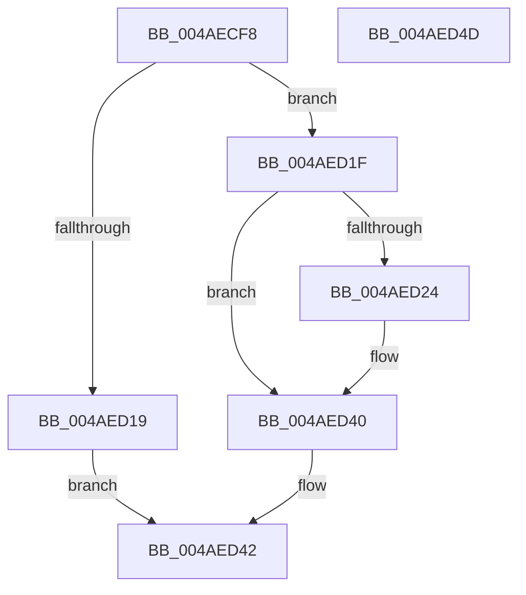

# BapdRegisterEtwProvider

- RVA: `0x004AECF8`–`0x004AED4E` (길이 `86` bytes)
- VA: `0x00000001404AECF8`
- 실행 섹션: `.text`
- PDB 이름 있음: `예`; PDB Function 태그: `아니요`
- unwind 정보 RVA: `0x0005CAAC`
- 디코드: `26`개 명령, `86/86` bytes 표시
- 미해석 바이트: `0` (있으면 어셈블리에 `.byte`로 보존)

> 이 문서는 커널 이미지의 기계어와 PDB 기호를 분석해 생성했습니다. 4번과 5번은 함수 원형과 자료형을 바이너리 사용 방식에서 추정한 C 해석이며 원본 소스 복구 결과는 아닙니다.

## 1. Dependencies

- 직접 호출 지점: **2**; 고유 호출 대상: **2**
- 직접 호출자로 확인된 함수: **3**
- RIP 상대 이미지 참조: **1**

### Outgoing calls
- `0x004AED10` → [EtwRegister](../../page/92/EtwRegister_function_00920960.md) (function, `0x00920960`)
- `0x004AED3B` → [EtwSetInformation](../../page/7B/EtwSetInformation_function_007B9070.md) (function, `0x007B9070`)

### Direct callers
- [BapdWriteEtwEvents](BapdWriteEtwEvents_function_004AE884.md) at `0x004AEB1F`
- [BapdRecordFirmwareBootStats](../../pagelk/B7/BapdRecordFirmwareBootStats_function_00B72474.md) at `0x00B72510`
- [BapdpRecordIumStatus](../../init/C5/BapdpRecordIumStatus_function_00C50424.md) at `0x00C50450`

### Static image references
- `0x004AED24` → RVA `0x0001BF90` (`.rdata`; read)

## 2. Other-region calls and transfers

- 다른 실행 섹션으로 향하는 call: **2**
  - `0x004AED10` → [EtwRegister](../../page/92/EtwRegister_function_00920960.md) (`.text` → `PAGE`)
  - `0x004AED3B` → [EtwSetInformation](../../page/7B/EtwSetInformation_function_007B9070.md) (`.text` → `PAGE`)
- 별도 외부 분기/꼬리 이동을 확인하지 못했습니다.

## 3. Assembly (complete function range)

```asm
004AECF8  48 89 5C 24 08                  mov qword ptr [rsp + 8], rbx
004AECFD  57                              push rdi
004AECFE  48 83 EC 20                     sub rsp, 0x20
004AED02  49 8B D8                        mov rbx, r8
004AED05  40 8A FA                        mov dil, dl
004AED08  4D 8B C8                        mov r9, r8
004AED0B  33 D2                           xor edx, edx
004AED0D  45 33 C0                        xor r8d, r8d
004AED10  E8 4B 1C 47 00                  call 0x140920960
004AED15  85 C0                           test eax, eax
004AED17  79 06                           jns 0x1404aed1f
004AED19  48 83 23 00                     and qword ptr [rbx], 0
004AED1D  EB 23                           jmp 0x1404aed42
004AED1F  40 84 FF                        test dil, dil
004AED22  74 1C                           je 0x1404aed40
004AED24  44 0F B7 0D 64 D2 B6 FF         movzx r9d, word ptr [rip - 0x492d9c]
004AED2C  4C 8D 05 5D D2 B6 FF            lea r8, [rip - 0x492da3]
004AED33  48 8B 0B                        mov rcx, qword ptr [rbx]
004AED36  BA 02 00 00 00                  mov edx, 2
004AED3B  E8 30 A3 30 00                  call 0x1407b9070
004AED40  33 C0                           xor eax, eax
004AED42  48 8B 5C 24 30                  mov rbx, qword ptr [rsp + 0x30]
004AED47  48 83 C4 20                     add rsp, 0x20
004AED4B  5F                              pop rdi
004AED4C  C3                              ret
004AED4D  CC                              int3
```

## 4. C-style interpretation (structured pseudocode)

```c
__int64 __fastcall BapdRegisterEtwProvider(__int64 a1, int a2, __int64 a3)
{
    __int64 result;
    __int64 v_rsp;
    unsigned __int64 v_stack_p8;

    v_stack_p8 = v_rbx;
    v_rsp = (v_rsp) - (32);
    a2 = 0;
    a3 = 0;
    result = EtwRegister(a1, a2, a3, a3);
    if (!sign_flag) goto loc_004AED1F;
    goto loc_004AED42;
loc_004AED1F:
    if ((unsigned __int8)((unsigned __int8)(a2)) != 0) {
        a4 = *(unsigned __int16 *)(v_rip - 4795804);
        a3 = v_rip - 4795811;
        a1 = *(unsigned __int64 *)(a3);
        a2 = 2;
        result = EtwSetInformation(a1, a2, a3, a4);
    }
    result = 0;
loc_004AED42:
    v_rsp = (v_rsp) + (32);
    return result;
}
```

## 5. (Beta) C Style

```c
int64_t BapdRegisterEtwProvider(int64_t Arg1, int32_t Arg2, void *Arg3)
{
    uint8_t *arg3 = (uint8_t *)Arg3;

    int64_t result;
    int64_t local_rsp;
    uint64_t v_stack_p8;

    v_stack_p8 = local_rbx;
    local_rsp = (local_rsp) - (32);
    Arg2 = 0;
    Arg3 = 0;
    result = EtwRegister(Arg1, Arg2, Arg3, Arg3);
    if (!sign_flag) goto loc_004AED1F;
    goto loc_004AED42;
loc_004AED1F:
    if ((uint8_t)((uint8_t)(Arg2)) != 0) {
        a4 = *(uint16_t *)(v_rip - 0x492D9C);
        Arg3 = v_rip - 4795811;
        Arg1 = *(uint64_t *)(arg3);
        Arg2 = 2;
        result = EtwSetInformation(Arg1, Arg2, Arg3, a4);
    }
    result = 0;
loc_004AED42:
    local_rsp = (local_rsp) + (32);
    return result;
}
```

### 관측된 메모리 오프셋

구조체 형식이 확인되지 않은 접근은 인자 기준의 오프셋으로만 기록했습니다.

| 기준 인자 | 오프셋 표현 | 폭 (bit) | 접근 |
|---|---:|---:|---|
| `Arg3` | `+ 0x0` | `64` | `R` |
| `Arg3` | `+ 0x0` | `64` | `R/W` |

## 6. Execution-region graph

[열기: 2D/3D 그래프와 함수 탐색 컨트롤 패널](../../../control-panel.html?section=text&rva=0x004AECF8&view=graph)

- 2D 그래프는 위에서 아래로 흐르고, 3D 그래프는 빈 공간을 드래그해 회전합니다. Shift+드래그는 이동, 휠은 확대·축소, 함수 노드 선택은 대상 보고서 이동입니다.

### Static fallback


