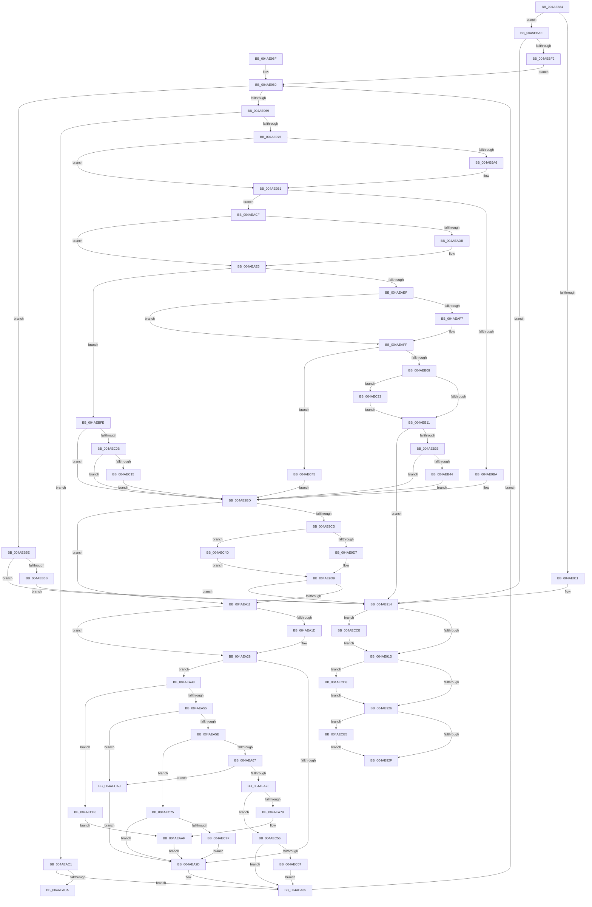

# BapdWriteEtwEvents

- RVA: `0x004AE884`–`0x004AECF2` (길이 `1,134` bytes)
- VA: `0x00000001404AE884`
- 실행 섹션: `.text`
- PDB 이름 있음: `예`; PDB Function 태그: `예`
- unwind 정보 RVA: `0x000B8688`
- 디코드: `273`개 명령, `1,134/1,134` bytes 표시
- 미해석 바이트: `0` (있으면 어셈블리에 `.byte`로 보존)

> 이 문서는 커널 이미지의 기계어와 PDB 기호를 분석해 생성했습니다. 4번과 5번은 함수 원형과 자료형을 바이너리 사용 방식에서 추정한 C 해석이며 원본 소스 복구 결과는 아닙니다.

## 1. Dependencies

- 직접 호출 지점: **22**; 고유 호출 대상: **12**
- 직접 호출자로 확인된 함수: **2**
- RIP 상대 이미지 참조: **13**

### Outgoing calls
- `0x004AE901` → [EtwRegister](../../page/92/EtwRegister_function_00920960.md) (function, `0x00920960`)
- `0x004AE939` → [_security_check_cookie](../6A/_security_check_cookie_function_006AC640.md) (function, `0x006AC640`)
- `0x004AE98E` → [BapdpParseEventParts](../4F/BapdpParseEventParts_function_004F770C.md) (function, `0x004F770C`)
- `0x004AE9C4` → [EtwEventEnabled](../39/EtwEventEnabled_function_00392450.md) (function, `0x00392450`)
- `0x004AEA01` → [EtwWriteEx](../25/EtwWriteEx_function_0025F0D0.md) (function, `0x0025F0D0`)
- `0x004AEA8C` → [wcslen](../50/wcslen_function_00501BA0.md) (function, `0x00501BA0`)
- `0x004AEAB7` → [BapdpWriteEventDataToRegistry](../../pagelk/B7/BapdpWriteEventDataToRegistry_function_00B7C1E8.md) (function, `0x00B7C1E8`)
- `0x004AEB1F` → [BapdRegisterEtwProvider](BapdRegisterEtwProvider_function_004AECF8.md) (function, `0x004AECF8`)
- `0x004AEB54` → [EtwSetInformation](../../page/7B/EtwSetInformation_function_007B9070.md) (function, `0x007B9070`)
- `0x004AEB7A` → [RtlInitUnicodeString](../42/RtlInitUnicodeString_function_0042A780.md) (function, `0x0042A780`)
- `0x004AEB87` → [BapdpWriteEventDataToRegistry](../../pagelk/B7/BapdpWriteEventDataToRegistry_function_00B7C1E8.md) (function, `0x00B7C1E8`)
- `0x004AEB97` → [RtlInitUnicodeString](../42/RtlInitUnicodeString_function_0042A780.md) (function, `0x0042A780`)
- `0x004AEBA4` → [BapdpWriteEventDataToRegistry](../../pagelk/B7/BapdpWriteEventDataToRegistry_function_00B7C1E8.md) (function, `0x00B7C1E8`)
- `0x004AEBC9` → [EtwSetInformation](../../page/7B/EtwSetInformation_function_007B9070.md) (function, `0x007B9070`)
- `0x004AEBE2` → [EtwRegister](../../page/92/EtwRegister_function_00920960.md) (function, `0x00920960`)
- `0x004AEC25` → [EtwSetInformation](../../page/7B/EtwSetInformation_function_007B9070.md) (function, `0x007B9070`)
- `0x004AEC36` → [EtwUnregister](../../page/A7/EtwUnregister_function_00A723D0.md) (function, `0x00A723D0`)
- `0x004AEC9E` → [ZwUpdateWnfStateData](../6B/ZwUpdateWnfStateData_function_006B0D10.md) (function, `0x006B0D10`)
- `0x004AECC1` → [RtlInitUnicodeString](../42/RtlInitUnicodeString_function_0042A780.md) (function, `0x0042A780`)
- `0x004AECCE` → [EtwUnregister](../../page/A7/EtwUnregister_function_00A723D0.md) (function, `0x00A723D0`)
- `0x004AECDB` → [EtwUnregister](../../page/A7/EtwUnregister_function_00A723D0.md) (function, `0x00A723D0`)
- `0x004AECE8` → [EtwUnregister](../../page/A7/EtwUnregister_function_00A723D0.md) (function, `0x00A723D0`)

### Direct callers
- [BapdpProcessEtwEvents](../65/BapdpProcessEtwEvents_function_00654C74.md) at `0x00654D63`
- [PopBootLoaderTraceProcess](../../page/75/PopBootLoaderTraceProcess_function_0075CC3C.md) at `0x0075CC83`

### Static image references
- `0x004AE8A7` → RVA `0x00E0A740` (`.data`; read)
- `0x004AE8CE` → RVA `0x000112D0` (`.rdata`; read)
- `0x004AE8ED` → RVA `0x0001BF70` (`.rdata`; read)
- `0x004AE9A6` → RVA `0x0001BF78` (`.rdata`; read)
- `0x004AEA7E` → RVA `0x006CFF20` (` ?? ::FNODOBFM::`string'`; read)
- `0x004AEACF` → RVA `0x0001BF80` (`.rdata`; read)
- `0x004AEADB` → RVA `0x0001BF88` (`.rdata`; read)
- `0x004AEB5E` → RVA `0x00EFF058` (`.data`; read)
- `0x004AEB8C` → RVA `0x006CFF90` (` ?? ::FNODOBFM::`string'`; read)
- `0x004AEBB2` → RVA `0x0001BF90` (`.rdata`; read)
- `0x004AEC6A` → RVA `0x00E6856C` (`.data`; write)
- `0x004AEC84` → RVA `0x00020A00` (`.rdata`; read)
- `0x004AECAB` → RVA `0x00E68568` (`.data`; write)

## 2. Other-region calls and transfers

- 다른 실행 섹션으로 향하는 call: **12**
  - `0x004AE901` → [EtwRegister](../../page/92/EtwRegister_function_00920960.md) (`.text` → `PAGE`)
  - `0x004AEAB7` → [BapdpWriteEventDataToRegistry](../../pagelk/B7/BapdpWriteEventDataToRegistry_function_00B7C1E8.md) (`.text` → `PAGELK`)
  - `0x004AEB54` → [EtwSetInformation](../../page/7B/EtwSetInformation_function_007B9070.md) (`.text` → `PAGE`)
  - `0x004AEB87` → [BapdpWriteEventDataToRegistry](../../pagelk/B7/BapdpWriteEventDataToRegistry_function_00B7C1E8.md) (`.text` → `PAGELK`)
  - `0x004AEBA4` → [BapdpWriteEventDataToRegistry](../../pagelk/B7/BapdpWriteEventDataToRegistry_function_00B7C1E8.md) (`.text` → `PAGELK`)
  - `0x004AEBC9` → [EtwSetInformation](../../page/7B/EtwSetInformation_function_007B9070.md) (`.text` → `PAGE`)
  - `0x004AEBE2` → [EtwRegister](../../page/92/EtwRegister_function_00920960.md) (`.text` → `PAGE`)
  - `0x004AEC25` → [EtwSetInformation](../../page/7B/EtwSetInformation_function_007B9070.md) (`.text` → `PAGE`)
  - `0x004AEC36` → [EtwUnregister](../../page/A7/EtwUnregister_function_00A723D0.md) (`.text` → `PAGE`)
  - `0x004AECCE` → [EtwUnregister](../../page/A7/EtwUnregister_function_00A723D0.md) (`.text` → `PAGE`)
  - `0x004AECDB` → [EtwUnregister](../../page/A7/EtwUnregister_function_00A723D0.md) (`.text` → `PAGE`)
  - `0x004AECE8` → [EtwUnregister](../../page/A7/EtwUnregister_function_00A723D0.md) (`.text` → `PAGE`)
- call이 아닌 외부 분기/꼬리 이동: **1**
  - `0x004AEACA` → [sub_006FAF68](../6F/Unknown_function_006FAF68.md) (`tail-transfer`)

## 3. Assembly (complete function range)

```asm
004AE884  48 8B C4                        mov rax, rsp
004AE887  48 89 58 08                     mov qword ptr [rax + 8], rbx
004AE88B  48 89 70 18                     mov qword ptr [rax + 0x18], rsi
004AE88F  48 89 78 20                     mov qword ptr [rax + 0x20], rdi
004AE893  55                              push rbp
004AE894  41 54                           push r12
004AE896  41 55                           push r13
004AE898  41 56                           push r14
004AE89A  41 57                           push r15
004AE89C  48 8D 68 A1                     lea rbp, [rax - 0x5f]
004AE8A0  48 81 EC D0 00 00 00            sub rsp, 0xd0
004AE8A7  48 8B 05 92 BE 95 00            mov rax, qword ptr [rip + 0x95be92]
004AE8AE  48 33 C4                        xor rax, rsp
004AE8B1  48 89 45 27                     mov qword ptr [rbp + 0x27], rax
004AE8B5  33 C0                           xor eax, eax
004AE8B7  41 8B F0                        mov esi, r8d
004AE8BA  48 03 F2                        add rsi, rdx
004AE8BD  48 89 4D EF                     mov qword ptr [rbp - 0x11], rcx
004AE8C1  48 8B DA                        mov rbx, rdx
004AE8C4  48 89 75 B7                     mov qword ptr [rbp - 0x49], rsi
004AE8C8  0F 57 C0                        xorps xmm0, xmm0
004AE8CB  89 45 C3                        mov dword ptr [rbp - 0x3d], eax
004AE8CE  4C 8D 35 FB 29 B6 FF            lea r14, [rip - 0x49d605]
004AE8D5  89 45 BF                        mov dword ptr [rbp - 0x41], eax
004AE8D8  33 D2                           xor edx, edx
004AE8DA  48 89 45 DF                     mov qword ptr [rbp - 0x21], rax
004AE8DE  4C 8D 4D DF                     lea r9, [rbp - 0x21]
004AE8E2  48 89 45 E7                     mov qword ptr [rbp - 0x19], rax
004AE8E6  45 33 C0                        xor r8d, r8d
004AE8E9  48 89 45 D7                     mov qword ptr [rbp - 0x29], rax
004AE8ED  48 8D 0D 7C D6 B6 FF            lea rcx, [rip - 0x492984]
004AE8F4  4C 89 75 AF                     mov qword ptr [rbp - 0x51], r14
004AE8F8  0F 11 45 C7                     movups xmmword ptr [rbp - 0x39], xmm0
004AE8FC  44 8B F8                        mov r15d, eax
004AE8FF  8B F8                           mov edi, eax
004AE901  E8 5A 20 47 00                  call 0x140920960
004AE906  44 8B E0                        mov r12d, eax
004AE909  85 C0                           test eax, eax
004AE90B  0F 89 9D 02 00 00               jns 0x1404aebae
004AE911  45 33 ED                        xor r13d, r13d
004AE914  4D 85 ED                        test r13, r13
004AE917  0F 85 AE 03 00 00               jne 0x1404aeccb
004AE91D  4D 85 FF                        test r15, r15
004AE920  0F 85 B2 03 00 00               jne 0x1404aecd8
004AE926  48 85 FF                        test rdi, rdi
004AE929  0F 85 B6 03 00 00               jne 0x1404aece5
004AE92F  41 8B C4                        mov eax, r12d
004AE932  48 8B 4D 27                     mov rcx, qword ptr [rbp + 0x27]
004AE936  48 33 CC                        xor rcx, rsp
004AE939  E8 02 DD 1F 00                  call 0x1406ac640
004AE93E  4C 8D 9C 24 D0 00 00 00         lea r11, [rsp + 0xd0]
004AE946  49 8B 5B 30                     mov rbx, qword ptr [r11 + 0x30]
004AE94A  49 8B 73 40                     mov rsi, qword ptr [r11 + 0x40]
004AE94E  49 8B 7B 48                     mov rdi, qword ptr [r11 + 0x48]
004AE952  49 8B E3                        mov rsp, r11
004AE955  41 5F                           pop r15
004AE957  41 5E                           pop r14
004AE959  41 5D                           pop r13
004AE95B  41 5C                           pop r12
004AE95D  5D                              pop rbp
004AE95E  C3                              ret
004AE95F  CC                              int3
004AE960  48 3B DE                        cmp rbx, rsi
004AE963  0F 83 F5 01 00 00               jae 0x1404aeb5e
004AE969  8B 43 08                        mov eax, dword ptr [rbx + 8]
004AE96C  83 F8 06                        cmp eax, 6
004AE96F  0F 85 4C 01 00 00               jne 0x1404aeac1
004AE975  44 8B 43 40                     mov r8d, dword ptr [rbx + 0x40]
004AE979  48 8D 55 C3                     lea rdx, [rbp - 0x3d]
004AE97D  48 89 54 24 20                  mov qword ptr [rsp + 0x20], rdx
004AE982  48 8D 4B 30                     lea rcx, [rbx + 0x30]
004AE986  48 8D 53 44                     lea rdx, [rbx + 0x44]
004AE98A  4C 8D 4D F7                     lea r9, [rbp - 9]
004AE98E  E8 79 8D 04 00                  call 0x1404f770c
004AE993  48 8B 0D D6 D5 B6 FF            mov rcx, qword ptr [rip - 0x492a2a]
004AE99A  48 8D 73 20                     lea rsi, [rbx + 0x20]
004AE99E  48 8B 06                        mov rax, qword ptr [rsi]
004AE9A1  48 2B C8                        sub rcx, rax
004AE9A4  75 0B                           jne 0x1404ae9b1
004AE9A6  48 8B 0D CB D5 B6 FF            mov rcx, qword ptr [rip - 0x492a35]
004AE9AD  48 2B 4E 08                     sub rcx, qword ptr [rsi + 8]
004AE9B1  48 85 C9                        test rcx, rcx
004AE9B4  0F 85 15 01 00 00               jne 0x1404aeacf
004AE9BA  4D 8B F5                        mov r14, r13
004AE9BD  48 8D 53 30                     lea rdx, [rbx + 0x30]
004AE9C1  49 8B CE                        mov rcx, r14
004AE9C4  E8 87 3A EE FF                  call 0x140392450
004AE9C9  84 C0                           test al, al
004AE9CB  74 44                           je 0x1404aea11
004AE9CD  80 7B 0F 00                     cmp byte ptr [rbx + 0xf], 0
004AE9D1  0F 85 76 02 00 00               jne 0x1404aec4d
004AE9D7  33 C9                           xor ecx, ecx
004AE9D9  48 8D 45 F7                     lea rax, [rbp - 9]
004AE9DD  45 33 C9                        xor r9d, r9d
004AE9E0  48 89 44 24 38                  mov qword ptr [rsp + 0x38], rax
004AE9E5  48 8D 53 30                     lea rdx, [rbx + 0x30]
004AE9E9  8B 45 C3                        mov eax, dword ptr [rbp - 0x3d]
004AE9EC  45 33 C0                        xor r8d, r8d
004AE9EF  89 44 24 30                     mov dword ptr [rsp + 0x30], eax
004AE9F3  48 83 64 24 28 00               and qword ptr [rsp + 0x28], 0
004AE9F9  48 89 4C 24 20                  mov qword ptr [rsp + 0x20], rcx
004AE9FE  49 8B CE                        mov rcx, r14
004AEA01  E8 CA 06 DB FF                  call 0x14025f0d0
004AEA06  44 8B E0                        mov r12d, eax
004AEA09  85 C0                           test eax, eax
004AEA0B  0F 88 03 FF FF FF               js 0x1404ae914
004AEA11  48 8B 0D 58 D5 B6 FF            mov rcx, qword ptr [rip - 0x492aa8]
004AEA18  48 2B 0E                        sub rcx, qword ptr [rsi]
004AEA1B  75 0B                           jne 0x1404aea28
004AEA1D  48 8B 0D 54 D5 B6 FF            mov rcx, qword ptr [rip - 0x492aac]
004AEA24  48 2B 4E 08                     sub rcx, qword ptr [rsi + 8]
004AEA28  48 85 C9                        test rcx, rcx
004AEA2B  74 1B                           je 0x1404aea48
004AEA2D  48 8B 75 B7                     mov rsi, qword ptr [rbp - 0x49]
004AEA31  4C 8B 75 AF                     mov r14, qword ptr [rbp - 0x51]
004AEA35  8B 43 04                        mov eax, dword ptr [rbx + 4]
004AEA38  48 83 C3 07                     add rbx, 7
004AEA3C  48 03 D8                        add rbx, rax
004AEA3F  48 83 E3 F8                     and rbx, 0xfffffffffffffff8
004AEA43  E9 18 FF FF FF                  jmp 0x1404ae960
004AEA48  0F B7 4B 30                     movzx ecx, word ptr [rbx + 0x30]
004AEA4C  83 E9 0B                        sub ecx, 0xb
004AEA4F  0F 84 61 02 00 00               je 0x1404aecb6
004AEA55  83 E9 05                        sub ecx, 5
004AEA58  0F 84 4A 02 00 00               je 0x1404aeca8
004AEA5E  83 E9 04                        sub ecx, 4
004AEA61  0F 84 0E 02 00 00               je 0x1404aec75
004AEA67  83 E9 09                        sub ecx, 9
004AEA6A  0F 84 38 02 00 00               je 0x1404aeca8
004AEA70  83 E9 03                        sub ecx, 3
004AEA73  0F 85 DD 01 00 00               jne 0x1404aec56
004AEA79  48 83 65 C7 00                  and qword ptr [rbp - 0x39], 0
004AEA7E  48 8D 05 9B 14 22 00            lea rax, [rip + 0x22149b]
004AEA85  48 8B C8                        mov rcx, rax
004AEA88  48 89 45 CF                     mov qword ptr [rbp - 0x31], rax
004AEA8C  E8 0F 31 05 00                  call 0x140501ba0
004AEA91  48 03 C0                        add rax, rax
004AEA94  B9 FC FF 00 00                  mov ecx, 0xfffc
004AEA99  48 3D FE FF 00 00               cmp rax, 0xfffe
004AEA9F  48 0F 43 C1                     cmovae rax, rcx
004AEAA3  66 89 45 C7                     mov word ptr [rbp - 0x39], ax
004AEAA7  66 83 C0 02                     add ax, 2
004AEAAB  66 89 45 C9                     mov word ptr [rbp - 0x37], ax
004AEAAF  4C 8D 45 C7                     lea r8, [rbp - 0x39]
004AEAB3  48 8D 4B 44                     lea rcx, [rbx + 0x44]
004AEAB7  E8 2C D7 6C 00                  call 0x140b7c1e8
004AEABC  E9 6C FF FF FF                  jmp 0x1404aea2d
004AEAC1  83 F8 05                        cmp eax, 5
004AEAC4  0F 85 6B FF FF FF               jne 0x1404aea35
004AEACA  E9 99 C4 24 00                  jmp 0x1406faf68
004AEACF  48 8B 0D AA D4 B6 FF            mov rcx, qword ptr [rip - 0x492b56]
004AEAD6  48 2B C8                        sub rcx, rax
004AEAD9  75 0B                           jne 0x1404aeae6
004AEADB  48 8B 0D A6 D4 B6 FF            mov rcx, qword ptr [rip - 0x492b5a]
004AEAE2  48 2B 4E 08                     sub rcx, qword ptr [rsi + 8]
004AEAE6  48 85 C9                        test rcx, rcx
004AEAE9  0F 84 0F 01 00 00               je 0x1404aebfe
004AEAEF  49 8B 0E                        mov rcx, qword ptr [r14]
004AEAF2  48 2B C8                        sub rcx, rax
004AEAF5  75 08                           jne 0x1404aeaff
004AEAF7  49 8B 4E 08                     mov rcx, qword ptr [r14 + 8]
004AEAFB  48 2B 4E 08                     sub rcx, qword ptr [rsi + 8]
004AEAFF  48 85 C9                        test rcx, rcx
004AEB02  0F 84 3D 01 00 00               je 0x1404aec45
004AEB08  48 85 FF                        test rdi, rdi
004AEB0B  0F 85 22 01 00 00               jne 0x1404aec33
004AEB11  80 7B 33 0B                     cmp byte ptr [rbx + 0x33], 0xb
004AEB15  4C 8D 45 D7                     lea r8, [rbp - 0x29]
004AEB19  48 8B CE                        mov rcx, rsi
004AEB1C  0F 95 C2                        setne dl
004AEB1F  E8 D4 01 00 00                  call 0x1404aecf8
004AEB24  48 8B 7D D7                     mov rdi, qword ptr [rbp - 0x29]
004AEB28  44 8B E0                        mov r12d, eax
004AEB2B  85 C0                           test eax, eax
004AEB2D  0F 88 E1 FD FF FF               js 0x1404ae914
004AEB33  80 7B 33 0B                     cmp byte ptr [rbx + 0x33], 0xb
004AEB37  4C 8B F7                        mov r14, rdi
004AEB3A  48 89 75 AF                     mov qword ptr [rbp - 0x51], rsi
004AEB3E  0F 85 79 FE FF FF               jne 0x1404ae9bd
004AEB44  44 8B 4D FF                     mov r9d, dword ptr [rbp - 1]
004AEB48  BA 02 00 00 00                  mov edx, 2
004AEB4D  4C 8B 45 F7                     mov r8, qword ptr [rbp - 9]
004AEB51  48 8B CF                        mov rcx, rdi
004AEB54  E8 17 A5 30 00                  call 0x1407b9070
004AEB59  E9 5F FE FF FF                  jmp 0x1404ae9bd
004AEB5E  F6 05 F3 04 A5 00 04            test byte ptr [rip + 0xa504f3], 4
004AEB65  0F 84 A9 FD FF FF               je 0x1404ae914
004AEB6B  83 65 BF 00                     and dword ptr [rbp - 0x41], 0
004AEB6F  48 8D 15 AA 13 22 00            lea rdx, [rip + 0x2213aa]
004AEB76  48 8D 4D C7                     lea rcx, [rbp - 0x39]
004AEB7A  E8 01 BC F7 FF                  call 0x14042a780
004AEB7F  4C 8D 45 C7                     lea r8, [rbp - 0x39]
004AEB83  48 8D 4D BF                     lea rcx, [rbp - 0x41]
004AEB87  E8 5C D6 6C 00                  call 0x140b7c1e8
004AEB8C  48 8D 15 FD 13 22 00            lea rdx, [rip + 0x2213fd]
004AEB93  48 8D 4D C7                     lea rcx, [rbp - 0x39]
004AEB97  E8 E4 BB F7 FF                  call 0x14042a780
004AEB9C  4C 8D 45 C7                     lea r8, [rbp - 0x39]
004AEBA0  48 8D 4D BF                     lea rcx, [rbp - 0x41]
004AEBA4  E8 3F D6 6C 00                  call 0x140b7c1e8
004AEBA9  E9 66 FD FF FF                  jmp 0x1404ae914
004AEBAE  4C 8B 6D DF                     mov r13, qword ptr [rbp - 0x21]
004AEBB2  4C 8D 05 D7 D3 B6 FF            lea r8, [rip - 0x492c29]
004AEBB9  44 0F B7 0D CF D3 B6 FF         movzx r9d, word ptr [rip - 0x492c31]
004AEBC1  49 8B CD                        mov rcx, r13
004AEBC4  BA 02 00 00 00                  mov edx, 2
004AEBC9  E8 A2 A4 30 00                  call 0x1407b9070
004AEBCE  4C 8D 4D E7                     lea r9, [rbp - 0x19]
004AEBD2  40 88 7D A7                     mov byte ptr [rbp - 0x59], dil
004AEBD6  45 33 C0                        xor r8d, r8d
004AEBD9  48 8D 0D A0 D3 B6 FF            lea rcx, [rip - 0x492c60]
004AEBE0  33 D2                           xor edx, edx
004AEBE2  E8 79 1D 47 00                  call 0x140920960
004AEBE7  44 8B E0                        mov r12d, eax
004AEBEA  85 C0                           test eax, eax
004AEBEC  0F 88 22 FD FF FF               js 0x1404ae914
004AEBF2  4C 8B 7D E7                     mov r15, qword ptr [rbp - 0x19]
004AEBF6  45 33 E4                        xor r12d, r12d
004AEBF9  E9 62 FD FF FF                  jmp 0x1404ae960
004AEBFE  80 7D A7 00                     cmp byte ptr [rbp - 0x59], 0
004AEC02  4D 8B F7                        mov r14, r15
004AEC05  0F 85 B2 FD FF FF               jne 0x1404ae9bd
004AEC0B  80 7B 33 0B                     cmp byte ptr [rbx + 0x33], 0xb
004AEC0F  0F 85 A8 FD FF FF               jne 0x1404ae9bd
004AEC15  44 8B 4D FF                     mov r9d, dword ptr [rbp - 1]
004AEC19  BA 02 00 00 00                  mov edx, 2
004AEC1E  4C 8B 45 F7                     mov r8, qword ptr [rbp - 9]
004AEC22  49 8B CF                        mov rcx, r15
004AEC25  E8 46 A4 30 00                  call 0x1407b9070
004AEC2A  C6 45 A7 01                     mov byte ptr [rbp - 0x59], 1
004AEC2E  E9 8A FD FF FF                  jmp 0x1404ae9bd
004AEC33  48 8B CF                        mov rcx, rdi
004AEC36  E8 95 37 5C 00                  call 0x140a723d0
004AEC3B  48 83 65 D7 00                  and qword ptr [rbp - 0x29], 0
004AEC40  E9 CC FE FF FF                  jmp 0x1404aeb11
004AEC45  4C 8B F7                        mov r14, rdi
004AEC48  E9 70 FD FF FF                  jmp 0x1404ae9bd
004AEC4D  48 8D 4B 10                     lea rcx, [rbx + 0x10]
004AEC51  E9 83 FD FF FF                  jmp 0x1404ae9d9
004AEC56  4C 8B 75 AF                     mov r14, qword ptr [rbp - 0x51]
004AEC5A  48 8B 75 B7                     mov rsi, qword ptr [rbp - 0x49]
004AEC5E  83 F9 7E                        cmp ecx, 0x7e
004AEC61  0F 85 CE FD FF FF               jne 0x1404aea35
004AEC67  8B 43 44                        mov eax, dword ptr [rbx + 0x44]
004AEC6A  89 05 FC 98 9B 00               mov dword ptr [rip + 0x9b98fc], eax
004AEC70  E9 C0 FD FF FF                  jmp 0x1404aea35
004AEC75  83 7B 44 00                     cmp dword ptr [rbx + 0x44], 0
004AEC79  0F 85 AE FD FF FF               jne 0x1404aea2d
004AEC7F  83 64 24 30 00                  and dword ptr [rsp + 0x30], 0
004AEC84  48 8D 0D 75 1D B7 FF            lea rcx, [rip - 0x48e28b]
004AEC8B  83 64 24 28 00                  and dword ptr [rsp + 0x28], 0
004AEC90  45 33 C9                        xor r9d, r9d
004AEC93  48 83 64 24 20 00               and qword ptr [rsp + 0x20], 0
004AEC99  45 33 C0                        xor r8d, r8d
004AEC9C  33 D2                           xor edx, edx
004AEC9E  E8 6D 20 20 00                  call 0x1406b0d10
004AECA3  E9 85 FD FF FF                  jmp 0x1404aea2d
004AECA8  8B 43 44                        mov eax, dword ptr [rbx + 0x44]
004AECAB  89 05 B7 98 9B 00               mov dword ptr [rip + 0x9b98b7], eax
004AECB1  E9 77 FD FF FF                  jmp 0x1404aea2d
004AECB6  48 8D 15 D3 12 22 00            lea rdx, [rip + 0x2212d3]
004AECBD  48 8D 4D C7                     lea rcx, [rbp - 0x39]
004AECC1  E8 BA BA F7 FF                  call 0x14042a780
004AECC6  E9 E4 FD FF FF                  jmp 0x1404aeaaf
004AECCB  49 8B CD                        mov rcx, r13
004AECCE  E8 FD 36 5C 00                  call 0x140a723d0
004AECD3  E9 45 FC FF FF                  jmp 0x1404ae91d
004AECD8  49 8B CF                        mov rcx, r15
004AECDB  E8 F0 36 5C 00                  call 0x140a723d0
004AECE0  E9 41 FC FF FF                  jmp 0x1404ae926
004AECE5  48 8B CF                        mov rcx, rdi
004AECE8  E8 E3 36 5C 00                  call 0x140a723d0
004AECED  E9 3D FC FF FF                  jmp 0x1404ae92f
```

## 4. C-style interpretation (structured pseudocode)

```c
__int64 __fastcall BapdWriteEtwEvents(__int64 a1, __int64 a2, int a3)
{
    __int64 result;
    __int64 v_r12;
    __int64 v_r13;
    __int64 v_rbx;
    __int64 v_rsi;
    __int64 v_rsp;
    unsigned __int64 v_stack_m28;
    unsigned __int64 v_stack_m98;
    unsigned int v_stack_mA0;
    unsigned __int64 v_stack_mA8;
    unsigned __int64 v_stack_mB0;

    *(unsigned __int64 *)(v_rsp + 8) = v_rbx;
    *(unsigned __int64 *)(v_rsp + 24) = v_rsi;
    *(unsigned __int64 *)(v_rsp + 32) = v_rdi;
    v_rsp = (v_rsp) - (208);
    result = (*(unsigned __int64 *)(v_rip + 9813650)) ^ (v_rsp);
    *(unsigned __int64 *)(v_rsp - 95 + 39) = result;
    result = 0;
    v_rsi = ((unsigned int)(a3)) + (a2);
    *(unsigned __int64 *)(v_rsp - 95 - 17) = a1;
    *(unsigned __int64 *)(v_rsp - 95 - 73) = v_rsi;
    *(unsigned int *)(v_rsp - 95 - 61) = 0;
    *(unsigned int *)(v_rsp - 95 - 65) = 0;
    a2 = 0;
    *(unsigned __int64 *)(v_rsp - 95 - 33) = 0;
    *(unsigned __int64 *)(v_rsp - 95 - 25) = 0;
    a3 = 0;
    *(unsigned __int64 *)(v_rsp - 95 - 41) = 0;
    *(unsigned __int64 *)(v_rsp - 95 - 81) = v_rip - 4838917;
    *(unsigned __int64 *)(v_rsp - 95 - 57) = v_xmm0;
    result = EtwRegister(v_rip - 4794756, a2, a3, v_rsp - 95 - 33);
    if (!sign_flag) goto loc_004AEBAE;
    v_r13 = 0;
loc_004AE914:
    if (0 != 0) goto loc_004AECCB;
loc_004AE91D:
    if (0 != 0) goto loc_004AECD8;
loc_004AE926:
    if (0 != 0) goto loc_004AECE5;
loc_004AE92F:
    a1 = (*(unsigned __int64 *)(v_rsp - 95 + 39)) ^ (v_rsp);
    result = _security_check_cookie(a1, a2, a3, v_rsp - 95 - 33);
    return result;
loc_004AE960:
    if ((*(unsigned __int64 *)(v_stack_m28 + 48)) >= (*(unsigned __int64 *)(v_stack_m28 + 64))) goto loc_004AEB5E;
    if (((unsigned int)((unsigned int)(*(unsigned int *)(*(unsigned __int64 *)(v_stack_m28 + 48) + 8)))) != 6) goto loc_004AEAC1;
    v_stack_mB0 = v_rsp - 95 - 61;
    result = BapdpParseEventParts(*(unsigned __int64 *)(v_stack_m28 + 48) + 48, *(unsigned __int64 *)(v_stack_m28 + 48) + 68, (unsigned int)(*(unsigned int *)(*(unsigned __int64 *)(v_stack_m28 + 48) + 64)), v_rsp - 95 - 9);
    a1 = (*(unsigned __int64 *)(v_rip - 4794922)) - (*(unsigned __int64 *)(*(unsigned __int64 *)(v_stack_m28 + 48) + 32));
    if (!(condition_is_not_equal)) {
        a1 = *(unsigned __int64 *)(v_rip - 4794933);
        a1 = (a1) - (*(unsigned __int64 *)(*(unsigned __int64 *)(v_stack_m28 + 48) + 32 + 8));
    }
    if (a1 != 0) goto loc_004AEACF;
loc_004AE9BD:
    result = EtwEventEnabled(0, *(unsigned __int64 *)(v_stack_m28 + 48) + 48, (unsigned int)(*(unsigned int *)(*(unsigned __int64 *)(v_stack_m28 + 48) + 64)), v_rsp - 95 - 9);
    if ((unsigned __int8)(result) == 0) goto loc_004AEA11;
    if ((*(unsigned __int8 *)(*(unsigned __int64 *)(v_stack_m28 + 48) + 15)) != 0) goto loc_004AEC4D;
    a1 = 0;
loc_004AE9D9:
    a4 = 0;
    v_stack_m98 = v_rsp - 95 - 9;
    a3 = 0;
    v_stack_mA0 = (unsigned int)((unsigned int)(*(unsigned int *)(v_rsp - 95 - 61)));
    v_stack_mB0 = 0;
    result = EtwWriteEx(0, *(unsigned __int64 *)(v_stack_m28 + 48) + 48, a3, a4);
    if (sign_flag) goto loc_004AE914;
loc_004AEA11:
    a1 = (*(unsigned __int64 *)(v_rip - 4795048)) - (*(unsigned __int64 *)(*(unsigned __int64 *)(v_stack_m28 + 48) + 32));
    if (!(condition_is_not_equal)) {
        a1 = *(unsigned __int64 *)(v_rip - 4795052);
        a1 = (a1) - (*(unsigned __int64 *)(*(unsigned __int64 *)(v_stack_m28 + 48) + 32 + 8));
    }
    if (a1 == 0) goto loc_004AEA48;
loc_004AEA2D:
loc_004AEA35:
    v_rbx = (*(unsigned __int64 *)(v_stack_m28 + 48)) + (7);
    v_rbx = (v_rbx) + ((unsigned int)(*(unsigned int *)(*(unsigned __int64 *)(v_stack_m28 + 48) + 4)));
    v_rbx = (v_rbx) & (-8);
    goto loc_004AE960;
loc_004AEA48:
    a1 = (unsigned int)((*(unsigned __int16 *)(v_rbx + 48)) - (11));
    if (condition_is_equal) goto loc_004AECB6;
    a1 = (unsigned int)((a1) - (5));
    if (condition_is_equal) goto loc_004AECA8;
    a1 = (unsigned int)((a1) - (4));
    if (condition_is_equal) goto loc_004AEC75;
    a1 = (unsigned int)((a1) - (9));
    if (condition_is_equal) goto loc_004AECA8;
    a1 = (unsigned int)((a1) - (3));
    if (condition_is_not_equal) goto loc_004AEC56;
    *(unsigned __int64 *)(v_rsp - 95 - 49) = v_rip + 2233499;
    result = wcslen(v_rip + 2233499, *(unsigned __int64 *)(v_stack_m28 + 48) + 48, a3, a4);
    result = (result) + (result);
    if (result >= 0xFFFEULL) { result = (unsigned int)(0xFFFCULL); }
    *(unsigned __int16 *)(v_rsp - 95 - 57) = (unsigned __int16)(result);
    result = (unsigned __int16)((result) + (2));
    *(unsigned __int16 *)(v_rsp - 95 - 55) = (unsigned __int16)(result);
loc_004AEAAF:
    result = BapdpWriteEventDataToRegistry(v_rbx + 68, *(unsigned __int64 *)(v_stack_m28 + 48) + 48, v_rsp - 95 - 57, a4);
    goto loc_004AEA2D;
loc_004AEAC1:
    if (((unsigned int)(result)) != 5) goto loc_004AEA35;
loc_004AEACF:
    a1 = (*(unsigned __int64 *)(v_rip - 4795222)) - (result);
    if (!(condition_is_not_equal)) {
        a1 = *(unsigned __int64 *)(v_rip - 4795226);
        a1 = (a1) - (*(unsigned __int64 *)(*(unsigned __int64 *)(v_rsp - 95 - 73) + 8));
    }
    if (a1 == 0) goto loc_004AEBFE;
    a1 = (*(unsigned __int64 *)(*(unsigned __int64 *)(v_rsp - 95 - 81))) - (result);
    if (!(condition_is_not_equal)) {
        a1 = *(unsigned __int64 *)(*(unsigned __int64 *)(v_rsp - 95 - 81) + 8);
        a1 = (a1) - (*(unsigned __int64 *)(*(unsigned __int64 *)(v_rsp - 95 - 73) + 8));
    }
    if (a1 == 0) goto loc_004AEC45;
    if (*(unsigned __int64 *)(v_stack_m28 + 72) != 0) goto loc_004AEC33;
loc_004AEB11:
    a2 = ((*(unsigned __int8 *)(v_rbx + 51)) != 11) ? 1 : 0;
    result = BapdRegisterEtwProvider(*(unsigned __int64 *)(v_rsp - 95 - 73), a2, v_rsp - 95 - 41, a4);
    if (sign_flag) goto loc_004AE914;
    *(unsigned __int64 *)(v_rsp - 95 - 81) = *(unsigned __int64 *)(v_rsp - 95 - 73);
    if ((*(unsigned __int8 *)(v_rbx + 51)) != 11) goto loc_004AE9BD;
    result = EtwSetInformation(*(unsigned __int64 *)(v_rsp - 95 - 41), 2, *(unsigned __int64 *)(v_rsp - 95 - 9), (unsigned int)(*(unsigned int *)(v_rsp - 95 - 1)));
    goto loc_004AE9BD;
loc_004AEB5E:
    if (((*(unsigned __int8 *)(v_rip + 10814707)) & (4)) == 0) goto loc_004AE914;
    result = RtlInitUnicodeString(v_rsp - 95 - 57, v_rip + 2233258, *(unsigned __int64 *)(v_rsp - 95 - 9), (unsigned int)(*(unsigned int *)(v_rsp - 95 - 1)));
    result = BapdpWriteEventDataToRegistry(v_rsp - 95 - 65, v_rip + 2233258, v_rsp - 95 - 57, (unsigned int)(*(unsigned int *)(v_rsp - 95 - 1)));
    result = RtlInitUnicodeString(v_rsp - 95 - 57, v_rip + 2233341, v_rsp - 95 - 57, (unsigned int)(*(unsigned int *)(v_rsp - 95 - 1)));
    result = BapdpWriteEventDataToRegistry(v_rsp - 95 - 65, v_rip + 2233341, v_rsp - 95 - 57, (unsigned int)(*(unsigned int *)(v_rsp - 95 - 1)));
    goto loc_004AE914;
loc_004AEBAE:
    result = EtwSetInformation(*(unsigned __int64 *)(v_rsp - 95 - 33), 2, v_rip - 4795433, *(unsigned __int16 *)(v_rip - 4795441));
    *(unsigned __int8 *)(v_rsp - 95 - 89) = (unsigned __int8)(*(unsigned __int64 *)(v_rsp - 95 - 41));
    a3 = 0;
    a2 = 0;
    result = EtwRegister(v_rip - 4795488, a2, a3, v_rsp - 95 - 25);
    if (sign_flag) goto loc_004AE914;
    v_r12 = 0;
    goto loc_004AE960;
loc_004AEBFE:
    if ((*(unsigned __int8 *)(v_rsp - 95 - 89)) != 0) goto loc_004AE9BD;
    if ((*(unsigned __int8 *)(v_rbx + 51)) != 11) goto loc_004AE9BD;
    result = EtwSetInformation(*(unsigned __int64 *)(v_rsp - 95 - 25), 2, *(unsigned __int64 *)(v_rsp - 95 - 9), (unsigned int)(*(unsigned int *)(v_rsp - 95 - 1)));
    *(unsigned __int8 *)(v_rsp - 95 - 89) = 1;
    goto loc_004AE9BD;
loc_004AEC33:
    result = EtwUnregister(*(unsigned __int64 *)(v_rsp - 95 - 41), 2, *(unsigned __int64 *)(v_rsp - 95 - 9), (unsigned int)(*(unsigned int *)(v_rsp - 95 - 1)));
    goto loc_004AEB11;
loc_004AEC45:
    goto loc_004AE9BD;
loc_004AEC4D:
    goto loc_004AE9D9;
loc_004AEC56:
    if (((unsigned int)(v_rbx + 16)) != 126) goto loc_004AEA35;
    *(unsigned int *)(v_rip + 10197244) = (unsigned int)((unsigned int)(*(unsigned int *)(v_rbx + 68)));
    goto loc_004AEA35;
loc_004AEC75:
    if ((*(unsigned int *)(v_rbx + 68)) != 0) goto loc_004AEA2D;
    a4 = 0;
    a3 = 0;
    a2 = 0;
    result = ZwUpdateWnfStateData(v_rip - 4776587, a2, a3, a4);
    goto loc_004AEA2D;
loc_004AECA8:
    *(unsigned int *)(v_rip + 10197175) = (unsigned int)((unsigned int)(*(unsigned int *)(v_rbx + 68)));
    goto loc_004AEA2D;
loc_004AECB6:
    result = RtlInitUnicodeString(v_rsp - 95 - 57, v_rip + 2233043, a3, a4);
    goto loc_004AEAAF;
loc_004AECCB:
    result = EtwUnregister(*(unsigned __int64 *)(v_rsp - 95 - 33), v_rip + 2233043, a3, a4);
    goto loc_004AE91D;
loc_004AECD8:
    result = EtwUnregister(*(unsigned __int64 *)(v_rsp - 95 - 25), v_rip + 2233043, a3, a4);
    goto loc_004AE926;
loc_004AECE5:
    result = EtwUnregister(*(unsigned __int64 *)(v_rsp - 95 - 41), v_rip + 2233043, a3, a4);
    goto loc_004AE92F;
}
```

## 5. (Beta) C Style

```c
int64_t BapdWriteEtwEvents(int64_t Arg1, int64_t Arg2, int32_t Arg3)
{
    int64_t result;
    int64_t local_r12;
    int64_t local_r13;
    int64_t local_rbx;
    int64_t local_rsi;
    int64_t local_rsp;
    uint64_t v_stack_m28;
    uint64_t v_stack_m98;
    uint32_t v_stack_mA0;
    uint64_t v_stack_mA8;
    uint64_t v_stack_mB0;

    *(uint64_t *)(local_rsp + 0x8) = local_rbx;
    *(uint64_t *)(local_rsp + 0x18) = local_rsi;
    *(uint64_t *)(local_rsp + 0x20) = local_rdi;
    local_rsp = (local_rsp) - (208);
    result = (*(uint64_t *)(v_rip + 0x95BE92)) ^ (local_rsp);
    *(uint64_t *)(local_rsp - 0x5F + 0x27) = result;
    result = 0;
    local_rsi = ((uint32_t)(Arg3)) + (Arg2);
    *(uint64_t *)(local_rsp - 0x5F - 0x11) = Arg1;
    *(uint64_t *)(local_rsp - 0x5F - 0x49) = local_rsi;
    *(uint32_t *)(local_rsp - 0x5F - 0x3D) = 0;
    *(uint32_t *)(local_rsp - 0x5F - 0x41) = 0;
    Arg2 = 0;
    *(uint64_t *)(local_rsp - 0x5F - 0x21) = 0;
    *(uint64_t *)(local_rsp - 0x5F - 0x19) = 0;
    Arg3 = 0;
    *(uint64_t *)(local_rsp - 0x5F - 0x29) = 0;
    *(uint64_t *)(local_rsp - 0x5F - 0x51) = v_rip - 4838917;
    *(uint64_t *)(local_rsp - 0x5F - 0x39) = v_xmm0;
    result = EtwRegister(v_rip - 4794756, Arg2, Arg3, local_rsp - 95 - 33);
    if (!sign_flag) goto loc_004AEBAE;
    local_r13 = 0;
loc_004AE914:
    if (0 != 0) goto loc_004AECCB;
loc_004AE91D:
    if (0 != 0) goto loc_004AECD8;
loc_004AE926:
    if (0 != 0) goto loc_004AECE5;
loc_004AE92F:
    Arg1 = (*(uint64_t *)(local_rsp - 0x5F + 0x27)) ^ (local_rsp);
    result = _security_check_cookie(Arg1, Arg2, Arg3, local_rsp - 95 - 33);
    return result;
loc_004AE960:
    if ((*(uint64_t *)(v_stack_m28 + 0x30)) >= (*(uint64_t *)(v_stack_m28 + 0x40))) goto loc_004AEB5E;
    if (((uint32_t)((uint32_t)(*(uint32_t *)(*(uint64_t *)(v_stack_m28 + 0x30) + 0x8)))) != 6) goto loc_004AEAC1;
    v_stack_mB0 = local_rsp - 95 - 61;
    result = BapdpParseEventParts(*(uint64_t *)(v_stack_m28 + 0x30) + 48, *(uint64_t *)(v_stack_m28 + 0x30) + 68, (uint32_t)(*(uint32_t *)(*(uint64_t *)(v_stack_m28 + 0x30) + 0x40)), local_rsp - 95 - 9);
    Arg1 = (*(uint64_t *)(v_rip - 0x492A2A)) - (*(uint64_t *)(*(uint64_t *)(v_stack_m28 + 0x30) + 0x20));
    if (!(condition_is_not_equal)) {
        Arg1 = *(uint64_t *)(v_rip - 0x492A35);
        Arg1 = (Arg1) - (*(uint64_t *)(*(uint64_t *)(v_stack_m28 + 0x30) + 0x20 + 0x8));
    }
    if (Arg1 != 0) goto loc_004AEACF;
loc_004AE9BD:
    result = EtwEventEnabled(0, *(uint64_t *)(v_stack_m28 + 0x30) + 48, (uint32_t)(*(uint32_t *)(*(uint64_t *)(v_stack_m28 + 0x30) + 0x40)), local_rsp - 95 - 9);
    if ((uint8_t)(result) == 0) goto loc_004AEA11;
    if ((*(uint8_t *)(*(uint64_t *)(v_stack_m28 + 0x30) + 0xF)) != 0) goto loc_004AEC4D;
    Arg1 = 0;
loc_004AE9D9:
    a4 = 0;
    v_stack_m98 = local_rsp - 95 - 9;
    Arg3 = 0;
    v_stack_mA0 = (uint32_t)((uint32_t)(*(uint32_t *)(local_rsp - 0x5F - 0x3D)));
    v_stack_mB0 = 0;
    result = EtwWriteEx(0, *(uint64_t *)(v_stack_m28 + 0x30) + 48, Arg3, a4);
    if (sign_flag) goto loc_004AE914;
loc_004AEA11:
    Arg1 = (*(uint64_t *)(v_rip - 0x492AA8)) - (*(uint64_t *)(*(uint64_t *)(v_stack_m28 + 0x30) + 0x20));
    if (!(condition_is_not_equal)) {
        Arg1 = *(uint64_t *)(v_rip - 0x492AAC);
        Arg1 = (Arg1) - (*(uint64_t *)(*(uint64_t *)(v_stack_m28 + 0x30) + 0x20 + 0x8));
    }
    if (Arg1 == 0) goto loc_004AEA48;
loc_004AEA2D:
loc_004AEA35:
    local_rbx = (*(uint64_t *)(v_stack_m28 + 0x30)) + (7);
    local_rbx = (local_rbx) + ((uint32_t)(*(uint32_t *)(*(uint64_t *)(v_stack_m28 + 0x30) + 0x4)));
    local_rbx = (local_rbx) & (-8);
    goto loc_004AE960;
loc_004AEA48:
    Arg1 = (uint32_t)((*(uint16_t *)(local_rbx + 0x30)) - (11));
    if (condition_is_equal) goto loc_004AECB6;
    Arg1 = (uint32_t)((Arg1) - (5));
    if (condition_is_equal) goto loc_004AECA8;
    Arg1 = (uint32_t)((Arg1) - (4));
    if (condition_is_equal) goto loc_004AEC75;
    Arg1 = (uint32_t)((Arg1) - (9));
    if (condition_is_equal) goto loc_004AECA8;
    Arg1 = (uint32_t)((Arg1) - (3));
    if (condition_is_not_equal) goto loc_004AEC56;
    *(uint64_t *)(local_rsp - 0x5F - 0x31) = v_rip + 2233499;
    result = wcslen(v_rip + 2233499, *(uint64_t *)(v_stack_m28 + 0x30) + 48, Arg3, a4);
    result = (result) + (result);
    if (result >= 0xFFFEULL) { result = (uint32_t)(0xFFFCULL); }
    *(uint16_t *)(local_rsp - 0x5F - 0x39) = (uint16_t)(result);
    result = (uint16_t)((result) + (2));
    *(uint16_t *)(local_rsp - 0x5F - 0x37) = (uint16_t)(result);
loc_004AEAAF:
    result = BapdpWriteEventDataToRegistry(local_rbx + 68, *(uint64_t *)(v_stack_m28 + 0x30) + 48, local_rsp - 95 - 57, a4);
    goto loc_004AEA2D;
loc_004AEAC1:
    if (((uint32_t)(result)) != 5) goto loc_004AEA35;
loc_004AEACF:
    Arg1 = (*(uint64_t *)(v_rip - 0x492B56)) - (result);
    if (!(condition_is_not_equal)) {
        Arg1 = *(uint64_t *)(v_rip - 0x492B5A);
        Arg1 = (Arg1) - (*(uint64_t *)(*(uint64_t *)(local_rsp - 0x5F - 0x49) + 0x8));
    }
    if (Arg1 == 0) goto loc_004AEBFE;
    Arg1 = (*(uint64_t *)(*(uint64_t *)(local_rsp - 0x5F - 0x51))) - (result);
    if (!(condition_is_not_equal)) {
        Arg1 = *(uint64_t *)(*(uint64_t *)(local_rsp - 0x5F - 0x51) + 0x8);
        Arg1 = (Arg1) - (*(uint64_t *)(*(uint64_t *)(local_rsp - 0x5F - 0x49) + 0x8));
    }
    if (Arg1 == 0) goto loc_004AEC45;
    if (*(uint64_t *)(v_stack_m28 + 0x48) != 0) goto loc_004AEC33;
loc_004AEB11:
    Arg2 = ((*(uint8_t *)(local_rbx + 0x33)) != 11) ? 1 : 0;
    result = BapdRegisterEtwProvider(*(uint64_t *)(local_rsp - 0x5F - 0x49), Arg2, local_rsp - 95 - 41, a4);
    if (sign_flag) goto loc_004AE914;
    *(uint64_t *)(local_rsp - 0x5F - 0x51) = *(uint64_t *)(local_rsp - 0x5F - 0x49);
    if ((*(uint8_t *)(local_rbx + 0x33)) != 11) goto loc_004AE9BD;
    result = EtwSetInformation(*(uint64_t *)(local_rsp - 0x5F - 0x29), 2, *(uint64_t *)(local_rsp - 0x5F - 0x9), (uint32_t)(*(uint32_t *)(local_rsp - 0x5F - 0x1)));
    goto loc_004AE9BD;
loc_004AEB5E:
    if (((*(uint8_t *)(v_rip + 0xA504F3)) & (4)) == 0) goto loc_004AE914;
    result = RtlInitUnicodeString(local_rsp - 95 - 57, v_rip + 2233258, *(uint64_t *)(local_rsp - 0x5F - 0x9), (uint32_t)(*(uint32_t *)(local_rsp - 0x5F - 0x1)));
    result = BapdpWriteEventDataToRegistry(local_rsp - 95 - 65, v_rip + 2233258, local_rsp - 95 - 57, (uint32_t)(*(uint32_t *)(local_rsp - 0x5F - 0x1)));
    result = RtlInitUnicodeString(local_rsp - 95 - 57, v_rip + 2233341, local_rsp - 95 - 57, (uint32_t)(*(uint32_t *)(local_rsp - 0x5F - 0x1)));
    result = BapdpWriteEventDataToRegistry(local_rsp - 95 - 65, v_rip + 2233341, local_rsp - 95 - 57, (uint32_t)(*(uint32_t *)(local_rsp - 0x5F - 0x1)));
    goto loc_004AE914;
loc_004AEBAE:
    result = EtwSetInformation(*(uint64_t *)(local_rsp - 0x5F - 0x21), 2, v_rip - 4795433, *(uint16_t *)(v_rip - 0x492C31));
    *(uint8_t *)(local_rsp - 0x5F - 0x59) = (uint8_t)(*(uint64_t *)(local_rsp - 0x5F - 0x29));
    Arg3 = 0;
    Arg2 = 0;
    result = EtwRegister(v_rip - 4795488, Arg2, Arg3, local_rsp - 95 - 25);
    if (sign_flag) goto loc_004AE914;
    local_r12 = 0;
    goto loc_004AE960;
loc_004AEBFE:
    if ((*(uint8_t *)(local_rsp - 0x5F - 0x59)) != 0) goto loc_004AE9BD;
    if ((*(uint8_t *)(local_rbx + 0x33)) != 11) goto loc_004AE9BD;
    result = EtwSetInformation(*(uint64_t *)(local_rsp - 0x5F - 0x19), 2, *(uint64_t *)(local_rsp - 0x5F - 0x9), (uint32_t)(*(uint32_t *)(local_rsp - 0x5F - 0x1)));
    *(uint8_t *)(local_rsp - 0x5F - 0x59) = 1;
    goto loc_004AE9BD;
loc_004AEC33:
    result = EtwUnregister(*(uint64_t *)(local_rsp - 0x5F - 0x29), 2, *(uint64_t *)(local_rsp - 0x5F - 0x9), (uint32_t)(*(uint32_t *)(local_rsp - 0x5F - 0x1)));
    goto loc_004AEB11;
loc_004AEC45:
    goto loc_004AE9BD;
loc_004AEC4D:
    goto loc_004AE9D9;
loc_004AEC56:
    if (((uint32_t)(local_rbx + 16)) != 126) goto loc_004AEA35;
    *(uint32_t *)(v_rip + 0x9B98FC) = (uint32_t)((uint32_t)(*(uint32_t *)(local_rbx + 0x44)));
    goto loc_004AEA35;
loc_004AEC75:
    if ((*(uint32_t *)(local_rbx + 0x44)) != 0) goto loc_004AEA2D;
    a4 = 0;
    Arg3 = 0;
    Arg2 = 0;
    result = ZwUpdateWnfStateData(v_rip - 4776587, Arg2, Arg3, a4);
    goto loc_004AEA2D;
loc_004AECA8:
    *(uint32_t *)(v_rip + 0x9B98B7) = (uint32_t)((uint32_t)(*(uint32_t *)(local_rbx + 0x44)));
    goto loc_004AEA2D;
loc_004AECB6:
    result = RtlInitUnicodeString(local_rsp - 95 - 57, v_rip + 2233043, Arg3, a4);
    goto loc_004AEAAF;
loc_004AECCB:
    result = EtwUnregister(*(uint64_t *)(local_rsp - 0x5F - 0x21), v_rip + 2233043, Arg3, a4);
    goto loc_004AE91D;
loc_004AECD8:
    result = EtwUnregister(*(uint64_t *)(local_rsp - 0x5F - 0x19), v_rip + 2233043, Arg3, a4);
    goto loc_004AE926;
loc_004AECE5:
    result = EtwUnregister(*(uint64_t *)(local_rsp - 0x5F - 0x29), v_rip + 2233043, Arg3, a4);
    goto loc_004AE92F;
}
```

## 6. Execution-region graph

[열기: 2D/3D 그래프와 함수 탐색 컨트롤 패널](../../../control-panel.html?section=text&rva=0x004AE884&view=graph)

- 2D 그래프는 위에서 아래로 흐르고, 3D 그래프는 빈 공간을 드래그해 회전합니다. Shift+드래그는 이동, 휠은 확대·축소, 함수 노드 선택은 대상 보고서 이동입니다.

### Static fallback


