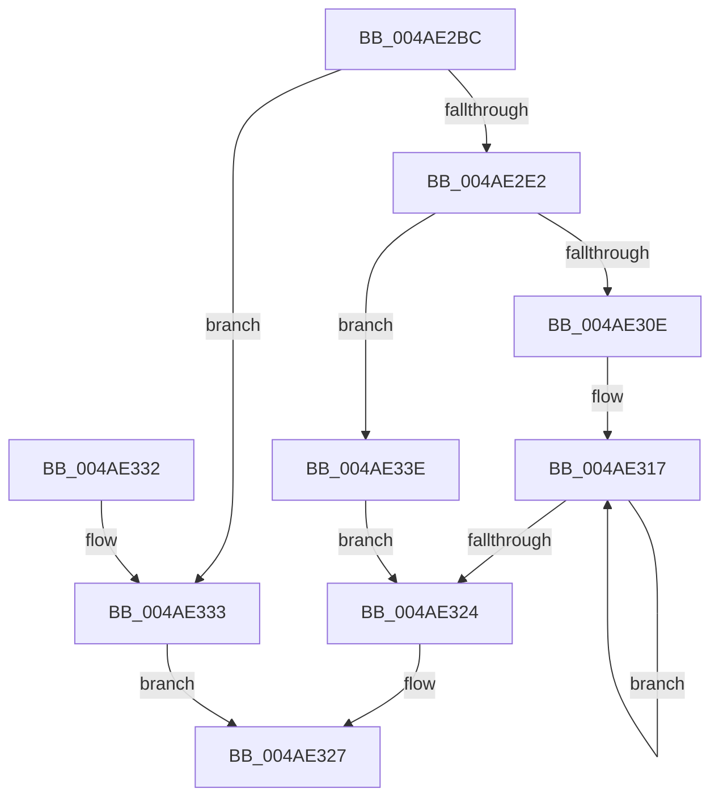

# CcAllocateInitializeVacbArray

- RVA: `0x004AE2BC`–`0x004AE358` (길이 `156` bytes)
- VA: `0x00000001404AE2BC`
- 실행 섹션: `.text`
- PDB 이름 있음: `예`; PDB Function 태그: `아니요`
- unwind 정보 RVA: `0x0009082C`
- 디코드: `44`개 명령, `156/156` bytes 표시
- 미해석 바이트: `0` (있으면 어셈블리에 `.byte`로 보존)

> 이 문서는 커널 이미지의 기계어와 PDB 기호를 분석해 생성했습니다. 4번과 5번은 함수 원형과 자료형을 바이너리 사용 방식에서 추정한 C 해석이며 원본 소스 복구 결과는 아닙니다.

## 1. Dependencies

- 직접 호출 지점: **6**; 고유 호출 대상: **3**
- 직접 호출자로 확인된 함수: **2**
- RIP 상대 이미지 참조: **3**

### Outgoing calls
- `0x004AE2CD` → [KeAcquireQueuedSpinLock](../27/KeAcquireQueuedSpinLock_function_00273D80.md) (function, `0x00273D80`)
- `0x004AE2EC` → [KeReleaseQueuedSpinLock](../27/KeReleaseQueuedSpinLock_function_00272540.md) (function, `0x00272540`)
- `0x004AE301` → [ExAllocatePoolWithTag](../../poolcode/B8/ExAllocatePoolWithTag_function_00B82010.md) (function, `0x00B82010`)
- `0x004AE335` → [KeReleaseQueuedSpinLock](../27/KeReleaseQueuedSpinLock_function_00272540.md) (function, `0x00272540`)
- `0x004AE341` → [KeAcquireQueuedSpinLock](../27/KeAcquireQueuedSpinLock_function_00273D80.md) (function, `0x00273D80`)
- `0x004AE351` → [KeReleaseQueuedSpinLock](../27/KeReleaseQueuedSpinLock_function_00272540.md) (function, `0x00272540`)

### Direct callers
- [CcGetVirtualAddress](../34/CcGetVirtualAddress_function_00340C9C.md) at `0x00340D1B`
- [CcInitializePartitionVacbs](../57/CcInitializePartitionVacbs_function_0057EB60.md) at `0x0057EBBC`

### Static image references
- `0x004AE2D2` → RVA `0x00F8F4B4` (`.data`; read)
- `0x004AE2E4` → RVA `0x00F8F4B4` (`.data`; write)
- `0x004AE346` → RVA `0x00F8F4B4` (`.data`; read/write)

## 2. Other-region calls and transfers

- 다른 실행 섹션으로 향하는 call: **1**
  - `0x004AE301` → [ExAllocatePoolWithTag](../../poolcode/B8/ExAllocatePoolWithTag_function_00B82010.md) (`.text` → `POOLCODE`)
- 별도 외부 분기/꼬리 이동을 확인하지 못했습니다.

## 3. Assembly (complete function range)

```asm
004AE2BC  48 89 5C 24 08                  mov qword ptr [rsp + 8], rbx
004AE2C1  57                              push rdi
004AE2C2  48 83 EC 20                     sub rsp, 0x20
004AE2C6  BF 04 00 00 00                  mov edi, 4
004AE2CB  8B CF                           mov ecx, edi
004AE2CD  E8 AE 5A DC FF                  call 0x140273d80
004AE2D2  8B 15 DC 11 AE 00               mov edx, dword ptr [rip + 0xae11dc]
004AE2D8  8B CF                           mov ecx, edi
004AE2DA  81 FA 00 05 00 00               cmp edx, 0x500
004AE2E0  73 51                           jae 0x1404ae333
004AE2E2  FF C2                           inc edx
004AE2E4  89 15 CA 11 AE 00               mov dword ptr [rip + 0xae11ca], edx
004AE2EA  8A D0                           mov dl, al
004AE2EC  E8 4F 42 DC FF                  call 0x140272540
004AE2F1  BA 00 00 02 00                  mov edx, 0x20000
004AE2F6  B9 00 06 00 00                  mov ecx, 0x600
004AE2FB  41 B8 43 63 56 61               mov r8d, 0x61566343
004AE301  E8 0A 3D 6D 00                  call 0x140b82010
004AE306  48 8B D8                        mov rbx, rax
004AE309  48 85 C0                        test rax, rax
004AE30C  74 30                           je 0x1404ae33e
004AE30E  48 8D 48 30                     lea rcx, [rax + 0x30]
004AE312  B8 CC 0C 00 00                  mov eax, 0xccc
004AE317  48 89 19                        mov qword ptr [rcx], rbx
004AE31A  48 8D 49 28                     lea rcx, [rcx + 0x28]
004AE31E  48 83 E8 01                     sub rax, 1
004AE322  75 F3                           jne 0x1404ae317
004AE324  48 8B C3                        mov rax, rbx
004AE327  48 8B 5C 24 30                  mov rbx, qword ptr [rsp + 0x30]
004AE32C  48 83 C4 20                     add rsp, 0x20
004AE330  5F                              pop rdi
004AE331  C3                              ret
004AE332  CC                              int3
004AE333  8A D0                           mov dl, al
004AE335  E8 06 42 DC FF                  call 0x140272540
004AE33A  33 C0                           xor eax, eax
004AE33C  EB E9                           jmp 0x1404ae327
004AE33E  48 8B CF                        mov rcx, rdi
004AE341  E8 3A 5A DC FF                  call 0x140273d80
004AE346  FF 0D 68 11 AE 00               dec dword ptr [rip + 0xae1168]
004AE34C  8A D0                           mov dl, al
004AE34E  48 8B CF                        mov rcx, rdi
004AE351  E8 EA 41 DC FF                  call 0x140272540
004AE356  EB CC                           jmp 0x1404ae324
```

## 4. C-style interpretation (structured pseudocode)

```c
__int64 __fastcall CcAllocateInitializeVacbArray(void)
{
    __int64 result;
    __int64 v_rsp;
    unsigned __int64 v_stack_p8;

    v_stack_p8 = v_rbx;
    v_rsp = (v_rsp) - (32);
    result = KeAcquireQueuedSpinLock(4, a2, a3, a4);
    if (((unsigned int)((unsigned int)(*(unsigned int *)(v_rip + 11407836)))) >= 0x500ULL) goto loc_004AE333;
    a2 = (unsigned int)(((unsigned int)(*(unsigned int *)(v_rip + 11407836))) + 1);
    *(unsigned int *)(v_rip + 11407818) = (unsigned int)(a2);
    result = KeReleaseQueuedSpinLock(4, (unsigned __int8)(result), a3, a4);
    result = ExAllocatePoolWithTag((unsigned int)(0x600ULL), (unsigned int)(0x20000ULL), (unsigned int)(0x61566343ULL), a4);
    if (result == 0) goto loc_004AE33E;
loc_004AE317:
    *(unsigned __int64 *)(result + 48) = result;
    result = ((unsigned int)(0xCCCULL)) - (1);
    if (condition_is_not_equal) goto loc_004AE317;
loc_004AE324:
loc_004AE327:
    v_rsp = (v_rsp) + (32);
    return result;
loc_004AE333:
    result = KeReleaseQueuedSpinLock(result + 48 + 40, (unsigned __int8)(result), (unsigned int)(0x61566343ULL), a4);
    result = 0;
    goto loc_004AE327;
loc_004AE33E:
    result = KeAcquireQueuedSpinLock(4, (unsigned __int8)(result), (unsigned int)(0x61566343ULL), a4);
    result = KeReleaseQueuedSpinLock(4, (unsigned __int8)(result), (unsigned int)(0x61566343ULL), a4);
    goto loc_004AE324;
}
```

## 5. (Beta) C Style

```c
void CcAllocateInitializeVacbArray(void)
{
    int64_t result;
    int64_t local_rsp;
    uint64_t v_stack_p8;

    v_stack_p8 = local_rbx;
    local_rsp = (local_rsp) - (32);
    result = KeAcquireQueuedSpinLock(4, a2, a3, a4);
    if (((uint32_t)((uint32_t)(*(uint32_t *)(v_rip + 0xAE11DC)))) >= 0x500ULL) goto loc_004AE333;
    a2 = (uint32_t)(((uint32_t)(*(uint32_t *)(v_rip + 0xAE11DC))) + 1);
    *(uint32_t *)(v_rip + 0xAE11CA) = (uint32_t)(a2);
    result = KeReleaseQueuedSpinLock(4, (uint8_t)(result), a3, a4);
    result = ExAllocatePoolWithTag((uint32_t)(0x600ULL), (uint32_t)(0x20000ULL), (uint32_t)(0x61566343ULL), a4);
    if (result == 0) goto loc_004AE33E;
loc_004AE317:
    *(uint64_t *)(result + 0x30) = result;
    result = ((uint32_t)(0xCCCULL)) - (1);
    if (condition_is_not_equal) goto loc_004AE317;
loc_004AE324:
loc_004AE327:
    local_rsp = (local_rsp) + (32);
    return result;
loc_004AE333:
    result = KeReleaseQueuedSpinLock(result + 48 + 40, (uint8_t)(result), (uint32_t)(0x61566343ULL), a4);
    result = 0;
    goto loc_004AE327;
loc_004AE33E:
    result = KeAcquireQueuedSpinLock(4, (uint8_t)(result), (uint32_t)(0x61566343ULL), a4);
    result = KeReleaseQueuedSpinLock(4, (uint8_t)(result), (uint32_t)(0x61566343ULL), a4);
    goto loc_004AE324;
}
```

## 6. Execution-region graph

[열기: 2D/3D 그래프와 함수 탐색 컨트롤 패널](../../../control-panel.html?section=text&rva=0x004AE2BC&view=graph)

- 2D 그래프는 위에서 아래로 흐르고, 3D 그래프는 빈 공간을 드래그해 회전합니다. Shift+드래그는 이동, 휠은 확대·축소, 함수 노드 선택은 대상 보고서 이동입니다.

### Static fallback


