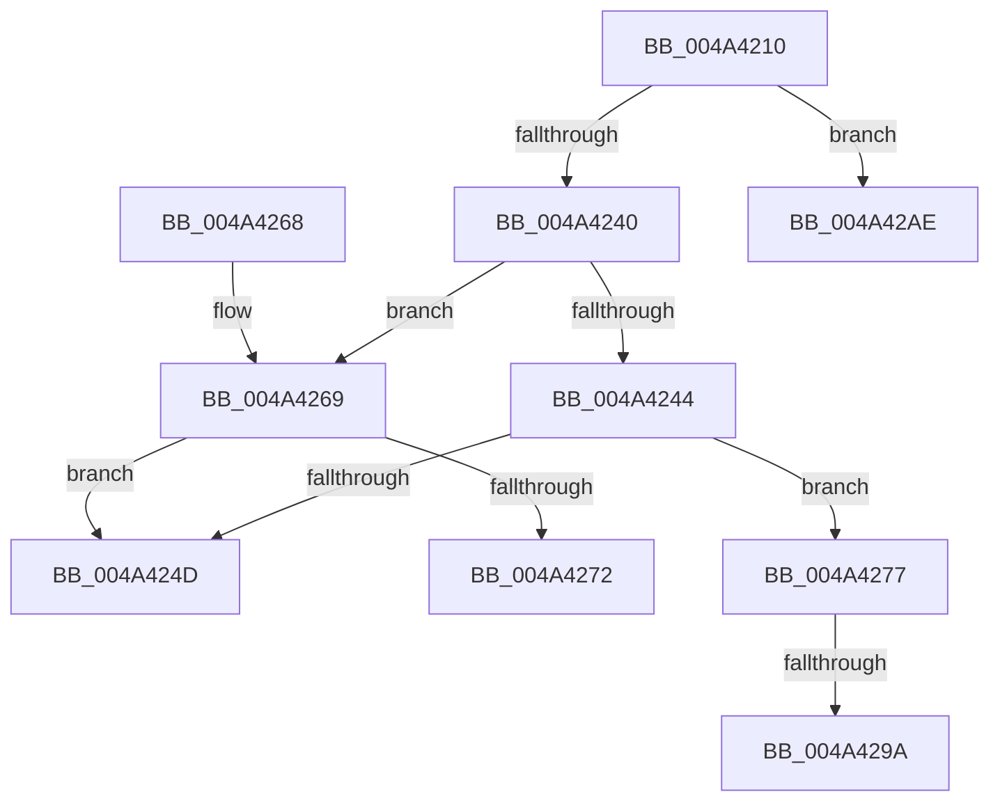

# CcApplyLowIoPriorityToThread

- RVA: `0x004A4210`–`0x004A42CD` (길이 `189` bytes)
- VA: `0x00000001404A4210`
- 실행 섹션: `.text`
- PDB 이름 있음: `예`; PDB Function 태그: `예`
- unwind 정보 RVA: `0x000B6564`
- 디코드: `50`개 명령, `189/189` bytes 표시
- 미해석 바이트: `0` (있으면 어셈블리에 `.byte`로 보존)

> 이 문서는 커널 이미지의 기계어와 PDB 기호를 분석해 생성했습니다. 4번과 5번은 함수 원형과 자료형을 바이너리 사용 방식에서 추정한 C 해석이며 원본 소스 복구 결과는 아닙니다.

## 1. Dependencies

- 직접 호출 지점: **4**; 고유 호출 대상: **4**
- 직접 호출자로 확인된 함수: **2**
- RIP 상대 이미지 참조: **0**

### Outgoing calls
- `0x004A4269` → [CcIsWriteBehindThreadpoolAtLowPriority](../35/CcIsWriteBehindThreadpoolAtLowPriority_function_003570DC.md) (function, `0x003570DC`)
- `0x004A4286` → [KeAbPreAcquire](../21/KeAbPreAcquire_function_00210230.md) (function, `0x00210230`)
- `0x004A42A3` → [ExfAcquirePushLockExclusiveEx](../20/ExfAcquirePushLockExclusiveEx_function_0020FC90.md) (function, `0x0020FC90`)
- `0x004A42C7` → [KeBugCheckEx](../4F/KeBugCheckEx_function_004FD660.md) (function, `0x004FD660`)

### Direct callers
- [CcWriteBehindPreProcess](../35/CcWriteBehindPreProcess_function_00357784.md) at `0x00357822`
- [CcWriteBehindPreProcess](../35/CcWriteBehindPreProcess_function_00357784.md) at `0x00357B08`
- [CcWriteBehindPreProcess](../35/CcWriteBehindPreProcess_function_00357784.md) at `0x00357B30`
- [CcWriteBehindReleaseFile](CcWriteBehindReleaseFile_function_004A4080.md) at `0x004A40B1`

### Static image references
- 디코드된 RIP-relative 메모리 참조가 없습니다.

## 2. Other-region calls and transfers

- 다른 실행 섹션으로 향하는 call: **0**
- call이 아닌 외부 분기/꼬리 이동: **3**
  - `0x004A4272` → [sub_006F937E](../6F/Unknown_function_006F937E.md) (`tail-transfer`)
  - `0x004A4294` → [sub_006F937E + 0x118](../6F/Unknown_function_006F937E.md) (`tail-transfer`)
  - `0x004A42A9` → [sub_006F937E + 0x118](../6F/Unknown_function_006F937E.md) (`tail-transfer`)

## 3. Assembly (complete function range)

```asm
004A4210  48 8B C4                        mov rax, rsp
004A4213  48 89 58 08                     mov qword ptr [rax + 8], rbx
004A4217  48 89 68 10                     mov qword ptr [rax + 0x10], rbp
004A421B  48 89 70 18                     mov qword ptr [rax + 0x18], rsi
004A421F  48 89 78 20                     mov qword ptr [rax + 0x20], rdi
004A4223  41 56                           push r14
004A4225  48 83 EC 30                     sub rsp, 0x30
004A4229  65 4C 8B 34 25 88 01 00 00      mov r14, qword ptr gs:[0x188]
004A4232  49 8B F0                        mov rsi, r8
004A4235  41 8B 40 04                     mov eax, dword ptr [r8 + 4]
004A4239  48 8B D9                        mov rbx, rcx
004A423C  85 C0                           test eax, eax
004A423E  74 6E                           je 0x1404a42ae
004A4240  84 D2                           test dl, dl
004A4242  75 25                           jne 0x1404a4269
004A4244  4C 39 B1 E8 04 00 00            cmp qword ptr [rcx + 0x4e8], r14
004A424B  74 2A                           je 0x1404a4277
004A424D  48 8B 5C 24 40                  mov rbx, qword ptr [rsp + 0x40]
004A4252  48 8B 6C 24 48                  mov rbp, qword ptr [rsp + 0x48]
004A4257  48 8B 74 24 50                  mov rsi, qword ptr [rsp + 0x50]
004A425C  48 8B 7C 24 58                  mov rdi, qword ptr [rsp + 0x58]
004A4261  48 83 C4 30                     add rsp, 0x30
004A4265  41 5E                           pop r14
004A4267  C3                              ret
004A4268  CC                              int3
004A4269  E8 6E 2E EB FF                  call 0x1403570dc
004A426E  84 C0                           test al, al
004A4270  74 DB                           je 0x1404a424d
004A4272  E9 07 51 25 00                  jmp 0x1406f937e
004A4277  48 8D B9 00 05 00 00            lea rdi, [rcx + 0x500]
004A427E  45 33 C0                        xor r8d, r8d
004A4281  48 8B CF                        mov rcx, rdi
004A4284  33 D2                           xor edx, edx
004A4286  E8 A5 BF D6 FF                  call 0x140210230
004A428B  F0 48 0F BA 2F 00               lock bts qword ptr [rdi], 0
004A4291  48 8B E8                        mov rbp, rax
004A4294  0F 83 FC 51 25 00               jae 0x1406f9496
004A429A  4C 8B C7                        mov r8, rdi
004A429D  48 8B D0                        mov rdx, rax
004A42A0  48 8B CF                        mov rcx, rdi
004A42A3  E8 E8 B9 D6 FF                  call 0x14020fc90
004A42A8  90                              nop
004A42A9  E9 E8 51 25 00                  jmp 0x1406f9496
004A42AE  48 83 64 24 20 00               and qword ptr [rsp + 0x20], 0
004A42B4  45 33 C9                        xor r9d, r9d
004A42B7  BA 1F 05 00 00                  mov edx, 0x51f
004A42BC  49 C7 C0 20 04 00 C0            mov r8, 0xffffffffc0000420
004A42C3  41 8D 49 34                     lea ecx, [r9 + 0x34]
004A42C7  E8 94 93 05 00                  call 0x1404fd660
004A42CC  CC                              int3
```

## 4. C-style interpretation (structured pseudocode)

```c
__int64 __fastcall CcApplyLowIoPriorityToThread(__int64 a1, int a2, __int64 a3, int a4)
{
    __int64 result;
    __int64 v_rsp;
    unsigned __int64 v_stack_p10;
    unsigned __int64 v_stack_p18;
    unsigned __int64 v_stack_p20;
    unsigned __int64 v_stack_p8;

    *(unsigned __int64 *)(v_rsp + 8) = v_rbx;
    *(unsigned __int64 *)(v_rsp + 16) = v_rbp;
    *(unsigned __int64 *)(v_rsp + 24) = v_rsi;
    *(unsigned __int64 *)(v_rsp + 32) = v_rdi;
    v_rsp = (v_rsp) - (48);
    if ((unsigned int)((unsigned int)(*(unsigned int *)(a3 + 4))) == 0) goto loc_004A42AE;
    if ((unsigned __int8)(a2) != 0) goto loc_004A4269;
    if ((*(unsigned __int64 *)(a1 + 1256)) == (*(unsigned __int64 *)(gs_base + (0 + 392)))) goto loc_004A4277;
loc_004A424D:
    v_rsp = (v_rsp) + (48);
    return (unsigned int)(*(unsigned int *)(a3 + 4));
loc_004A4269:
    result = CcIsWriteBehindThreadpoolAtLowPriority(a1, a2, a3, a4);
    if ((unsigned __int8)(result) == 0) goto loc_004A424D;
loc_004A4277:
    a3 = 0;
    a2 = 0;
    result = KeAbPreAcquire(a1 + 1280, a2, a3, a4);
    result = ExfAcquirePushLockExclusiveEx(a1 + 1280, result, a1 + 1280, a4);
loc_004A42AE:
    a4 = 0;
    result = KeBugCheckEx(a4 + 52, (unsigned int)(0x51FULL), 0xFFFFFFFFC0000420ULL, a4);
    return result;
}
```

## 5. (Beta) C Style

```c
int64_t CcApplyLowIoPriorityToThread(void *Arg1, int32_t Arg2, void *Arg3, int32_t Arg4)
{
    uint8_t *arg1 = (uint8_t *)Arg1;
    uint8_t *arg3 = (uint8_t *)Arg3;

    int64_t result;
    int64_t local_rsp;
    uint64_t v_stack_p10;
    uint64_t v_stack_p18;
    uint64_t v_stack_p20;
    uint64_t v_stack_p8;

    *(uint64_t *)(local_rsp + 0x8) = local_rbx;
    *(uint64_t *)(local_rsp + 0x10) = local_rbp;
    *(uint64_t *)(local_rsp + 0x18) = local_rsi;
    *(uint64_t *)(local_rsp + 0x20) = local_rdi;
    local_rsp = (local_rsp) - (48);
    if ((uint32_t)((uint32_t)(*(uint32_t *)(arg3 + 0x4))) == 0) goto loc_004A42AE;
    if ((uint8_t)(Arg2) != 0) goto loc_004A4269;
    if ((*(uint64_t *)(arg1 + 0x4E8)) == (*(uint64_t *)(gs_base + (0 + 0x188)))) goto loc_004A4277;
loc_004A424D:
    local_rsp = (local_rsp) + (48);
    return (uint32_t)(*(uint32_t *)(arg3 + 0x4));
loc_004A4269:
    result = CcIsWriteBehindThreadpoolAtLowPriority(Arg1, Arg2, Arg3, Arg4);
    if ((uint8_t)(result) == 0) goto loc_004A424D;
loc_004A4277:
    Arg3 = 0;
    Arg2 = 0;
    result = KeAbPreAcquire(Arg1 + 1280, Arg2, Arg3, Arg4);
    result = ExfAcquirePushLockExclusiveEx(Arg1 + 1280, result, Arg1 + 1280, Arg4);
loc_004A42AE:
    Arg4 = 0;
    result = KeBugCheckEx(Arg4 + 52, (uint32_t)(0x51FULL), 0xFFFFFFFFC0000420ULL, Arg4);
    return result;
}
```

### 관측된 메모리 오프셋

구조체 형식이 확인되지 않은 접근은 인자 기준의 오프셋으로만 기록했습니다.

| 기준 인자 | 오프셋 표현 | 폭 (bit) | 접근 |
|---|---:|---:|---|
| `Arg1` | `+ 0x0` | `64` | `R/W` |
| `Arg1` | `+ 0x4E8` | `64` | `R` |
| `Arg1` | `+ 0x500` | `64` | `R` |
| `Arg3` | `+ 0x4` | `32` | `R` |

## 6. Execution-region graph

[열기: 2D/3D 그래프와 함수 탐색 컨트롤 패널](../../../control-panel.html?section=text&rva=0x004A4210&view=graph)

- 2D 그래프는 위에서 아래로 흐르고, 3D 그래프는 빈 공간을 드래그해 회전합니다. Shift+드래그는 이동, 휠은 확대·축소, 함수 노드 선택은 대상 보고서 이동입니다.

### Static fallback


