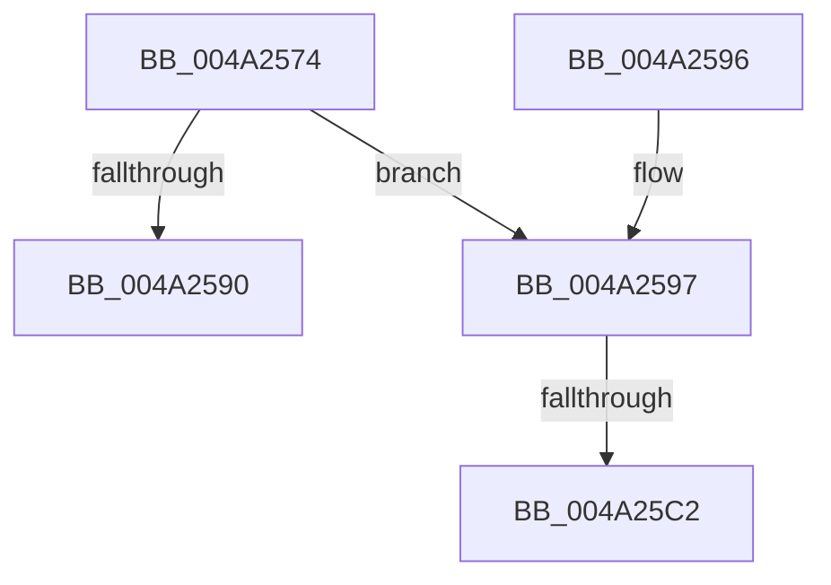

# CcComputeNextScanTime

- RVA: `0x004A2574`–`0x004A25CE` (길이 `90` bytes)
- VA: `0x00000001404A2574`
- 실행 섹션: `.text`
- PDB 이름 있음: `예`; PDB Function 태그: `예`
- unwind 정보 RVA: `0x000929B4`
- 디코드: `23`개 명령, `90/90` bytes 표시
- 미해석 바이트: `0` (있으면 어셈블리에 `.byte`로 보존)

> 이 문서는 커널 이미지의 기계어와 PDB 기호를 분석해 생성했습니다. 4번과 5번은 함수 원형과 자료형을 바이너리 사용 방식에서 추정한 C 해석이며 원본 소스 복구 결과는 아닙니다.

## 1. Dependencies

- 직접 호출 지점: **1**; 고유 호출 대상: **1**
- 직접 호출자로 확인된 함수: **2**
- RIP 상대 이미지 참조: **2**

### Outgoing calls
- `0x004A2587` → [CcIsWriteBehindThreadpoolAtLowPriority](../35/CcIsWriteBehindThreadpoolAtLowPriority_function_003570DC.md) (function, `0x003570DC`)

### Direct callers
- [CcLazyWriteScanVolume](../38/CcLazyWriteScanVolume_function_00388DC0.md) at `0x00389536`
- [CcLazyWriteScan](../3C/CcLazyWriteScan_function_003C9394.md) at `0x003C9A37`

### Static image references
- `0x004A25AB` → RVA `0x00FC6AA0` (`ALMOSTRO`; read)
- `0x004A25B5` → RVA `0x00E65B88` (`.data`; read)

## 2. Other-region calls and transfers

- 다른 실행 섹션으로 향하는 call: **0**
- call이 아닌 외부 분기/꼬리 이동: **2**
  - `0x004A25BC` → [sub_006F878C](../6F/Unknown_function_006F878C.md) (`tail-transfer`)
  - `0x004A25C9` → [sub_006F878C + 0x7](../6F/Unknown_function_006F878C.md) (`tail-transfer`)

## 3. Assembly (complete function range)

```asm
004A2574  40 53                           push rbx
004A2576  48 83 EC 20                     sub rsp, 0x20
004A257A  49 83 21 00                     and qword ptr [r9], 0
004A257E  49 8B D8                        mov rbx, r8
004A2581  4C 8B C2                        mov r8, rdx
004A2584  4D 8B D9                        mov r11, r9
004A2587  E8 50 4B EB FF                  call 0x1403570dc
004A258C  84 C0                           test al, al
004A258E  75 07                           jne 0x1404a2597
004A2590  48 83 C4 20                     add rsp, 0x20
004A2594  5B                              pop rbx
004A2595  C3                              ret
004A2596  CC                              int3
004A2597  33 D2                           xor edx, edx
004A2599  49 BA 20 03 00 00 80 F7 FF FF   movabs r10, 0xfffff78000000320
004A25A3  B8 00 68 89 09                  mov eax, 0x9896800
004A25A8  4D 8B 12                        mov r10, qword ptr [r10]
004A25AB  44 8B 0D EE 44 B2 00            mov r9d, dword ptr [rip + 0xb244ee]
004A25B2  49 F7 F1                        div r9
004A25B5  80 3D CC 35 9C 00 00            cmp byte ptr [rip + 0x9c35cc], 0
004A25BC  0F 84 CA 61 25 00               je 0x1406f878c
004A25C2  49 81 C0 C4 02 00 00            add r8, 0x2c4
004A25C9  E9 C5 61 25 00                  jmp 0x1406f8793
```

## 4. C-style interpretation (structured pseudocode)

```c
__int64 __fastcall CcComputeNextScanTime(__int64 a1, __int64 a2, __int64 a3, __int64 a4)
{
    __int64 result;
    __int64 v_rsp;

    v_rsp = (v_rsp) - (32);
    result = CcIsWriteBehindThreadpoolAtLowPriority(a1, a2, a2, a4);
    if ((unsigned __int8)(result) != 0) goto loc_004A2597;
    v_rsp = (v_rsp) + (32);
    return result;
loc_004A2597:
    a2 = 0;
    a3 = (a2) + (708);
}
```

## 5. (Beta) C Style

```c
int64_t CcComputeNextScanTime(int64_t Arg1, int64_t Arg2, int64_t Arg3, void *Arg4)
{
    uint8_t *arg4 = (uint8_t *)Arg4;

    int64_t result;
    int64_t local_rsp;

    local_rsp = (local_rsp) - (32);
    result = CcIsWriteBehindThreadpoolAtLowPriority(Arg1, Arg2, Arg2, Arg4);
    if ((uint8_t)(result) != 0) goto loc_004A2597;
    local_rsp = (local_rsp) + (32);
    return result;
loc_004A2597:
    Arg2 = 0;
    Arg3 = (Arg2) + (708);
}
```

### 관측된 메모리 오프셋

구조체 형식이 확인되지 않은 접근은 인자 기준의 오프셋으로만 기록했습니다.

| 기준 인자 | 오프셋 표현 | 폭 (bit) | 접근 |
|---|---:|---:|---|
| `Arg4` | `+ 0x0` | `64` | `R/W` |

## 6. Execution-region graph

[열기: 2D/3D 그래프와 함수 탐색 컨트롤 패널](../../../control-panel.html?section=text&rva=0x004A2574&view=graph)

- 2D 그래프는 위에서 아래로 흐르고, 3D 그래프는 빈 공간을 드래그해 회전합니다. Shift+드래그는 이동, 휠은 확대·축소, 함수 노드 선택은 대상 보고서 이동입니다.

### Static fallback


