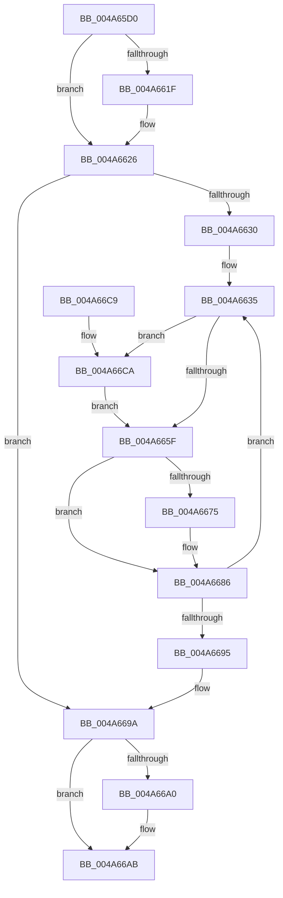

# CcDeductDirtyPagesFromExternalCache

- RVA: `0x004A65D0`–`0x004A66D0` (길이 `256` bytes)
- VA: `0x00000001404A65D0`
- 실행 섹션: `.text`
- PDB 이름 있음: `예`; PDB Function 태그: `아니요`
- unwind 정보 RVA: `0x000B6DD8`
- 디코드: `71`개 명령, `256/256` bytes 표시
- 미해석 바이트: `0` (있으면 어셈블리에 `.byte`로 보존)

> 이 문서는 커널 이미지의 기계어와 PDB 기호를 분석해 생성했습니다. 4번과 5번은 함수 원형과 자료형을 바이너리 사용 방식에서 추정한 C 해석이며 원본 소스 복구 결과는 아닙니다.

## 1. Dependencies

- 직접 호출 지점: **3**; 고유 호출 대상: **3**
- 직접 호출자로 확인된 함수: **2**
- RIP 상대 이미지 참조: **2**

### Outgoing calls
- `0x004A6651` → [KeAcquireInStackQueuedSpinLock](../27/KeAcquireInStackQueuedSpinLock_function_002757A0.md) (function, `0x002757A0`)
- `0x004A668B` → [KeReleaseInStackQueuedSpinLock](../34/KeReleaseInStackQueuedSpinLock_function_00342CE0.md) (function, `0x00342CE0`)
- `0x004A66A6` → [CcPostDeferredWrites](../35/CcPostDeferredWrites_function_003590FC.md) (function, `0x003590FC`)

### Direct callers
- [CcUnregisterExternalCache](../57/CcUnregisterExternalCache_function_0057C3A0.md) at `0x0057C3B5`
- [CcUnregisterExternalCacheEx](../57/CcUnregisterExternalCacheEx_function_0057C3E0.md) at `0x0057C3F5`

### Static image references
- `0x004A65F2` → RVA `0x00E65B88` (`.data`; read)
- `0x004A6608` → RVA `0x00FC6EA0` (`ALMOSTRO`; read)

## 2. Other-region calls and transfers

- 다른 실행 섹션으로 향하는 call: **0**
- 별도 외부 분기/꼬리 이동을 확인하지 못했습니다.

## 3. Assembly (complete function range)

```asm
004A65D0  4C 8B DC                        mov r11, rsp
004A65D3  49 89 5B 10                     mov qword ptr [r11 + 0x10], rbx
004A65D7  49 89 6B 18                     mov qword ptr [r11 + 0x18], rbp
004A65DB  49 89 73 20                     mov qword ptr [r11 + 0x20], rsi
004A65DF  57                              push rdi
004A65E0  41 54                           push r12
004A65E2  41 55                           push r13
004A65E4  41 56                           push r14
004A65E6  41 57                           push r15
004A65E8  48 83 EC 40                     sub rsp, 0x40
004A65EC  48 8B 71 38                     mov rsi, qword ptr [rcx + 0x38]
004A65F0  33 C0                           xor eax, eax
004A65F2  80 3D 8F F5 9B 00 00            cmp byte ptr [rip + 0x9bf58f], 0
004A65F9  0F 57 C0                        xorps xmm0, xmm0
004A65FC  0F 11 44 24 20                  movups xmmword ptr [rsp + 0x20], xmm0
004A6601  49 89 43 C8                     mov qword ptr [r11 - 0x38], rax
004A6605  4C 8B F2                        mov r14, rdx
004A6608  48 8B 05 91 08 B2 00            mov rax, qword ptr [rip + 0xb20891]
004A660F  48 8D AE 50 04 00 00            lea rbp, [rsi + 0x450]
004A6616  4C 8B F9                        mov r15, rcx
004A6619  48 8B 78 08                     mov rdi, qword ptr [rax + 8]
004A661D  75 07                           jne 0x1404a6626
004A661F  48 8D AF 90 04 00 00            lea rbp, [rdi + 0x490]
004A6626  48 89 6C 24 70                  mov qword ptr [rsp + 0x70], rbp
004A662B  48 85 D2                        test rdx, rdx
004A662E  74 6A                           je 0x1404a669a
004A6630  BD FF FF FF FF                  mov ebp, 0xffffffff
004A6635  4C 3B F5                        cmp r14, rbp
004A6638  48 8D 54 24 20                  lea rdx, [rsp + 0x20]
004A663D  45 8B E6                        mov r12d, r14d
004A6640  48 8D 8F 00 03 00 00            lea rcx, [rdi + 0x300]
004A6647  44 0F 47 E5                     cmova r12d, ebp
004A664B  41 8B DC                        mov ebx, r12d
004A664E  4C 2B F3                        sub r14, rbx
004A6651  E8 4A F1 DC FF                  call 0x1402757a0
004A6656  49 8B 47 08                     mov rax, qword ptr [r15 + 8]
004A665A  48 3B C3                        cmp rax, rbx
004A665D  72 6B                           jb 0x1404a66ca
004A665F  41 8B CC                        mov ecx, r12d
004A6662  48 2B C1                        sub rax, rcx
004A6665  49 89 47 08                     mov qword ptr [r15 + 8], rax
004A6669  48 29 8F 20 04 00 00            sub qword ptr [rdi + 0x420], rcx
004A6670  48 85 F6                        test rsi, rsi
004A6673  74 11                           je 0x1404a6686
004A6675  48 8B 86 E0 03 00 00            mov rax, qword ptr [rsi + 0x3e0]
004A667C  48 2B C1                        sub rax, rcx
004A667F  48 89 86 E0 03 00 00            mov qword ptr [rsi + 0x3e0], rax
004A6686  48 8D 4C 24 20                  lea rcx, [rsp + 0x20]
004A668B  E8 50 C6 E9 FF                  call 0x140342ce0
004A6690  4D 85 F6                        test r14, r14
004A6693  75 A0                           jne 0x1404a6635
004A6695  48 8B 6C 24 70                  mov rbp, qword ptr [rsp + 0x70]
004A669A  48 39 6D 00                     cmp qword ptr [rbp], rbp
004A669E  74 0B                           je 0x1404a66ab
004A66A0  48 8B D6                        mov rdx, rsi
004A66A3  48 8B CF                        mov rcx, rdi
004A66A6  E8 51 2A EB FF                  call 0x1403590fc
004A66AB  4C 8D 5C 24 40                  lea r11, [rsp + 0x40]
004A66B0  49 8B 5B 38                     mov rbx, qword ptr [r11 + 0x38]
004A66B4  49 8B 6B 40                     mov rbp, qword ptr [r11 + 0x40]
004A66B8  49 8B 73 48                     mov rsi, qword ptr [r11 + 0x48]
004A66BC  49 8B E3                        mov rsp, r11
004A66BF  41 5F                           pop r15
004A66C1  41 5E                           pop r14
004A66C3  41 5D                           pop r13
004A66C5  41 5C                           pop r12
004A66C7  5F                              pop rdi
004A66C8  C3                              ret
004A66C9  CC                              int3
004A66CA  45 8B 67 08                     mov r12d, dword ptr [r15 + 8]
004A66CE  EB 8F                           jmp 0x1404a665f
```

## 4. C-style interpretation (structured pseudocode)

```c
__int64 __fastcall CcDeductDirtyPagesFromExternalCache(__int64 a1, __int64 a2)
{
    __int64 result;
    __int64 v_r12;
    __int64 v_r14;
    __int64 v_rbp;
    __int64 v_rsp;
    unsigned __int64 v_stack_m28;
    unsigned __int64 v_stack_m48;
    unsigned __int64 v_stack_p8;

    *(unsigned __int64 *)(v_rsp + 16) = v_rbx;
    *(unsigned __int64 *)(v_rsp + 24) = v_rbp;
    *(unsigned __int64 *)(v_rsp + 32) = v_rsi;
    v_rsp = (v_rsp) - (64);
    result = 0;
    v_stack_m48 = v_xmm0;
    *(unsigned __int64 *)(v_rsp - 56) = 0;
    v_rbp = *(unsigned __int64 *)(a1 + 56) + 1104;
    if ((*(unsigned __int8 *)(v_rip + 10220943)) == 0) {
        v_rbp = *(unsigned __int64 *)(*(unsigned __int64 *)(v_rip + 11667601) + 8) + 1168;
    }
    v_stack_p8 = v_rbp;
    if (a2 == 0) goto loc_004A669A;
loc_004A6635:
    v_r12 = (unsigned int)((unsigned int)(a2));
    if (a2 > ((unsigned int)(0xFFFFFFFFULL))) { v_r12 = (unsigned int)((unsigned int)(0xFFFFFFFFULL)); }
    v_r14 = (a2) - ((unsigned int)((unsigned int)(v_r12)));
    result = KeAcquireInStackQueuedSpinLock(*(unsigned __int64 *)(*(unsigned __int64 *)(v_rip + 11667601) + 8) + 768, v_stack_m48, a3, a4);
    if ((*(unsigned __int64 *)(a1 + 8)) < ((unsigned int)((unsigned int)(v_r12)))) goto loc_004A66CA;
loc_004A665F:
    result = (*(unsigned __int64 *)(a1 + 8)) - ((unsigned int)((unsigned int)(v_r12)));
    *(unsigned __int64 *)(a1 + 8) = result;
    if (*(unsigned __int64 *)(a1 + 56) != 0) {
        result = *(unsigned __int64 *)(*(unsigned __int64 *)(a1 + 56) + 992);
        result = (result) - ((unsigned int)((unsigned int)(v_r12)));
        *(unsigned __int64 *)(*(unsigned __int64 *)(a1 + 56) + 992) = result;
    }
    result = KeReleaseInStackQueuedSpinLock(v_stack_m48, v_stack_m48, a3, a4);
    if (v_r14 != 0) goto loc_004A6635;
loc_004A669A:
    if ((*(unsigned __int64 *)(v_stack_p8)) != v_stack_p8) {
        a2 = *(unsigned __int64 *)(a1 + 56);
        a1 = *(unsigned __int64 *)(*(unsigned __int64 *)(v_rip + 11667601) + 8);
        result = CcPostDeferredWrites(a1, a2, a3, a4);
    }
    return result;
loc_004A66CA:
    goto loc_004A665F;
}
```

## 5. (Beta) C Style

```c
int64_t CcDeductDirtyPagesFromExternalCache(void *Arg1, int64_t Arg2)
{
    uint8_t *arg1 = (uint8_t *)Arg1;

    int64_t result;
    int64_t local_r12;
    int64_t local_r14;
    int64_t local_rbp;
    int64_t local_rsp;
    uint64_t v_stack_m28;
    uint64_t v_stack_m48;
    uint64_t v_stack_p8;

    *(uint64_t *)(local_rsp + 0x10) = local_rbx;
    *(uint64_t *)(local_rsp + 0x18) = local_rbp;
    *(uint64_t *)(local_rsp + 0x20) = local_rsi;
    local_rsp = (local_rsp) - (64);
    result = 0;
    v_stack_m48 = v_xmm0;
    *(uint64_t *)(local_rsp - 0x38) = 0;
    local_rbp = *(uint64_t *)(arg1 + 0x38) + 1104;
    if ((*(uint8_t *)(v_rip + 0x9BF58F)) == 0) {
        local_rbp = *(uint64_t *)(*(uint64_t *)(v_rip + 0xB20891) + 0x8) + 1168;
    }
    v_stack_p8 = local_rbp;
    if (Arg2 == 0) goto loc_004A669A;
loc_004A6635:
    local_r12 = (uint32_t)((uint32_t)(Arg2));
    if (Arg2 > ((uint32_t)(0xFFFFFFFFULL))) { local_r12 = (uint32_t)((uint32_t)(0xFFFFFFFFULL)); }
    local_r14 = (Arg2) - ((uint32_t)((uint32_t)(local_r12)));
    result = KeAcquireInStackQueuedSpinLock(*(uint64_t *)(*(uint64_t *)(v_rip + 0xB20891) + 0x8) + 768, v_stack_m48, a3, a4);
    if ((*(uint64_t *)(arg1 + 0x8)) < ((uint32_t)((uint32_t)(local_r12)))) goto loc_004A66CA;
loc_004A665F:
    result = (*(uint64_t *)(arg1 + 0x8)) - ((uint32_t)((uint32_t)(local_r12)));
    *(uint64_t *)(arg1 + 0x8) = result;
    if (*(uint64_t *)(arg1 + 0x38) != 0) {
        result = *(uint64_t *)(*(uint64_t *)(arg1 + 0x38) + 0x3E0);
        result = (result) - ((uint32_t)((uint32_t)(local_r12)));
        *(uint64_t *)(*(uint64_t *)(arg1 + 0x38) + 0x3E0) = result;
    }
    result = KeReleaseInStackQueuedSpinLock(v_stack_m48, v_stack_m48, a3, a4);
    if (local_r14 != 0) goto loc_004A6635;
loc_004A669A:
    if ((*(uint64_t *)(v_stack_p8)) != v_stack_p8) {
        Arg2 = *(uint64_t *)(arg1 + 0x38);
        Arg1 = *(uint64_t *)(*(uint64_t *)(v_rip + 0xB20891) + 0x8);
        result = CcPostDeferredWrites(Arg1, Arg2, a3, a4);
    }
    return result;
loc_004A66CA:
    goto loc_004A665F;
}
```

### 관측된 메모리 오프셋

구조체 형식이 확인되지 않은 접근은 인자 기준의 오프셋으로만 기록했습니다.

| 기준 인자 | 오프셋 표현 | 폭 (bit) | 접근 |
|---|---:|---:|---|
| `Arg1` | `+ 0x8` | `32` | `R` |
| `Arg1` | `+ 0x8` | `64` | `R` |
| `Arg1` | `+ 0x8` | `64` | `W` |
| `Arg1` | `+ 0x38` | `64` | `R` |

## 6. Execution-region graph

[열기: 2D/3D 그래프와 함수 탐색 컨트롤 패널](../../../control-panel.html?section=text&rva=0x004A65D0&view=graph)

- 2D 그래프는 위에서 아래로 흐르고, 3D 그래프는 빈 공간을 드래그해 회전합니다. Shift+드래그는 이동, 휠은 확대·축소, 함수 노드 선택은 대상 보고서 이동입니다.

### Static fallback


