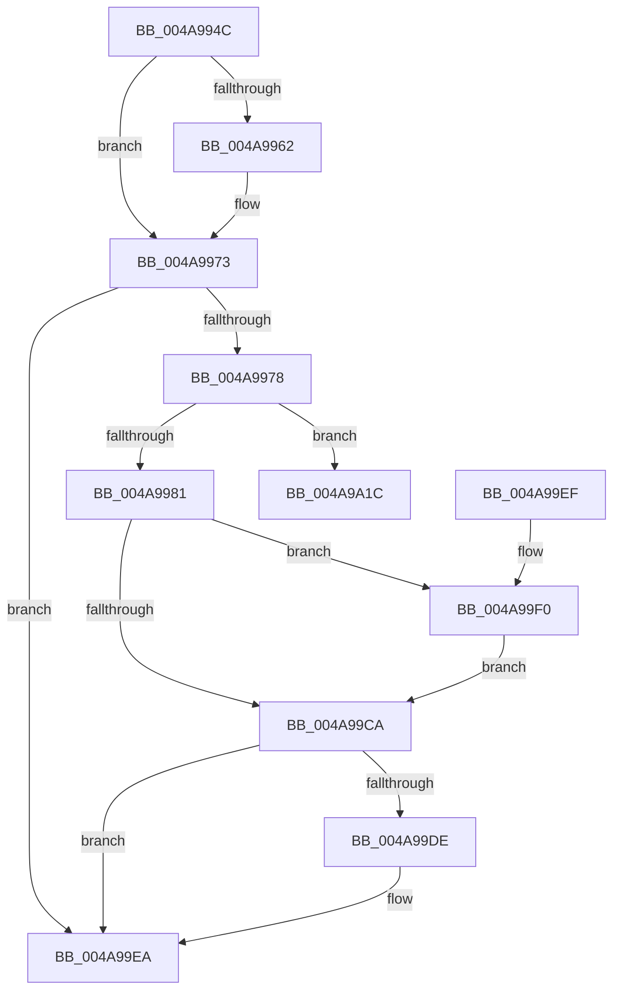

# CcDeductDirtyPagesInternal

- RVA: `0x004A994C`–`0x004A9A3B` (길이 `239` bytes)
- VA: `0x00000001404A994C`
- 실행 섹션: `.text`
- PDB 이름 있음: `예`; PDB Function 태그: `아니요`
- unwind 정보 RVA: `0x000B7B30`
- 디코드: `50`개 명령, `239/239` bytes 표시
- 미해석 바이트: `0` (있으면 어셈블리에 `.byte`로 보존)

> 이 문서는 커널 이미지의 기계어와 PDB 기호를 분석해 생성했습니다. 4번과 5번은 함수 원형과 자료형을 바이너리 사용 방식에서 추정한 C 해석이며 원본 소스 복구 결과는 아닙니다.

## 1. Dependencies

- 직접 호출 지점: **1**; 고유 호출 대상: **1**
- 직접 호출자로 확인된 함수: **1**
- RIP 상대 이미지 참조: **0**

### Outgoing calls
- `0x004A9A35` → [KeBugCheckEx](../4F/KeBugCheckEx_function_004FD660.md) (function, `0x004FD660`)

### Direct callers
- [CcUpdateExternalCacheInfoEx](../57/CcUpdateExternalCacheInfoEx_function_0057C420.md) at `0x0057C52B`

### Static image references
- 디코드된 RIP-relative 메모리 참조가 없습니다.

## 2. Other-region calls and transfers

- 다른 실행 섹션으로 향하는 call: **0**
- 별도 외부 분기/꼬리 이동을 확인하지 못했습니다.

## 3. Assembly (complete function range)

```asm
004A994C  48 83 EC 38                     sub rsp, 0x38
004A9950  44 8B DA                        mov r11d, edx
004A9953  4C 8B D1                        mov r10, rcx
004A9956  4D 29 98 20 04 00 00            sub qword ptr [r8 + 0x420], r11
004A995D  4D 85 C9                        test r9, r9
004A9960  74 11                           je 0x1404a9973
004A9962  49 8B 81 E0 03 00 00            mov rax, qword ptr [r9 + 0x3e0]
004A9969  49 2B C3                        sub rax, r11
004A996C  49 89 81 E0 03 00 00            mov qword ptr [r9 + 0x3e0], rax
004A9973  4D 85 D2                        test r10, r10
004A9976  74 72                           je 0x1404a99ea
004A9978  83 FA FF                        cmp edx, -1
004A997B  0F 83 9B 00 00 00               jae 0x1404a9a1c
004A9981  29 51 70                        sub dword ptr [rcx + 0x70], edx
004A9984  48 8B 81 00 02 00 00            mov rax, qword ptr [rcx + 0x200]
004A998B  49 F7 DB                        neg r11
004A998E  F0 4C 01 58 28                  lock add qword ptr [rax + 0x28], r11
004A9993  4C 8B 81 00 02 00 00            mov r8, qword ptr [rcx + 0x200]
004A999A  49 8B 40 28                     mov rax, qword ptr [r8 + 0x28]
004A999E  49 01 80 F8 00 00 00            add qword ptr [r8 + 0xf8], rax
004A99A5  49 8B 90 00 01 00 00            mov rdx, qword ptr [r8 + 0x100]
004A99AC  48 8B 81 00 02 00 00            mov rax, qword ptr [rcx + 0x200]
004A99B3  48 8B 48 28                     mov rcx, qword ptr [rax + 0x28]
004A99B7  48 3B D1                        cmp rdx, rcx
004A99BA  48 0F 46 D1                     cmovbe rdx, rcx
004A99BE  49 89 90 00 01 00 00            mov qword ptr [r8 + 0x100], rdx
004A99C5  4D 85 C9                        test r9, r9
004A99C8  75 26                           jne 0x1404a99f0
004A99CA  49 FF 80 20 01 00 00            inc qword ptr [r8 + 0x120]
004A99D1  41 F7 82 98 00 00 00 00 00 00 01  test dword ptr [r10 + 0x98], 0x1000000
004A99DC  74 0C                           je 0x1404a99ea
004A99DE  49 8B 82 F8 00 00 00            mov rax, qword ptr [r10 + 0xf8]
004A99E5  F0 4C 01 58 18                  lock add qword ptr [rax + 0x18], r11
004A99EA  48 83 C4 38                     add rsp, 0x38
004A99EE  C3                              ret
004A99EF  CC                              int3
004A99F0  49 8B 81 F8 03 00 00            mov rax, qword ptr [r9 + 0x3f8]
004A99F7  49 01 80 08 01 00 00            add qword ptr [r8 + 0x108], rax
004A99FE  49 8B 81 00 04 00 00            mov rax, qword ptr [r9 + 0x400]
004A9A05  49 89 80 10 01 00 00            mov qword ptr [r8 + 0x110], rax
004A9A0C  49 8B 81 08 04 00 00            mov rax, qword ptr [r9 + 0x408]
004A9A13  49 89 80 18 01 00 00            mov qword ptr [r8 + 0x118], rax
004A9A1A  EB AE                           jmp 0x1404a99ca
004A9A1C  48 83 64 24 20 00               and qword ptr [rsp + 0x20], 0
004A9A22  45 33 C9                        xor r9d, r9d
004A9A25  BA B1 35 00 00                  mov edx, 0x35b1
004A9A2A  49 C7 C0 20 04 00 C0            mov r8, 0xffffffffc0000420
004A9A31  41 8D 49 34                     lea ecx, [r9 + 0x34]
004A9A35  E8 26 3C 05 00                  call 0x1404fd660
004A9A3A  CC                              int3
```

## 4. C-style interpretation (structured pseudocode)

```c
__int64 __fastcall CcDeductDirtyPagesInternal(__int64 a1, int a2, __int64 a3, __int64 a4)
{
    __int64 result;
    __int64 v_r11;
    __int64 v_rsp;
    unsigned __int64 v_stack_p20;

    v_rsp = (v_rsp) - (56);
    if (a4 != 0) {
        result = *(unsigned __int64 *)(a4 + 992);
        result = (result) - ((unsigned int)(a2));
        *(unsigned __int64 *)(a4 + 992) = result;
    }
    if (a1 == 0) goto loc_004A99EA;
    if (a2 >= -1) goto loc_004A9A1C;
    v_r11 = -((unsigned int)(a2));
    a2 = *(unsigned __int64 *)(*(unsigned __int64 *)(a1 + 512) + 256);
    if ((*(unsigned __int64 *)(*(unsigned __int64 *)(a1 + 512) + 256)) <= (*(unsigned __int64 *)(*(unsigned __int64 *)(a1 + 512) + 40))) { a2 = *(unsigned __int64 *)(*(unsigned __int64 *)(a1 + 512) + 40); }
    *(unsigned __int64 *)(*(unsigned __int64 *)(a1 + 512) + 256) = a2;
    if (a4 != 0) goto loc_004A99F0;
loc_004A99CA:
    result = *(unsigned __int64 *)(a1 + 512);
    if (((*(unsigned int *)(a1 + 152)) & (0x1000000ULL)) != 0) {
        result = *(unsigned __int64 *)(a1 + 248);
    }
    v_rsp = (v_rsp) + (56);
    return result;
loc_004A99F0:
    *(unsigned __int64 *)(*(unsigned __int64 *)(a1 + 512) + 272) = *(unsigned __int64 *)(a4 + 1024);
    *(unsigned __int64 *)(*(unsigned __int64 *)(a1 + 512) + 280) = *(unsigned __int64 *)(a4 + 1032);
    goto loc_004A99CA;
loc_004A9A1C:
    a4 = 0;
    result = KeBugCheckEx(a4 + 52, (unsigned int)(0x35B1ULL), 0xFFFFFFFFC0000420ULL, a4);
    return result;
}
```

## 5. (Beta) C Style

```c
int64_t CcDeductDirtyPagesInternal(void *Arg1, int32_t Arg2, void *Arg3, int64_t Arg4)
{
    uint8_t *arg1 = (uint8_t *)Arg1;
    uint8_t *arg3 = (uint8_t *)Arg3;

    int64_t result;
    int64_t local_r11;
    int64_t local_rsp;
    uint64_t v_stack_p20;

    local_rsp = (local_rsp) - (56);
    if (Arg4 != 0) {
        result = *(uint64_t *)(Arg4 + 0x3E0);
        result = (result) - ((uint32_t)(Arg2));
        *(uint64_t *)(Arg4 + 0x3E0) = result;
    }
    if (Arg1 == NULL) goto loc_004A99EA;
    if (Arg2 >= -1) goto loc_004A9A1C;
    local_r11 = -((uint32_t)(Arg2));
    Arg2 = *(uint64_t *)(*(uint64_t *)(arg1 + 0x200) + 0x100);
    if ((*(uint64_t *)(*(uint64_t *)(arg1 + 0x200) + 0x100)) <= (*(uint64_t *)(*(uint64_t *)(arg1 + 0x200) + 0x28))) { Arg2 = *(uint64_t *)(*(uint64_t *)(arg1 + 0x200) + 0x28); }
    *(uint64_t *)(*(uint64_t *)(arg1 + 0x200) + 0x100) = Arg2;
    if (Arg4 != 0) goto loc_004A99F0;
loc_004A99CA:
    result = *(uint64_t *)(arg1 + 0x200);
    if (((*(uint32_t *)(arg1 + 0x98)) & (0x1000000ULL)) != 0) {
        result = *(uint64_t *)(arg1 + 0xF8);
    }
    local_rsp = (local_rsp) + (56);
    return result;
loc_004A99F0:
    *(uint64_t *)(*(uint64_t *)(arg1 + 0x200) + 0x110) = *(uint64_t *)(Arg4 + 0x400);
    *(uint64_t *)(*(uint64_t *)(arg1 + 0x200) + 0x118) = *(uint64_t *)(Arg4 + 0x408);
    goto loc_004A99CA;
loc_004A9A1C:
    Arg4 = 0;
    result = KeBugCheckEx(Arg4 + 52, (uint32_t)(0x35B1ULL), 0xFFFFFFFFC0000420ULL, Arg4);
    return result;
}
```

### 관측된 메모리 오프셋

구조체 형식이 확인되지 않은 접근은 인자 기준의 오프셋으로만 기록했습니다.

| 기준 인자 | 오프셋 표현 | 폭 (bit) | 접근 |
|---|---:|---:|---|
| `Arg1` | `+ 0x70` | `32` | `R/W` |
| `Arg1` | `+ 0x200` | `64` | `R` |
| `Arg3` | `+ 0x420` | `64` | `R/W` |

## 6. Execution-region graph

[열기: 2D/3D 그래프와 함수 탐색 컨트롤 패널](../../../control-panel.html?section=text&rva=0x004A994C&view=graph)

- 2D 그래프는 위에서 아래로 흐르고, 3D 그래프는 빈 공간을 드래그해 회전합니다. Shift+드래그는 이동, 휠은 확대·축소, 함수 노드 선택은 대상 보고서 이동입니다.

### Static fallback


