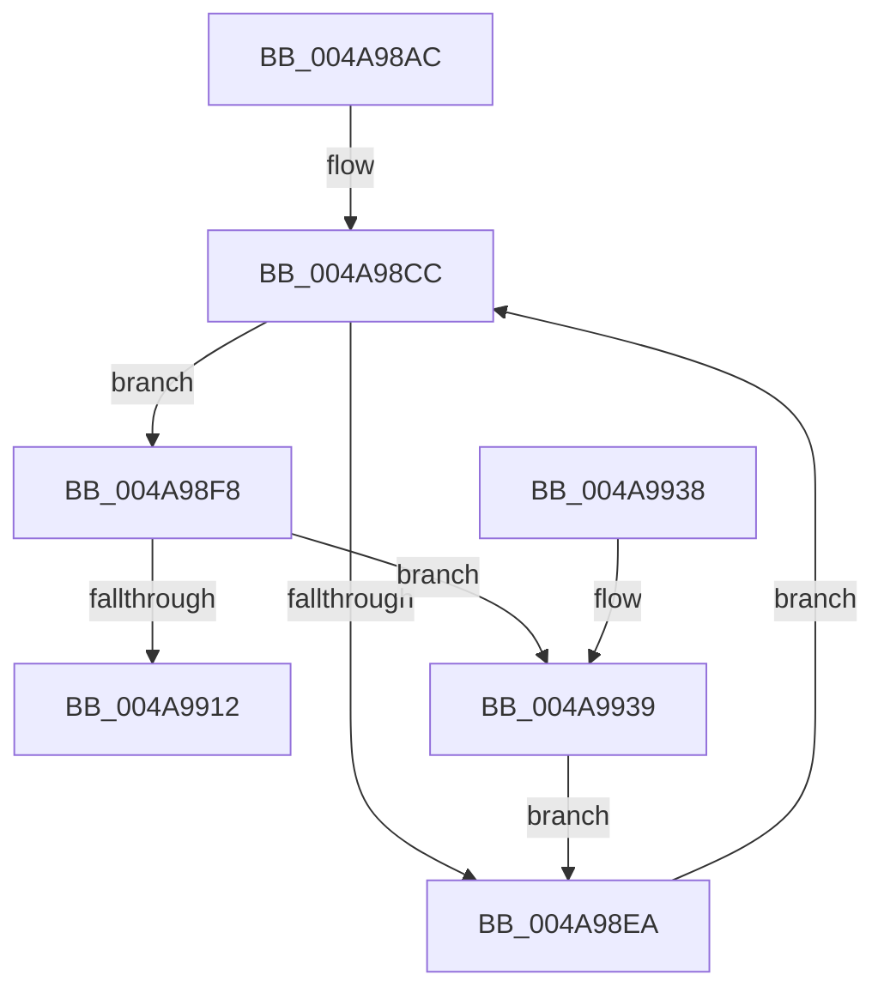

# CcGetRandomVacbArrayWithReference

- RVA: `0x004A98AC`–`0x004A9946` (길이 `154` bytes)
- VA: `0x00000001404A98AC`
- 실행 섹션: `.text`
- PDB 이름 있음: `예`; PDB Function 태그: `아니요`
- unwind 정보 RVA: `0x00069B08`
- 디코드: `43`개 명령, `154/154` bytes 표시
- 미해석 바이트: `0` (있으면 어셈블리에 `.byte`로 보존)

> 이 문서는 커널 이미지의 기계어와 PDB 기호를 분석해 생성했습니다. 4번과 5번은 함수 원형과 자료형을 바이너리 사용 방식에서 추정한 C 해석이며 원본 소스 복구 결과는 아닙니다.

## 1. Dependencies

- 직접 호출 지점: **7**; 고유 호출 대상: **5**
- 직접 호출자로 확인된 함수: **1**
- RIP 상대 이미지 참조: **3**

### Outgoing calls
- `0x004A98C2` → [RtlRandom](../../page/A6/RtlRandom_function_00A65C60.md) (function, `0x00A65C60`)
- `0x004A98F1` → [RtlRandom](../../page/A6/RtlRandom_function_00A65C60.md) (function, `0x00A65C60`)
- `0x004A98FB` → [KeAcquireQueuedSpinLock](../27/KeAcquireQueuedSpinLock_function_00273D80.md) (function, `0x00273D80`)
- `0x004A9905` → [CcReferenceVacbArray](../27/CcReferenceVacbArray_function_00271D70.md) (function, `0x00271D70`)
- `0x004A9915` → [CcRecalculateVacbArrayHighwaterMark](../27/CcRecalculateVacbArrayHighwaterMark_function_00271DC4.md) (function, `0x00271DC4`)
- `0x004A9920` → [KeReleaseQueuedSpinLock](../27/KeReleaseQueuedSpinLock_function_00272540.md) (function, `0x00272540`)
- `0x004A993F` → [KeReleaseQueuedSpinLock](../27/KeReleaseQueuedSpinLock_function_00272540.md) (function, `0x00272540`)

### Direct callers
- [CcUnmapInactiveViewsInternal](../27/CcUnmapInactiveViewsInternal_function_0027174C.md) at `0x00271C6F`

### Static image references
- `0x004A98BB` → RVA `0x00E0A898` (`.data`; read)
- `0x004A98CC` → RVA `0x00E65BB0` (`.data`; read)
- `0x004A98D8` → RVA `0x00F8F4A0` (`.data`; read)

## 2. Other-region calls and transfers

- 다른 실행 섹션으로 향하는 call: **2**
  - `0x004A98C2` → [RtlRandom](../../page/A6/RtlRandom_function_00A65C60.md) (`.text` → `PAGE`)
  - `0x004A98F1` → [RtlRandom](../../page/A6/RtlRandom_function_00A65C60.md) (`.text` → `PAGE`)
- 별도 외부 분기/꼬리 이동을 확인하지 못했습니다.

## 3. Assembly (complete function range)

```asm
004A98AC  48 89 5C 24 08                  mov qword ptr [rsp + 8], rbx
004A98B1  48 89 74 24 10                  mov qword ptr [rsp + 0x10], rsi
004A98B6  57                              push rdi
004A98B7  48 83 EC 20                     sub rsp, 0x20
004A98BB  48 8D 0D D6 0F 96 00            lea rcx, [rip + 0x960fd6]
004A98C2  E8 99 C3 5B 00                  call 0x140a65c60
004A98C7  BE 04 00 00 00                  mov esi, 4
004A98CC  8B 0D DE C2 9B 00               mov ecx, dword ptr [rip + 0x9bc2de]
004A98D2  33 D2                           xor edx, edx
004A98D4  FF C1                           inc ecx
004A98D6  F7 F1                           div ecx
004A98D8  48 8B 05 C1 5B AE 00            mov rax, qword ptr [rip + 0xae5bc1]
004A98DF  8B CA                           mov ecx, edx
004A98E1  8B DA                           mov ebx, edx
004A98E3  48 83 3C C8 00                  cmp qword ptr [rax + rcx*8], 0
004A98E8  75 0E                           jne 0x1404a98f8
004A98EA  48 8D 0D A7 0F 96 00            lea rcx, [rip + 0x960fa7]
004A98F1  E8 6A C3 5B 00                  call 0x140a65c60
004A98F6  EB D4                           jmp 0x1404a98cc
004A98F8  48 8B CE                        mov rcx, rsi
004A98FB  E8 80 A4 DC FF                  call 0x140273d80
004A9900  8B CB                           mov ecx, ebx
004A9902  40 8A F8                        mov dil, al
004A9905  E8 66 84 DC FF                  call 0x140271d70
004A990A  48 8B D8                        mov rbx, rax
004A990D  48 85 C0                        test rax, rax
004A9910  74 27                           je 0x1404a9939
004A9912  48 8B C8                        mov rcx, rax
004A9915  E8 AA 84 DC FF                  call 0x140271dc4
004A991A  40 8A D7                        mov dl, dil
004A991D  48 8B CE                        mov rcx, rsi
004A9920  E8 1B 8C DC FF                  call 0x140272540
004A9925  48 8B 74 24 38                  mov rsi, qword ptr [rsp + 0x38]
004A992A  48 8B C3                        mov rax, rbx
004A992D  48 8B 5C 24 30                  mov rbx, qword ptr [rsp + 0x30]
004A9932  48 83 C4 20                     add rsp, 0x20
004A9936  5F                              pop rdi
004A9937  C3                              ret
004A9938  CC                              int3
004A9939  40 8A D7                        mov dl, dil
004A993C  48 8B CE                        mov rcx, rsi
004A993F  E8 FC 8B DC FF                  call 0x140272540
004A9944  EB A4                           jmp 0x1404a98ea
```

## 4. C-style interpretation (structured pseudocode)

```c
__int64 __fastcall CcGetRandomVacbArrayWithReference(__int64 a1, int a2)
{
    __int64 result;
    __int64 v_rsp;
    unsigned __int64 v_stack_p10;
    unsigned __int64 v_stack_p8;

    v_stack_p8 = v_rbx;
    v_stack_p10 = v_rsi;
    v_rsp = (v_rsp) - (32);
    result = RtlRandom(v_rip + 9834454, a2, a3, a4);
loc_004A98CC:
    a2 = 0;
    a1 = (unsigned int)(((unsigned int)(*(unsigned int *)(v_rip + 10207966))) + 1);
    if ((*(unsigned __int64 *)(*(unsigned __int64 *)(v_rip + 11426753) + 0 * 8)) != 0) goto loc_004A98F8;
loc_004A98EA:
    result = RtlRandom(v_rip + 9834407, a2, a3, a4);
    goto loc_004A98CC;
loc_004A98F8:
    result = KeAcquireQueuedSpinLock(4, a2, a3, a4);
    result = CcReferenceVacbArray(0, a2, a3, a4);
    if (result == 0) goto loc_004A9939;
    result = CcRecalculateVacbArrayHighwaterMark(result, a2, a3, a4);
    result = KeReleaseQueuedSpinLock(4, (unsigned __int8)((unsigned __int8)(result)), a3, a4);
    v_rsp = (v_rsp) + (32);
    return result;
loc_004A9939:
    result = KeReleaseQueuedSpinLock(v_stack_p10, (unsigned __int8)((unsigned __int8)(result)), a3, a4);
    goto loc_004A98EA;
}
```

## 5. (Beta) C Style

```c
int64_t CcGetRandomVacbArrayWithReference(int64_t Arg1, int32_t Arg2)
{
    int64_t result;
    int64_t local_rsp;
    uint64_t v_stack_p10;
    uint64_t v_stack_p8;

    v_stack_p8 = local_rbx;
    v_stack_p10 = local_rsi;
    local_rsp = (local_rsp) - (32);
    result = RtlRandom(v_rip + 9834454, Arg2, a3, a4);
loc_004A98CC:
    Arg2 = 0;
    Arg1 = (uint32_t)(((uint32_t)(*(uint32_t *)(v_rip + 0x9BC2DE))) + 1);
    if ((*(uint64_t *)(*(uint64_t *)(v_rip + 0xAE5BC1) + 0x0 * 8)) != 0) goto loc_004A98F8;
loc_004A98EA:
    result = RtlRandom(v_rip + 9834407, Arg2, a3, a4);
    goto loc_004A98CC;
loc_004A98F8:
    result = KeAcquireQueuedSpinLock(4, Arg2, a3, a4);
    result = CcReferenceVacbArray(0, Arg2, a3, a4);
    if (result == 0) goto loc_004A9939;
    result = CcRecalculateVacbArrayHighwaterMark(result, Arg2, a3, a4);
    result = KeReleaseQueuedSpinLock(4, (uint8_t)((uint8_t)(result)), a3, a4);
    local_rsp = (local_rsp) + (32);
    return result;
loc_004A9939:
    result = KeReleaseQueuedSpinLock(v_stack_p10, (uint8_t)((uint8_t)(result)), a3, a4);
    goto loc_004A98EA;
}
```

## 6. Execution-region graph

[열기: 2D/3D 그래프와 함수 탐색 컨트롤 패널](../../../control-panel.html?section=text&rva=0x004A98AC&view=graph)

- 2D 그래프는 위에서 아래로 흐르고, 3D 그래프는 빈 공간을 드래그해 회전합니다. Shift+드래그는 이동, 휠은 확대·축소, 함수 노드 선택은 대상 보고서 이동입니다.

### Static fallback


