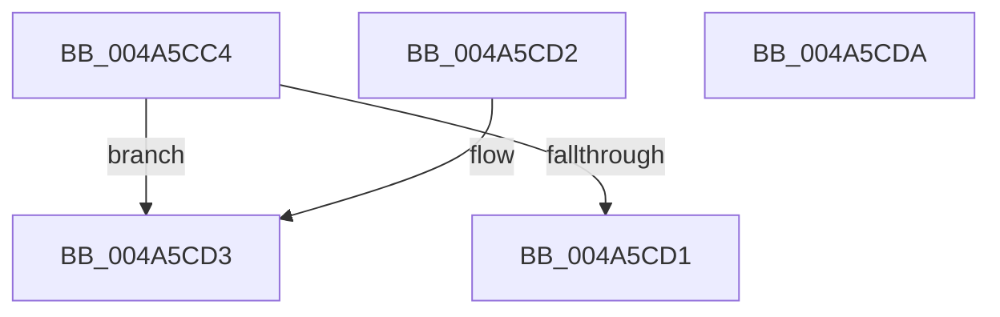

# CcIncrementOpenCount

- RVA: `0x004A5CC4`–`0x004A5CDB` (길이 `23` bytes)
- VA: `0x00000001404A5CC4`
- 실행 섹션: `.text`
- PDB 이름 있음: `예`; PDB Function 태그: `아니요`
- unwind 정보 RVA: `0x000DB714`
- 디코드: `10`개 명령, `23/23` bytes 표시
- 미해석 바이트: `0` (있으면 어셈블리에 `.byte`로 보존)

> 이 문서는 커널 이미지의 기계어와 PDB 기호를 분석해 생성했습니다. 4번과 5번은 함수 원형과 자료형을 바이너리 사용 방식에서 추정한 C 해석이며 원본 소스 복구 결과는 아닙니다.

## 1. Dependencies

- 직접 호출 지점: **0**; 고유 호출 대상: **0**
- 직접 호출자로 확인된 함수: **2**
- RIP 상대 이미지 참조: **0**

### Outgoing calls
- 직접 디코드된 call 명령이 없습니다.

### Direct callers
- [CcPrepareMdlWrite$fin$0](../6D/CcPrepareMdlWrite_fin_0_function_006D3DF5.md) at `0x006D3F13`
- [sub_006E86B0](../6E/Unknown_function_006E86B0.md) at `0x006E86B6`

### Static image references
- 디코드된 RIP-relative 메모리 참조가 없습니다.

## 2. Other-region calls and transfers

- 다른 실행 섹션으로 향하는 call: **0**
- 별도 외부 분기/꼬리 이동을 확인하지 못했습니다.

## 3. Assembly (complete function range)

```asm
004A5CC4  8B 41 04                        mov eax, dword ptr [rcx + 4]
004A5CC7  FF C0                           inc eax
004A5CC9  89 41 04                        mov dword ptr [rcx + 4], eax
004A5CCC  45 84 C0                        test r8b, r8b
004A5CCF  75 02                           jne 0x1404a5cd3
004A5CD1  C3                              ret
004A5CD2  CC                              int3
004A5CD3  FF 81 20 02 00 00               inc dword ptr [rcx + 0x220]
004A5CD9  C3                              ret
004A5CDA  CC                              int3
```

## 4. C-style interpretation (structured pseudocode)

```c
__int64 __fastcall CcIncrementOpenCount(__int64 a1, __int64 a2, unsigned __int8 a3)
{
    __int64 result;

    result = (unsigned int)(((unsigned int)(*(unsigned int *)(a1 + 4))) + 1);
    *(unsigned int *)(a1 + 4) = (unsigned int)(result);
    if (a3 != 0) goto loc_004A5CD3;
    return result;
loc_004A5CD3:
    return result;
}
```

## 5. (Beta) C Style

```c
int64_t CcIncrementOpenCount(void *Arg1, int64_t Arg2, uint8_t Arg3)
{
    uint8_t *arg1 = (uint8_t *)Arg1;

    int64_t result;

    result = (uint32_t)(((uint32_t)(*(uint32_t *)(arg1 + 0x4))) + 1);
    *(uint32_t *)(arg1 + 0x4) = (uint32_t)(result);
    if (Arg3 != 0) goto loc_004A5CD3;
    return result;
loc_004A5CD3:
    return result;
}
```

### 관측된 메모리 오프셋

구조체 형식이 확인되지 않은 접근은 인자 기준의 오프셋으로만 기록했습니다.

| 기준 인자 | 오프셋 표현 | 폭 (bit) | 접근 |
|---|---:|---:|---|
| `Arg1` | `+ 0x4` | `32` | `R` |
| `Arg1` | `+ 0x4` | `32` | `W` |
| `Arg1` | `+ 0x220` | `32` | `R/W` |

## 6. Execution-region graph

[열기: 2D/3D 그래프와 함수 탐색 컨트롤 패널](../../../control-panel.html?section=text&rva=0x004A5CC4&view=graph)

- 2D 그래프는 위에서 아래로 흐르고, 3D 그래프는 빈 공간을 드래그해 회전합니다. Shift+드래그는 이동, 휠은 확대·축소, 함수 노드 선택은 대상 보고서 이동입니다.

### Static fallback


