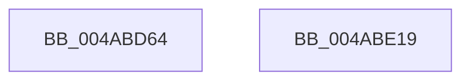

# CcPerfLogLazyWriteScan

- RVA: `0x004ABD64`–`0x004ABE1A` (길이 `182` bytes)
- VA: `0x00000001404ABD64`
- 실행 섹션: `.text`
- PDB 이름 있음: `예`; PDB Function 태그: `아니요`
- unwind 정보 RVA: `0x00079278`
- 디코드: `43`개 명령, `182/182` bytes 표시
- 미해석 바이트: `0` (있으면 어셈블리에 `.byte`로 보존)

> 이 문서는 커널 이미지의 기계어와 PDB 기호를 분석해 생성했습니다. 4번과 5번은 함수 원형과 자료형을 바이너리 사용 방식에서 추정한 C 해석이며 원본 소스 복구 결과는 아닙니다.

## 1. Dependencies

- 직접 호출 지점: **2**; 고유 호출 대상: **2**
- 직접 호출자로 확인된 함수: **2**
- RIP 상대 이미지 참조: **1**

### Outgoing calls
- `0x004ABDFF` → [EtwTraceKernelEvent](../23/EtwTraceKernelEvent_function_00235350.md) (function, `0x00235350`)
- `0x004ABE0B` → [_security_check_cookie](../6A/_security_check_cookie_function_006AC640.md) (function, `0x006AC640`)

### Direct callers
- [CcLazyWriteScan](../3C/CcLazyWriteScan_function_003C9394.md) at `0x003C965C`
- [sub_006E4FBA](../6E/Unknown_function_006E4FBA.md) at `0x006E5033`

### Static image references
- `0x004ABD72` → RVA `0x00E0A740` (`.data`; read)

## 2. Other-region calls and transfers

- 다른 실행 섹션으로 향하는 call: **0**
- 별도 외부 분기/꼬리 이동을 확인하지 못했습니다.

## 3. Assembly (complete function range)

```asm
004ABD64  40 55                           push rbp
004ABD66  48 8D 6C 24 E9                  lea rbp, [rsp - 0x17]
004ABD6B  48 81 EC B0 00 00 00            sub rsp, 0xb0
004ABD72  48 8B 05 C7 E9 95 00            mov rax, qword ptr [rip + 0x95e9c7]
004ABD79  48 33 C4                        xor rax, rsp
004ABD7C  48 89 45 07                     mov qword ptr [rbp + 7], rax
004ABD80  48 8B 45 47                     mov rax, qword ptr [rbp + 0x47]
004ABD84  83 65 A3 00                     and dword ptr [rbp - 0x5d], 0
004ABD88  48 89 45 BF                     mov qword ptr [rbp - 0x41], rax
004ABD8C  48 8B 45 4F                     mov rax, qword ptr [rbp + 0x4f]
004ABD90  48 89 45 C7                     mov qword ptr [rbp - 0x39], rax
004ABD94  48 8B 45 57                     mov rax, qword ptr [rbp + 0x57]
004ABD98  48 89 45 CF                     mov qword ptr [rbp - 0x31], rax
004ABD9C  48 8B 45 5F                     mov rax, qword ptr [rbp + 0x5f]
004ABDA0  48 89 45 D7                     mov qword ptr [rbp - 0x29], rax
004ABDA4  48 8B 45 67                     mov rax, qword ptr [rbp + 0x67]
004ABDA8  48 89 45 DF                     mov qword ptr [rbp - 0x21], rax
004ABDAC  48 8B 45 6F                     mov rax, qword ptr [rbp + 0x6f]
004ABDB0  48 89 45 E7                     mov qword ptr [rbp - 0x19], rax
004ABDB4  48 8B 45 77                     mov rax, qword ptr [rbp + 0x77]
004ABDB8  48 89 45 EF                     mov qword ptr [rbp - 0x11], rax
004ABDBC  48 8B 45 7F                     mov rax, qword ptr [rbp + 0x7f]
004ABDC0  48 89 45 F7                     mov qword ptr [rbp - 9], rax
004ABDC4  48 8D 45 A7                     lea rax, [rbp - 0x59]
004ABDC8  48 89 4D A7                     mov qword ptr [rbp - 0x59], rcx
004ABDCC  48 8D 4D 97                     lea rcx, [rbp - 0x69]
004ABDD0  89 55 AF                        mov dword ptr [rbp - 0x51], edx
004ABDD3  BA 01 00 00 00                  mov edx, 1
004ABDD8  44 89 45 B3                     mov dword ptr [rbp - 0x4d], r8d
004ABDDC  41 B8 00 00 02 80               mov r8d, 0x80020000
004ABDE2  4C 89 4D B7                     mov qword ptr [rbp - 0x49], r9
004ABDE6  41 B9 05 16 00 00               mov r9d, 0x1605
004ABDEC  48 89 45 97                     mov qword ptr [rbp - 0x69], rax
004ABDF0  C7 45 9F 58 00 00 00            mov dword ptr [rbp - 0x61], 0x58
004ABDF7  C7 44 24 20 02 01 50 00         mov dword ptr [rsp + 0x20], 0x500102
004ABDFF  E8 4C 95 D8 FF                  call 0x140235350
004ABE04  48 8B 4D 07                     mov rcx, qword ptr [rbp + 7]
004ABE08  48 33 CC                        xor rcx, rsp
004ABE0B  E8 30 08 20 00                  call 0x1406ac640
004ABE10  48 81 C4 B0 00 00 00            add rsp, 0xb0
004ABE17  5D                              pop rbp
004ABE18  C3                              ret
004ABE19  CC                              int3
```

## 4. C-style interpretation (structured pseudocode)

```c
__int64 __fastcall CcPerfLogLazyWriteScan(__int64 a1, int a2, int a3, __int64 a4, __int64 a5, __int64 a6, __int64 a7, __int64 a8, __int64 a9, __int64 a10, __int64 a11, __int64 a12)
{
    __int64 result;
    __int64 v_rsp;
    unsigned __int64 v_stack_m18;
    unsigned __int64 v_stack_m1F;
    unsigned __int64 v_stack_m28;
    unsigned __int64 v_stack_m30;
    unsigned __int64 v_stack_m38;
    unsigned __int64 v_stack_m40;
    unsigned __int64 v_stack_m48;
    unsigned __int64 v_stack_m50;
    unsigned __int64 v_stack_m58;
    unsigned __int64 v_stack_m60;
    unsigned __int64 v_stack_m68;
    unsigned int v_stack_m6C;
    unsigned int v_stack_m70;
    unsigned __int64 v_stack_m78;
    unsigned int v_stack_m7C;
    unsigned int v_stack_m80;
    unsigned __int64 v_stack_m88;
    unsigned int v_stack_m98;

    v_rsp = (v_rsp) - (176);
    result = (*(unsigned __int64 *)(v_rip + 9824711)) ^ (v_rsp);
    v_stack_m18 = result;
    v_stack_m60 = a5;
    v_stack_m58 = a6;
    v_stack_m50 = a7;
    v_stack_m48 = a8;
    v_stack_m40 = a9;
    v_stack_m38 = a10;
    v_stack_m30 = a11;
    v_stack_m28 = a12;
    v_stack_m78 = a1;
    v_stack_m70 = a2;
    v_stack_m6C = a3;
    v_stack_m68 = a4;
    v_stack_m88 = v_stack_m78;
    v_stack_m80 = 88;
    v_stack_m98 = 0x500102ULL;
    result = EtwTraceKernelEvent(v_stack_m88, 1, (unsigned int)(0x80020000ULL), (unsigned int)(0x1605ULL));
    a1 = (v_stack_m18) ^ (v_rsp);
    result = _security_check_cookie(a1, 1, (unsigned int)(0x80020000ULL), (unsigned int)(0x1605ULL));
    v_rsp = (v_rsp) + (176);
    return result;
}
```

## 5. (Beta) C Style

```c
int64_t CcPerfLogLazyWriteScan(int64_t Arg1, int32_t Arg2, int32_t Arg3, int64_t Arg4, int64_t Arg5, int64_t Arg6, int64_t Arg7, int64_t Arg8, int64_t Arg9, int64_t Arg10, int64_t Arg11, int64_t Arg12)
{
    int64_t result;
    int64_t local_rsp;
    uint64_t v_stack_m18;
    uint64_t v_stack_m1F;
    uint64_t v_stack_m28;
    uint64_t v_stack_m30;
    uint64_t v_stack_m38;
    uint64_t v_stack_m40;
    uint64_t v_stack_m48;
    uint64_t v_stack_m50;
    uint64_t v_stack_m58;
    uint64_t v_stack_m60;
    uint64_t v_stack_m68;
    uint32_t v_stack_m6C;
    uint32_t v_stack_m70;
    uint64_t v_stack_m78;
    uint32_t v_stack_m7C;
    uint32_t v_stack_m80;
    uint64_t v_stack_m88;
    uint32_t v_stack_m98;

    local_rsp = (local_rsp) - (176);
    result = (*(uint64_t *)(v_rip + 0x95E9C7)) ^ (local_rsp);
    v_stack_m18 = result;
    v_stack_m60 = Arg5;
    v_stack_m58 = Arg6;
    v_stack_m50 = Arg7;
    v_stack_m48 = Arg8;
    v_stack_m40 = Arg9;
    v_stack_m38 = Arg10;
    v_stack_m30 = Arg11;
    v_stack_m28 = Arg12;
    v_stack_m78 = Arg1;
    v_stack_m70 = Arg2;
    v_stack_m6C = Arg3;
    v_stack_m68 = Arg4;
    v_stack_m88 = v_stack_m78;
    v_stack_m80 = 88;
    v_stack_m98 = 0x500102ULL;
    result = EtwTraceKernelEvent(v_stack_m88, 1, (uint32_t)(0x80020000ULL), (uint32_t)(0x1605ULL));
    Arg1 = (v_stack_m18) ^ (local_rsp);
    result = _security_check_cookie(Arg1, 1, (uint32_t)(0x80020000ULL), (uint32_t)(0x1605ULL));
    local_rsp = (local_rsp) + (176);
    return result;
}
```

## 6. Execution-region graph

[열기: 2D/3D 그래프와 함수 탐색 컨트롤 패널](../../../control-panel.html?section=text&rva=0x004ABD64&view=graph)

- 2D 그래프는 위에서 아래로 흐르고, 3D 그래프는 빈 공간을 드래그해 회전합니다. Shift+드래그는 이동, 휠은 확대·축소, 함수 노드 선택은 대상 보고서 이동입니다.

### Static fallback


