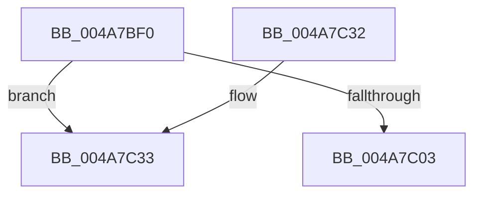

# CcRepinBcb

- RVA: `0x004A7BF0`–`0x004A7C52` (길이 `98` bytes)
- VA: `0x00000001404A7BF0`
- 실행 섹션: `.text`
- PDB 이름 있음: `예`; PDB Function 태그: `아니요`
- unwind 정보 RVA: `0x00060220`
- 디코드: `24`개 명령, `98/98` bytes 표시
- 미해석 바이트: `0` (있으면 어셈블리에 `.byte`로 보존)

> 이 문서는 커널 이미지의 기계어와 PDB 기호를 분석해 생성했습니다. 4번과 5번은 함수 원형과 자료형을 바이너리 사용 방식에서 추정한 C 해석이며 원본 소스 복구 결과는 아닙니다.

## 1. Dependencies

- 직접 호출 지점: **3**; 고유 호출 대상: **3**
- 직접 호출자로 확인된 함수: **0**
- RIP 상대 이미지 참조: **0**

### Outgoing calls
- `0x004A7C11` → [ExAcquireFastMutex](../20/ExAcquireFastMutex_function_0020E5A0.md) (function, `0x0020E5A0`)
- `0x004A7C27` → [ExReleaseFastMutex](../25/ExReleaseFastMutex_function_002519C0.md) (function, `0x002519C0`)
- `0x004A7C4C` → [KeBugCheckEx](../4F/KeBugCheckEx_function_004FD660.md) (function, `0x004FD660`)

### Direct callers
- 이 함수 시작 RVA로 연결되는 직접 call은 확인되지 않았습니다. 간접 호출은 완전히 역산할 수 없습니다.

### Static image references
- 디코드된 RIP-relative 메모리 참조가 없습니다.

## 2. Other-region calls and transfers

- 다른 실행 섹션으로 향하는 call: **0**
- 별도 외부 분기/꼬리 이동을 확인하지 못했습니다.

## 3. Assembly (complete function range)

```asm
004A7BF0  40 53                           push rbx
004A7BF2  48 83 EC 30                     sub rsp, 0x30
004A7BF6  B8 FD 02 00 00                  mov eax, 0x2fd
004A7BFB  48 8B D9                        mov rbx, rcx
004A7BFE  66 39 01                        cmp word ptr [rcx], ax
004A7C01  75 30                           jne 0x1404a7c33
004A7C03  48 8B 89 B0 00 00 00            mov rcx, qword ptr [rcx + 0xb0]
004A7C0A  48 81 C1 20 01 00 00            add rcx, 0x120
004A7C11  E8 8A 69 D6 FF                  call 0x14020e5a0
004A7C16  48 8B 8B B0 00 00 00            mov rcx, qword ptr [rbx + 0xb0]
004A7C1D  FF 43 40                        inc dword ptr [rbx + 0x40]
004A7C20  48 81 C1 20 01 00 00            add rcx, 0x120
004A7C27  E8 94 9D DA FF                  call 0x1402519c0
004A7C2C  48 83 C4 30                     add rsp, 0x30
004A7C30  5B                              pop rbx
004A7C31  C3                              ret
004A7C32  CC                              int3
004A7C33  48 83 64 24 20 00               and qword ptr [rsp + 0x20], 0
004A7C39  45 33 C9                        xor r9d, r9d
004A7C3C  BA 28 26 00 00                  mov edx, 0x2628
004A7C41  49 C7 C0 20 04 00 C0            mov r8, 0xffffffffc0000420
004A7C48  41 8D 49 34                     lea ecx, [r9 + 0x34]
004A7C4C  E8 0F 5A 05 00                  call 0x1404fd660
004A7C51  CC                              int3
```

## 4. C-style interpretation (structured pseudocode)

```c
__int64 __fastcall CcRepinBcb(__int64 a1, __int64 a2, __int64 a3, int a4)
{
    __int64 result;
    __int64 v_rsp;
    unsigned __int64 v_stack_p20;

    v_rsp = (v_rsp) - (48);
    if ((*(unsigned __int16 *)(a1)) != 765) goto loc_004A7C33;
    a1 = (*(unsigned __int64 *)(a1 + 176)) + (288);
    result = ExAcquireFastMutex(a1, a2, a3, a4);
    a1 = (*(unsigned __int64 *)(a1 + 176)) + (288);
    result = ExReleaseFastMutex(a1, a2, a3, a4);
    v_rsp = (v_rsp) + (48);
    return result;
loc_004A7C33:
    a4 = 0;
    result = KeBugCheckEx(a4 + 52, (unsigned int)(0x2628ULL), 0xFFFFFFFFC0000420ULL, a4);
    return result;
}
```

## 5. (Beta) C Style

```c
int64_t CcRepinBcb(void *Arg1, int64_t Arg2, int64_t Arg3, int32_t Arg4)
{
    uint8_t *arg1 = (uint8_t *)Arg1;

    int64_t result;
    int64_t local_rsp;
    uint64_t v_stack_p20;

    local_rsp = (local_rsp) - (48);
    if ((*(uint16_t *)(arg1)) != 765) goto loc_004A7C33;
    Arg1 = (*(uint64_t *)(arg1 + 0xB0)) + (288);
    result = ExAcquireFastMutex(Arg1, Arg2, Arg3, Arg4);
    Arg1 = (*(uint64_t *)(arg1 + 0xB0)) + (288);
    result = ExReleaseFastMutex(Arg1, Arg2, Arg3, Arg4);
    local_rsp = (local_rsp) + (48);
    return result;
loc_004A7C33:
    Arg4 = 0;
    result = KeBugCheckEx(Arg4 + 52, (uint32_t)(0x2628ULL), 0xFFFFFFFFC0000420ULL, Arg4);
    return result;
}
```

### 관측된 메모리 오프셋

구조체 형식이 확인되지 않은 접근은 인자 기준의 오프셋으로만 기록했습니다.

| 기준 인자 | 오프셋 표현 | 폭 (bit) | 접근 |
|---|---:|---:|---|
| `Arg1` | `+ 0x0` | `16` | `R` |
| `Arg1` | `+ 0x40` | `32` | `R/W` |
| `Arg1` | `+ 0xB0` | `64` | `R` |

## 6. Execution-region graph

[열기: 2D/3D 그래프와 함수 탐색 컨트롤 패널](../../../control-panel.html?section=text&rva=0x004A7BF0&view=graph)

- 2D 그래프는 위에서 아래로 흐르고, 3D 그래프는 빈 공간을 드래그해 회전합니다. Shift+드래그는 이동, 휠은 확대·축소, 함수 노드 선택은 대상 보고서 이동입니다.

### Static fallback


