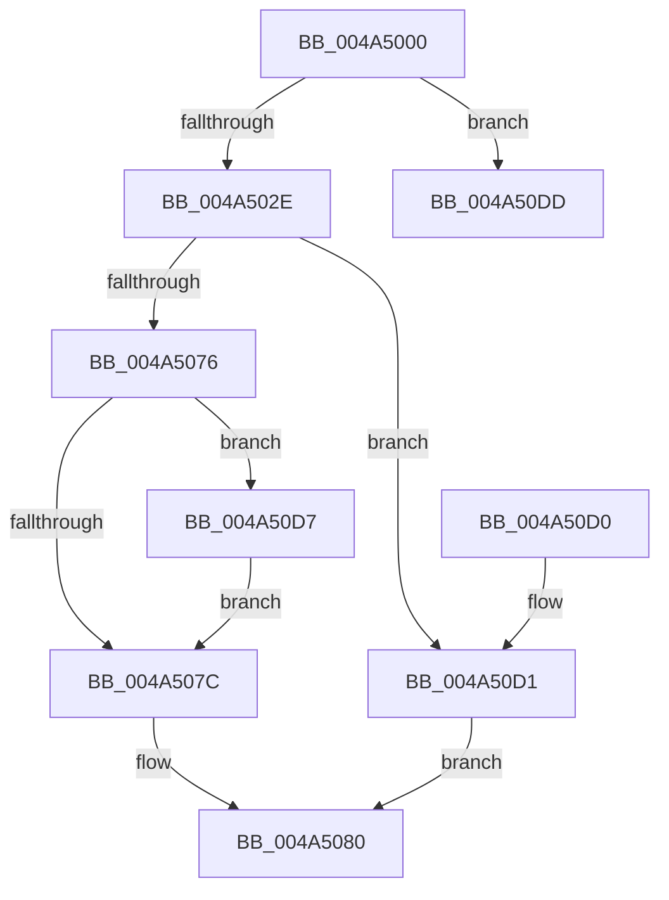

# CcSetAdditionalCacheAttributesEx

- RVA: `0x004A5000`–`0x004A50FC` (길이 `252` bytes)
- VA: `0x00000001404A5000`
- 실행 섹션: `.text`
- PDB 이름 있음: `예`; PDB Function 태그: `아니요`
- unwind 정보 RVA: `0x000B6820`
- 디코드: `69`개 명령, `252/252` bytes 표시
- 미해석 바이트: `0` (있으면 어셈블리에 `.byte`로 보존)

> 이 문서는 커널 이미지의 기계어와 PDB 기호를 분석해 생성했습니다. 4번과 5번은 함수 원형과 자료형을 바이너리 사용 방식에서 추정한 C 해석이며 원본 소스 복구 결과는 아닙니다.

## 1. Dependencies

- 직접 호출 지점: **4**; 고유 호출 대상: **4**
- 직접 호출자로 확인된 함수: **0**
- RIP 상대 이미지 참조: **0**

### Outgoing calls
- `0x004A503E` → [CcSetAdditionalCacheAttributes](CcSetAdditionalCacheAttributes_function_004A5110.md) (function, `0x004A5110`)
- `0x004A5056` → [KeAcquireInStackQueuedSpinLock](../27/KeAcquireInStackQueuedSpinLock_function_002757A0.md) (function, `0x002757A0`)
- `0x004A50C0` → [KeReleaseInStackQueuedSpinLock](../34/KeReleaseInStackQueuedSpinLock_function_00342CE0.md) (function, `0x00342CE0`)
- `0x004A50F6` → [KeBugCheckEx](../4F/KeBugCheckEx_function_004FD660.md) (function, `0x004FD660`)

### Direct callers
- 이 함수 시작 RVA로 연결되는 직접 call은 확인되지 않았습니다. 간접 호출은 완전히 역산할 수 없습니다.

### Static image references
- 디코드된 RIP-relative 메모리 참조가 없습니다.

## 2. Other-region calls and transfers

- 다른 실행 섹션으로 향하는 call: **0**
- 별도 외부 분기/꼬리 이동을 확인하지 못했습니다.

## 3. Assembly (complete function range)

```asm
004A5000  48 89 5C 24 08                  mov qword ptr [rsp + 8], rbx
004A5005  57                              push rdi
004A5006  48 83 EC 50                     sub rsp, 0x50
004A500A  33 C0                           xor eax, eax
004A500C  0F 57 C0                        xorps xmm0, xmm0
004A500F  48 89 44 24 40                  mov qword ptr [rsp + 0x40], rax
004A5014  8B DA                           mov ebx, edx
004A5016  48 8B 41 28                     mov rax, qword ptr [rcx + 0x28]
004A501A  0F 11 44 24 30                  movups xmmword ptr [rsp + 0x30], xmm0
004A501F  48 8B 78 08                     mov rdi, qword ptr [rax + 8]
004A5023  8B 47 04                        mov eax, dword ptr [rdi + 4]
004A5026  85 C0                           test eax, eax
004A5028  0F 84 AF 00 00 00               je 0x1404a50dd
004A502E  44 8B C2                        mov r8d, edx
004A5031  D1 EA                           shr edx, 1
004A5033  41 C1 E8 02                     shr r8d, 2
004A5037  80 E2 01                        and dl, 1
004A503A  41 80 E0 01                     and r8b, 1
004A503E  E8 CD 00 00 00                  call 0x1404a5110
004A5043  48 8B 8F 18 02 00 00            mov rcx, qword ptr [rdi + 0x218]
004A504A  48 8D 54 24 30                  lea rdx, [rsp + 0x30]
004A504F  48 81 C1 00 03 00 00            add rcx, 0x300
004A5056  E8 45 07 DD FF                  call 0x1402757a0
004A505B  8B 97 98 00 00 00               mov edx, dword ptr [rdi + 0x98]
004A5061  8B C2                           mov eax, edx
004A5063  0F BA F0 17                     btr eax, 0x17
004A5067  0F BA EA 17                     bts edx, 0x17
004A506B  F6 C3 01                        test bl, 1
004A506E  0F 44 D0                        cmove edx, eax
004A5071  F6 C3 08                        test bl, 8
004A5074  75 5B                           jne 0x1404a50d1
004A5076  0F BA E2 1A                     bt edx, 0x1a
004A507A  72 5B                           jb 0x1404a50d7
004A507C  0F BA F2 1A                     btr edx, 0x1a
004A5080  8B C2                           mov eax, edx
004A5082  48 8D 4C 24 30                  lea rcx, [rsp + 0x30]
004A5087  0F BA F0 1C                     btr eax, 0x1c
004A508B  41 B8 00 00 00 10               mov r8d, 0x10000000
004A5091  41 0B D0                        or edx, r8d
004A5094  F6 C3 10                        test bl, 0x10
004A5097  0F 44 D0                        cmove edx, eax
004A509A  8B C2                           mov eax, edx
004A509C  0F BA EA 1B                     bts edx, 0x1b
004A50A0  0F BA F0 1B                     btr eax, 0x1b
004A50A4  F6 C3 20                        test bl, 0x20
004A50A7  0F 44 D0                        cmove edx, eax
004A50AA  8B C2                           mov eax, edx
004A50AC  0F BA EA 0C                     bts edx, 0xc
004A50B0  0F BA F0 0C                     btr eax, 0xc
004A50B4  41 85 D8                        test r8d, ebx
004A50B7  0F 44 D0                        cmove edx, eax
004A50BA  89 97 98 00 00 00               mov dword ptr [rdi + 0x98], edx
004A50C0  E8 1B DC E9 FF                  call 0x140342ce0
004A50C5  48 8B 5C 24 60                  mov rbx, qword ptr [rsp + 0x60]
004A50CA  48 83 C4 50                     add rsp, 0x50
004A50CE  5F                              pop rdi
004A50CF  C3                              ret
004A50D0  CC                              int3
004A50D1  0F BA EA 1A                     bts edx, 0x1a
004A50D5  EB A9                           jmp 0x1404a5080
004A50D7  0F BA EA 11                     bts edx, 0x11
004A50DB  EB 9F                           jmp 0x1404a507c
004A50DD  48 83 64 24 20 00               and qword ptr [rsp + 0x20], 0
004A50E3  45 33 C9                        xor r9d, r9d
004A50E6  BA C6 00 00 00                  mov edx, 0xc6
004A50EB  49 C7 C0 20 04 00 C0            mov r8, 0xffffffffc0000420
004A50F2  41 8D 49 34                     lea ecx, [r9 + 0x34]
004A50F6  E8 65 85 05 00                  call 0x1404fd660
004A50FB  CC                              int3
```

## 4. C-style interpretation (structured pseudocode)

```c
__int64 __fastcall CcSetAdditionalCacheAttributesEx(__int64 a1, int a2, __int64 a3, int a4)
{
    __int64 result;
    __int64 v_rsp;
    unsigned __int64 v_stack_m18;
    unsigned __int64 v_stack_m28;
    unsigned __int64 v_stack_p20;
    unsigned __int64 v_stack_p8;

    v_stack_p8 = v_rbx;
    v_rsp = (v_rsp) - (80);
    result = 0;
    v_stack_m18 = 0;
    v_stack_m28 = v_xmm0;
    if ((unsigned int)((unsigned int)(*(unsigned int *)(*(unsigned __int64 *)(*(unsigned __int64 *)(a1 + 40) + 8) + 4))) == 0) goto loc_004A50DD;
    a2 = (unsigned int)((a2) >> (1));
    a3 = (unsigned int)(((unsigned int)(a2)) >> (2));
    a2 = (unsigned __int8)((a2) & (1));
    a3 = (unsigned __int8)((a3) & (1));
    result = CcSetAdditionalCacheAttributes(a1, a2, a3, a4);
    a1 = (*(unsigned __int64 *)(*(unsigned __int64 *)(*(unsigned __int64 *)(a1 + 40) + 8) + 536)) + (768);
    result = KeAcquireInStackQueuedSpinLock(a1, v_stack_m28, a3, a4);
    a2 = (unsigned int)(*(unsigned int *)(*(unsigned __int64 *)(*(unsigned __int64 *)(a1 + 40) + 8) + 152));
    if ((((unsigned __int8)((unsigned int)(a2))) & (1)) == 0) { a2 = (unsigned int)((unsigned int)((unsigned int)((unsigned int)(*(unsigned int *)(*(unsigned __int64 *)(*(unsigned __int64 *)(a1 + 40) + 8) + 152))))); }
    if ((((unsigned __int8)((unsigned int)(a2))) & (8)) != 0) goto loc_004A50D1;
    if (condition_is_below) goto loc_004A50D7;
loc_004A507C:
loc_004A5080:
    a2 = (unsigned int)((a2) | ((unsigned int)((unsigned int)(0x10000000ULL))));
    if ((((unsigned __int8)((unsigned int)(a2))) & (16)) == 0) { a2 = (unsigned int)((unsigned int)(a2)); }
    if ((((unsigned __int8)((unsigned int)(a2))) & (32)) == 0) { a2 = (unsigned int)((unsigned int)(a2)); }
    if ((((unsigned int)((unsigned int)(0x10000000ULL))) & ((unsigned int)((unsigned int)(a2)))) == 0) { a2 = (unsigned int)((unsigned int)(a2)); }
    *(unsigned int *)(*(unsigned __int64 *)(*(unsigned __int64 *)(a1 + 40) + 8) + 152) = a2;
    result = KeReleaseInStackQueuedSpinLock(v_stack_m28, a2, (unsigned int)(0x10000000ULL), a4);
    v_rsp = (v_rsp) + (80);
    return result;
loc_004A50D1:
    goto loc_004A5080;
loc_004A50D7:
    goto loc_004A507C;
loc_004A50DD:
    a4 = 0;
    result = KeBugCheckEx(a4 + 52, 198, 0xFFFFFFFFC0000420ULL, a4);
    return result;
}
```

## 5. (Beta) C Style

```c
int64_t CcSetAdditionalCacheAttributesEx(void *Arg1, int32_t Arg2, int64_t Arg3, int32_t Arg4)
{
    uint8_t *arg1 = (uint8_t *)Arg1;

    int64_t result;
    int64_t local_rsp;
    uint64_t v_stack_m18;
    uint64_t v_stack_m28;
    uint64_t v_stack_p20;
    uint64_t v_stack_p8;

    v_stack_p8 = local_rbx;
    local_rsp = (local_rsp) - (80);
    result = 0;
    v_stack_m18 = 0;
    v_stack_m28 = v_xmm0;
    if ((uint32_t)((uint32_t)(*(uint32_t *)(*(uint64_t *)(*(uint64_t *)(arg1 + 0x28) + 0x8) + 0x4))) == 0) goto loc_004A50DD;
    Arg2 = (uint32_t)((Arg2) >> (1));
    Arg3 = (uint32_t)(((uint32_t)(Arg2)) >> (2));
    Arg2 = (uint8_t)((Arg2) & (1));
    Arg3 = (uint8_t)((Arg3) & (1));
    result = CcSetAdditionalCacheAttributes(Arg1, Arg2, Arg3, Arg4);
    Arg1 = (*(uint64_t *)(*(uint64_t *)(*(uint64_t *)(arg1 + 0x28) + 0x8) + 0x218)) + (768);
    result = KeAcquireInStackQueuedSpinLock(Arg1, v_stack_m28, Arg3, Arg4);
    Arg2 = (uint32_t)(*(uint32_t *)(*(uint64_t *)(*(uint64_t *)(arg1 + 0x28) + 0x8) + 0x98));
    if ((((uint8_t)((uint32_t)(Arg2))) & (1)) == 0) { Arg2 = (uint32_t)((uint32_t)((uint32_t)((uint32_t)(*(uint32_t *)(*(uint64_t *)(*(uint64_t *)(arg1 + 0x28) + 0x8) + 0x98))))); }
    if ((((uint8_t)((uint32_t)(Arg2))) & (8)) != 0) goto loc_004A50D1;
    if (condition_is_below) goto loc_004A50D7;
loc_004A507C:
loc_004A5080:
    Arg2 = (uint32_t)((Arg2) | ((uint32_t)((uint32_t)(0x10000000ULL))));
    if ((((uint8_t)((uint32_t)(Arg2))) & (16)) == 0) { Arg2 = (uint32_t)((uint32_t)(Arg2)); }
    if ((((uint8_t)((uint32_t)(Arg2))) & (32)) == 0) { Arg2 = (uint32_t)((uint32_t)(Arg2)); }
    if ((((uint32_t)((uint32_t)(0x10000000ULL))) & ((uint32_t)((uint32_t)(Arg2)))) == 0) { Arg2 = (uint32_t)((uint32_t)(Arg2)); }
    *(uint32_t *)(*(uint64_t *)(*(uint64_t *)(arg1 + 0x28) + 0x8) + 0x98) = Arg2;
    result = KeReleaseInStackQueuedSpinLock(v_stack_m28, Arg2, (uint32_t)(0x10000000ULL), Arg4);
    local_rsp = (local_rsp) + (80);
    return result;
loc_004A50D1:
    goto loc_004A5080;
loc_004A50D7:
    goto loc_004A507C;
loc_004A50DD:
    Arg4 = 0;
    result = KeBugCheckEx(Arg4 + 52, 198, 0xFFFFFFFFC0000420ULL, Arg4);
    return result;
}
```

### 관측된 메모리 오프셋

구조체 형식이 확인되지 않은 접근은 인자 기준의 오프셋으로만 기록했습니다.

| 기준 인자 | 오프셋 표현 | 폭 (bit) | 접근 |
|---|---:|---:|---|
| `Arg1` | `+ 0x28` | `64` | `R` |

## 6. Execution-region graph

[열기: 2D/3D 그래프와 함수 탐색 컨트롤 패널](../../../control-panel.html?section=text&rva=0x004A5000&view=graph)

- 2D 그래프는 위에서 아래로 흐르고, 3D 그래프는 빈 공간을 드래그해 회전합니다. Shift+드래그는 이동, 휠은 확대·축소, 함수 노드 선택은 대상 보고서 이동입니다.

### Static fallback


