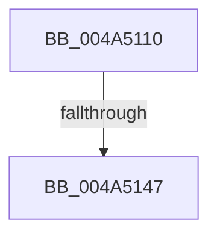

# CcSetAdditionalCacheAttributes

- RVA: `0x004A5110`–`0x004A5162` (길이 `82` bytes)
- VA: `0x00000001404A5110`
- 실행 섹션: `.text`
- PDB 이름 있음: `예`; PDB Function 태그: `예`
- unwind 정보 RVA: `0x000B6830`
- 디코드: `23`개 명령, `82/82` bytes 표시
- 미해석 바이트: `0` (있으면 어셈블리에 `.byte`로 보존)

> 이 문서는 커널 이미지의 기계어와 PDB 기호를 분석해 생성했습니다. 4번과 5번은 함수 원형과 자료형을 바이너리 사용 방식에서 추정한 C 해석이며 원본 소스 복구 결과는 아닙니다.

## 1. Dependencies

- 직접 호출 지점: **1**; 고유 호출 대상: **1**
- 직접 호출자로 확인된 함수: **1**
- RIP 상대 이미지 참조: **0**

### Outgoing calls
- `0x004A515C` → [KeBugCheckEx](../4F/KeBugCheckEx_function_004FD660.md) (function, `0x004FD660`)

### Direct callers
- [CcSetAdditionalCacheAttributesEx](CcSetAdditionalCacheAttributesEx_function_004A5000.md) at `0x004A503E`

### Static image references
- 디코드된 RIP-relative 메모리 참조가 없습니다.

## 2. Other-region calls and transfers

- 다른 실행 섹션으로 향하는 call: **0**
- call이 아닌 외부 분기/꼬리 이동: **1**
  - `0x004A5141` → [sub_006F94DC](../6F/Unknown_function_006F94DC.md) (`tail-transfer`)

## 3. Assembly (complete function range)

```asm
004A5110  4C 8B DC                        mov r11, rsp
004A5113  49 89 5B 08                     mov qword ptr [r11 + 8], rbx
004A5117  49 89 73 10                     mov qword ptr [r11 + 0x10], rsi
004A511B  57                              push rdi
004A511C  48 83 EC 50                     sub rsp, 0x50
004A5120  33 C0                           xor eax, eax
004A5122  0F 57 C0                        xorps xmm0, xmm0
004A5125  0F 11 44 24 30                  movups xmmword ptr [rsp + 0x30], xmm0
004A512A  49 89 43 E8                     mov qword ptr [r11 - 0x18], rax
004A512E  41 8A F8                        mov dil, r8b
004A5131  48 8B 41 28                     mov rax, qword ptr [rcx + 0x28]
004A5135  40 8A F2                        mov sil, dl
004A5138  48 8B 58 08                     mov rbx, qword ptr [rax + 8]
004A513C  8B 43 04                        mov eax, dword ptr [rbx + 4]
004A513F  85 C0                           test eax, eax
004A5141  0F 85 95 43 25 00               jne 0x1406f94dc
004A5147  49 83 63 C8 00                  and qword ptr [r11 - 0x38], 0
004A514C  8D 50 5F                        lea edx, [rax + 0x5f]
004A514F  45 33 C9                        xor r9d, r9d
004A5152  8D 48 34                        lea ecx, [rax + 0x34]
004A5155  49 C7 C0 20 04 00 C0            mov r8, 0xffffffffc0000420
004A515C  E8 FF 84 05 00                  call 0x1404fd660
004A5161  CC                              int3
```

## 4. C-style interpretation (structured pseudocode)

```c
__int64 __fastcall CcSetAdditionalCacheAttributes(__int64 a1, unsigned __int8 a2, unsigned __int8 a3, int a4)
{
    __int64 result;
    __int64 v_rsp;
    unsigned __int64 v_stack_m28;

    *(unsigned __int64 *)(v_rsp + 8) = v_rbx;
    *(unsigned __int64 *)(v_rsp + 16) = v_rsi;
    v_rsp = (v_rsp) - (80);
    result = 0;
    v_stack_m28 = v_xmm0;
    *(unsigned __int64 *)(v_rsp - 24) = 0;
    a4 = 0;
    result = KeBugCheckEx((unsigned int)(*(unsigned int *)(*(unsigned __int64 *)(*(unsigned __int64 *)(a1 + 40) + 8) + 4)) + 52, (unsigned int)(*(unsigned int *)(*(unsigned __int64 *)(*(unsigned __int64 *)(a1 + 40) + 8) + 4)) + 95, 0xFFFFFFFFC0000420ULL, a4);
    return result;
}
```

## 5. (Beta) C Style

```c
int64_t CcSetAdditionalCacheAttributes(void *Arg1, uint8_t Arg2, uint8_t Arg3, int32_t Arg4)
{
    uint8_t *arg1 = (uint8_t *)Arg1;

    int64_t result;
    int64_t local_rsp;
    uint64_t v_stack_m28;

    *(uint64_t *)(local_rsp + 0x8) = local_rbx;
    *(uint64_t *)(local_rsp + 0x10) = local_rsi;
    local_rsp = (local_rsp) - (80);
    result = 0;
    v_stack_m28 = v_xmm0;
    *(uint64_t *)(local_rsp - 0x18) = 0;
    Arg4 = 0;
    result = KeBugCheckEx((uint32_t)(*(uint32_t *)(*(uint64_t *)(*(uint64_t *)(arg1 + 0x28) + 0x8) + 0x4)) + 52, (uint32_t)(*(uint32_t *)(*(uint64_t *)(*(uint64_t *)(arg1 + 0x28) + 0x8) + 0x4)) + 95, 0xFFFFFFFFC0000420ULL, Arg4);
    return result;
}
```

### 관측된 메모리 오프셋

구조체 형식이 확인되지 않은 접근은 인자 기준의 오프셋으로만 기록했습니다.

| 기준 인자 | 오프셋 표현 | 폭 (bit) | 접근 |
|---|---:|---:|---|
| `Arg1` | `+ 0x28` | `64` | `R` |

## 6. Execution-region graph

[열기: 2D/3D 그래프와 함수 탐색 컨트롤 패널](../../../control-panel.html?section=text&rva=0x004A5110&view=graph)

- 2D 그래프는 위에서 아래로 흐르고, 3D 그래프는 빈 공간을 드래그해 회전합니다. Shift+드래그는 이동, 휠은 확대·축소, 함수 노드 선택은 대상 보고서 이동입니다.

### Static fallback


