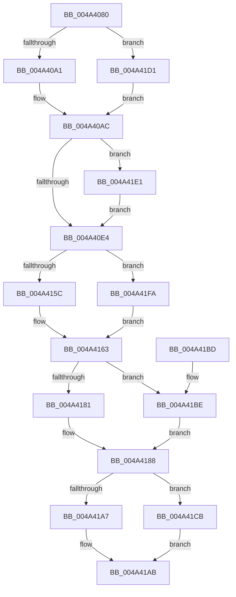

# CcWriteBehindReleaseFile

- RVA: `0x004A4080`–`0x004A420A` (길이 `394` bytes)
- VA: `0x00000001404A4080`
- 실행 섹션: `.text`
- PDB 이름 있음: `예`; PDB Function 태그: `아니요`
- unwind 정보 RVA: `0x000AA5B4`
- 디코드: `79`개 명령, `394/394` bytes 표시
- 미해석 바이트: `0` (있으면 어셈블리에 `.byte`로 보존)

> 이 문서는 커널 이미지의 기계어와 PDB 기호를 분석해 생성했습니다. 4번과 5번은 함수 원형과 자료형을 바이너리 사용 방식에서 추정한 C 해석이며 원본 소스 복구 결과는 아닙니다.

## 1. Dependencies

- 직접 호출 지점: **2**; 고유 호출 대상: **2**
- 직접 호출자로 확인된 함수: **2**
- RIP 상대 이미지 참조: **0**

### Outgoing calls
- `0x004A40B1` → [CcApplyLowIoPriorityToThread](CcApplyLowIoPriorityToThread_function_004A4210.md) (function, `0x004A4210`)
- `0x004A41AB` → [guard_dispatch_icall](../6B/guard_dispatch_icall_function_006BAAD0.md) (function, `0x006BAAD0`)

### Direct callers
- [CcWriteBehindPostProcess](../35/CcWriteBehindPostProcess_function_00357BB4.md) at `0x00357E6B`
- [CcQueueAsyncLazywriteCompletion](../57/CcQueueAsyncLazywriteCompletion_function_0057FA60.md) at `0x0057FAA1`

### Static image references
- 디코드된 RIP-relative 메모리 참조가 없습니다.

## 2. Other-region calls and transfers

- 다른 실행 섹션으로 향하는 call: **0**
- 별도 외부 분기/꼬리 이동을 확인하지 못했습니다.

## 3. Assembly (complete function range)

```asm
004A4080  48 89 5C 24 08                  mov qword ptr [rsp + 8], rbx
004A4085  57                              push rdi
004A4086  48 83 EC 20                     sub rsp, 0x20
004A408A  48 8B 81 08 01 00 00            mov rax, qword ptr [rcx + 0x108]
004A4091  48 8B F9                        mov rdi, rcx
004A4094  83 B8 80 00 00 00 02            cmp dword ptr [rax + 0x80], 2
004A409B  0F 84 30 01 00 00               je 0x1404a41d1
004A40A1  48 8B 58 18                     mov rbx, qword ptr [rax + 0x18]
004A40A5  48 8B 88 88 00 00 00            mov rcx, qword ptr [rax + 0x88]
004A40AC  4C 8B C3                        mov r8, rbx
004A40AF  33 D2                           xor edx, edx
004A40B1  E8 5A 01 00 00                  call 0x1404a4210
004A40B6  8B 8F FC 00 00 00               mov ecx, dword ptr [rdi + 0xfc]
004A40BC  41 BA CC 00 00 00               mov r10d, 0xcc
004A40C2  48 8B 83 00 02 00 00            mov rax, qword ptr [rbx + 0x200]
004A40C9  F7 D9                           neg ecx
004A40CB  F0 42 01 0C 10                  lock add dword ptr [rax + r10], ecx
004A40D0  F7 83 98 00 00 00 00 00 00 01   test dword ptr [rbx + 0x98], 0x1000000
004A40DA  45 8D 4A 04                     lea r9d, [r10 + 4]
004A40DE  0F 85 FD 00 00 00               jne 0x1404a41e1
004A40E4  4C 8B 83 00 02 00 00            mov r8, qword ptr [rbx + 0x200]
004A40EB  41 8B 88 CC 00 00 00            mov ecx, dword ptr [r8 + 0xcc]
004A40F2  49 8B 80 28 01 00 00            mov rax, qword ptr [r8 + 0x128]
004A40F9  48 03 C8                        add rcx, rax
004A40FC  49 89 88 28 01 00 00            mov qword ptr [r8 + 0x128], rcx
004A4103  49 8B 80 38 01 00 00            mov rax, qword ptr [r8 + 0x138]
004A410A  48 FF C0                        inc rax
004A410D  49 89 80 38 01 00 00            mov qword ptr [r8 + 0x138], rax
004A4114  48 8B 83 00 02 00 00            mov rax, qword ptr [rbx + 0x200]
004A411B  42 8B 0C 08                     mov ecx, dword ptr [rax + r9]
004A411F  49 8B 80 40 01 00 00            mov rax, qword ptr [r8 + 0x140]
004A4126  48 03 C8                        add rcx, rax
004A4129  49 89 88 40 01 00 00            mov qword ptr [r8 + 0x140], rcx
004A4130  49 8B 80 50 01 00 00            mov rax, qword ptr [r8 + 0x150]
004A4137  48 FF C0                        inc rax
004A413A  49 89 80 50 01 00 00            mov qword ptr [r8 + 0x150], rax
004A4141  49 8B 90 30 01 00 00            mov rdx, qword ptr [r8 + 0x130]
004A4148  48 8B 83 00 02 00 00            mov rax, qword ptr [rbx + 0x200]
004A414F  42 8B 04 10                     mov eax, dword ptr [rax + r10]
004A4153  48 3B D0                        cmp rdx, rax
004A4156  0F 86 9E 00 00 00               jbe 0x1404a41fa
004A415C  49 8B 80 30 01 00 00            mov rax, qword ptr [r8 + 0x130]
004A4163  49 89 80 30 01 00 00            mov qword ptr [r8 + 0x130], rax
004A416A  49 8B 90 48 01 00 00            mov rdx, qword ptr [r8 + 0x148]
004A4171  48 8B 83 00 02 00 00            mov rax, qword ptr [rbx + 0x200]
004A4178  42 8B 04 08                     mov eax, dword ptr [rax + r9]
004A417C  48 3B D0                        cmp rdx, rax
004A417F  76 3D                           jbe 0x1404a41be
004A4181  49 8B 80 48 01 00 00            mov rax, qword ptr [r8 + 0x148]
004A4188  49 89 80 48 01 00 00            mov qword ptr [r8 + 0x148], rax
004A418F  8B 83 9C 00 00 00               mov eax, dword ptr [rbx + 0x9c]
004A4195  48 8B 93 D8 00 00 00            mov rdx, qword ptr [rbx + 0xd8]
004A419C  48 8B 8B E0 00 00 00            mov rcx, qword ptr [rbx + 0xe0]
004A41A3  A8 01                           test al, 1
004A41A5  75 24                           jne 0x1404a41cb
004A41A7  48 8B 42 08                     mov rax, qword ptr [rdx + 8]
004A41AB  E8 20 69 21 00                  call 0x1406baad0
004A41B0  48 8B 5C 24 30                  mov rbx, qword ptr [rsp + 0x30]
004A41B5  B0 01                           mov al, 1
004A41B7  48 83 C4 20                     add rsp, 0x20
004A41BB  5F                              pop rdi
004A41BC  C3                              ret
004A41BD  CC                              int3
004A41BE  48 8B 83 00 02 00 00            mov rax, qword ptr [rbx + 0x200]
004A41C5  42 8B 04 08                     mov eax, dword ptr [rax + r9]
004A41C9  EB BD                           jmp 0x1404a4188
004A41CB  48 8B 42 10                     mov rax, qword ptr [rdx + 0x10]
004A41CF  EB DA                           jmp 0x1404a41ab
004A41D1  48 8B 58 10                     mov rbx, qword ptr [rax + 0x10]
004A41D5  48 8B 8B 18 02 00 00            mov rcx, qword ptr [rbx + 0x218]
004A41DC  E9 CB FE FF FF                  jmp 0x1404a40ac
004A41E1  8B 8F FC 00 00 00               mov ecx, dword ptr [rdi + 0xfc]
004A41E7  48 8B 83 00 02 00 00            mov rax, qword ptr [rbx + 0x200]
004A41EE  F7 D9                           neg ecx
004A41F0  F0 42 01 0C 08                  lock add dword ptr [rax + r9], ecx
004A41F5  E9 EA FE FF FF                  jmp 0x1404a40e4
004A41FA  48 8B 83 00 02 00 00            mov rax, qword ptr [rbx + 0x200]
004A4201  42 8B 04 10                     mov eax, dword ptr [rax + r10]
004A4205  E9 59 FF FF FF                  jmp 0x1404a4163
```

## 4. C-style interpretation (structured pseudocode)

```c
__int64 __fastcall CcWriteBehindReleaseFile(__int64 a1, int a2)
{
    __int64 result;
    __int64 v_rsp;
    unsigned __int64 v_stack_p8;

    v_stack_p8 = v_rbx;
    v_rsp = (v_rsp) - (32);
    if ((*(unsigned int *)(*(unsigned __int64 *)(a1 + 264) + 128)) == 2) goto loc_004A41D1;
loc_004A40AC:
    a2 = 0;
    result = CcApplyLowIoPriorityToThread(*(unsigned __int64 *)(*(unsigned __int64 *)(a1 + 264) + 136), a2, *(unsigned __int64 *)(*(unsigned __int64 *)(a1 + 264) + 24), a4);
    a1 = (unsigned int)(-((unsigned int)(*(unsigned int *)(a1 + 252))));
    if (((*(unsigned int *)(*(unsigned __int64 *)(*(unsigned __int64 *)(a1 + 264) + 24) + 152)) & (0x1000000ULL)) != 0) goto loc_004A41E1;
loc_004A40E4:
    a1 = ((unsigned int)(*(unsigned int *)(*(unsigned __int64 *)(*(unsigned __int64 *)(*(unsigned __int64 *)(a1 + 264) + 24) + 512) + 204))) + (*(unsigned __int64 *)(*(unsigned __int64 *)(*(unsigned __int64 *)(*(unsigned __int64 *)(a1 + 264) + 24) + 512) + 296));
    *(unsigned __int64 *)(*(unsigned __int64 *)(*(unsigned __int64 *)(*(unsigned __int64 *)(a1 + 264) + 24) + 512) + 296) = a1;
    result = (*(unsigned __int64 *)(*(unsigned __int64 *)(*(unsigned __int64 *)(*(unsigned __int64 *)(a1 + 264) + 24) + 512) + 312)) + 1;
    *(unsigned __int64 *)(*(unsigned __int64 *)(*(unsigned __int64 *)(*(unsigned __int64 *)(a1 + 264) + 24) + 512) + 312) = result;
    a1 = ((unsigned int)(*(unsigned int *)(*(unsigned __int64 *)(*(unsigned __int64 *)(*(unsigned __int64 *)(a1 + 264) + 24) + 512) + 204 + 4 * 1))) + (*(unsigned __int64 *)(*(unsigned __int64 *)(*(unsigned __int64 *)(*(unsigned __int64 *)(a1 + 264) + 24) + 512) + 320));
    *(unsigned __int64 *)(*(unsigned __int64 *)(*(unsigned __int64 *)(*(unsigned __int64 *)(a1 + 264) + 24) + 512) + 320) = a1;
    result = (*(unsigned __int64 *)(*(unsigned __int64 *)(*(unsigned __int64 *)(*(unsigned __int64 *)(a1 + 264) + 24) + 512) + 336)) + 1;
    *(unsigned __int64 *)(*(unsigned __int64 *)(*(unsigned __int64 *)(*(unsigned __int64 *)(a1 + 264) + 24) + 512) + 336) = result;
    if ((*(unsigned __int64 *)(*(unsigned __int64 *)(*(unsigned __int64 *)(*(unsigned __int64 *)(a1 + 264) + 24) + 512) + 304)) <= ((unsigned int)(*(unsigned int *)(*(unsigned __int64 *)(*(unsigned __int64 *)(*(unsigned __int64 *)(a1 + 264) + 24) + 512) + 204 * 1)))) goto loc_004A41FA;
loc_004A4163:
    *(unsigned __int64 *)(*(unsigned __int64 *)(*(unsigned __int64 *)(*(unsigned __int64 *)(a1 + 264) + 24) + 512) + 304) = *(unsigned __int64 *)(*(unsigned __int64 *)(*(unsigned __int64 *)(*(unsigned __int64 *)(a1 + 264) + 24) + 512) + 304);
    if ((*(unsigned __int64 *)(*(unsigned __int64 *)(*(unsigned __int64 *)(*(unsigned __int64 *)(a1 + 264) + 24) + 512) + 328)) <= ((unsigned int)(*(unsigned int *)(*(unsigned __int64 *)(*(unsigned __int64 *)(*(unsigned __int64 *)(a1 + 264) + 24) + 512) + 204 + 4 * 1)))) goto loc_004A41BE;
loc_004A4188:
    *(unsigned __int64 *)(*(unsigned __int64 *)(*(unsigned __int64 *)(*(unsigned __int64 *)(a1 + 264) + 24) + 512) + 328) = *(unsigned __int64 *)(*(unsigned __int64 *)(*(unsigned __int64 *)(*(unsigned __int64 *)(a1 + 264) + 24) + 512) + 328);
    if ((((unsigned __int8)((unsigned int)(*(unsigned int *)(*(unsigned __int64 *)(*(unsigned __int64 *)(a1 + 264) + 24) + 156)))) & (1)) != 0) goto loc_004A41CB;
loc_004A41AB:
    result = guard_dispatch_icall(*(unsigned __int64 *)(*(unsigned __int64 *)(*(unsigned __int64 *)(a1 + 264) + 24) + 224), *(unsigned __int64 *)(*(unsigned __int64 *)(*(unsigned __int64 *)(a1 + 264) + 24) + 216), *(unsigned __int64 *)(*(unsigned __int64 *)(*(unsigned __int64 *)(a1 + 264) + 24) + 512), 204 + 4);
    v_rsp = (v_rsp) + (32);
    return 1;
loc_004A41BE:
    goto loc_004A4188;
loc_004A41CB:
    goto loc_004A41AB;
loc_004A41D1:
    goto loc_004A40AC;
loc_004A41E1:
    a1 = (unsigned int)(-((unsigned int)(*(unsigned int *)(a1 + 252))));
    goto loc_004A40E4;
loc_004A41FA:
    goto loc_004A4163;
}
```

## 5. (Beta) C Style

```c
int64_t CcWriteBehindReleaseFile(void *Arg1, int32_t Arg2)
{
    uint8_t *arg1 = (uint8_t *)Arg1;

    int64_t result;
    int64_t local_rsp;
    uint64_t v_stack_p8;

    v_stack_p8 = local_rbx;
    local_rsp = (local_rsp) - (32);
    if ((*(uint32_t *)(*(uint64_t *)(arg1 + 0x108) + 0x80)) == 2) goto loc_004A41D1;
loc_004A40AC:
    Arg2 = 0;
    result = CcApplyLowIoPriorityToThread(*(uint64_t *)(*(uint64_t *)(arg1 + 0x108) + 0x88), Arg2, *(uint64_t *)(*(uint64_t *)(arg1 + 0x108) + 0x18), a4);
    Arg1 = (uint32_t)(-((uint32_t)(*(uint32_t *)(arg1 + 0xFC))));
    if (((*(uint32_t *)(*(uint64_t *)(*(uint64_t *)(arg1 + 0x108) + 0x18) + 0x98)) & (0x1000000ULL)) != 0) goto loc_004A41E1;
loc_004A40E4:
    Arg1 = ((uint32_t)(*(uint32_t *)(*(uint64_t *)(*(uint64_t *)(*(uint64_t *)(arg1 + 0x108) + 0x18) + 0x200) + 0xCC))) + (*(uint64_t *)(*(uint64_t *)(*(uint64_t *)(*(uint64_t *)(arg1 + 0x108) + 0x18) + 0x200) + 0x128));
    *(void **)(*(uint64_t *)(*(uint64_t *)(*(uint64_t *)(arg1 + 0x108) + 0x18) + 0x200) + 0x128) = Arg1;
    result = (*(uint64_t *)(*(uint64_t *)(*(uint64_t *)(*(uint64_t *)(arg1 + 0x108) + 0x18) + 0x200) + 0x138)) + 1;
    *(uint64_t *)(*(uint64_t *)(*(uint64_t *)(*(uint64_t *)(arg1 + 0x108) + 0x18) + 0x200) + 0x138) = result;
    Arg1 = ((uint32_t)(*(uint32_t *)(*(uint64_t *)(*(uint64_t *)(*(uint64_t *)(arg1 + 0x108) + 0x18) + 0x200) + 0xCC + 0x4 * 1))) + (*(uint64_t *)(*(uint64_t *)(*(uint64_t *)(*(uint64_t *)(arg1 + 0x108) + 0x18) + 0x200) + 0x140));
    *(void **)(*(uint64_t *)(*(uint64_t *)(*(uint64_t *)(arg1 + 0x108) + 0x18) + 0x200) + 0x140) = Arg1;
    result = (*(uint64_t *)(*(uint64_t *)(*(uint64_t *)(*(uint64_t *)(arg1 + 0x108) + 0x18) + 0x200) + 0x150)) + 1;
    *(uint64_t *)(*(uint64_t *)(*(uint64_t *)(*(uint64_t *)(arg1 + 0x108) + 0x18) + 0x200) + 0x150) = result;
    if ((*(uint64_t *)(*(uint64_t *)(*(uint64_t *)(*(uint64_t *)(arg1 + 0x108) + 0x18) + 0x200) + 0x130)) <= ((uint32_t)(*(uint32_t *)(*(uint64_t *)(*(uint64_t *)(*(uint64_t *)(arg1 + 0x108) + 0x18) + 0x200) + 0xCC * 1)))) goto loc_004A41FA;
loc_004A4163:
    *(uint64_t *)(*(uint64_t *)(*(uint64_t *)(*(uint64_t *)(arg1 + 0x108) + 0x18) + 0x200) + 0x130) = *(uint64_t *)(*(uint64_t *)(*(uint64_t *)(*(uint64_t *)(arg1 + 0x108) + 0x18) + 0x200) + 0x130);
    if ((*(uint64_t *)(*(uint64_t *)(*(uint64_t *)(*(uint64_t *)(arg1 + 0x108) + 0x18) + 0x200) + 0x148)) <= ((uint32_t)(*(uint32_t *)(*(uint64_t *)(*(uint64_t *)(*(uint64_t *)(arg1 + 0x108) + 0x18) + 0x200) + 0xCC + 0x4 * 1)))) goto loc_004A41BE;
loc_004A4188:
    *(uint64_t *)(*(uint64_t *)(*(uint64_t *)(*(uint64_t *)(arg1 + 0x108) + 0x18) + 0x200) + 0x148) = *(uint64_t *)(*(uint64_t *)(*(uint64_t *)(*(uint64_t *)(arg1 + 0x108) + 0x18) + 0x200) + 0x148);
    if ((((uint8_t)((uint32_t)(*(uint32_t *)(*(uint64_t *)(*(uint64_t *)(arg1 + 0x108) + 0x18) + 0x9C)))) & (1)) != 0) goto loc_004A41CB;
loc_004A41AB:
    result = guard_dispatch_icall(*(uint64_t *)(*(uint64_t *)(*(uint64_t *)(arg1 + 0x108) + 0x18) + 0xE0), *(uint64_t *)(*(uint64_t *)(*(uint64_t *)(arg1 + 0x108) + 0x18) + 0xD8), *(uint64_t *)(*(uint64_t *)(*(uint64_t *)(arg1 + 0x108) + 0x18) + 0x200), 204 + 4);
    local_rsp = (local_rsp) + (32);
    return 1;
loc_004A41BE:
    goto loc_004A4188;
loc_004A41CB:
    goto loc_004A41AB;
loc_004A41D1:
    goto loc_004A40AC;
loc_004A41E1:
    Arg1 = (uint32_t)(-((uint32_t)(*(uint32_t *)(arg1 + 0xFC))));
    goto loc_004A40E4;
loc_004A41FA:
    goto loc_004A4163;
}
```

### 관측된 메모리 오프셋

구조체 형식이 확인되지 않은 접근은 인자 기준의 오프셋으로만 기록했습니다.

| 기준 인자 | 오프셋 표현 | 폭 (bit) | 접근 |
|---|---:|---:|---|
| `Arg1` | `+ 0xFC` | `32` | `R` |
| `Arg1` | `+ 0x108` | `64` | `R` |

## 6. Execution-region graph

[열기: 2D/3D 그래프와 함수 탐색 컨트롤 패널](../../../control-panel.html?section=text&rva=0x004A4080&view=graph)

- 2D 그래프는 위에서 아래로 흐르고, 3D 그래프는 빈 공간을 드래그해 회전합니다. Shift+드래그는 이동, 휠은 확대·축소, 함수 노드 선택은 대상 보고서 이동입니다.

### Static fallback


