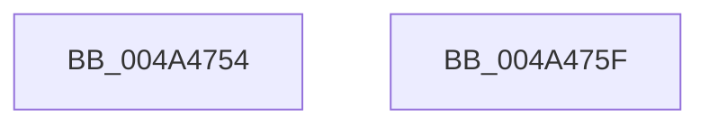

# CmIsStateSeparationEnabled

- RVA: `0x004A4754`–`0x004A4760` (길이 `12` bytes)
- VA: `0x00000001404A4754`
- 실행 섹션: `.text`
- PDB 이름 있음: `예`; PDB Function 태그: `아니요`
- unwind 정보 RVA: `0x000DB714`
- 디코드: `4`개 명령, `12/12` bytes 표시
- 미해석 바이트: `0` (있으면 어셈블리에 `.byte`로 보존)

> 이 문서는 커널 이미지의 기계어와 PDB 기호를 분석해 생성했습니다. 4번과 5번은 함수 원형과 자료형을 바이너리 사용 방식에서 추정한 C 해석이며 원본 소스 복구 결과는 아닙니다.

## 1. Dependencies

- 직접 호출 지점: **0**; 고유 호출 대상: **0**
- 직접 호출자로 확인된 함수: **13**
- RIP 상대 이미지 참조: **1**

### Outgoing calls
- 직접 디코드된 call 명령이 없습니다.

### Direct callers
- [IopCrashDumpPolicyChangeWnfCallback](../../page/71/IopCrashDumpPolicyChangeWnfCallback_function_00719E40.md) at `0x00719EB4`
- [IopInitializeDumpPolicySettings](../../page/71/IopInitializeDumpPolicySettings_function_0071A444.md) at `0x0071A496`
- [IopInitializeDumpPolicySettings](../../page/71/IopInitializeDumpPolicySettings_function_0071A444.md) at `0x0071A562`
- [PiPnpRtlInit](../../page/73/PiPnpRtlInit_function_007300A4.md) at `0x0073011F`
- [PiDrvDbInit](../../page/74/PiDrvDbInit_function_0074130C.md) at `0x00741359`
- [PiDrvDbInit](../../page/74/PiDrvDbInit_function_0074130C.md) at `0x00741366`
- [PiDrvDbResolveKeyFilePaths](../../page/74/PiDrvDbResolveKeyFilePaths_function_0074326C.md) at `0x0074334F`
- [PiDrvDbResolveNodeFilePaths](../../page/74/PiDrvDbResolveNodeFilePaths_function_007433A4.md) at `0x0074342F`
- [PiDrvDbSetupNodeHive](../../page/74/PiDrvDbSetupNodeHive_function_00743884.md) at `0x00743A1F`
- [KIsSideloadingEnabled](../../page/7D/KIsSideloadingEnabled_function_007D9DD8.md) at `0x007D9E51`
- [PiDevCfgEnumDeviceKeys](../../page/96/PiDevCfgEnumDeviceKeys_function_00964EE8.md) at `0x009650E3`
- [PiCMEnumerateSubKeys](../../page/99/PiCMEnumerateSubKeys_function_009926E8.md) at `0x0099289B`
- [RtlIsStateSeparationEnabled](../../page/A3/RtlIsStateSeparationEnabled_function_00A3C560.md) at `0x00A3C564`
- [PopBcdSetDefaultResumeObjectElements](../../page/A3/PopBcdSetDefaultResumeObjectElements_function_00A3C7F8.md) at `0x00A3C9BB`
- [KIsUnlockSettingEnabled](../../page/A6/KIsUnlockSettingEnabled_function_00A68F54.md) at `0x00A69076`
- [KIsUnlockSettingEnabled](../../page/A6/KIsUnlockSettingEnabled_function_00A68F54.md) at `0x00A690A2`

### Static image references
- `0x004A4754` → RVA `0x00EEFB6C` (`.data`; read)

## 2. Other-region calls and transfers

- 다른 실행 섹션으로 향하는 call: **0**
- 별도 외부 분기/꼬리 이동을 확인하지 못했습니다.

## 3. Assembly (complete function range)

```asm
004A4754  83 3D 11 B4 A4 00 00            cmp dword ptr [rip + 0xa4b411], 0
004A475B  0F 95 C0                        setne al
004A475E  C3                              ret
004A475F  CC                              int3
```

## 4. C-style interpretation (structured pseudocode)

```c
__int64 __fastcall CmIsStateSeparationEnabled(void)
{
    __int64 result;

    result = ((*(unsigned int *)(v_rip + 10794001)) != 0) ? 1 : 0;
    return result;
}
```

## 5. (Beta) C Style

```c
void CmIsStateSeparationEnabled(void)
{
    int64_t result;

    result = ((*(uint32_t *)(v_rip + 0xA4B411)) != 0) ? 1 : 0;
    return result;
}
```

## 6. Execution-region graph

[열기: 2D/3D 그래프와 함수 탐색 컨트롤 패널](../../../control-panel.html?section=text&rva=0x004A4754&view=graph)

- 2D 그래프는 위에서 아래로 흐르고, 3D 그래프는 빈 공간을 드래그해 회전합니다. Shift+드래그는 이동, 휠은 확대·축소, 함수 노드 선택은 대상 보고서 이동입니다.

### Static fallback


