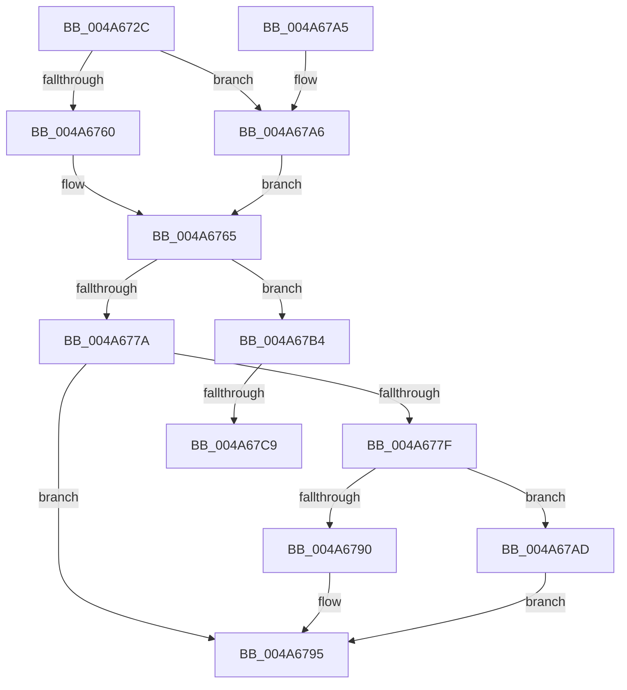

# CmpDereferenceSecurityNode

- RVA: `0x004A672C`–`0x004A67D4` (길이 `168` bytes)
- VA: `0x00000001404A672C`
- 실행 섹션: `.text`
- PDB 이름 있음: `예`; PDB Function 태그: `예`
- unwind 정보 RVA: `0x000B6E10`
- 디코드: `46`개 명령, `168/168` bytes 표시
- 미해석 바이트: `0` (있으면 어셈블리에 `.byte`로 보존)

> 이 문서는 커널 이미지의 기계어와 PDB 기호를 분석해 생성했습니다. 4번과 5번은 함수 원형과 자료형을 바이너리 사용 방식에서 추정한 C 해석이며 원본 소스 복구 결과는 아닙니다.

## 1. Dependencies

- 직접 호출 지점: **7**; 고유 호출 대상: **6**
- 직접 호출자로 확인된 함수: **8**
- RIP 상대 이미지 참조: **0**

### Outgoing calls
- `0x004A674A` → [HvpGetCellContextInitialize](../../page/85/HvpGetCellContextInitialize_function_00855F10.md) (function, `0x00855F10`)
- `0x004A6760` → [HvpGetCellFlat](../../page/85/HvpGetCellFlat_function_00854C60.md) (function, `0x00854C60`)
- `0x004A6771` → [CmpKeySecurityDecrementReferenceCount](CmpKeySecurityDecrementReferenceCount_function_004A67DC.md) (function, `0x004A67DC`)
- `0x004A6790` → [HvpReleaseCellPaged](../../page/85/HvpReleaseCellPaged_function_00855F40.md) (function, `0x00855F40`)
- `0x004A67A6` → [HvpGetCellPaged](../../page/85/HvpGetCellPaged_function_00854CB0.md) (function, `0x00854CB0`)
- `0x004A67AD` → [HvpReleaseCellFlat](../../page/85/HvpReleaseCellFlat_function_0085CC20.md) (function, `0x0085CC20`)
- `0x004A67C9` → [HvpReleaseCellFlat](../../page/85/HvpReleaseCellFlat_function_0085CC20.md) (function, `0x0085CC20`)

### Direct callers
- [CmRenameKey](../../page/7E/CmRenameKey_function_007E8F48.md) at `0x007EA0B8`
- [CmpCopySaclToVirtualKey](../../page/7E/CmpCopySaclToVirtualKey_function_007ECA6C.md) at `0x007ECD86`
- [CmpSyncKeyValues](../../page/7F/CmpSyncKeyValues_function_007F2DF4.md) at `0x007F3096`
- [CmpFreeSecurityDescriptor](../../page/84/CmpFreeSecurityDescriptor_function_00849E44.md) at `0x00849E85`
- [CmpTransMgrFreeVolatileData](../../page/87/CmpTransMgrFreeVolatileData_function_00874BDC.md) at `0x00874D19`
- [CmpUndoDeleteKeyForTrans](../../page/94/CmpUndoDeleteKeyForTrans_function_0094A728.md) at `0x0094ABE1`
- [CmpLightWeightCleanupSetSecDescUoW](../../page/94/CmpLightWeightCleanupSetSecDescUoW_function_0094B374.md) at `0x0094B39C`
- [CmpLightWeightCommitSetSecDescUoW](../../page/94/CmpLightWeightCommitSetSecDescUoW_function_0094B4AC.md) at `0x0094B512`

### Static image references
- 디코드된 RIP-relative 메모리 참조가 없습니다.

## 2. Other-region calls and transfers

- 다른 실행 섹션으로 향하는 call: **6**
  - `0x004A674A` → [HvpGetCellContextInitialize](../../page/85/HvpGetCellContextInitialize_function_00855F10.md) (`.text` → `PAGE`)
  - `0x004A6760` → [HvpGetCellFlat](../../page/85/HvpGetCellFlat_function_00854C60.md) (`.text` → `PAGE`)
  - `0x004A6790` → [HvpReleaseCellPaged](../../page/85/HvpReleaseCellPaged_function_00855F40.md) (`.text` → `PAGE`)
  - `0x004A67A6` → [HvpGetCellPaged](../../page/85/HvpGetCellPaged_function_00854CB0.md) (`.text` → `PAGE`)
  - `0x004A67AD` → [HvpReleaseCellFlat](../../page/85/HvpReleaseCellFlat_function_0085CC20.md) (`.text` → `PAGE`)
  - `0x004A67C9` → [HvpReleaseCellFlat](../../page/85/HvpReleaseCellFlat_function_0085CC20.md) (`.text` → `PAGE`)
- call이 아닌 외부 분기/꼬리 이동: **2**
  - `0x004A67C3` → [sub_006F98D4](../6F/Unknown_function_006F98D4.md) (`tail-transfer`)
  - `0x004A67CF` → [sub_006F98D4 + 0x5](../6F/Unknown_function_006F98D4.md) (`tail-transfer`)

## 3. Assembly (complete function range)

```asm
004A672C  48 8B C4                        mov rax, rsp
004A672F  48 89 58 10                     mov qword ptr [rax + 0x10], rbx
004A6733  48 89 70 18                     mov qword ptr [rax + 0x18], rsi
004A6737  57                              push rdi
004A6738  48 83 EC 20                     sub rsp, 0x20
004A673C  48 83 60 08 00                  and qword ptr [rax + 8], 0
004A6741  48 8B D9                        mov rbx, rcx
004A6744  48 8D 48 08                     lea rcx, [rax + 8]
004A6748  8B FA                           mov edi, edx
004A674A  E8 C1 F7 3A 00                  call 0x140855f10
004A674F  F6 83 8C 00 00 00 01            test byte ptr [rbx + 0x8c], 1
004A6756  4C 8D 44 24 30                  lea r8, [rsp + 0x30]
004A675B  48 8B CB                        mov rcx, rbx
004A675E  74 46                           je 0x1404a67a6
004A6760  E8 FB E4 3A 00                  call 0x140854c60
004A6765  44 8B C7                        mov r8d, edi
004A6768  48 8B D3                        mov rdx, rbx
004A676B  48 8B C8                        mov rcx, rax
004A676E  48 8B F0                        mov rsi, rax
004A6771  E8 66 00 00 00                  call 0x1404a67dc
004A6776  84 C0                           test al, al
004A6778  75 3A                           jne 0x1404a67b4
004A677A  48 85 F6                        test rsi, rsi
004A677D  74 16                           je 0x1404a6795
004A677F  F6 83 8C 00 00 00 01            test byte ptr [rbx + 0x8c], 1
004A6786  48 8D 54 24 30                  lea rdx, [rsp + 0x30]
004A678B  48 8B CB                        mov rcx, rbx
004A678E  75 1D                           jne 0x1404a67ad
004A6790  E8 AB F7 3A 00                  call 0x140855f40
004A6795  48 8B 5C 24 38                  mov rbx, qword ptr [rsp + 0x38]
004A679A  48 8B 74 24 40                  mov rsi, qword ptr [rsp + 0x40]
004A679F  48 83 C4 20                     add rsp, 0x20
004A67A3  5F                              pop rdi
004A67A4  C3                              ret
004A67A5  CC                              int3
004A67A6  E8 05 E5 3A 00                  call 0x140854cb0
004A67AB  EB B8                           jmp 0x1404a6765
004A67AD  E8 6E 64 3B 00                  call 0x14085cc20
004A67B2  EB E1                           jmp 0x1404a6795
004A67B4  F6 83 8C 00 00 00 01            test byte ptr [rbx + 0x8c], 1
004A67BB  48 8D 54 24 30                  lea rdx, [rsp + 0x30]
004A67C0  48 8B CB                        mov rcx, rbx
004A67C3  0F 84 0B 31 25 00               je 0x1406f98d4
004A67C9  E8 52 64 3B 00                  call 0x14085cc20
004A67CE  90                              nop
004A67CF  E9 05 31 25 00                  jmp 0x1406f98d9
```

## 4. C-style interpretation (structured pseudocode)

```c
__int64 __fastcall CmpDereferenceSecurityNode(__int64 a1, int a2)
{
    __int64 result;
    __int64 v_rsp;
    unsigned __int64 v_stack_p10;
    unsigned __int64 v_stack_p18;
    unsigned __int64 v_stack_p30;
    unsigned __int64 v_stack_p8;

    *(unsigned __int64 *)(v_rsp + 16) = v_rbx;
    *(unsigned __int64 *)(v_rsp + 24) = v_rsi;
    v_rsp = (v_rsp) - (32);
    result = HvpGetCellContextInitialize(v_rsp + 8, a2, a3, a4);
    if (((*(unsigned __int8 *)(a1 + 140)) & (1)) == 0) goto loc_004A67A6;
    result = HvpGetCellFlat(a1, a2, v_stack_p8, a4);
loc_004A6765:
    result = CmpKeySecurityDecrementReferenceCount(result, a1, (unsigned int)((unsigned int)((unsigned int)(a2))), a4);
    if ((unsigned __int8)(result) != 0) goto loc_004A67B4;
    if (result == 0) goto loc_004A6795;
    if (((*(unsigned __int8 *)(a1 + 140)) & (1)) != 0) goto loc_004A67AD;
    result = HvpReleaseCellPaged(a1, v_stack_p8, (unsigned int)((unsigned int)((unsigned int)(a2))), a4);
loc_004A6795:
    v_rsp = (v_rsp) + (32);
    return result;
loc_004A67A6:
    result = HvpGetCellPaged(a1, v_stack_p8, (unsigned int)((unsigned int)((unsigned int)(a2))), a4);
    goto loc_004A6765;
loc_004A67AD:
    result = HvpReleaseCellFlat(a1, v_stack_p8, (unsigned int)((unsigned int)((unsigned int)(a2))), a4);
    goto loc_004A6795;
loc_004A67B4:
    result = HvpReleaseCellFlat(v_stack_p10, v_stack_p30, (unsigned int)((unsigned int)((unsigned int)(a2))), a4);
}
```

## 5. (Beta) C Style

```c
int64_t CmpDereferenceSecurityNode(void *Arg1, int32_t Arg2)
{
    uint8_t *arg1 = (uint8_t *)Arg1;

    int64_t result;
    int64_t local_rsp;
    uint64_t v_stack_p10;
    uint64_t v_stack_p18;
    uint64_t v_stack_p30;
    uint64_t v_stack_p8;

    *(uint64_t *)(local_rsp + 0x10) = local_rbx;
    *(uint64_t *)(local_rsp + 0x18) = local_rsi;
    local_rsp = (local_rsp) - (32);
    result = HvpGetCellContextInitialize(local_rsp + 8, Arg2, a3, a4);
    if (((*(uint8_t *)(arg1 + 0x8C)) & (1)) == 0) goto loc_004A67A6;
    result = HvpGetCellFlat(Arg1, Arg2, v_stack_p8, a4);
loc_004A6765:
    result = CmpKeySecurityDecrementReferenceCount(result, Arg1, (uint32_t)((uint32_t)((uint32_t)(Arg2))), a4);
    if ((uint8_t)(result) != 0) goto loc_004A67B4;
    if (result == 0) goto loc_004A6795;
    if (((*(uint8_t *)(arg1 + 0x8C)) & (1)) != 0) goto loc_004A67AD;
    result = HvpReleaseCellPaged(Arg1, v_stack_p8, (uint32_t)((uint32_t)((uint32_t)(Arg2))), a4);
loc_004A6795:
    local_rsp = (local_rsp) + (32);
    return result;
loc_004A67A6:
    result = HvpGetCellPaged(Arg1, v_stack_p8, (uint32_t)((uint32_t)((uint32_t)(Arg2))), a4);
    goto loc_004A6765;
loc_004A67AD:
    result = HvpReleaseCellFlat(Arg1, v_stack_p8, (uint32_t)((uint32_t)((uint32_t)(Arg2))), a4);
    goto loc_004A6795;
loc_004A67B4:
    result = HvpReleaseCellFlat(v_stack_p10, v_stack_p30, (uint32_t)((uint32_t)((uint32_t)(Arg2))), a4);
}
```

### 관측된 메모리 오프셋

구조체 형식이 확인되지 않은 접근은 인자 기준의 오프셋으로만 기록했습니다.

| 기준 인자 | 오프셋 표현 | 폭 (bit) | 접근 |
|---|---:|---:|---|
| `Arg1` | `+ 0x8C` | `8` | `R` |

## 6. Execution-region graph

[열기: 2D/3D 그래프와 함수 탐색 컨트롤 패널](../../../control-panel.html?section=text&rva=0x004A672C&view=graph)

- 2D 그래프는 위에서 아래로 흐르고, 3D 그래프는 빈 공간을 드래그해 회전합니다. Shift+드래그는 이동, 휠은 확대·축소, 함수 노드 선택은 대상 보고서 이동입니다.

### Static fallback


