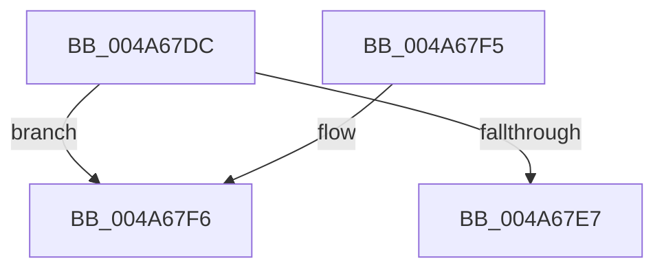

# CmpKeySecurityDecrementReferenceCount

- RVA: `0x004A67DC`–`0x004A6813` (길이 `55` bytes)
- VA: `0x00000001404A67DC`
- 실행 섹션: `.text`
- PDB 이름 있음: `예`; PDB Function 태그: `아니요`
- unwind 정보 RVA: `0x000A82A0`
- 디코드: `18`개 명령, `55/55` bytes 표시
- 미해석 바이트: `0` (있으면 어셈블리에 `.byte`로 보존)

> 이 문서는 커널 이미지의 기계어와 PDB 기호를 분석해 생성했습니다. 4번과 5번은 함수 원형과 자료형을 바이너리 사용 방식에서 추정한 C 해석이며 원본 소스 복구 결과는 아닙니다.

## 1. Dependencies

- 직접 호출 지점: **1**; 고유 호출 대상: **1**
- 직접 호출자로 확인된 함수: **3**
- RIP 상대 이미지 참조: **0**

### Outgoing calls
- `0x004A680D` → [KeBugCheckEx](../4F/KeBugCheckEx_function_004FD660.md) (function, `0x004FD660`)

### Direct callers
- [CmpDereferenceSecurityNode](CmpDereferenceSecurityNode_function_004A672C.md) at `0x004A6771`
- [CmpSetSecurityDescriptorInfo](../../page/94/CmpSetSecurityDescriptorInfo_function_00949688.md) at `0x00949A69`
- [CmpSetSecurityDescriptorInfo](../../page/94/CmpSetSecurityDescriptorInfo_function_00949688.md) at `0x00949C21`
- [sub_00B25C42](../../page/B2/Unknown_function_00B25C42.md) at `0x00B25CBD`

### Static image references
- 디코드된 RIP-relative 메모리 참조가 없습니다.

## 2. Other-region calls and transfers

- 다른 실행 섹션으로 향하는 call: **0**
- 별도 외부 분기/꼬리 이동을 확인하지 못했습니다.

## 3. Assembly (complete function range)

```asm
004A67DC  48 83 EC 38                     sub rsp, 0x38
004A67E0  8B 41 0C                        mov eax, dword ptr [rcx + 0xc]
004A67E3  85 C0                           test eax, eax
004A67E5  74 0F                           je 0x1404a67f6
004A67E7  83 E8 01                        sub eax, 1
004A67EA  89 41 0C                        mov dword ptr [rcx + 0xc], eax
004A67ED  0F 94 C0                        sete al
004A67F0  48 83 C4 38                     add rsp, 0x38
004A67F4  C3                              ret
004A67F5  CC                              int3
004A67F6  41 8B C0                        mov eax, r8d
004A67F9  4C 8B CA                        mov r9, rdx
004A67FC  BA 04 00 00 00                  mov edx, 4
004A6801  48 89 44 24 20                  mov qword ptr [rsp + 0x20], rax
004A6806  8D 4A 4D                        lea ecx, [rdx + 0x4d]
004A6809  44 8D 42 03                     lea r8d, [rdx + 3]
004A680D  E8 4E 6E 05 00                  call 0x1404fd660
004A6812  CC                              int3
```

## 4. C-style interpretation (structured pseudocode)

```c
__int64 __fastcall CmpKeySecurityDecrementReferenceCount(__int64 a1, __int64 a2, int a3)
{
    __int64 result;
    __int64 v_rsp;
    unsigned __int64 v_stack_p20;

    v_rsp = (v_rsp) - (56);
    if ((unsigned int)((unsigned int)(*(unsigned int *)(a1 + 12))) == 0) goto loc_004A67F6;
    result = (unsigned int)(((unsigned int)(*(unsigned int *)(a1 + 12))) - (1));
    *(unsigned int *)(a1 + 12) = (unsigned int)(result);
    result = (condition_is_equal) ? 1 : 0;
    v_rsp = (v_rsp) + (56);
    return result;
loc_004A67F6:
    v_stack_p20 = (unsigned int)(a3);
    result = KeBugCheckEx(4 + 77, 4, 4 + 3, a2);
    return result;
}
```

## 5. (Beta) C Style

```c
int64_t CmpKeySecurityDecrementReferenceCount(void *Arg1, int64_t Arg2, int32_t Arg3)
{
    uint8_t *arg1 = (uint8_t *)Arg1;

    int64_t result;
    int64_t local_rsp;
    uint64_t v_stack_p20;

    local_rsp = (local_rsp) - (56);
    if ((uint32_t)((uint32_t)(*(uint32_t *)(arg1 + 0xC))) == 0) goto loc_004A67F6;
    result = (uint32_t)(((uint32_t)(*(uint32_t *)(arg1 + 0xC))) - (1));
    *(uint32_t *)(arg1 + 0xC) = (uint32_t)(result);
    result = (condition_is_equal) ? 1 : 0;
    local_rsp = (local_rsp) + (56);
    return result;
loc_004A67F6:
    v_stack_p20 = (uint32_t)(Arg3);
    result = KeBugCheckEx(4 + 77, 4, 4 + 3, Arg2);
    return result;
}
```

### 관측된 메모리 오프셋

구조체 형식이 확인되지 않은 접근은 인자 기준의 오프셋으로만 기록했습니다.

| 기준 인자 | 오프셋 표현 | 폭 (bit) | 접근 |
|---|---:|---:|---|
| `Arg1` | `+ 0xC` | `32` | `R` |
| `Arg1` | `+ 0xC` | `32` | `W` |

## 6. Execution-region graph

[열기: 2D/3D 그래프와 함수 탐색 컨트롤 패널](../../../control-panel.html?section=text&rva=0x004A67DC&view=graph)

- 2D 그래프는 위에서 아래로 흐르고, 3D 그래프는 빈 공간을 드래그해 회전합니다. Shift+드래그는 이동, 휠은 확대·축소, 함수 노드 선택은 대상 보고서 이동입니다.

### Static fallback


