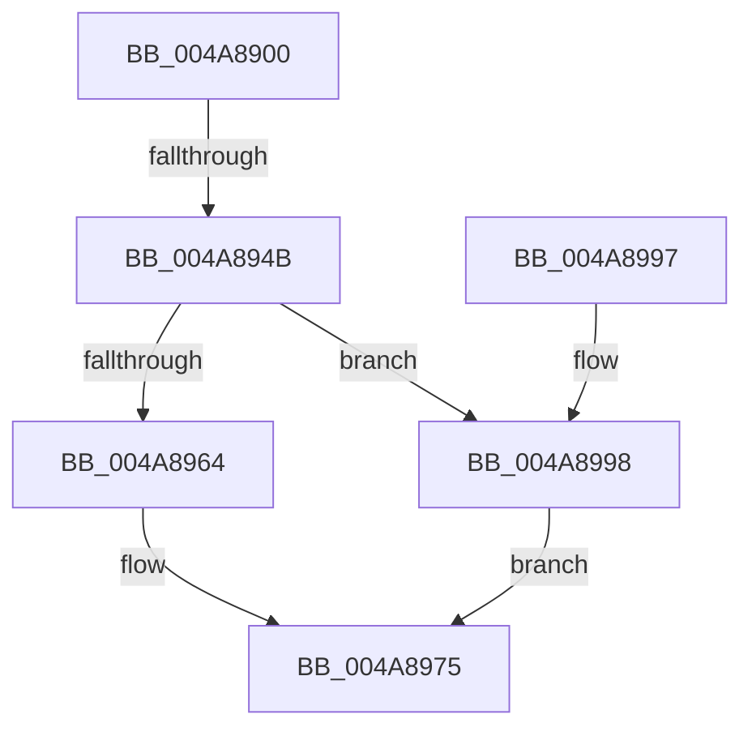

# CmpLazyFlushDpcRoutine

- RVA: `0x004A8900`–`0x004A89A2` (길이 `162` bytes)
- VA: `0x00000001404A8900`
- 실행 섹션: `.text`
- PDB 이름 있음: `예`; PDB Function 태그: `예`
- unwind 정보 RVA: `0x000B7758`
- 디코드: `42`개 명령, `162/162` bytes 표시
- 미해석 바이트: `0` (있으면 어셈블리에 `.byte`로 보존)

> 이 문서는 커널 이미지의 기계어와 PDB 기호를 분석해 생성했습니다. 4번과 5번은 함수 원형과 자료형을 바이너리 사용 방식에서 추정한 C 해석이며 원본 소스 복구 결과는 아닙니다.

## 1. Dependencies

- 직접 호출 지점: **4**; 고유 호출 대상: **4**
- 직접 호출자로 확인된 함수: **0**
- RIP 상대 이미지 참조: **1**

### Outgoing calls
- `0x004A8932` → [memset](../6C/memset_function_006C6C40.md) (function, `0x006C6C40`)
- `0x004A8955` → [KeAcquireSpinLockAtDpcLevel](../20/KeAcquireSpinLockAtDpcLevel_function_00208430.md) (function, `0x00208430`)
- `0x004A8970` → [KeSetEvent](../33/KeSetEvent_function_0033F310.md) (function, `0x0033F310`)
- `0x004A8978` → [KxReleaseSpinLock](../20/KxReleaseSpinLock_function_00206670.md) (function, `0x00206670`)

### Direct callers
- 이 함수 시작 RVA로 연결되는 직접 call은 확인되지 않았습니다. 간접 호출은 완전히 역산할 수 없습니다.

### Static image references
- `0x004A895A` → RVA `0x00E0ECC0` (`.data`; read)

## 2. Other-region calls and transfers

- 다른 실행 섹션으로 향하는 call: **0**
- call이 아닌 외부 분기/꼬리 이동: **1**
  - `0x004A8945` → [sub_006F9CF2](../6F/Unknown_function_006F9CF2.md) (`tail-transfer`)

## 3. Assembly (complete function range)

```asm
004A8900  48 8B C4                        mov rax, rsp
004A8903  48 89 58 08                     mov qword ptr [rax + 8], rbx
004A8907  48 89 70 18                     mov qword ptr [rax + 0x18], rsi
004A890B  48 89 78 20                     mov qword ptr [rax + 0x20], rdi
004A890F  48 89 50 10                     mov qword ptr [rax + 0x10], rdx
004A8913  41 56                           push r14
004A8915  48 81 EC 80 01 00 00            sub rsp, 0x180
004A891C  4D 8B F1                        mov r14, r9
004A891F  49 8B F0                        mov rsi, r8
004A8922  48 8B DA                        mov rbx, rdx
004A8925  48 8B F9                        mov rdi, rcx
004A8928  33 D2                           xor edx, edx
004A892A  44 8D 42 5E                     lea r8d, [rdx + 0x5e]
004A892E  48 8D 48 98                     lea rcx, [rax - 0x68]
004A8932  E8 09 E3 21 00                  call 0x1406c6c40
004A8937  48 8B C3                        mov rax, rbx
004A893A  48 C1 F8 2F                     sar rax, 0x2f
004A893E  48 FF C0                        inc rax
004A8941  48 83 F8 01                     cmp rax, 1
004A8945  0F 87 A7 13 25 00               ja 0x1406f9cf2
004A894B  48 8D BB 98 00 00 00            lea rdi, [rbx + 0x98]
004A8952  48 8B CF                        mov rcx, rdi
004A8955  E8 D6 FA D5 FF                  call 0x140208430
004A895A  8B 05 60 63 96 00               mov eax, dword ptr [rip + 0x966360]
004A8960  85 C0                           test eax, eax
004A8962  75 34                           jne 0x1404a8998
004A8964  48 8D 8B 80 00 00 00            lea rcx, [rbx + 0x80]
004A896B  45 33 C0                        xor r8d, r8d
004A896E  33 D2                           xor edx, edx
004A8970  E8 9B 69 E9 FF                  call 0x14033f310
004A8975  48 8B CF                        mov rcx, rdi
004A8978  E8 F3 DC D5 FF                  call 0x140206670
004A897D  4C 8D 9C 24 80 01 00 00         lea r11, [rsp + 0x180]
004A8985  49 8B 5B 10                     mov rbx, qword ptr [r11 + 0x10]
004A8989  49 8B 73 20                     mov rsi, qword ptr [r11 + 0x20]
004A898D  49 8B 7B 28                     mov rdi, qword ptr [r11 + 0x28]
004A8991  49 8B E3                        mov rsp, r11
004A8994  41 5E                           pop r14
004A8996  C3                              ret
004A8997  CC                              int3
004A8998  48 83 A3 A8 00 00 00 00         and qword ptr [rbx + 0xa8], 0
004A89A0  EB D3                           jmp 0x1404a8975
```

## 4. C-style interpretation (structured pseudocode)

```c
__int64 __fastcall CmpLazyFlushDpcRoutine(__int64 a1, __int64 a2, __int64 a3, __int64 a4)
{
    __int64 result;
    __int64 v_rsp;
    unsigned __int64 v_stack_m8;

    *(unsigned __int64 *)(v_rsp + 8) = v_rbx;
    *(unsigned __int64 *)(v_rsp + 24) = v_rsi;
    *(unsigned __int64 *)(v_rsp + 32) = v_rdi;
    *(unsigned __int64 *)(v_rsp + 16) = a2;
    v_rsp = (v_rsp) - (384);
    a2 = 0;
    result = memset(v_rsp - 104, a2, a2 + 94, a4);
    result = (0) >> (47);
    result = (result) + 1;
    result = KeAcquireSpinLockAtDpcLevel(a2 + 152, a2, a2 + 94, a4);
    if ((unsigned int)((unsigned int)(*(unsigned int *)(v_rip + 9855840))) != 0) goto loc_004A8998;
    a3 = 0;
    a2 = 0;
    result = KeSetEvent(a2 + 128, a2, a3, a4);
loc_004A8975:
    result = KxReleaseSpinLock(a2 + 152, a2, a3, a4);
    return result;
loc_004A8998:
    goto loc_004A8975;
}
```

## 5. (Beta) C Style

```c
int64_t CmpLazyFlushDpcRoutine(int64_t Arg1, void *Arg2, int64_t Arg3, int64_t Arg4)
{
    uint8_t *arg2 = (uint8_t *)Arg2;

    int64_t result;
    int64_t local_rsp;
    uint64_t v_stack_m8;

    *(uint64_t *)(local_rsp + 0x8) = local_rbx;
    *(uint64_t *)(local_rsp + 0x18) = local_rsi;
    *(uint64_t *)(local_rsp + 0x20) = local_rdi;
    *(void **)(local_rsp + 0x10) = Arg2;
    local_rsp = (local_rsp) - (384);
    Arg2 = 0;
    result = memset(local_rsp - 104, Arg2, Arg2 + 94, Arg4);
    result = (0) >> (47);
    result = (result) + 1;
    result = KeAcquireSpinLockAtDpcLevel(Arg2 + 152, Arg2, Arg2 + 94, Arg4);
    if ((uint32_t)((uint32_t)(*(uint32_t *)(v_rip + 0x966360))) != 0) goto loc_004A8998;
    Arg3 = 0;
    Arg2 = 0;
    result = KeSetEvent(Arg2 + 128, Arg2, Arg3, Arg4);
loc_004A8975:
    result = KxReleaseSpinLock(Arg2 + 152, Arg2, Arg3, Arg4);
    return result;
loc_004A8998:
    goto loc_004A8975;
}
```

### 관측된 메모리 오프셋

구조체 형식이 확인되지 않은 접근은 인자 기준의 오프셋으로만 기록했습니다.

| 기준 인자 | 오프셋 표현 | 폭 (bit) | 접근 |
|---|---:|---:|---|
| `Arg2` | `+ 0x80` | `64` | `R` |
| `Arg2` | `+ 0x98` | `64` | `R` |
| `Arg2` | `+ 0xA8` | `64` | `R/W` |

## 6. Execution-region graph

[열기: 2D/3D 그래프와 함수 탐색 컨트롤 패널](../../../control-panel.html?section=text&rva=0x004A8900&view=graph)

- 2D 그래프는 위에서 아래로 흐르고, 3D 그래프는 빈 공간을 드래그해 회전합니다. Shift+드래그는 이동, 휠은 확대·축소, 함수 노드 선택은 대상 보고서 이동입니다.

### Static fallback


