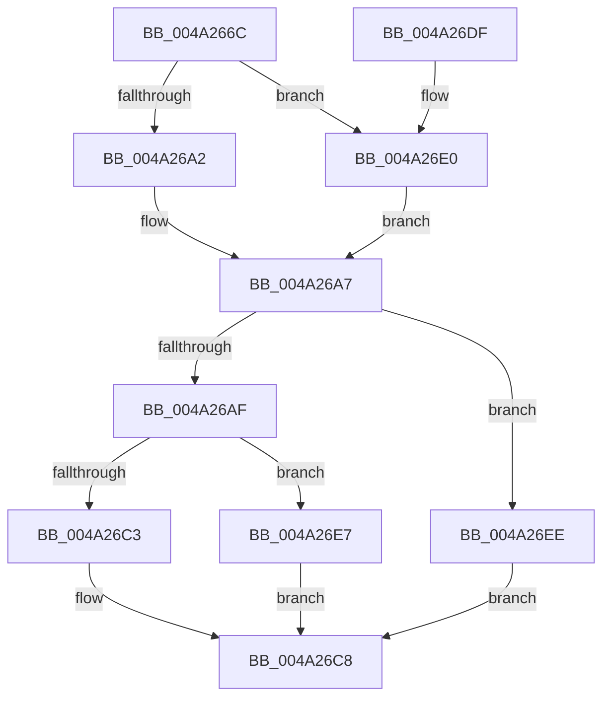

# CmpSwapValueInList

- RVA: `0x004A266C`–`0x004A26F5` (길이 `137` bytes)
- VA: `0x00000001404A266C`
- 실행 섹션: `.text`
- PDB 이름 있음: `예`; PDB Function 태그: `아니요`
- unwind 정보 RVA: `0x0008C6A8`
- 디코드: `40`개 명령, `137/137` bytes 표시
- 미해석 바이트: `0` (있으면 어셈블리에 `.byte`로 보존)

> 이 문서는 커널 이미지의 기계어와 PDB 기호를 분석해 생성했습니다. 4번과 5번은 함수 원형과 자료형을 바이너리 사용 방식에서 추정한 C 해석이며 원본 소스 복구 결과는 아닙니다.

## 1. Dependencies

- 직접 호출 지점: **4**; 고유 호출 대상: **4**
- 직접 호출자로 확인된 함수: **3**
- RIP 상대 이미지 참조: **0**

### Outgoing calls
- `0x004A26A2` → [HvpGetCellFlat](../../page/85/HvpGetCellFlat_function_00854C60.md) (function, `0x00854C60`)
- `0x004A26C3` → [HvpReleaseCellPaged](../../page/85/HvpReleaseCellPaged_function_00855F40.md) (function, `0x00855F40`)
- `0x004A26E0` → [HvpGetCellPaged](../../page/85/HvpGetCellPaged_function_00854CB0.md) (function, `0x00854CB0`)
- `0x004A26E7` → [HvpReleaseCellFlat](../../page/85/HvpReleaseCellFlat_function_0085CC20.md) (function, `0x0085CC20`)

### Direct callers
- [CmSetValueKey](../../page/84/CmSetValueKey_function_008457C0.md) at `0x00846405`
- [CmpLightWeightPrepareSetValueKeyUoW](../../page/A0/CmpLightWeightPrepareSetValueKeyUoW_function_00A0EF28.md) at `0x00A0F267`
- [sub_00B160F4](../../page/B1/Unknown_function_00B160F4.md) at `0x00B162B9`

### Static image references
- 디코드된 RIP-relative 메모리 참조가 없습니다.

## 2. Other-region calls and transfers

- 다른 실행 섹션으로 향하는 call: **4**
  - `0x004A26A2` → [HvpGetCellFlat](../../page/85/HvpGetCellFlat_function_00854C60.md) (`.text` → `PAGE`)
  - `0x004A26C3` → [HvpReleaseCellPaged](../../page/85/HvpReleaseCellPaged_function_00855F40.md) (`.text` → `PAGE`)
  - `0x004A26E0` → [HvpGetCellPaged](../../page/85/HvpGetCellPaged_function_00854CB0.md) (`.text` → `PAGE`)
  - `0x004A26E7` → [HvpReleaseCellFlat](../../page/85/HvpReleaseCellFlat_function_0085CC20.md) (`.text` → `PAGE`)
- 별도 외부 분기/꼬리 이동을 확인하지 못했습니다.

## 3. Assembly (complete function range)

```asm
004A266C  48 8B C4                        mov rax, rsp
004A266F  48 89 58 10                     mov qword ptr [rax + 0x10], rbx
004A2673  48 89 68 18                     mov qword ptr [rax + 0x18], rbp
004A2677  48 89 70 20                     mov qword ptr [rax + 0x20], rsi
004A267B  57                              push rdi
004A267C  48 83 EC 20                     sub rsp, 0x20
004A2680  83 48 08 FF                     or dword ptr [rax + 8], 0xffffffff
004A2684  33 FF                           xor edi, edi
004A2686  F6 81 8C 00 00 00 01            test byte ptr [rcx + 0x8c], 1
004A268D  8B EA                           mov ebp, edx
004A268F  41 8B 51 04                     mov edx, dword ptr [r9 + 4]
004A2693  48 8B D9                        mov rbx, rcx
004A2696  41 8B F0                        mov esi, r8d
004A2699  4C 8D 40 08                     lea r8, [rax + 8]
004A269D  89 78 0C                        mov dword ptr [rax + 0xc], edi
004A26A0  74 3E                           je 0x1404a26e0
004A26A2  E8 B9 25 3B 00                  call 0x140854c60
004A26A7  48 8B C8                        mov rcx, rax
004A26AA  48 85 C0                        test rax, rax
004A26AD  74 3F                           je 0x1404a26ee
004A26AF  89 2C B0                        mov dword ptr [rax + rsi*4], ebp
004A26B2  F6 83 8C 00 00 00 01            test byte ptr [rbx + 0x8c], 1
004A26B9  48 8D 54 24 30                  lea rdx, [rsp + 0x30]
004A26BE  48 8B CB                        mov rcx, rbx
004A26C1  75 24                           jne 0x1404a26e7
004A26C3  E8 78 38 3B 00                  call 0x140855f40
004A26C8  48 8B 5C 24 38                  mov rbx, qword ptr [rsp + 0x38]
004A26CD  8B C7                           mov eax, edi
004A26CF  48 8B 6C 24 40                  mov rbp, qword ptr [rsp + 0x40]
004A26D4  48 8B 74 24 48                  mov rsi, qword ptr [rsp + 0x48]
004A26D9  48 83 C4 20                     add rsp, 0x20
004A26DD  5F                              pop rdi
004A26DE  C3                              ret
004A26DF  CC                              int3
004A26E0  E8 CB 25 3B 00                  call 0x140854cb0
004A26E5  EB C0                           jmp 0x1404a26a7
004A26E7  E8 34 A5 3B 00                  call 0x14085cc20
004A26EC  EB DA                           jmp 0x1404a26c8
004A26EE  BF 9A 00 00 C0                  mov edi, 0xc000009a
004A26F3  EB D3                           jmp 0x1404a26c8
```

## 4. C-style interpretation (structured pseudocode)

```c
__int64 __fastcall CmpSwapValueInList(__int64 a1, int a2, int a3, __int64 a4)
{
    __int64 result;
    __int64 v_rdi;
    __int64 v_rsp;
    unsigned __int64 v_stack_p10;
    unsigned __int64 v_stack_p18;
    unsigned __int64 v_stack_p20;
    unsigned __int64 v_stack_p8;

    *(unsigned __int64 *)(v_rsp + 16) = v_rbx;
    *(unsigned __int64 *)(v_rsp + 24) = v_rbp;
    *(unsigned __int64 *)(v_rsp + 32) = v_rsi;
    v_rsp = (v_rsp) - (32);
    v_rdi = 0;
    *(unsigned int *)(v_rsp + 12) = 0;
    if (((*(unsigned __int8 *)(a1 + 140)) & (1)) == 0) goto loc_004A26E0;
    result = HvpGetCellFlat(a1, (unsigned int)(*(unsigned int *)(a4 + 4)), v_rsp + 8, a4);
loc_004A26A7:
    if (result == 0) goto loc_004A26EE;
    *(unsigned int *)(result + (unsigned int)(a3) * 4) = (unsigned int)((unsigned int)(a2));
    if (((*(unsigned __int8 *)(a1 + 140)) & (1)) != 0) goto loc_004A26E7;
    result = HvpReleaseCellPaged(a1, v_stack_p8, v_rsp + 8, a4);
loc_004A26C8:
    v_rsp = (v_rsp) + (32);
    return 0;
loc_004A26E0:
    result = HvpGetCellPaged(a1, v_stack_p8, v_rsp + 8, a4);
    goto loc_004A26A7;
loc_004A26E7:
    result = HvpReleaseCellFlat(a1, v_stack_p8, v_rsp + 8, a4);
    goto loc_004A26C8;
loc_004A26EE:
    goto loc_004A26C8;
}
```

## 5. (Beta) C Style

```c
int64_t CmpSwapValueInList(void *Arg1, int32_t Arg2, int32_t Arg3, void *Arg4)
{
    uint8_t *arg1 = (uint8_t *)Arg1;
    uint8_t *arg4 = (uint8_t *)Arg4;

    int64_t result;
    int64_t local_rdi;
    int64_t local_rsp;
    uint64_t v_stack_p10;
    uint64_t v_stack_p18;
    uint64_t v_stack_p20;
    uint64_t v_stack_p8;

    *(uint64_t *)(local_rsp + 0x10) = local_rbx;
    *(uint64_t *)(local_rsp + 0x18) = local_rbp;
    *(uint64_t *)(local_rsp + 0x20) = local_rsi;
    local_rsp = (local_rsp) - (32);
    local_rdi = 0;
    *(uint32_t *)(local_rsp + 0xC) = 0;
    if (((*(uint8_t *)(arg1 + 0x8C)) & (1)) == 0) goto loc_004A26E0;
    result = HvpGetCellFlat(Arg1, (uint32_t)(*(uint32_t *)(arg4 + 0x4)), local_rsp + 8, Arg4);
loc_004A26A7:
    if (result == 0) goto loc_004A26EE;
    *(uint32_t *)(result + (uint32_t)(Arg3) * 4) = (uint32_t)((uint32_t)(Arg2));
    if (((*(uint8_t *)(arg1 + 0x8C)) & (1)) != 0) goto loc_004A26E7;
    result = HvpReleaseCellPaged(Arg1, v_stack_p8, local_rsp + 8, Arg4);
loc_004A26C8:
    local_rsp = (local_rsp) + (32);
    return 0;
loc_004A26E0:
    result = HvpGetCellPaged(Arg1, v_stack_p8, local_rsp + 8, Arg4);
    goto loc_004A26A7;
loc_004A26E7:
    result = HvpReleaseCellFlat(Arg1, v_stack_p8, local_rsp + 8, Arg4);
    goto loc_004A26C8;
loc_004A26EE:
    goto loc_004A26C8;
}
```

### 관측된 메모리 오프셋

구조체 형식이 확인되지 않은 접근은 인자 기준의 오프셋으로만 기록했습니다.

| 기준 인자 | 오프셋 표현 | 폭 (bit) | 접근 |
|---|---:|---:|---|
| `Arg1` | `+ 0x8C` | `8` | `R` |
| `Arg4` | `+ 0x4` | `32` | `R` |

## 6. Execution-region graph

[열기: 2D/3D 그래프와 함수 탐색 컨트롤 패널](../../../control-panel.html?section=text&rva=0x004A266C&view=graph)

- 2D 그래프는 위에서 아래로 흐르고, 3D 그래프는 빈 공간을 드래그해 회전합니다. Shift+드래그는 이동, 휠은 확대·축소, 함수 노드 선택은 대상 보고서 이동입니다.

### Static fallback


