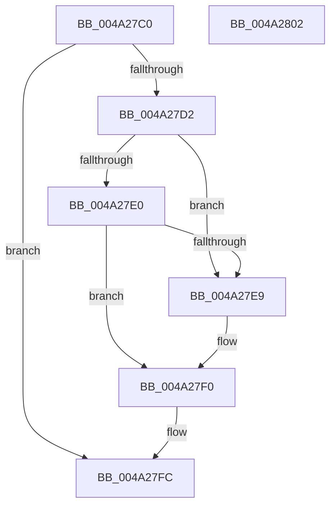

# CmpUnJoinClassOfTrust

- RVA: `0x004A27C0`–`0x004A2803` (길이 `67` bytes)
- VA: `0x00000001404A27C0`
- 실행 섹션: `.text`
- PDB 이름 있음: `예`; PDB Function 태그: `아니요`
- unwind 정보 RVA: `0x0005CF00`
- 디코드: `21`개 명령, `67/67` bytes 표시
- 미해석 바이트: `0` (있으면 어셈블리에 `.byte`로 보존)

> 이 문서는 커널 이미지의 기계어와 PDB 기호를 분석해 생성했습니다. 4번과 5번은 함수 원형과 자료형을 바이너리 사용 방식에서 추정한 C 해석이며 원본 소스 복구 결과는 아닙니다.

## 1. Dependencies

- 직접 호출 지점: **2**; 고유 호출 대상: **2**
- 직접 호출자로 확인된 함수: **4**
- RIP 상대 이미지 참조: **0**

### Outgoing calls
- `0x004A27D2` → [CmpLockHiveListExclusive](../../page/A7/CmpLockHiveListExclusive_function_00A72240.md) (function, `0x00A72240`)
- `0x004A27F7` → [CmpUnlockHiveList](../../page/84/CmpUnlockHiveList_function_0084E424.md) (function, `0x0084E424`)

### Direct callers
- [CmShutdownSystem2](../66/CmShutdownSystem2_function_0066A7FC.md) at `0x0066A86A`
- [CmpDestroyHive](../../page/9B/CmpDestroyHive_function_009B1708.md) at `0x009B1719`
- [CmpCompleteUnloadKey](../../page/9B/CmpCompleteUnloadKey_function_009B32FC.md) at `0x009B3446`
- [sub_00B49062](../../page/B4/Unknown_function_00B49062.md) at `0x00B4917A`

### Static image references
- 디코드된 RIP-relative 메모리 참조가 없습니다.

## 2. Other-region calls and transfers

- 다른 실행 섹션으로 향하는 call: **2**
  - `0x004A27D2` → [CmpLockHiveListExclusive](../../page/A7/CmpLockHiveListExclusive_function_00A72240.md) (`.text` → `PAGE`)
  - `0x004A27F7` → [CmpUnlockHiveList](../../page/84/CmpUnlockHiveList_function_0084E424.md) (`.text` → `PAGE`)
- 별도 외부 분기/꼬리 이동을 확인하지 못했습니다.

## 3. Assembly (complete function range)

```asm
004A27C0  40 53                           push rbx
004A27C2  48 83 EC 20                     sub rsp, 0x20
004A27C6  48 8D 99 18 10 00 00            lea rbx, [rcx + 0x1018]
004A27CD  48 39 1B                        cmp qword ptr [rbx], rbx
004A27D0  74 2A                           je 0x1404a27fc
004A27D2  E8 69 FA 5C 00                  call 0x140a72240
004A27D7  48 8B 0B                        mov rcx, qword ptr [rbx]
004A27DA  48 39 59 08                     cmp qword ptr [rcx + 8], rbx
004A27DE  75 09                           jne 0x1404a27e9
004A27E0  48 8B 43 08                     mov rax, qword ptr [rbx + 8]
004A27E4  48 39 18                        cmp qword ptr [rax], rbx
004A27E7  74 07                           je 0x1404a27f0
004A27E9  B9 03 00 00 00                  mov ecx, 3
004A27EE  CD 29                           int 0x29
004A27F0  48 89 08                        mov qword ptr [rax], rcx
004A27F3  48 89 41 08                     mov qword ptr [rcx + 8], rax
004A27F7  E8 28 BC 3A 00                  call 0x14084e424
004A27FC  48 83 C4 20                     add rsp, 0x20
004A2800  5B                              pop rbx
004A2801  C3                              ret
004A2802  CC                              int3
```

## 4. C-style interpretation (structured pseudocode)

```c
__int64 __fastcall CmpUnJoinClassOfTrust(__int64 a1)
{
    __int64 result;
    __int64 v_rsp;

    v_rsp = (v_rsp) - (32);
    if ((*(unsigned __int64 *)(a1 + 4120)) == (a1 + 4120)) goto loc_004A27FC;
    result = CmpLockHiveListExclusive(a1, a2, a3, a4);
    if ((*(unsigned __int64 *)(*(unsigned __int64 *)(a1 + 4120) + 8)) != (a1 + 4120)) goto loc_004A27E9;
    if ((*(unsigned __int64 *)(*(unsigned __int64 *)(a1 + 4120 + 8))) != (a1 + 4120)) {
        a1 = 3;
    }
    *(unsigned __int64 *)(*(unsigned __int64 *)(a1 + 4120 + 8)) = a1;
    *(unsigned __int64 *)(a1 + 8) = *(unsigned __int64 *)(a1 + 4120 + 8);
    result = CmpUnlockHiveList(a1, a2, a3, a4);
loc_004A27FC:
    v_rsp = (v_rsp) + (32);
    return result;
}
```

## 5. (Beta) C Style

```c
int64_t CmpUnJoinClassOfTrust(void *Arg1)
{
    uint8_t *arg1 = (uint8_t *)Arg1;

    int64_t result;
    int64_t local_rsp;

    local_rsp = (local_rsp) - (32);
    if ((*(uint64_t *)(arg1 + 0x1018)) == (Arg1 + 4120)) goto loc_004A27FC;
    result = CmpLockHiveListExclusive(Arg1, a2, a3, a4);
    if ((*(uint64_t *)(*(uint64_t *)(arg1 + 0x1018) + 0x8)) != (Arg1 + 4120)) goto loc_004A27E9;
    if ((*(uint64_t *)(*(uint64_t *)(arg1 + 0x1018 + 0x8))) != (Arg1 + 4120)) {
        Arg1 = 3;
    }
    *(void **)(*(uint64_t *)(arg1 + 0x1018 + 0x8)) = Arg1;
    *(uint64_t *)(arg1 + 0x8) = *(uint64_t *)(arg1 + 0x1018 + 0x8);
    result = CmpUnlockHiveList(Arg1, a2, a3, a4);
loc_004A27FC:
    local_rsp = (local_rsp) + (32);
    return result;
}
```

### 관측된 메모리 오프셋

구조체 형식이 확인되지 않은 접근은 인자 기준의 오프셋으로만 기록했습니다.

| 기준 인자 | 오프셋 표현 | 폭 (bit) | 접근 |
|---|---:|---:|---|
| `Arg1` | `+ 0x0` | `64` | `R` |
| `Arg1` | `+ 0x8` | `64` | `R` |
| `Arg1` | `+ 0x1018` | `64` | `R` |

## 6. Execution-region graph

[열기: 2D/3D 그래프와 함수 탐색 컨트롤 패널](../../../control-panel.html?section=text&rva=0x004A27C0&view=graph)

- 2D 그래프는 위에서 아래로 흐르고, 3D 그래프는 빈 공간을 드래그해 회전합니다. Shift+드래그는 이동, 휠은 확대·축소, 함수 노드 선택은 대상 보고서 이동입니다.

### Static fallback


