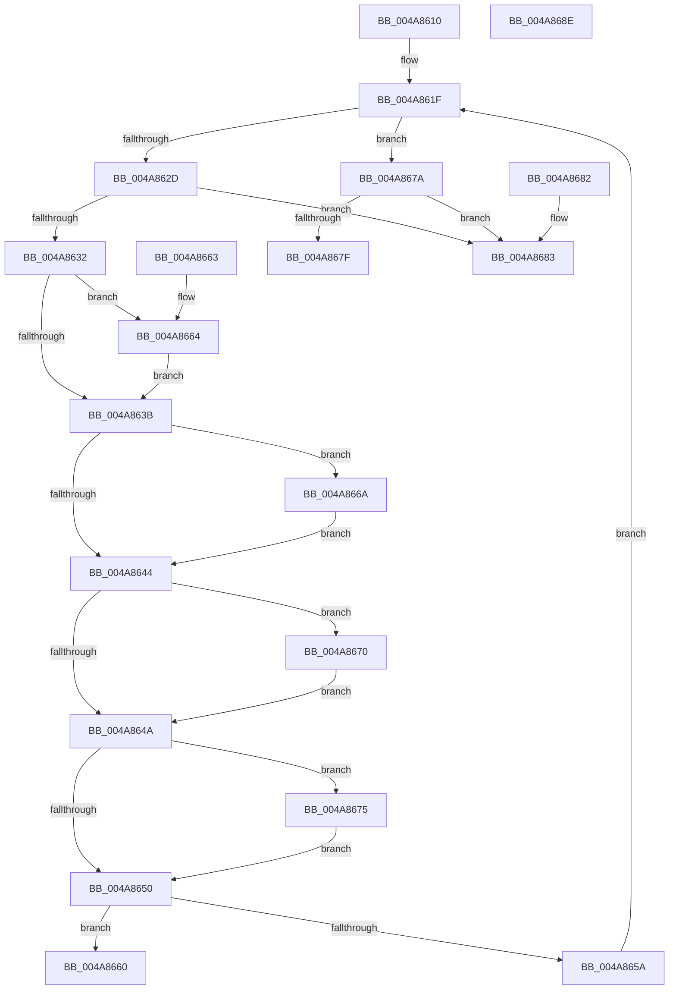

# CompareLangName

- RVA: `0x004A8610`–`0x004A868F` (길이 `127` bytes)
- VA: `0x00000001404A8610`
- 실행 섹션: `.text`
- PDB 이름 있음: `예`; PDB Function 태그: `아니요`
- unwind 정보 RVA: `0x000DB714`
- 디코드: `48`개 명령, `127/127` bytes 표시
- 미해석 바이트: `0` (있으면 어셈블리에 `.byte`로 보존)

> 이 문서는 커널 이미지의 기계어와 PDB 기호를 분석해 생성했습니다. 4번과 5번은 함수 원형과 자료형을 바이너리 사용 방식에서 추정한 C 해석이며 원본 소스 복구 결과는 아닙니다.

## 1. Dependencies

- 직접 호출 지점: **0**; 고유 호출 대상: **0**
- 직접 호출자로 확인된 함수: **0**
- RIP 상대 이미지 참조: **0**

### Outgoing calls
- 직접 디코드된 call 명령이 없습니다.

### Direct callers
- 이 함수 시작 RVA로 연결되는 직접 call은 확인되지 않았습니다. 간접 호출은 완전히 역산할 수 없습니다.

### Static image references
- 디코드된 RIP-relative 메모리 참조가 없습니다.

## 2. Other-region calls and transfers

- 다른 실행 섹션으로 향하는 call: **0**
- 별도 외부 분기/꼬리 이동을 확인하지 못했습니다.

## 3. Assembly (complete function range)

```asm
004A8610  4C 8B 02                        mov r8, qword ptr [rdx]
004A8613  4C 8B C9                        mov r9, rcx
004A8616  4D 2B C8                        sub r9, r8
004A8619  41 BA 2D 00 00 00               mov r10d, 0x2d
004A861F  43 0F B7 0C 01                  movzx ecx, word ptr [r9 + r8]
004A8624  41 0F B7 10                     movzx edx, word ptr [r8]
004A8628  66 85 C9                        test cx, cx
004A862B  74 4D                           je 0x1404a867a
004A862D  66 85 D2                        test dx, dx
004A8630  74 51                           je 0x1404a8683
004A8632  8D 41 BF                        lea eax, [rcx - 0x41]
004A8635  66 83 F8 19                     cmp ax, 0x19
004A8639  76 29                           jbe 0x1404a8664
004A863B  8D 42 BF                        lea eax, [rdx - 0x41]
004A863E  66 83 F8 19                     cmp ax, 0x19
004A8642  76 26                           jbe 0x1404a866a
004A8644  66 83 F9 5F                     cmp cx, 0x5f
004A8648  74 26                           je 0x1404a8670
004A864A  66 83 FA 5F                     cmp dx, 0x5f
004A864E  74 25                           je 0x1404a8675
004A8650  0F B7 C2                        movzx eax, dx
004A8653  0F B7 D1                        movzx edx, cx
004A8656  2B D0                           sub edx, eax
004A8658  75 06                           jne 0x1404a8660
004A865A  49 83 C0 02                     add r8, 2
004A865E  EB BF                           jmp 0x1404a861f
004A8660  8B C2                           mov eax, edx
004A8662  C3                              ret
004A8663  CC                              int3
004A8664  66 83 C9 20                     or cx, 0x20
004A8668  EB D1                           jmp 0x1404a863b
004A866A  66 83 CA 20                     or dx, 0x20
004A866E  EB D4                           jmp 0x1404a8644
004A8670  41 8B CA                        mov ecx, r10d
004A8673  EB D5                           jmp 0x1404a864a
004A8675  41 8B D2                        mov edx, r10d
004A8678  EB D6                           jmp 0x1404a8650
004A867A  66 85 D2                        test dx, dx
004A867D  75 04                           jne 0x1404a8683
004A867F  33 C0                           xor eax, eax
004A8681  C3                              ret
004A8682  CC                              int3
004A8683  66 F7 D9                        neg cx
004A8686  1B C0                           sbb eax, eax
004A8688  83 E0 02                        and eax, 2
004A868B  FF C8                           dec eax
004A868D  C3                              ret
004A868E  CC                              int3
```

## 4. C-style interpretation (structured pseudocode)

```c
__int64 __fastcall CompareLangName(__int64 a1, __int64 a2)
{
    __int64 result;

    a4 = (a1) - (*(unsigned __int64 *)(a2));
loc_004A861F:
    if ((unsigned __int16)(*(unsigned __int16 *)(a4 + *(unsigned __int64 *)(a2) * 1)) == 0) goto loc_004A867A;
    if ((unsigned __int16)(*(unsigned __int16 *)(*(unsigned __int64 *)(a2))) == 0) goto loc_004A8683;
    if (((unsigned __int16)(*(unsigned __int16 *)(a4 + *(unsigned __int64 *)(a2) * 1) - 65)) <= 25) goto loc_004A8664;
loc_004A863B:
    if (((unsigned __int16)(*(unsigned __int16 *)(*(unsigned __int64 *)(a2)) - 65)) <= 25) goto loc_004A866A;
loc_004A8644:
    if (((unsigned __int16)(*(unsigned __int16 *)(a4 + *(unsigned __int64 *)(a2) * 1))) == 95) goto loc_004A8670;
loc_004A864A:
    if (((unsigned __int16)(*(unsigned __int16 *)(*(unsigned __int64 *)(a2)))) == 95) goto loc_004A8675;
loc_004A8650:
    a2 = (unsigned int)(((unsigned __int16)(*(unsigned __int16 *)(a4 + *(unsigned __int64 *)(a2) * 1))) - ((unsigned int)((unsigned __int16)(*(unsigned __int16 *)(*(unsigned __int64 *)(a2))))));
    if (condition_is_not_equal) goto loc_004A8660;
    a3 = (*(unsigned __int64 *)(a2)) + (2);
    goto loc_004A861F;
loc_004A8660:
    return (unsigned int)((unsigned int)(a2));
loc_004A8664:
    a1 = (unsigned __int16)((*(unsigned __int16 *)(a4 + *(unsigned __int64 *)(a2) * 1)) | (32));
    goto loc_004A863B;
loc_004A866A:
    a2 = (unsigned __int16)((a2) | (32));
    goto loc_004A8644;
loc_004A8670:
    goto loc_004A864A;
loc_004A8675:
    goto loc_004A8650;
loc_004A867A:
    if (45 != 0) goto loc_004A8683;
    result = 0;
    return result;
loc_004A8683:
    a1 = (unsigned __int16)(-(45));
    result = (unsigned int)((result) & (2));
    result = (unsigned int)((result) - 1);
    return result;
}
```

## 5. (Beta) C Style

```c
int64_t CompareLangName(void *Arg1, void *Arg2)
{
    uint8_t *arg1 = (uint8_t *)Arg1;
    uint8_t *arg2 = (uint8_t *)Arg2;

    int64_t result;

    a4 = (Arg1) - (*(uint64_t *)(arg2));
loc_004A861F:
    if ((uint16_t)(*(uint16_t *)(a4 + *(uint64_t *)(arg2) * 1)) == 0) goto loc_004A867A;
    if ((uint16_t)(*(uint16_t *)(*(uint64_t *)(arg2))) == 0) goto loc_004A8683;
    if (((uint16_t)(*(uint16_t *)(a4 + *(uint64_t *)(arg2) * 1) - 65)) <= 25) goto loc_004A8664;
loc_004A863B:
    if (((uint16_t)(*(uint16_t *)(*(uint64_t *)(arg2)) - 65)) <= 25) goto loc_004A866A;
loc_004A8644:
    if (((uint16_t)(*(uint16_t *)(a4 + *(uint64_t *)(arg2) * 1))) == 95) goto loc_004A8670;
loc_004A864A:
    if (((uint16_t)(*(uint16_t *)(*(uint64_t *)(arg2)))) == 95) goto loc_004A8675;
loc_004A8650:
    Arg2 = (uint32_t)(((uint16_t)(*(uint16_t *)(a4 + *(uint64_t *)(arg2) * 1))) - ((uint32_t)((uint16_t)(*(uint16_t *)(*(uint64_t *)(arg2))))));
    if (condition_is_not_equal) goto loc_004A8660;
    a3 = (*(uint64_t *)(arg2)) + (2);
    goto loc_004A861F;
loc_004A8660:
    return (uint32_t)((uint32_t)(Arg2));
loc_004A8664:
    Arg1 = (uint16_t)((*(uint16_t *)(a4 + *(uint64_t *)(arg2) * 1)) | (32));
    goto loc_004A863B;
loc_004A866A:
    Arg2 = (uint16_t)((Arg2) | (32));
    goto loc_004A8644;
loc_004A8670:
    goto loc_004A864A;
loc_004A8675:
    goto loc_004A8650;
loc_004A867A:
    if (45 != 0) goto loc_004A8683;
    result = 0;
    return result;
loc_004A8683:
    Arg1 = (uint16_t)(-(45));
    result = (uint32_t)((result) & (2));
    result = (uint32_t)((result) - 1);
    return result;
}
```

### 관측된 메모리 오프셋

구조체 형식이 확인되지 않은 접근은 인자 기준의 오프셋으로만 기록했습니다.

| 기준 인자 | 오프셋 표현 | 폭 (bit) | 접근 |
|---|---:|---:|---|
| `Arg1` | `+ 0x0 + r8*1` | `16` | `R` |
| `Arg2` | `+ 0x0` | `64` | `R` |

## 6. Execution-region graph

[열기: 2D/3D 그래프와 함수 탐색 컨트롤 패널](../../../control-panel.html?section=text&rva=0x004A8610&view=graph)

- 2D 그래프는 위에서 아래로 흐르고, 3D 그래프는 빈 공간을 드래그해 회전합니다. Shift+드래그는 이동, 휠은 확대·축소, 함수 노드 선택은 대상 보고서 이동입니다.

### Static fallback


