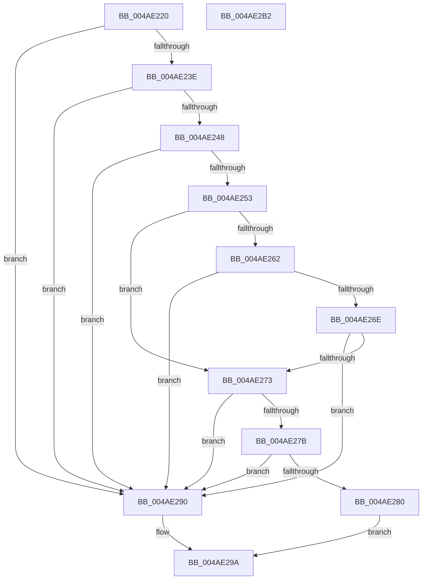

# DbgLoadImageSymbols

- RVA: `0x004AE220`–`0x004AE2B3` (길이 `147` bytes)
- VA: `0x00000001404AE220`
- 실행 섹션: `.text`
- PDB 이름 있음: `예`; PDB Function 태그: `아니요`
- unwind 정보 RVA: `0x00063458`
- 디코드: `41`개 명령, `147/147` bytes 표시
- 미해석 바이트: `0` (있으면 어셈블리에 `.byte`로 보존)

> 이 문서는 커널 이미지의 기계어와 PDB 기호를 분석해 생성했습니다. 4번과 5번은 함수 원형과 자료형을 바이너리 사용 방식에서 추정한 C 해석이며 원본 소스 복구 결과는 아닙니다.

## 1. Dependencies

- 직접 호출 지점: **1**; 고유 호출 대상: **1**
- 직접 호출자로 확인된 함수: **3**
- RIP 상대 이미지 참조: **0**

### Outgoing calls
- `0x004AE2A8` → [DebugService2](../4F/DebugService2_function_004FE530.md) (function, `0x004FE530`)

### Direct callers
- [DbgLoadImageSymbolsUnicode](DbgLoadImageSymbolsUnicode_function_004AE0BC.md) at `0x004AE0EA`
- [KdInitSystem](../../pagekd/B8/KdInitSystem_function_00B85E30.md) at `0x00B864AB`
- [KdInitSystem](../../pagekd/B8/KdInitSystem_function_00B85E30.md) at `0x00B864D9`
- [InitLoadDebuggerSymbols](../../init/C1/InitLoadDebuggerSymbols_function_00C1BEB0.md) at `0x00C1BF41`

### Static image references
- 디코드된 RIP-relative 메모리 참조가 없습니다.

## 2. Other-region calls and transfers

- 다른 실행 섹션으로 향하는 call: **0**
- 별도 외부 분기/꼬리 이동을 확인하지 못했습니다.

## 3. Assembly (complete function range)

```asm
004AE220  48 83 EC 48                     sub rsp, 0x48
004AE224  48 8D 42 FF                     lea rax, [rdx - 1]
004AE228  48 89 54 24 20                  mov qword ptr [rsp + 0x20], rdx
004AE22D  4C 89 44 24 28                  mov qword ptr [rsp + 0x28], r8
004AE232  4C 8B CA                        mov r9, rdx
004AE235  4C 8B D1                        mov r10, rcx
004AE238  48 83 F8 FD                     cmp rax, -3
004AE23C  77 52                           ja 0x1404ae290
004AE23E  B8 4D 5A 00 00                  mov eax, 0x5a4d
004AE243  66 39 02                        cmp word ptr [rdx], ax
004AE246  75 48                           jne 0x1404ae290
004AE248  8B 52 3C                        mov edx, dword ptr [rdx + 0x3c]
004AE24B  49 03 D1                        add rdx, r9
004AE24E  49 3B D1                        cmp rdx, r9
004AE251  72 3D                           jb 0x1404ae290
004AE253  48 B9 FF FF FE FF FF 7F 00 00   movabs rcx, 0x7ffffffeffff
004AE25D  4C 3B C9                        cmp r9, rcx
004AE260  77 11                           ja 0x1404ae273
004AE262  48 8D 82 07 01 00 00            lea rax, [rdx + 0x107]
004AE269  48 3B C2                        cmp rax, rdx
004AE26C  72 22                           jb 0x1404ae290
004AE26E  48 3B C1                        cmp rax, rcx
004AE271  77 1D                           ja 0x1404ae290
004AE273  81 3A 50 45 00 00               cmp dword ptr [rdx], 0x4550
004AE279  75 15                           jne 0x1404ae290
004AE27B  48 85 D2                        test rdx, rdx
004AE27E  74 10                           je 0x1404ae290
004AE280  8B 42 58                        mov eax, dword ptr [rdx + 0x58]
004AE283  89 44 24 30                     mov dword ptr [rsp + 0x30], eax
004AE287  8B 42 50                        mov eax, dword ptr [rdx + 0x50]
004AE28A  89 44 24 34                     mov dword ptr [rsp + 0x34], eax
004AE28E  EB 0A                           jmp 0x1404ae29a
004AE290  83 64 24 34 00                  and dword ptr [rsp + 0x34], 0
004AE295  83 64 24 30 00                  and dword ptr [rsp + 0x30], 0
004AE29A  41 B8 03 00 00 00               mov r8d, 3
004AE2A0  48 8D 54 24 20                  lea rdx, [rsp + 0x20]
004AE2A5  49 8B CA                        mov rcx, r10
004AE2A8  E8 83 02 05 00                  call 0x1404fe530
004AE2AD  48 83 C4 48                     add rsp, 0x48
004AE2B1  C3                              ret
004AE2B2  CC                              int3
```

## 4. C-style interpretation (structured pseudocode)

```c
__int64 __fastcall DbgLoadImageSymbols(__int64 a1, __int64 a2, __int64 a3)
{
    __int64 result;
    __int64 v_rsp;
    unsigned int v_stack_m14;
    unsigned int v_stack_m18;
    unsigned __int64 v_stack_m20;
    unsigned __int64 v_stack_m28;

    v_rsp = (v_rsp) - (72);
    v_stack_m28 = a2;
    v_stack_m20 = a3;
    if ((a2 - 1) > -3) goto loc_004AE290;
    if ((*(unsigned __int16 *)(a2)) != ((unsigned __int16)((unsigned int)(0x5A4DULL)))) goto loc_004AE290;
    a2 = ((unsigned int)(*(unsigned int *)(a2 + 60))) + (a2);
    if (a2 < a2) goto loc_004AE290;
    if (a2 > a1) goto loc_004AE273;
    if ((a2 + 263) < a2) goto loc_004AE290;
    if ((a2 + 263) > a1) goto loc_004AE290;
loc_004AE273:
    if ((*(unsigned int *)(a2)) != 0x4550ULL) goto loc_004AE290;
    if (a2 == 0) goto loc_004AE290;
    v_stack_m18 = (unsigned int)((unsigned int)(*(unsigned int *)(a2 + 88)));
    v_stack_m14 = (unsigned int)((unsigned int)(*(unsigned int *)(a2 + 80)));
    goto loc_004AE29A;
loc_004AE290:
loc_004AE29A:
    result = DebugService2(a1, v_stack_m28, 3, a2);
    v_rsp = (v_rsp) + (72);
    return result;
}
```

## 5. (Beta) C Style

```c
int64_t DbgLoadImageSymbols(int64_t Arg1, void *Arg2, int64_t Arg3)
{
    uint8_t *arg2 = (uint8_t *)Arg2;

    int64_t result;
    int64_t local_rsp;
    uint32_t v_stack_m14;
    uint32_t v_stack_m18;
    uint64_t v_stack_m20;
    uint64_t v_stack_m28;

    local_rsp = (local_rsp) - (72);
    v_stack_m28 = Arg2;
    v_stack_m20 = Arg3;
    if ((Arg2 - 1) > -3) goto loc_004AE290;
    if ((*(uint16_t *)(arg2)) != ((uint16_t)((uint32_t)(0x5A4DULL)))) goto loc_004AE290;
    Arg2 = ((uint32_t)(*(uint32_t *)(arg2 + 0x3C))) + (Arg2);
    if (Arg2 < Arg2) goto loc_004AE290;
    if (Arg2 > Arg1) goto loc_004AE273;
    if ((Arg2 + 263) < Arg2) goto loc_004AE290;
    if ((Arg2 + 263) > Arg1) goto loc_004AE290;
loc_004AE273:
    if ((*(uint32_t *)(arg2)) != 0x4550ULL) goto loc_004AE290;
    if (Arg2 == NULL) goto loc_004AE290;
    v_stack_m18 = (uint32_t)((uint32_t)(*(uint32_t *)(arg2 + 0x58)));
    v_stack_m14 = (uint32_t)((uint32_t)(*(uint32_t *)(arg2 + 0x50)));
    goto loc_004AE29A;
loc_004AE290:
loc_004AE29A:
    result = DebugService2(Arg1, v_stack_m28, 3, Arg2);
    local_rsp = (local_rsp) + (72);
    return result;
}
```

### 관측된 메모리 오프셋

구조체 형식이 확인되지 않은 접근은 인자 기준의 오프셋으로만 기록했습니다.

| 기준 인자 | 오프셋 표현 | 폭 (bit) | 접근 |
|---|---:|---:|---|
| `Arg2` | `- 0x1` | `64` | `R` |
| `Arg2` | `+ 0x0` | `16` | `R` |
| `Arg2` | `+ 0x3C` | `32` | `R` |

## 6. Execution-region graph

[열기: 2D/3D 그래프와 함수 탐색 컨트롤 패널](../../../control-panel.html?section=text&rva=0x004AE220&view=graph)

- 2D 그래프는 위에서 아래로 흐르고, 3D 그래프는 빈 공간을 드래그해 회전합니다. Shift+드래그는 이동, 휠은 확대·축소, 함수 노드 선택은 대상 보고서 이동입니다.

### Static fallback


