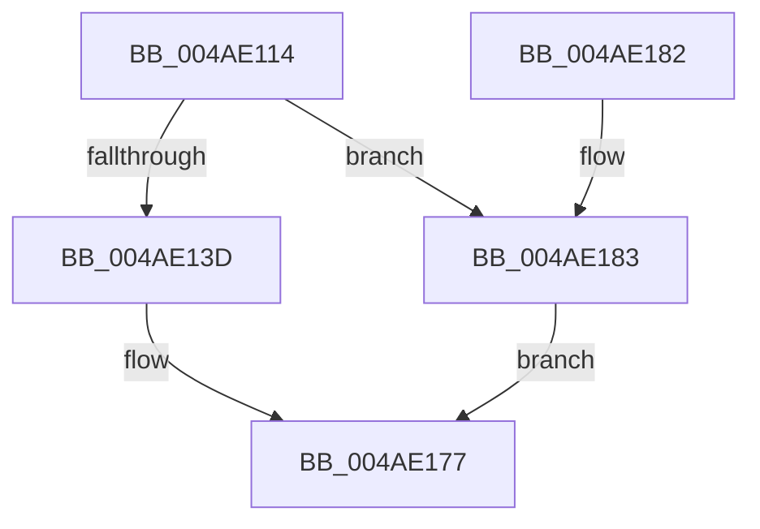

# DbgUnLoadImageSymbolsUnicode

- RVA: `0x004AE114`–`0x004AE187` (길이 `115` bytes)
- VA: `0x00000001404AE114`
- 실행 섹션: `.text`
- PDB 이름 있음: `예`; PDB Function 태그: `아니요`
- unwind 정보 RVA: `0x000B85A0`
- 디코드: `31`개 명령, `115/115` bytes 표시
- 미해석 바이트: `0` (있으면 어셈블리에 `.byte`로 보존)

> 이 문서는 커널 이미지의 기계어와 PDB 기호를 분석해 생성했습니다. 4번과 5번은 함수 원형과 자료형을 바이너리 사용 방식에서 추정한 C 해석이며 원본 소스 복구 결과는 아닙니다.

## 1. Dependencies

- 직접 호출 지점: **3**; 고유 호출 대상: **3**
- 직접 호출자로 확인된 함수: **3**
- RIP 상대 이미지 참조: **0**

### Outgoing calls
- `0x004AE134` → [DbgUnicodeStringToAnsiString](DbgUnicodeStringToAnsiString_function_004AE190.md) (function, `0x004AE190`)
- `0x004AE161` → [DebugService2](../4F/DebugService2_function_004FE530.md) (function, `0x004FE530`)
- `0x004AE16D` → [ExFreePoolWithTag](../../poolcode/B8/ExFreePoolWithTag_function_00B82870.md) (function, `0x00B82870`)

### Direct callers
- [MiSwitchBaseAddress](../../page/98/MiSwitchBaseAddress_function_00988CDC.md) at `0x00988DFB`
- [MiSegmentDelete](../../page/A1/MiSegmentDelete_function_00A1FBB4.md) at `0x00A1FD17`
- [MiUnloadSystemImage](../../page/AA/MiUnloadSystemImage_function_00AA2FD4.md) at `0x00AA31FE`

### Static image references
- 디코드된 RIP-relative 메모리 참조가 없습니다.

## 2. Other-region calls and transfers

- 다른 실행 섹션으로 향하는 call: **1**
  - `0x004AE16D` → [ExFreePoolWithTag](../../poolcode/B8/ExFreePoolWithTag_function_00B82870.md) (`.text` → `POOLCODE`)
- 별도 외부 분기/꼬리 이동을 확인하지 못했습니다.

## 3. Assembly (complete function range)

```asm
004AE114  48 89 5C 24 08                  mov qword ptr [rsp + 8], rbx
004AE119  57                              push rdi
004AE11A  48 83 EC 50                     sub rsp, 0x50
004AE11E  48 8B FA                        mov rdi, rdx
004AE121  0F 57 C0                        xorps xmm0, xmm0
004AE124  48 8B D1                        mov rdx, rcx
004AE127  49 8B D8                        mov rbx, r8
004AE12A  48 8D 4C 24 20                  lea rcx, [rsp + 0x20]
004AE12F  0F 11 44 24 20                  movups xmmword ptr [rsp + 0x20], xmm0
004AE134  E8 57 00 00 00                  call 0x1404ae190
004AE139  85 C0                           test eax, eax
004AE13B  74 46                           je 0x1404ae183
004AE13D  83 64 24 40 00                  and dword ptr [rsp + 0x40], 0
004AE142  48 8D 54 24 30                  lea rdx, [rsp + 0x30]
004AE147  83 64 24 44 00                  and dword ptr [rsp + 0x44], 0
004AE14C  48 8D 4C 24 20                  lea rcx, [rsp + 0x20]
004AE151  41 B8 04 00 00 00               mov r8d, 4
004AE157  48 89 7C 24 30                  mov qword ptr [rsp + 0x30], rdi
004AE15C  48 89 5C 24 38                  mov qword ptr [rsp + 0x38], rbx
004AE161  E8 CA 03 05 00                  call 0x1404fe530
004AE166  48 8B 4C 24 28                  mov rcx, qword ptr [rsp + 0x28]
004AE16B  33 D2                           xor edx, edx
004AE16D  E8 FE 46 6D 00                  call 0x140b82870
004AE172  B8 01 00 00 00                  mov eax, 1
004AE177  48 8B 5C 24 60                  mov rbx, qword ptr [rsp + 0x60]
004AE17C  48 83 C4 50                     add rsp, 0x50
004AE180  5F                              pop rdi
004AE181  C3                              ret
004AE182  CC                              int3
004AE183  33 C0                           xor eax, eax
004AE185  EB F0                           jmp 0x1404ae177
```

## 4. C-style interpretation (structured pseudocode)

```c
__int64 __fastcall DbgUnLoadImageSymbolsUnicode(__int64 a1, __int64 a2, __int64 a3)
{
    __int64 result;
    __int64 v_rsp;
    unsigned int v_stack_m14;
    unsigned int v_stack_m18;
    unsigned __int64 v_stack_m20;
    unsigned __int64 v_stack_m28;
    unsigned __int64 v_stack_m30;
    unsigned __int64 v_stack_m38;
    unsigned __int64 v_stack_p8;

    v_stack_p8 = v_rbx;
    v_rsp = (v_rsp) - (80);
    v_stack_m38 = v_xmm0;
    result = DbgUnicodeStringToAnsiString(v_stack_m38, a1, a3, a4);
    if ((unsigned int)(result) == 0) goto loc_004AE183;
    v_stack_m28 = a2;
    v_stack_m20 = a3;
    result = DebugService2(v_stack_m38, v_stack_m28, 4, a4);
    a2 = 0;
    result = ExFreePoolWithTag(v_stack_m30, a2, 4, a4);
loc_004AE177:
    v_rsp = (v_rsp) + (80);
    return 1;
loc_004AE183:
    result = 0;
    goto loc_004AE177;
}
```

## 5. (Beta) C Style

```c
int64_t DbgUnLoadImageSymbolsUnicode(int64_t Arg1, int64_t Arg2, int64_t Arg3)
{
    int64_t result;
    int64_t local_rsp;
    uint32_t v_stack_m14;
    uint32_t v_stack_m18;
    uint64_t v_stack_m20;
    uint64_t v_stack_m28;
    uint64_t v_stack_m30;
    uint64_t v_stack_m38;
    uint64_t v_stack_p8;

    v_stack_p8 = local_rbx;
    local_rsp = (local_rsp) - (80);
    v_stack_m38 = v_xmm0;
    result = DbgUnicodeStringToAnsiString(v_stack_m38, Arg1, Arg3, a4);
    if ((uint32_t)(result) == 0) goto loc_004AE183;
    v_stack_m28 = Arg2;
    v_stack_m20 = Arg3;
    result = DebugService2(v_stack_m38, v_stack_m28, 4, a4);
    Arg2 = 0;
    result = ExFreePoolWithTag(v_stack_m30, Arg2, 4, a4);
loc_004AE177:
    local_rsp = (local_rsp) + (80);
    return 1;
loc_004AE183:
    result = 0;
    goto loc_004AE177;
}
```

## 6. Execution-region graph

[열기: 2D/3D 그래프와 함수 탐색 컨트롤 패널](../../../control-panel.html?section=text&rva=0x004AE114&view=graph)

- 2D 그래프는 위에서 아래로 흐르고, 3D 그래프는 빈 공간을 드래그해 회전합니다. Shift+드래그는 이동, 휠은 확대·축소, 함수 노드 선택은 대상 보고서 이동입니다.

### Static fallback


