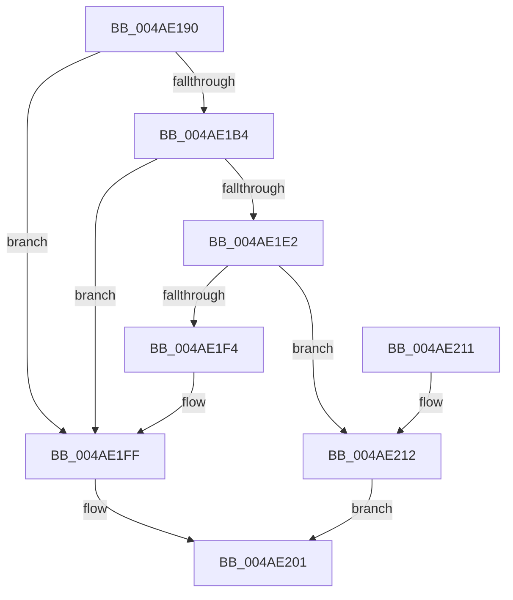

# DbgUnicodeStringToAnsiString

- RVA: `0x004AE190`–`0x004AE216` (길이 `134` bytes)
- VA: `0x00000001404AE190`
- 실행 섹션: `.text`
- PDB 이름 있음: `예`; PDB Function 태그: `아니요`
- unwind 정보 RVA: `0x00088864`
- 디코드: `40`개 명령, `134/134` bytes 표시
- 미해석 바이트: `0` (있으면 어셈블리에 `.byte`로 보존)

> 이 문서는 커널 이미지의 기계어와 PDB 기호를 분석해 생성했습니다. 4번과 5번은 함수 원형과 자료형을 바이너리 사용 방식에서 추정한 C 해석이며 원본 소스 복구 결과는 아닙니다.

## 1. Dependencies

- 직접 호출 지점: **4**; 고유 호출 대상: **4**
- 직접 호출자로 확인된 함수: **3**
- RIP 상대 이미지 참조: **0**

### Outgoing calls
- `0x004AE1A8` → [RtlxUnicodeStringToAnsiSize](../../page/90/RtlxUnicodeStringToAnsiSize_function_0090CE80.md) (function, `0x0090CE80`)
- `0x004AE1D4` → [ExAllocatePool2](../../poolcode/B8/ExAllocatePool2_function_00B820F0.md) (function, `0x00B820F0`)
- `0x004AE1EB` → [RtlUnicodeStringToAnsiString](../../page/90/RtlUnicodeStringToAnsiString_function_0090D1F0.md) (function, `0x0090D1F0`)
- `0x004AE1FA` → [ExFreePoolWithTag](../../poolcode/B8/ExFreePoolWithTag_function_00B82870.md) (function, `0x00B82870`)

### Direct callers
- [DbgLoadImageSymbolsUnicode](DbgLoadImageSymbolsUnicode_function_004AE0BC.md) at `0x004AE0D5`
- [DbgUnLoadImageSymbolsUnicode](DbgUnLoadImageSymbolsUnicode_function_004AE114.md) at `0x004AE134`
- [MiLoadUserSymbols](../../page/AC/MiLoadUserSymbols_function_00AC91D0.md) at `0x00AC9232`

### Static image references
- 디코드된 RIP-relative 메모리 참조가 없습니다.

## 2. Other-region calls and transfers

- 다른 실행 섹션으로 향하는 call: **4**
  - `0x004AE1A8` → [RtlxUnicodeStringToAnsiSize](../../page/90/RtlxUnicodeStringToAnsiSize_function_0090CE80.md) (`.text` → `PAGE`)
  - `0x004AE1D4` → [ExAllocatePool2](../../poolcode/B8/ExAllocatePool2_function_00B820F0.md) (`.text` → `POOLCODE`)
  - `0x004AE1EB` → [RtlUnicodeStringToAnsiString](../../page/90/RtlUnicodeStringToAnsiString_function_0090D1F0.md) (`.text` → `PAGE`)
  - `0x004AE1FA` → [ExFreePoolWithTag](../../poolcode/B8/ExFreePoolWithTag_function_00B82870.md) (`.text` → `POOLCODE`)
- 별도 외부 분기/꼬리 이동을 확인하지 못했습니다.

## 3. Assembly (complete function range)

```asm
004AE190  48 89 5C 24 08                  mov qword ptr [rsp + 8], rbx
004AE195  48 89 74 24 10                  mov qword ptr [rsp + 0x10], rsi
004AE19A  57                              push rdi
004AE19B  48 83 EC 20                     sub rsp, 0x20
004AE19F  48 8B D9                        mov rbx, rcx
004AE1A2  48 8B FA                        mov rdi, rdx
004AE1A5  48 8B CA                        mov rcx, rdx
004AE1A8  E8 D3 EC 45 00                  call 0x14090ce80
004AE1AD  3D FF FF 00 00                  cmp eax, 0xffff
004AE1B2  77 4B                           ja 0x1404ae1ff
004AE1B4  44 0F B7 C0                     movzx r8d, ax
004AE1B8  8B D0                           mov edx, eax
004AE1BA  BE 01 00 00 00                  mov esi, 1
004AE1BF  66 89 43 02                     mov word ptr [rbx + 2], ax
004AE1C3  66 44 2B C6                     sub r8w, si
004AE1C7  66 44 89 03                     mov word ptr [rbx], r8w
004AE1CB  41 B8 4D 6D 4C 64               mov r8d, 0x644c6d4d
004AE1D1  8D 4E 3F                        lea ecx, [rsi + 0x3f]
004AE1D4  E8 17 3F 6D 00                  call 0x140b820f0
004AE1D9  48 89 43 08                     mov qword ptr [rbx + 8], rax
004AE1DD  48 85 C0                        test rax, rax
004AE1E0  74 1D                           je 0x1404ae1ff
004AE1E2  45 33 C0                        xor r8d, r8d
004AE1E5  48 8B D7                        mov rdx, rdi
004AE1E8  48 8B CB                        mov rcx, rbx
004AE1EB  E8 00 F0 45 00                  call 0x14090d1f0
004AE1F0  85 C0                           test eax, eax
004AE1F2  79 1E                           jns 0x1404ae212
004AE1F4  48 8B 4B 08                     mov rcx, qword ptr [rbx + 8]
004AE1F8  33 D2                           xor edx, edx
004AE1FA  E8 71 46 6D 00                  call 0x140b82870
004AE1FF  33 C0                           xor eax, eax
004AE201  48 8B 5C 24 30                  mov rbx, qword ptr [rsp + 0x30]
004AE206  48 8B 74 24 38                  mov rsi, qword ptr [rsp + 0x38]
004AE20B  48 83 C4 20                     add rsp, 0x20
004AE20F  5F                              pop rdi
004AE210  C3                              ret
004AE211  CC                              int3
004AE212  8B C6                           mov eax, esi
004AE214  EB EB                           jmp 0x1404ae201
```

## 4. C-style interpretation (structured pseudocode)

```c
__int64 __fastcall DbgUnicodeStringToAnsiString(__int64 a1, __int64 a2)
{
    __int64 result;
    __int64 v_rsp;
    unsigned __int64 v_stack_p10;
    unsigned __int64 v_stack_p8;

    v_stack_p8 = v_rbx;
    v_stack_p10 = v_rsi;
    v_rsp = (v_rsp) - (32);
    result = RtlxUnicodeStringToAnsiSize(a2, a2, a3, a4);
    if (((unsigned int)(result)) > 0xFFFFULL) goto loc_004AE1FF;
    *(unsigned __int16 *)(a1 + 2) = (unsigned __int16)(result);
    a3 = (unsigned __int16)(((unsigned __int16)(result)) - (1));
    *(unsigned __int16 *)(a1) = (unsigned __int16)(a3);
    result = ExAllocatePool2(1 + 63, (unsigned int)((unsigned int)(result)), (unsigned int)(0x644C6D4DULL), a4);
    *(unsigned __int64 *)(a1 + 8) = result;
    if (result == 0) goto loc_004AE1FF;
    a3 = 0;
    result = RtlUnicodeStringToAnsiString(a1, a2, a3, a4);
    if (!sign_flag) goto loc_004AE212;
    a2 = 0;
    result = ExFreePoolWithTag(*(unsigned __int64 *)(a1 + 8), a2, a3, a4);
loc_004AE1FF:
    result = 0;
loc_004AE201:
    v_rsp = (v_rsp) + (32);
    return result;
loc_004AE212:
    goto loc_004AE201;
}
```

## 5. (Beta) C Style

```c
int64_t DbgUnicodeStringToAnsiString(void *Arg1, int64_t Arg2)
{
    uint8_t *arg1 = (uint8_t *)Arg1;

    int64_t result;
    int64_t local_rsp;
    uint64_t v_stack_p10;
    uint64_t v_stack_p8;

    v_stack_p8 = local_rbx;
    v_stack_p10 = local_rsi;
    local_rsp = (local_rsp) - (32);
    result = RtlxUnicodeStringToAnsiSize(Arg2, Arg2, a3, a4);
    if (((uint32_t)(result)) > 0xFFFFULL) goto loc_004AE1FF;
    *(uint16_t *)(arg1 + 0x2) = (uint16_t)(result);
    a3 = (uint16_t)(((uint16_t)(result)) - (1));
    *(uint16_t *)(arg1) = (uint16_t)(a3);
    result = ExAllocatePool2(1 + 63, (uint32_t)((uint32_t)(result)), (uint32_t)(0x644C6D4DULL), a4);
    *(uint64_t *)(arg1 + 0x8) = result;
    if (result == 0) goto loc_004AE1FF;
    a3 = 0;
    result = RtlUnicodeStringToAnsiString(Arg1, Arg2, a3, a4);
    if (!sign_flag) goto loc_004AE212;
    Arg2 = 0;
    result = ExFreePoolWithTag(*(uint64_t *)(arg1 + 0x8), Arg2, a3, a4);
loc_004AE1FF:
    result = 0;
loc_004AE201:
    local_rsp = (local_rsp) + (32);
    return result;
loc_004AE212:
    goto loc_004AE201;
}
```

### 관측된 메모리 오프셋

구조체 형식이 확인되지 않은 접근은 인자 기준의 오프셋으로만 기록했습니다.

| 기준 인자 | 오프셋 표현 | 폭 (bit) | 접근 |
|---|---:|---:|---|
| `Arg1` | `+ 0x0` | `16` | `W` |
| `Arg1` | `+ 0x2` | `16` | `W` |
| `Arg1` | `+ 0x8` | `64` | `R` |
| `Arg1` | `+ 0x8` | `64` | `W` |

## 6. Execution-region graph

[열기: 2D/3D 그래프와 함수 탐색 컨트롤 패널](../../../control-panel.html?section=text&rva=0x004AE190&view=graph)

- 2D 그래프는 위에서 아래로 흐르고, 3D 그래프는 빈 공간을 드래그해 회전합니다. Shift+드래그는 이동, 휠은 확대·축소, 함수 노드 선택은 대상 보고서 이동입니다.

### Static fallback


