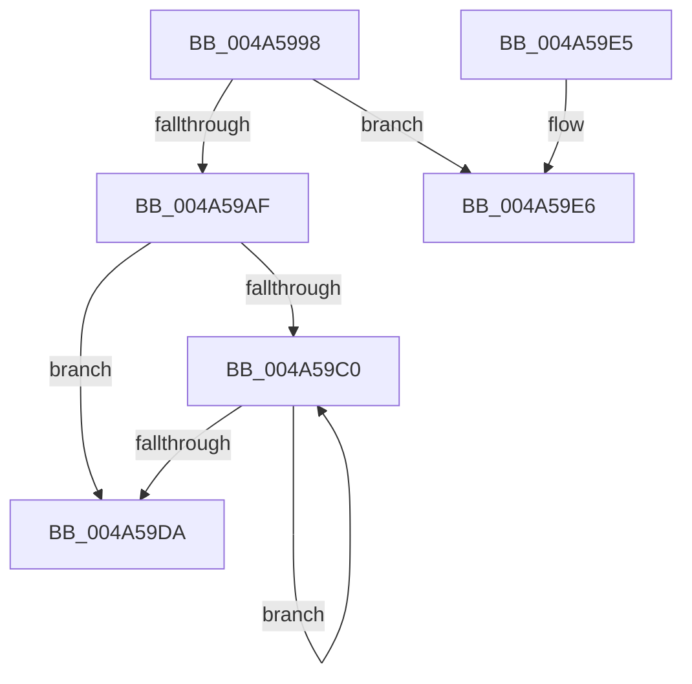

# EtwpFreeApcPool

- RVA: `0x004A5998`–`0x004A59F1` (길이 `89` bytes)
- VA: `0x00000001404A5998`
- 실행 섹션: `.text`
- PDB 이름 있음: `예`; PDB Function 태그: `아니요`
- unwind 정보 RVA: `0x00069334`
- 디코드: `27`개 명령, `89/89` bytes 표시
- 미해석 바이트: `0` (있으면 어셈블리에 `.byte`로 보존)

> 이 문서는 커널 이미지의 기계어와 PDB 기호를 분석해 생성했습니다. 4번과 5번은 함수 원형과 자료형을 바이너리 사용 방식에서 추정한 C 해석이며 원본 소스 복구 결과는 아닙니다.

## 1. Dependencies

- 직접 호출 지점: **3**; 고유 호출 대상: **3**
- 직접 호출자로 확인된 함수: **2**
- RIP 상대 이미지 참조: **0**

### Outgoing calls
- `0x004A59B3` → [ExpInterlockedFlushSList](../6B/ExpInterlockedFlushSList_function_006BA5F0.md) (function, `0x006BA5F0`)
- `0x004A59C9` → [ExFreePoolWithTag](../../poolcode/B8/ExFreePoolWithTag_function_00B82870.md) (function, `0x00B82870`)
- `0x004A59EB` → [KeBugCheck](../4F/KeBugCheck_function_004FD640.md) (function, `0x004FD640`)

### Direct callers
- [EtwpFreeLoggerContext](../../page/9C/EtwpFreeLoggerContext_function_009C1688.md) at `0x009C1818`
- [EtwpFreeLoggerContext](../../page/9C/EtwpFreeLoggerContext_function_009C1688.md) at `0x009C1A27`
- [EtwpStartLogger](../../page/A9/EtwpStartLogger_function_00A99D80.md) at `0x00A9A794`

### Static image references
- 디코드된 RIP-relative 메모리 참조가 없습니다.

## 2. Other-region calls and transfers

- 다른 실행 섹션으로 향하는 call: **1**
  - `0x004A59C9` → [ExFreePoolWithTag](../../poolcode/B8/ExFreePoolWithTag_function_00B82870.md) (`.text` → `POOLCODE`)
- 별도 외부 분기/꼬리 이동을 확인하지 못했습니다.

## 3. Assembly (complete function range)

```asm
004A5998  48 89 5C 24 08                  mov qword ptr [rsp + 8], rbx
004A599D  57                              push rdi
004A599E  48 83 EC 20                     sub rsp, 0x20
004A59A2  8B 81 B0 00 00 00               mov eax, dword ptr [rcx + 0xb0]
004A59A8  48 8B D9                        mov rbx, rcx
004A59AB  85 C0                           test eax, eax
004A59AD  7F 37                           jg 0x1404a59e6
004A59AF  48 83 C1 10                     add rcx, 0x10
004A59B3  E8 38 4C 21 00                  call 0x1406ba5f0
004A59B8  48 8B F8                        mov rdi, rax
004A59BB  48 85 C0                        test rax, rax
004A59BE  74 1A                           je 0x1404a59da
004A59C0  48 8D 4F A0                     lea rcx, [rdi - 0x60]
004A59C4  33 D2                           xor edx, edx
004A59C6  48 8B 3F                        mov rdi, qword ptr [rdi]
004A59C9  E8 A2 CE 6D 00                  call 0x140b82870
004A59CE  F0 FF 8B A4 00 00 00            lock dec dword ptr [rbx + 0xa4]
004A59D5  48 85 FF                        test rdi, rdi
004A59D8  75 E6                           jne 0x1404a59c0
004A59DA  48 8B 5C 24 30                  mov rbx, qword ptr [rsp + 0x30]
004A59DF  48 83 C4 20                     add rsp, 0x20
004A59E3  5F                              pop rdi
004A59E4  C3                              ret
004A59E5  CC                              int3
004A59E6  B9 1D 01 00 00                  mov ecx, 0x11d
004A59EB  E8 50 7C 05 00                  call 0x1404fd640
004A59F0  CC                              int3
```

## 4. C-style interpretation (structured pseudocode)

```c
__int64 __fastcall EtwpFreeApcPool(__int64 a1, int a2)
{
    __int64 result;
    __int64 v_rsp;
    unsigned __int64 v_stack_p8;

    v_stack_p8 = v_rbx;
    v_rsp = (v_rsp) - (32);
    if (condition_is_greater) goto loc_004A59E6;
    a1 = (a1) + (16);
    result = ExpInterlockedFlushSList(a1, a2, a3, a4);
    if (result == 0) goto loc_004A59DA;
loc_004A59C0:
    a2 = 0;
    result = ExFreePoolWithTag(result - 96, a2, a3, a4);
    if (*(unsigned __int64 *)(result) != 0) goto loc_004A59C0;
loc_004A59DA:
    v_rsp = (v_rsp) + (32);
    return result;
loc_004A59E6:
    result = KeBugCheck(285, a2, a3, a4);
    return result;
}
```

## 5. (Beta) C Style

```c
int64_t EtwpFreeApcPool(void *Arg1, int32_t Arg2)
{
    uint8_t *arg1 = (uint8_t *)Arg1;

    int64_t result;
    int64_t local_rsp;
    uint64_t v_stack_p8;

    v_stack_p8 = local_rbx;
    local_rsp = (local_rsp) - (32);
    if (condition_is_greater) goto loc_004A59E6;
    Arg1 = (Arg1) + (16);
    result = ExpInterlockedFlushSList(Arg1, Arg2, a3, a4);
    if (result == 0) goto loc_004A59DA;
loc_004A59C0:
    Arg2 = 0;
    result = ExFreePoolWithTag(result - 96, Arg2, a3, a4);
    if (*(uint64_t *)(result) != 0) goto loc_004A59C0;
loc_004A59DA:
    local_rsp = (local_rsp) + (32);
    return result;
loc_004A59E6:
    result = KeBugCheck(285, Arg2, a3, a4);
    return result;
}
```

### 관측된 메모리 오프셋

구조체 형식이 확인되지 않은 접근은 인자 기준의 오프셋으로만 기록했습니다.

| 기준 인자 | 오프셋 표현 | 폭 (bit) | 접근 |
|---|---:|---:|---|
| `Arg1` | `+ 0xA4` | `32` | `R/W` |
| `Arg1` | `+ 0xB0` | `32` | `R` |

## 6. Execution-region graph

[열기: 2D/3D 그래프와 함수 탐색 컨트롤 패널](../../../control-panel.html?section=text&rva=0x004A5998&view=graph)

- 2D 그래프는 위에서 아래로 흐르고, 3D 그래프는 빈 공간을 드래그해 회전합니다. Shift+드래그는 이동, 휠은 확대·축소, 함수 노드 선택은 대상 보고서 이동입니다.

### Static fallback


