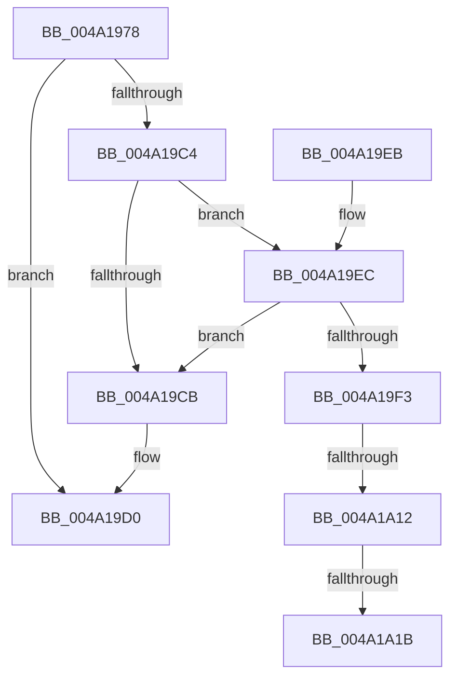

# EtwpGetTimeStampAndQpcDelta

- RVA: `0x004A1978`–`0x004A1A28` (길이 `176` bytes)
- VA: `0x00000001404A1978`
- 실행 섹션: `.text`
- PDB 이름 있음: `예`; PDB Function 태그: `예`
- unwind 정보 RVA: `0x000B5C84`
- 디코드: `46`개 명령, `176/176` bytes 표시
- 미해석 바이트: `0` (있으면 어셈블리에 `.byte`로 보존)

> 이 문서는 커널 이미지의 기계어와 PDB 기호를 분석해 생성했습니다. 4번과 5번은 함수 원형과 자료형을 바이너리 사용 방식에서 추정한 C 해석이며 원본 소스 복구 결과는 아닙니다.

## 1. Dependencies

- 직접 호출 지점: **1**; 고유 호출 대상: **1**
- 직접 호출자로 확인된 함수: **1**
- RIP 상대 이미지 참조: **0**

### Outgoing calls
- `0x004A19BB` → [RtlGetMultiTimePrecise](RtlGetMultiTimePrecise_function_004A1A30.md) (function, `0x004A1A30`)

### Direct callers
- [EtwpReserveTraceBuffer](../2F/EtwpReserveTraceBuffer_function_002FC8C0.md) at `0x002FCDB7`

### Static image references
- 디코드된 RIP-relative 메모리 참조가 없습니다.

## 2. Other-region calls and transfers

- 다른 실행 섹션으로 향하는 call: **0**
- call이 아닌 외부 분기/꼬리 이동: **3**
  - `0x004A1A0C` → [sub_006F8782](../6F/Unknown_function_006F8782.md) (`tail-transfer`)
  - `0x004A1A15` → [sub_006F8782](../6F/Unknown_function_006F8782.md) (`tail-transfer`)
  - `0x004A1A23` → [sub_006F8782 + 0x3](../6F/Unknown_function_006F8782.md) (`tail-transfer`)

## 3. Assembly (complete function range)

```asm
004A1978  4C 8B DC                        mov r11, rsp
004A197B  49 89 5B 10                     mov qword ptr [r11 + 0x10], rbx
004A197F  49 89 73 18                     mov qword ptr [r11 + 0x18], rsi
004A1983  57                              push rdi
004A1984  48 83 EC 40                     sub rsp, 0x40
004A1988  33 C0                           xor eax, eax
004A198A  48 8B FA                        mov rdi, rdx
004A198D  21 44 24 50                     and dword ptr [rsp + 0x50], eax
004A1991  0F 57 C0                        xorps xmm0, xmm0
004A1994  83 B9 C8 00 00 00 02            cmp dword ptr [rcx + 0xc8], 2
004A199B  49 8B F0                        mov rsi, r8
004A199E  0F 11 44 24 20                  movups xmmword ptr [rsp + 0x20], xmm0
004A19A3  8D 50 07                        lea edx, [rax + 7]
004A19A6  49 89 43 E8                     mov qword ptr [r11 - 0x18], rax
004A19AA  8D 42 FC                        lea eax, [rdx - 4]
004A19AD  48 8B D9                        mov rbx, rcx
004A19B0  0F 45 D0                        cmovne edx, eax
004A19B3  4D 8D 43 08                     lea r8, [r11 + 8]
004A19B7  49 8D 4B D8                     lea rcx, [r11 - 0x28]
004A19BB  E8 70 00 00 00                  call 0x1404a1a30
004A19C0  85 C0                           test eax, eax
004A19C2  75 0C                           jne 0x1404a19d0
004A19C4  F6 44 24 50 02                  test byte ptr [rsp + 0x50], 2
004A19C9  75 21                           jne 0x1404a19ec
004A19CB  B8 01 00 00 C0                  mov eax, 0xc0000001
004A19D0  F0 81 A3 30 03 00 00 FF FF FF F7  lock and dword ptr [rbx + 0x330], 0xf7ffffff
004A19DB  48 8B 5C 24 58                  mov rbx, qword ptr [rsp + 0x58]
004A19E0  48 8B 74 24 60                  mov rsi, qword ptr [rsp + 0x60]
004A19E5  48 83 C4 40                     add rsp, 0x40
004A19E9  5F                              pop rdi
004A19EA  C3                              ret
004A19EB  CC                              int3
004A19EC  F6 44 24 50 01                  test byte ptr [rsp + 0x50], 1
004A19F1  74 D8                           je 0x1404a19cb
004A19F3  48 8B 44 24 28                  mov rax, qword ptr [rsp + 0x28]
004A19F8  48 8B 54 24 20                  mov rdx, qword ptr [rsp + 0x20]
004A19FD  8B 8B C8 00 00 00               mov ecx, dword ptr [rbx + 0xc8]
004A1A03  48 2B C2                        sub rax, rdx
004A1A06  48 89 06                        mov qword ptr [rsi], rax
004A1A09  83 E9 01                        sub ecx, 1
004A1A0C  0F 84 70 6D 25 00               je 0x1406f8782
004A1A12  83 F9 01                        cmp ecx, 1
004A1A15  0F 85 67 6D 25 00               jne 0x1406f8782
004A1A1B  48 8B 44 24 30                  mov rax, qword ptr [rsp + 0x30]
004A1A20  48 89 07                        mov qword ptr [rdi], rax
004A1A23  E9 5D 6D 25 00                  jmp 0x1406f8785
```

## 4. C-style interpretation (structured pseudocode)

```c
__int64 __fastcall EtwpGetTimeStampAndQpcDelta(__int64 a1, __int64 a2, __int64 a3)
{
    __int64 result;
    __int64 v_rsp;
    unsigned __int64 v_stack_m28;
    unsigned __int64 v_stack_p10;
    unsigned __int64 v_stack_p18;
    unsigned __int64 v_stack_p20;
    unsigned __int64 v_stack_p28;
    unsigned __int64 v_stack_p30;
    unsigned __int8 v_stack_p50;
    unsigned int v_stack_p8;

    *(unsigned __int64 *)(v_rsp + 16) = v_rbx;
    *(unsigned __int64 *)(v_rsp + 24) = v_rsi;
    v_rsp = (v_rsp) - (64);
    result = 0;
    v_stack_m28 = v_xmm0;
    *(unsigned __int64 *)(v_rsp - 24) = 0;
    a2 = result + 7;
    if ((*(unsigned int *)(a1 + 200)) != 2) { a2 = (unsigned int)(result + 7 - 4); }
    result = RtlGetMultiTimePrecise(v_rsp - 40, a2, v_rsp + 8, a4);
    if ((unsigned int)(result) != 0) goto loc_004A19D0;
    if (((v_stack_p8) & (2)) != 0) goto loc_004A19EC;
loc_004A19CB:
loc_004A19D0:
    v_rsp = (v_rsp) + (64);
    return (unsigned int)(0xC0000001ULL);
loc_004A19EC:
    if (((v_stack_p50) & (1)) == 0) goto loc_004A19CB;
    result = (v_stack_p28) - (v_stack_p20);
    *(unsigned __int64 *)(v_stack_p18) = result;
    a1 = (unsigned int)(((unsigned int)(*(unsigned int *)(v_stack_p10 + 200))) - (1));
    *(unsigned __int64 *)(a2) = v_stack_p30;
}
```

## 5. (Beta) C Style

```c
int64_t EtwpGetTimeStampAndQpcDelta(void *Arg1, void *Arg2, void *Arg3)
{
    uint8_t *arg1 = (uint8_t *)Arg1;
    uint8_t *arg2 = (uint8_t *)Arg2;
    uint8_t *arg3 = (uint8_t *)Arg3;

    int64_t result;
    int64_t local_rsp;
    uint64_t v_stack_m28;
    uint64_t v_stack_p10;
    uint64_t v_stack_p18;
    uint64_t v_stack_p20;
    uint64_t v_stack_p28;
    uint64_t v_stack_p30;
    uint8_t v_stack_p50;
    uint32_t v_stack_p8;

    *(uint64_t *)(local_rsp + 0x10) = local_rbx;
    *(uint64_t *)(local_rsp + 0x18) = local_rsi;
    local_rsp = (local_rsp) - (64);
    result = 0;
    v_stack_m28 = v_xmm0;
    *(uint64_t *)(local_rsp - 0x18) = 0;
    Arg2 = result + 7;
    if ((*(uint32_t *)(arg1 + 0xC8)) != 2) { Arg2 = (uint32_t)(result + 7 - 4); }
    result = RtlGetMultiTimePrecise(local_rsp - 40, Arg2, local_rsp + 8, a4);
    if ((uint32_t)(result) != 0) goto loc_004A19D0;
    if (((v_stack_p8) & (2)) != 0) goto loc_004A19EC;
loc_004A19CB:
loc_004A19D0:
    local_rsp = (local_rsp) + (64);
    return (uint32_t)(0xC0000001ULL);
loc_004A19EC:
    if (((v_stack_p50) & (1)) == 0) goto loc_004A19CB;
    result = (v_stack_p28) - (v_stack_p20);
    *(uint64_t *)(v_stack_p18) = result;
    Arg1 = (uint32_t)(((uint32_t)(*(uint32_t *)(v_stack_p10 + 0xC8))) - (1));
    *(uint64_t *)(arg2) = v_stack_p30;
}
```

### 관측된 메모리 오프셋

구조체 형식이 확인되지 않은 접근은 인자 기준의 오프셋으로만 기록했습니다.

| 기준 인자 | 오프셋 표현 | 폭 (bit) | 접근 |
|---|---:|---:|---|
| `Arg1` | `+ 0xC8` | `32` | `R` |
| `Arg1` | `+ 0x330` | `32` | `R/W` |
| `Arg2` | `+ 0x0` | `64` | `W` |
| `Arg3` | `+ 0x0` | `64` | `W` |

## 6. Execution-region graph

[열기: 2D/3D 그래프와 함수 탐색 컨트롤 패널](../../../control-panel.html?section=text&rva=0x004A1978&view=graph)

- 2D 그래프는 위에서 아래로 흐르고, 3D 그래프는 빈 공간을 드래그해 회전합니다. Shift+드래그는 이동, 휠은 확대·축소, 함수 노드 선택은 대상 보고서 이동입니다.

### Static fallback


