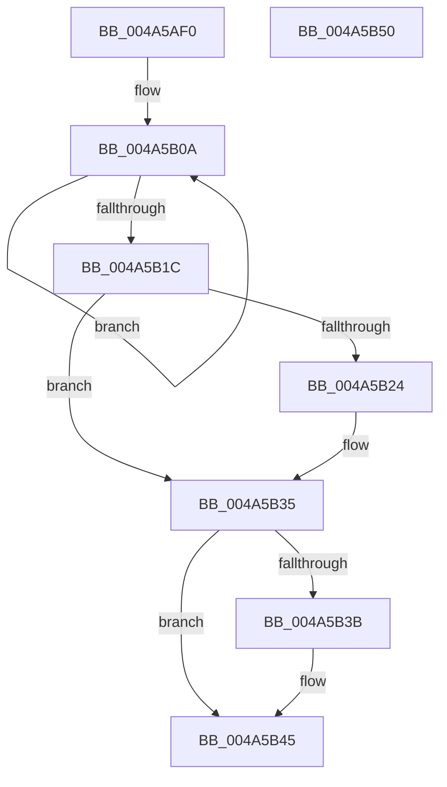

# EtwpLoggerDpc

- RVA: `0x004A5AF0`–`0x004A5B51` (길이 `97` bytes)
- VA: `0x00000001404A5AF0`
- 실행 섹션: `.text`
- PDB 이름 있음: `예`; PDB Function 태그: `아니요`
- unwind 정보 RVA: `0x0005CAAC`
- 디코드: `27`개 명령, `97/97` bytes 표시
- 미해석 바이트: `0` (있으면 어셈블리에 `.byte`로 보존)

> 이 문서는 커널 이미지의 기계어와 PDB 기호를 분석해 생성했습니다. 4번과 5번은 함수 원형과 자료형을 바이너리 사용 방식에서 추정한 C 해석이며 원본 소스 복구 결과는 아닙니다.

## 1. Dependencies

- 직접 호출 지점: **2**; 고유 호출 대상: **2**
- 직접 호출자로 확인된 함수: **0**
- RIP 상대 이미지 참조: **0**

### Outgoing calls
- `0x004A5B30` → [KeSetEvent](../33/KeSetEvent_function_0033F310.md) (function, `0x0033F310`)
- `0x004A5B40` → [EtwpRequestFlushTimer](../2F/EtwpRequestFlushTimer_function_002FE6B0.md) (function, `0x002FE6B0`)

### Direct callers
- 이 함수 시작 RVA로 연결되는 직접 call은 확인되지 않았습니다. 간접 호출은 완전히 역산할 수 없습니다.

### Static image references
- 디코드된 RIP-relative 메모리 참조가 없습니다.

## 2. Other-region calls and transfers

- 다른 실행 섹션으로 향하는 call: **0**
- 별도 외부 분기/꼬리 이동을 확인하지 못했습니다.

## 3. Assembly (complete function range)

```asm
004A5AF0  48 89 5C 24 08                  mov qword ptr [rsp + 8], rbx
004A5AF5  57                              push rdi
004A5AF6  48 83 EC 20                     sub rsp, 0x20
004A5AFA  48 8B DA                        mov rbx, rdx
004A5AFD  0F 0D 8A 38 03 00 00            prefetchw byte ptr [rdx + 0x338]
004A5B04  8B 82 38 03 00 00               mov eax, dword ptr [rdx + 0x338]
004A5B0A  8B C8                           mov ecx, eax
004A5B0C  81 E1 FF FC FF FF               and ecx, 0xfffffcff
004A5B12  F0 0F B1 8A 38 03 00 00         lock cmpxchg dword ptr [rdx + 0x338], ecx
004A5B1A  75 EE                           jne 0x1404a5b0a
004A5B1C  8B F8                           mov edi, eax
004A5B1E  0F BA E0 08                     bt eax, 8
004A5B22  73 11                           jae 0x1404a5b35
004A5B24  48 8D 8A E0 01 00 00            lea rcx, [rdx + 0x1e0]
004A5B2B  45 33 C0                        xor r8d, r8d
004A5B2E  33 D2                           xor edx, edx
004A5B30  E8 DB 97 E9 FF                  call 0x14033f310
004A5B35  0F BA E7 09                     bt edi, 9
004A5B39  73 0A                           jae 0x1404a5b45
004A5B3B  33 D2                           xor edx, edx
004A5B3D  48 8B CB                        mov rcx, rbx
004A5B40  E8 6B 8B E5 FF                  call 0x1402fe6b0
004A5B45  48 8B 5C 24 30                  mov rbx, qword ptr [rsp + 0x30]
004A5B4A  48 83 C4 20                     add rsp, 0x20
004A5B4E  5F                              pop rdi
004A5B4F  C3                              ret
004A5B50  CC                              int3
```

## 4. C-style interpretation (structured pseudocode)

```c
__int64 __fastcall EtwpLoggerDpc(__int64 a1, __int64 a2, int a3)
{
    __int64 result;
    __int64 v_rsp;
    unsigned __int64 v_stack_p8;

    v_stack_p8 = v_rbx;
    v_rsp = (v_rsp) - (32);
loc_004A5B0A:
    a1 = (unsigned int)(((unsigned int)((unsigned int)((unsigned int)(*(unsigned int *)(a2 + 824))))) & (0xFFFFFCFFULL));
    if (condition_is_not_equal) goto loc_004A5B0A;
    result = (unsigned int)(*(unsigned int *)(a2 + 824));
    if (!(condition_is_above_or_equal)) {
        a1 = a2 + 480;
        a3 = 0;
        a2 = 0;
        result = KeSetEvent(a1, a2, a3, a4);
    }
    if (!(condition_is_above_or_equal)) {
        a2 = 0;
        a1 = 0;
        result = EtwpRequestFlushTimer(a1, a2, a3, a4);
    }
    v_rsp = (v_rsp) + (32);
    return result;
}
```

## 5. (Beta) C Style

```c
int64_t EtwpLoggerDpc(int64_t Arg1, void *Arg2, int32_t Arg3)
{
    uint8_t *arg2 = (uint8_t *)Arg2;

    int64_t result;
    int64_t local_rsp;
    uint64_t v_stack_p8;

    v_stack_p8 = local_rbx;
    local_rsp = (local_rsp) - (32);
loc_004A5B0A:
    Arg1 = (uint32_t)(((uint32_t)((uint32_t)((uint32_t)(*(uint32_t *)(arg2 + 0x338))))) & (0xFFFFFCFFULL));
    if (condition_is_not_equal) goto loc_004A5B0A;
    result = (uint32_t)(*(uint32_t *)(arg2 + 0x338));
    if (!(condition_is_above_or_equal)) {
        Arg1 = Arg2 + 480;
        Arg3 = 0;
        Arg2 = 0;
        result = KeSetEvent(Arg1, Arg2, Arg3, a4);
    }
    if (!(condition_is_above_or_equal)) {
        Arg2 = 0;
        Arg1 = 0;
        result = EtwpRequestFlushTimer(Arg1, Arg2, Arg3, a4);
    }
    local_rsp = (local_rsp) + (32);
    return result;
}
```

### 관측된 메모리 오프셋

구조체 형식이 확인되지 않은 접근은 인자 기준의 오프셋으로만 기록했습니다.

| 기준 인자 | 오프셋 표현 | 폭 (bit) | 접근 |
|---|---:|---:|---|
| `Arg2` | `+ 0x1E0` | `64` | `R` |
| `Arg2` | `+ 0x338` | `8` | `R` |
| `Arg2` | `+ 0x338` | `32` | `R` |

## 6. Execution-region graph

[열기: 2D/3D 그래프와 함수 탐색 컨트롤 패널](../../../control-panel.html?section=text&rva=0x004A5AF0&view=graph)

- 2D 그래프는 위에서 아래로 흐르고, 3D 그래프는 빈 공간을 드래그해 회전합니다. Shift+드래그는 이동, 휠은 확대·축소, 함수 노드 선택은 대상 보고서 이동입니다.

### Static fallback


