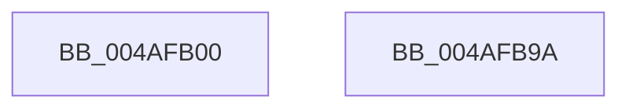

# EtwpPmcInterrupt

- RVA: `0x004AFB00`–`0x004AFB9B` (길이 `155` bytes)
- VA: `0x00000001404AFB00`
- 실행 섹션: `.text`
- PDB 이름 있음: `예`; PDB Function 태그: `아니요`
- unwind 정보 RVA: `0x00065FB8`
- 디코드: `33`개 명령, `155/155` bytes 표시
- 미해석 바이트: `0` (있으면 어셈블리에 `.byte`로 보존)

> 이 문서는 커널 이미지의 기계어와 PDB 기호를 분석해 생성했습니다. 4번과 5번은 함수 원형과 자료형을 바이너리 사용 방식에서 추정한 C 해석이며 원본 소스 복구 결과는 아닙니다.

## 1. Dependencies

- 직접 호출 지점: **2**; 고유 호출 대상: **2**
- 직접 호출자로 확인된 함수: **0**
- RIP 상대 이미지 참조: **1**

### Outgoing calls
- `0x004AFB83` → [EtwTraceKernelEvent](../23/EtwTraceKernelEvent_function_00235350.md) (function, `0x00235350`)
- `0x004AFB90` → [_security_check_cookie](../6A/_security_check_cookie_function_006AC640.md) (function, `0x006AC640`)

### Direct callers
- 이 함수 시작 RVA로 연결되는 직접 call은 확인되지 않았습니다. 간접 호출은 완전히 역산할 수 없습니다.

### Static image references
- `0x004AFB07` → RVA `0x00E0A740` (`.data`; read)

## 2. Other-region calls and transfers

- 다른 실행 섹션으로 향하는 call: **0**
- 별도 외부 분기/꼬리 이동을 확인하지 못했습니다.

## 3. Assembly (complete function range)

```asm
004AFB00  4C 8B DC                        mov r11, rsp
004AFB03  48 83 EC 68                     sub rsp, 0x68
004AFB07  48 8B 05 32 AC 95 00            mov rax, qword ptr [rip + 0x95ac32]
004AFB0E  48 33 C4                        xor rax, rsp
004AFB11  48 89 44 24 50                  mov qword ptr [rsp + 0x50], rax
004AFB16  65 48 8B 04 25 88 01 00 00      mov rax, qword ptr gs:[0x188]
004AFB1F  41 B9 2F 0F 00 00               mov r9d, 0xf2f
004AFB25  4C 8B 81 68 01 00 00            mov r8, qword ptr [rcx + 0x168]
004AFB2C  49 C7 43 E0 10 00 00 00         mov qword ptr [r11 - 0x20], 0x10
004AFB34  8B 88 10 05 00 00               mov ecx, dword ptr [rax + 0x510]
004AFB3A  49 8D 43 C8                     lea rax, [r11 - 0x38]
004AFB3E  89 4C 24 38                     mov dword ptr [rsp + 0x38], ecx
004AFB42  33 C9                           xor ecx, ecx
004AFB44  4D 89 43 C8                     mov qword ptr [r11 - 0x38], r8
004AFB48  66 89 4C 24 3E                  mov word ptr [rsp + 0x3e], cx
004AFB4D  48 B9 FF FF FE FF FF 7F 00 00   movabs rcx, 0x7ffffffeffff
004AFB57  4C 3B C1                        cmp r8, rcx
004AFB5A  66 89 54 24 3C                  mov word ptr [rsp + 0x3c], dx
004AFB5F  49 89 43 D8                     mov qword ptr [r11 - 0x28], rax
004AFB63  49 8D 4B D8                     lea rcx, [r11 - 0x28]
004AFB67  BA 02 9A 10 02                  mov edx, 0x2109a02
004AFB6C  B8 02 92 10 02                  mov eax, 0x2109202
004AFB71  0F 47 C2                        cmova eax, edx
004AFB74  41 B8 00 04 00 20               mov r8d, 0x20000400
004AFB7A  BA 01 00 00 00                  mov edx, 1
004AFB7F  89 44 24 20                     mov dword ptr [rsp + 0x20], eax
004AFB83  E8 C8 57 D8 FF                  call 0x140235350
004AFB88  48 8B 4C 24 50                  mov rcx, qword ptr [rsp + 0x50]
004AFB8D  48 33 CC                        xor rcx, rsp
004AFB90  E8 AB CA 1F 00                  call 0x1406ac640
004AFB95  48 83 C4 68                     add rsp, 0x68
004AFB99  C3                              ret
004AFB9A  CC                              int3
```

## 4. C-style interpretation (structured pseudocode)

```c
__int64 __fastcall EtwpPmcInterrupt(__int64 a1, unsigned __int16 a2)
{
    __int64 result;
    __int64 v_rsp;
    unsigned __int64 v_stack_m18;
    unsigned __int16 v_stack_m2A;
    unsigned __int16 v_stack_m2C;
    unsigned int v_stack_m30;
    unsigned int v_stack_m48;

    v_rsp = (v_rsp) - (104);
    result = (*(unsigned __int64 *)(v_rip + 9808946)) ^ (v_rsp);
    v_stack_m18 = result;
    *(unsigned __int64 *)(v_rsp - 32) = 16;
    v_stack_m30 = (unsigned int)((unsigned int)(*(unsigned int *)(*(unsigned __int64 *)(gs_base + (0 + 392)) + 1296)));
    a1 = 0;
    *(unsigned __int64 *)(v_rsp - 56) = *(unsigned __int64 *)(a1 + 360);
    v_stack_m2A = 0;
    v_stack_m2C = a2;
    *(unsigned __int64 *)(v_rsp - 40) = v_rsp - 56;
    result = (unsigned int)(0x2109202ULL);
    if ((*(unsigned __int64 *)(a1 + 360)) > 0) { result = (unsigned int)((unsigned int)(0x2109A02ULL)); }
    v_stack_m48 = (unsigned int)(result);
    result = EtwTraceKernelEvent(v_rsp - 40, 1, (unsigned int)(0x20000400ULL), (unsigned int)(0xF2FULL));
    a1 = (v_stack_m18) ^ (v_rsp);
    result = _security_check_cookie(a1, 1, (unsigned int)(0x20000400ULL), (unsigned int)(0xF2FULL));
    v_rsp = (v_rsp) + (104);
    return result;
}
```

## 5. (Beta) C Style

```c
int64_t EtwpPmcInterrupt(void *Arg1, uint16_t Arg2)
{
    uint8_t *arg1 = (uint8_t *)Arg1;

    int64_t result;
    int64_t local_rsp;
    uint64_t v_stack_m18;
    uint16_t v_stack_m2A;
    uint16_t v_stack_m2C;
    uint32_t v_stack_m30;
    uint32_t v_stack_m48;

    local_rsp = (local_rsp) - (104);
    result = (*(uint64_t *)(v_rip + 0x95AC32)) ^ (local_rsp);
    v_stack_m18 = result;
    *(uint64_t *)(local_rsp - 0x20) = 16;
    v_stack_m30 = (uint32_t)((uint32_t)(*(uint32_t *)(*(uint64_t *)(gs_base + (0 + 0x188)) + 0x510)));
    Arg1 = 0;
    *(uint64_t *)(local_rsp - 0x38) = *(uint64_t *)(arg1 + 0x168);
    v_stack_m2A = 0;
    v_stack_m2C = Arg2;
    *(uint64_t *)(local_rsp - 0x28) = local_rsp - 56;
    result = (uint32_t)(0x2109202ULL);
    if ((*(uint64_t *)(arg1 + 0x168)) > 0) { result = (uint32_t)((uint32_t)(0x2109A02ULL)); }
    v_stack_m48 = (uint32_t)(result);
    result = EtwTraceKernelEvent(local_rsp - 40, 1, (uint32_t)(0x20000400ULL), (uint32_t)(0xF2FULL));
    Arg1 = (v_stack_m18) ^ (local_rsp);
    result = _security_check_cookie(Arg1, 1, (uint32_t)(0x20000400ULL), (uint32_t)(0xF2FULL));
    local_rsp = (local_rsp) + (104);
    return result;
}
```

### 관측된 메모리 오프셋

구조체 형식이 확인되지 않은 접근은 인자 기준의 오프셋으로만 기록했습니다.

| 기준 인자 | 오프셋 표현 | 폭 (bit) | 접근 |
|---|---:|---:|---|
| `Arg1` | `+ 0x168` | `64` | `R` |

## 6. Execution-region graph

[열기: 2D/3D 그래프와 함수 탐색 컨트롤 패널](../../../control-panel.html?section=text&rva=0x004AFB00&view=graph)

- 2D 그래프는 위에서 아래로 흐르고, 3D 그래프는 빈 공간을 드래그해 회전합니다. Shift+드래그는 이동, 휠은 확대·축소, 함수 노드 선택은 대상 보고서 이동입니다.

### Static fallback


