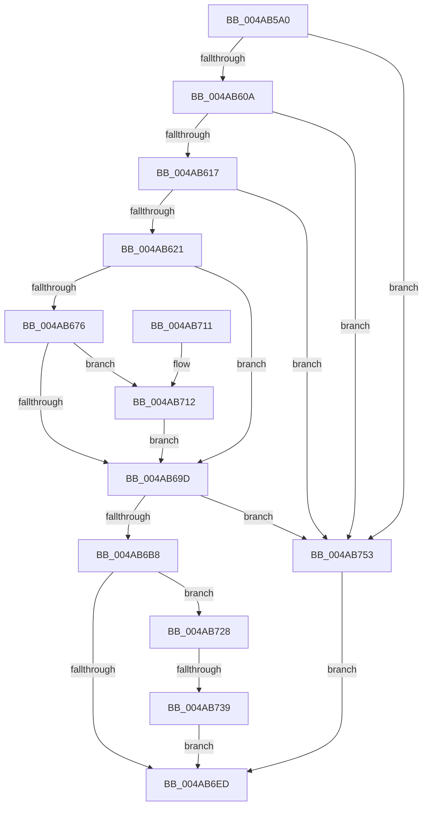

# EtwpTraceThreadRundownWithStack

- RVA: `0x004AB5A0`–`0x004AB760` (길이 `448` bytes)
- VA: `0x00000001404AB5A0`
- 실행 섹션: `.text`
- PDB 이름 있음: `예`; PDB Function 태그: `예`
- unwind 정보 RVA: `0x000B8018`
- 디코드: `113`개 명령, `448/448` bytes 표시
- 미해석 바이트: `0` (있으면 어셈블리에 `.byte`로 보존)

> 이 문서는 커널 이미지의 기계어와 PDB 기호를 분석해 생성했습니다. 4번과 5번은 함수 원형과 자료형을 바이너리 사용 방식에서 추정한 C 해석이며 원본 소스 복구 결과는 아닙니다.

## 1. Dependencies

- 직접 호출 지점: **11**; 고유 호출 대상: **9**
- 직접 호출자로 확인된 함수: **1**
- RIP 상대 이미지 참조: **4**

### Outgoing calls
- `0x004AB5D8` → [memset](../6C/memset_function_006C6C40.md) (function, `0x006C6C40`)
- `0x004AB66D` → [Feature_EtwThreadStackRundownPriority__private_IsEnabledDeviceUsageNoInline](../4F/Feature_EtwThreadStackRundownPriority__private_IsEnabledDeviceUsageNoInline_function_004F3B5C.md) (function, `0x004F3B5C`)
- `0x004AB687` → [KeQueryPriorityThread](../38/KeQueryPriorityThread_function_0038F4F0.md) (function, `0x0038F4F0`)
- `0x004AB691` → [KeQueryPriorityThread](../38/KeQueryPriorityThread_function_0038F4F0.md) (function, `0x0038F4F0`)
- `0x004AB6AB` → [KeInsertQueueApc](../20/KeInsertQueueApc_function_00203F10.md) (function, `0x00203F10`)
- `0x004AB6E1` → [KeWaitForSingleObject](../20/KeWaitForSingleObject_function_0020E6B0.md) (function, `0x0020E6B0`)
- `0x004AB6F4` → [_security_check_cookie](../6A/_security_check_cookie_function_006AC640.md) (function, `0x006AC640`)
- `0x004AB71B` → [KeSetPriorityThread](../2C/KeSetPriorityThread_function_002C76E0.md) (function, `0x002C76E0`)
- `0x004AB72C` → [KeRemoveQueueApc](../3C/KeRemoveQueueApc_function_003C4820.md) (function, `0x003C4820`)
- `0x004AB74C` → [KeWaitForSingleObject](../20/KeWaitForSingleObject_function_0020E6B0.md) (function, `0x0020E6B0`)
- `0x004AB759` → [EtwpTraceThreadRundown](../3C/EtwpTraceThreadRundown_function_003C370C.md) (function, `0x003C370C`)

### Direct callers
- [EtwpThreadEnumCallback](../../page/8C/EtwpThreadEnumCallback_function_008C9BD0.md) at `0x008C9C0B`

### Static image references
- `0x004AB5BA` → RVA `0x00E0A740` (`.data`; read)
- `0x004AB637` → RVA `0x003C1B50` (`EtwpThreadRundownApc`; read)
- `0x004AB6B8` → RVA `0x00E0EB30` (`.data`; read)
- `0x004AB6C2` → RVA `0x00010FF0` (`.rdata`; read)

## 2. Other-region calls and transfers

- 다른 실행 섹션으로 향하는 call: **0**
- call이 아닌 외부 분기/꼬리 이동: **1**
  - `0x004AB733` → [sub_006FA560](../6F/Unknown_function_006FA560.md) (`tail-transfer`)

## 3. Assembly (complete function range)

```asm
004AB5A0  48 89 5C 24 18                  mov qword ptr [rsp + 0x18], rbx
004AB5A5  48 89 74 24 20                  mov qword ptr [rsp + 0x20], rsi
004AB5AA  55                              push rbp
004AB5AB  57                              push rdi
004AB5AC  41 56                           push r14
004AB5AE  48 8D 6C 24 B9                  lea rbp, [rsp - 0x47]
004AB5B3  48 81 EC E0 00 00 00            sub rsp, 0xe0
004AB5BA  48 8B 05 7F F1 95 00            mov rax, qword ptr [rip + 0x95f17f]
004AB5C1  48 33 C4                        xor rax, rsp
004AB5C4  48 89 45 37                     mov qword ptr [rbp + 0x37], rax
004AB5C8  48 8B DA                        mov rbx, rdx
004AB5CB  48 8B F9                        mov rdi, rcx
004AB5CE  33 D2                           xor edx, edx
004AB5D0  48 8D 4D B7                     lea rcx, [rbp - 0x49]
004AB5D4  44 8D 42 58                     lea r8d, [rdx + 0x58]
004AB5D8  E8 63 B6 21 00                  call 0x1406c6c40
004AB5DD  33 C0                           xor eax, eax
004AB5DF  45 33 F6                        xor r14d, r14d
004AB5E2  0F 57 C0                        xorps xmm0, xmm0
004AB5E5  48 89 45 A7                     mov qword ptr [rbp - 0x59], rax
004AB5E9  0F 11 45 97                     movups xmmword ptr [rbp - 0x69], xmm0
004AB5ED  4C 89 75 AF                     mov qword ptr [rbp - 0x51], r14
004AB5F1  41 8B F6                        mov esi, r14d
004AB5F4  0F 11 45 17                     movups xmmword ptr [rbp + 0x17], xmm0
004AB5F8  65 48 8B 04 25 88 01 00 00      mov rax, qword ptr gs:[0x188]
004AB601  48 3B F8                        cmp rdi, rax
004AB604  0F 84 49 01 00 00               je 0x1404ab753
004AB60A  F6 87 A8 05 00 00 04            test byte ptr [rdi + 0x5a8], 4
004AB611  0F 85 3C 01 00 00               jne 0x1404ab753
004AB617  44 38 73 43                     cmp byte ptr [rbx + 0x43], r14b
004AB61B  0F 85 32 01 00 00               jne 0x1404ab753
004AB621  48 8D 45 9F                     lea rax, [rbp - 0x61]
004AB625  66 C7 45 97 01 00               mov word ptr [rbp - 0x69], 1
004AB62B  48 89 45 A7                     mov qword ptr [rbp - 0x59], rax
004AB62F  48 8D 45 9F                     lea rax, [rbp - 0x61]
004AB633  48 89 45 9F                     mov qword ptr [rbp - 0x61], rax
004AB637  48 8D 05 12 65 F1 FF            lea rax, [rip - 0xe9aee]
004AB63E  48 89 45 D7                     mov qword ptr [rbp - 0x29], rax
004AB642  C6 45 99 06                     mov byte ptr [rbp - 0x67], 6
004AB646  44 89 75 9B                     mov dword ptr [rbp - 0x65], r14d
004AB64A  66 C7 45 B7 12 00               mov word ptr [rbp - 0x49], 0x12
004AB650  C6 45 B9 58                     mov byte ptr [rbp - 0x47], 0x58
004AB654  66 44 89 75 07                  mov word ptr [rbp + 7], r14w
004AB659  48 89 7D BF                     mov qword ptr [rbp - 0x41], rdi
004AB65D  4C 89 75 DF                     mov qword ptr [rbp - 0x21], r14
004AB661  4C 89 75 E7                     mov qword ptr [rbp - 0x19], r14
004AB665  4C 89 75 EF                     mov qword ptr [rbp - 0x11], r14
004AB669  44 88 75 09                     mov byte ptr [rbp + 9], r14b
004AB66D  E8 EA 84 04 00                  call 0x1404f3b5c
004AB672  85 C0                           test eax, eax
004AB674  74 27                           je 0x1404ab69d
004AB676  44 89 73 48                     mov dword ptr [rbx + 0x48], r14d
004AB67A  44 88 73 4C                     mov byte ptr [rbx + 0x4c], r14b
004AB67E  65 48 8B 0C 25 88 01 00 00      mov rcx, qword ptr gs:[0x188]
004AB687  E8 64 3E EE FF                  call 0x14038f4f0
004AB68C  48 8B CF                        mov rcx, rdi
004AB68F  8B F0                           mov esi, eax
004AB691  E8 5A 3E EE FF                  call 0x14038f4f0
004AB696  89 43 48                        mov dword ptr [rbx + 0x48], eax
004AB699  3B C6                           cmp eax, esi
004AB69B  7C 75                           jl 0x1404ab712
004AB69D  45 33 C9                        xor r9d, r9d
004AB6A0  48 8D 55 97                     lea rdx, [rbp - 0x69]
004AB6A4  4C 8B C3                        mov r8, rbx
004AB6A7  48 8D 4D B7                     lea rcx, [rbp - 0x49]
004AB6AB  E8 60 88 D5 FF                  call 0x140203f10
004AB6B0  84 C0                           test al, al
004AB6B2  0F 84 9B 00 00 00               je 0x1404ab753
004AB6B8  8B 05 72 34 96 00               mov eax, dword ptr [rip + 0x963472]
004AB6BE  48 8D 4D 97                     lea rcx, [rbp - 0x69]
004AB6C2  48 0F AF 05 26 59 B6 FF         imul rax, qword ptr [rip - 0x49a6da]
004AB6CA  45 33 C9                        xor r9d, r9d
004AB6CD  45 33 C0                        xor r8d, r8d
004AB6D0  48 89 45 AF                     mov qword ptr [rbp - 0x51], rax
004AB6D4  48 8D 45 AF                     lea rax, [rbp - 0x51]
004AB6D8  48 89 44 24 20                  mov qword ptr [rsp + 0x20], rax
004AB6DD  41 8D 51 07                     lea edx, [r9 + 7]
004AB6E1  E8 CA 2F D6 FF                  call 0x14020e6b0
004AB6E6  3D 02 01 00 00                  cmp eax, 0x102
004AB6EB  74 3B                           je 0x1404ab728
004AB6ED  48 8B 4D 37                     mov rcx, qword ptr [rbp + 0x37]
004AB6F1  48 33 CC                        xor rcx, rsp
004AB6F4  E8 47 0F 20 00                  call 0x1406ac640
004AB6F9  4C 8D 9C 24 E0 00 00 00         lea r11, [rsp + 0xe0]
004AB701  49 8B 5B 30                     mov rbx, qword ptr [r11 + 0x30]
004AB705  49 8B 73 38                     mov rsi, qword ptr [r11 + 0x38]
004AB709  49 8B E3                        mov rsp, r11
004AB70C  41 5E                           pop r14
004AB70E  5F                              pop rdi
004AB70F  5D                              pop rbp
004AB710  C3                              ret
004AB711  CC                              int3
004AB712  8B D6                           mov edx, esi
004AB714  C6 43 4C 01                     mov byte ptr [rbx + 0x4c], 1
004AB718  48 8B CF                        mov rcx, rdi
004AB71B  E8 C0 BF E1 FF                  call 0x1402c76e0
004AB720  89 43 48                        mov dword ptr [rbx + 0x48], eax
004AB723  E9 75 FF FF FF                  jmp 0x1404ab69d
004AB728  48 8D 4D B7                     lea rcx, [rbp - 0x49]
004AB72C  E8 EF 90 F1 FF                  call 0x1403c4820
004AB731  84 C0                           test al, al
004AB733  0F 85 27 EE 24 00               jne 0x1406fa560
004AB739  45 33 C9                        xor r9d, r9d
004AB73C  4C 89 74 24 20                  mov qword ptr [rsp + 0x20], r14
004AB741  45 33 C0                        xor r8d, r8d
004AB744  48 8D 4D 97                     lea rcx, [rbp - 0x69]
004AB748  41 8D 51 07                     lea edx, [r9 + 7]
004AB74C  E8 5F 2F D6 FF                  call 0x14020e6b0
004AB751  EB 9A                           jmp 0x1404ab6ed
004AB753  48 8B D3                        mov rdx, rbx
004AB756  48 8B CF                        mov rcx, rdi
004AB759  E8 AE 7F F1 FF                  call 0x1403c370c
004AB75E  EB 8D                           jmp 0x1404ab6ed
```

## 4. C-style interpretation (structured pseudocode)

```c
__int64 __fastcall EtwpTraceThreadRundownWithStack(__int64 a1, __int64 a2, __int64 a3, int a4)
{
    __int64 result;
    __int64 v_r14;
    __int64 v_rsp;
    unsigned __int64 v_stack_m18;
    unsigned __int64 v_stack_m28;
    unsigned __int64 v_stack_m48;
    unsigned __int8 v_stack_m56;
    unsigned __int16 v_stack_m58;
    unsigned __int64 v_stack_m5F;
    unsigned __int64 v_stack_m70;
    unsigned __int64 v_stack_m78;
    unsigned __int64 v_stack_m80;
    unsigned __int64 v_stack_m88;
    unsigned __int64 v_stack_mA0;
    unsigned __int8 v_stack_mA6;
    unsigned __int64 v_stack_mA8;
    unsigned __int64 v_stack_mB0;
    unsigned __int64 v_stack_mB8;
    unsigned __int64 v_stack_mC0;
    unsigned int v_stack_mC4;
    unsigned __int8 v_stack_mC6;
    unsigned __int64 v_stack_mC8;
    unsigned __int64 v_stack_mD8;
    unsigned __int64 v_stack_p18;
    unsigned __int64 v_stack_p20;

    v_stack_p18 = v_rbx;
    v_stack_p20 = v_rsi;
    v_rsp = (v_rsp) - (224);
    result = (*(unsigned __int64 *)(v_rip + 9826687)) ^ (v_rsp);
    v_stack_m28 = result;
    a2 = 0;
    result = memset(v_stack_mA8, a2, a2 + 88, a4);
    result = 0;
    v_r14 = 0;
    v_stack_mB8 = 0;
    v_stack_mC8 = v_xmm0;
    v_stack_mB0 = 0;
    v_stack_m48 = v_xmm0;
    if (a1 == (*(unsigned __int64 *)(gs_base + (0 + 392)))) goto loc_004AB753;
    if (((*(unsigned __int8 *)(a1 + 1448)) & (4)) != 0) goto loc_004AB753;
    if ((*(unsigned __int8 *)(a2 + 67)) != 0) goto loc_004AB753;
    v_stack_mC8 = 1;
    v_stack_mB8 = v_stack_mC0;
    v_stack_mC0 = v_stack_mC0;
    v_stack_m88 = v_rip - 957166;
    v_stack_mC6 = 6;
    v_stack_mC4 = 0;
    v_stack_mA8 = 18;
    v_stack_mA6 = 88;
    v_stack_m58 = 0;
    v_stack_mA0 = a1;
    v_stack_m80 = 0;
    v_stack_m78 = 0;
    v_stack_m70 = 0;
    v_stack_m56 = 0;
    result = Feature_EtwThreadStackRundownPriority__private_IsEnabledDeviceUsageNoInline(v_stack_mA8, a2, a2 + 88, a4);
    if ((unsigned int)(result) == 0) goto loc_004AB69D;
    *(unsigned int *)(a2 + 72) = 0;
    *(unsigned __int8 *)(a2 + 76) = 0;
    result = KeQueryPriorityThread(*(unsigned __int64 *)(gs_base + (0 + 392)), a2, a2 + 88, a4);
    result = KeQueryPriorityThread(a1, a2, a2 + 88, a4);
    *(unsigned int *)(a2 + 72) = (unsigned int)(result);
    if (((unsigned int)(result)) < ((unsigned int)((unsigned int)((unsigned int)(result))))) goto loc_004AB712;
loc_004AB69D:
    a4 = 0;
    result = KeInsertQueueApc(v_stack_mA8, v_stack_mC8, 0, a4);
    if ((unsigned __int8)(result) == 0) goto loc_004AB753;
    result = ((unsigned int)(*(unsigned int *)(v_rip + 9843826))) * (*(unsigned __int64 *)(v_rip - 4826842));
    a4 = 0;
    a3 = 0;
    v_stack_mB0 = result;
    v_stack_mD8 = v_stack_mB0;
    result = KeWaitForSingleObject(v_stack_mC8, a4 + 7, a3, a4);
    if (((unsigned int)(result)) == 258) goto loc_004AB728;
loc_004AB6ED:
    a1 = (v_stack_m28) ^ (v_rsp);
    result = _security_check_cookie(a1, a4 + 7, a3, a4);
    return result;
loc_004AB712:
    *(unsigned __int8 *)(*(unsigned __int64 *)(v_stack_m18 + 48) + 76) = 1;
    result = KeSetPriorityThread(a1, (unsigned int)((unsigned int)(*(unsigned __int64 *)(v_stack_m18 + 56))), a3, a4);
    *(unsigned int *)(*(unsigned __int64 *)(v_stack_m18 + 48) + 72) = (unsigned int)(result);
    goto loc_004AB69D;
loc_004AB728:
    result = KeRemoveQueueApc(v_stack_mA8, (unsigned int)((unsigned int)(*(unsigned __int64 *)(v_stack_m18 + 56))), a3, a4);
    a4 = 0;
    v_stack_mC0 = 0;
    a3 = 0;
    result = KeWaitForSingleObject(v_stack_mC8, a4 + 7, a3, a4);
    goto loc_004AB6ED;
loc_004AB753:
    result = EtwpTraceThreadRundown(a1, *(unsigned __int64 *)(v_stack_m18 + 48), a3, a4);
    goto loc_004AB6ED;
}
```

## 5. (Beta) C Style

```c
int64_t EtwpTraceThreadRundownWithStack(int64_t Arg1, void *Arg2, int64_t Arg3, int32_t Arg4)
{
    uint8_t *arg2 = (uint8_t *)Arg2;

    int64_t result;
    int64_t local_r14;
    int64_t local_rsp;
    uint64_t v_stack_m18;
    uint64_t v_stack_m28;
    uint64_t v_stack_m48;
    uint8_t v_stack_m56;
    uint16_t v_stack_m58;
    uint64_t v_stack_m5F;
    uint64_t v_stack_m70;
    uint64_t v_stack_m78;
    uint64_t v_stack_m80;
    uint64_t v_stack_m88;
    uint64_t v_stack_mA0;
    uint8_t v_stack_mA6;
    uint64_t v_stack_mA8;
    uint64_t v_stack_mB0;
    uint64_t v_stack_mB8;
    uint64_t v_stack_mC0;
    uint32_t v_stack_mC4;
    uint8_t v_stack_mC6;
    uint64_t v_stack_mC8;
    uint64_t v_stack_mD8;
    uint64_t v_stack_p18;
    uint64_t v_stack_p20;

    v_stack_p18 = local_rbx;
    v_stack_p20 = local_rsi;
    local_rsp = (local_rsp) - (224);
    result = (*(uint64_t *)(v_rip + 0x95F17F)) ^ (local_rsp);
    v_stack_m28 = result;
    Arg2 = 0;
    result = memset(v_stack_mA8, Arg2, Arg2 + 88, Arg4);
    result = 0;
    local_r14 = 0;
    v_stack_mB8 = 0;
    v_stack_mC8 = v_xmm0;
    v_stack_mB0 = 0;
    v_stack_m48 = v_xmm0;
    if (Arg1 == (*(uint64_t *)(gs_base + (0 + 0x188)))) goto loc_004AB753;
    if (((*(uint8_t *)(Arg1 + 0x5A8)) & (4)) != 0) goto loc_004AB753;
    if ((*(uint8_t *)(arg2 + 0x43)) != 0) goto loc_004AB753;
    v_stack_mC8 = 1;
    v_stack_mB8 = v_stack_mC0;
    v_stack_mC0 = v_stack_mC0;
    v_stack_m88 = v_rip - 957166;
    v_stack_mC6 = 6;
    v_stack_mC4 = 0;
    v_stack_mA8 = 18;
    v_stack_mA6 = 88;
    v_stack_m58 = 0;
    v_stack_mA0 = Arg1;
    v_stack_m80 = 0;
    v_stack_m78 = 0;
    v_stack_m70 = 0;
    v_stack_m56 = 0;
    result = Feature_EtwThreadStackRundownPriority__private_IsEnabledDeviceUsageNoInline(v_stack_mA8, Arg2, Arg2 + 88, Arg4);
    if ((uint32_t)(result) == 0) goto loc_004AB69D;
    *(uint32_t *)(arg2 + 0x48) = 0;
    *(uint8_t *)(arg2 + 0x4C) = 0;
    result = KeQueryPriorityThread(*(uint64_t *)(gs_base + (0 + 0x188)), Arg2, Arg2 + 88, Arg4);
    result = KeQueryPriorityThread(Arg1, Arg2, Arg2 + 88, Arg4);
    *(uint32_t *)(arg2 + 0x48) = (uint32_t)(result);
    if (((uint32_t)(result)) < ((uint32_t)((uint32_t)((uint32_t)(result))))) goto loc_004AB712;
loc_004AB69D:
    Arg4 = 0;
    result = KeInsertQueueApc(v_stack_mA8, v_stack_mC8, 0, Arg4);
    if ((uint8_t)(result) == 0) goto loc_004AB753;
    result = ((uint32_t)(*(uint32_t *)(v_rip + 0x963472))) * (*(uint64_t *)(v_rip - 0x49A6DA));
    Arg4 = 0;
    Arg3 = 0;
    v_stack_mB0 = result;
    v_stack_mD8 = v_stack_mB0;
    result = KeWaitForSingleObject(v_stack_mC8, Arg4 + 7, Arg3, Arg4);
    if (((uint32_t)(result)) == 258) goto loc_004AB728;
loc_004AB6ED:
    Arg1 = (v_stack_m28) ^ (local_rsp);
    result = _security_check_cookie(Arg1, Arg4 + 7, Arg3, Arg4);
    return result;
loc_004AB712:
    *(uint8_t *)(*(uint64_t *)(v_stack_m18 + 0x30) + 0x4C) = 1;
    result = KeSetPriorityThread(Arg1, (uint32_t)((uint32_t)(*(uint64_t *)(v_stack_m18 + 0x38))), Arg3, Arg4);
    *(uint32_t *)(*(uint64_t *)(v_stack_m18 + 0x30) + 0x48) = (uint32_t)(result);
    goto loc_004AB69D;
loc_004AB728:
    result = KeRemoveQueueApc(v_stack_mA8, (uint32_t)((uint32_t)(*(uint64_t *)(v_stack_m18 + 0x38))), Arg3, Arg4);
    Arg4 = 0;
    v_stack_mC0 = 0;
    Arg3 = 0;
    result = KeWaitForSingleObject(v_stack_mC8, Arg4 + 7, Arg3, Arg4);
    goto loc_004AB6ED;
loc_004AB753:
    result = EtwpTraceThreadRundown(Arg1, *(uint64_t *)(v_stack_m18 + 0x30), Arg3, Arg4);
    goto loc_004AB6ED;
}
```

### 관측된 메모리 오프셋

구조체 형식이 확인되지 않은 접근은 인자 기준의 오프셋으로만 기록했습니다.

| 기준 인자 | 오프셋 표현 | 폭 (bit) | 접근 |
|---|---:|---:|---|
| `Arg2` | `+ 0x43` | `8` | `R` |
| `Arg2` | `+ 0x48` | `32` | `W` |
| `Arg2` | `+ 0x4C` | `8` | `W` |

## 6. Execution-region graph

[열기: 2D/3D 그래프와 함수 탐색 컨트롤 패널](../../../control-panel.html?section=text&rva=0x004AB5A0&view=graph)

- 2D 그래프는 위에서 아래로 흐르고, 3D 그래프는 빈 공간을 드래그해 회전합니다. Shift+드래그는 이동, 휠은 확대·축소, 함수 노드 선택은 대상 보고서 이동입니다.

### Static fallback


