# ExDisownFastResource

- RVA: `0x004A2C10`–`0x004A2E19` (길이 `521` bytes)
- VA: `0x00000001404A2C10`
- 실행 섹션: `.text`
- PDB 이름 있음: `예`; PDB Function 태그: `아니요`
- unwind 정보 RVA: `0x000B6064`
- 디코드: `138`개 명령, `521/521` bytes 표시
- 미해석 바이트: `0` (있으면 어셈블리에 `.byte`로 보존)

> 이 문서는 커널 이미지의 기계어와 PDB 기호를 분석해 생성했습니다. 4번과 5번은 함수 원형과 자료형을 바이너리 사용 방식에서 추정한 C 해석이며 원본 소스 복구 결과는 아닙니다.

## 1. Dependencies

- 직접 호출 지점: **13**; 고유 호출 대상: **7**
- 직접 호출자로 확인된 함수: **2**
- RIP 상대 이미지 참조: **0**

### Outgoing calls
- `0x004A2C57` → [KeBugCheckEx](../4F/KeBugCheckEx_function_004FD660.md) (function, `0x004FD660`)
- `0x004A2C83` → [KeBugCheckEx](../4F/KeBugCheckEx_function_004FD660.md) (function, `0x004FD660`)
- `0x004A2CB4` → [KeBugCheckEx](../4F/KeBugCheckEx_function_004FD660.md) (function, `0x004FD660`)
- `0x004A2CDD` → [KeBugCheckEx](../4F/KeBugCheckEx_function_004FD660.md) (function, `0x004FD660`)
- `0x004A2D06` → [ExpRemoveFastOwnerEntryFromThreadList](../41/ExpRemoveFastOwnerEntryFromThreadList_function_00416760.md) (function, `0x00416760`)
- `0x004A2D15` → [KeAcquireSpinLockAtDpcLevel](../20/KeAcquireSpinLockAtDpcLevel_function_00208430.md) (function, `0x00208430`)
- `0x004A2D4F` → [KeBugCheckEx](../4F/KeBugCheckEx_function_004FD660.md) (function, `0x004FD660`)
- `0x004A2D6F` → [KeBugCheckEx](../4F/KeBugCheckEx_function_004FD660.md) (function, `0x004FD660`)
- `0x004A2D86` → [KxReleaseSpinLock](../20/KxReleaseSpinLock_function_00206670.md) (function, `0x00206670`)
- `0x004A2DAE` → [ObfReferenceObjectWithTag](../21/ObfReferenceObjectWithTag_function_00210710.md) (function, `0x00210710`)
- `0x004A2DE4` → [KiRemoveSystemWorkPriorityKick](../26/KiRemoveSystemWorkPriorityKick_function_002631D0.md) (function, `0x002631D0`)
- `0x004A2E09` → [KeBugCheckEx](../4F/KeBugCheckEx_function_004FD660.md) (function, `0x004FD660`)
- `0x004A2E12` → [KeAbMarkCrossThreadReleasable](../3B/KeAbMarkCrossThreadReleasable_function_003BE8AC.md) (function, `0x003BE8AC`)

### Direct callers
- [ExMoveFastResourceOwnershipWithFlags](../41/ExMoveFastResourceOwnershipWithFlags_function_00415C20.md) at `0x00415C3E`
- [DifExDisownFastResourceWrapper](../61/DifExDisownFastResourceWrapper_function_0061FB80.md) at `0x0061FC57`

### Static image references
- 디코드된 RIP-relative 메모리 참조가 없습니다.

## 2. Other-region calls and transfers

- 다른 실행 섹션으로 향하는 call: **0**
- 별도 외부 분기/꼬리 이동을 확인하지 못했습니다.

## 3. Assembly (complete function range)

```asm
004A2C10  48 89 5C 24 08                  mov qword ptr [rsp + 8], rbx
004A2C15  48 89 6C 24 10                  mov qword ptr [rsp + 0x10], rbp
004A2C1A  48 89 74 24 18                  mov qword ptr [rsp + 0x18], rsi
004A2C1F  41 56                           push r14
004A2C21  48 83 EC 30                     sub rsp, 0x30
004A2C25  65 4C 8B 34 25 88 01 00 00      mov r14, qword ptr gs:[0x188]
004A2C2E  48 8B DA                        mov rbx, rdx
004A2C31  48 8B 01                        mov rax, qword ptr [rcx]
004A2C34  A8 01                           test al, 1
004A2C36  0F 85 AF 01 00 00               jne 0x1404a2deb
004A2C3C  F6 41 1A 01                     test byte ptr [rcx + 0x1a], 1
004A2C40  75 1B                           jne 0x1404a2c5d
004A2C42  48 83 64 24 20 00               and qword ptr [rsp + 0x20], 0
004A2C48  45 33 C9                        xor r9d, r9d
004A2C4B  4C 8B C1                        mov r8, rcx
004A2C4E  B9 C6 01 00 00                  mov ecx, 0x1c6
004A2C53  41 8D 51 03                     lea edx, [r9 + 3]
004A2C57  E8 04 AA 05 00                  call 0x1404fd660
004A2C5C  CC                              int3
004A2C5D  44 0F 20 C0                     mov rax, cr8
004A2C61  65 48 8B 14 25 88 01 00 00      mov rdx, qword ptr gs:[0x188]
004A2C6A  3C 02                           cmp al, 2
004A2C6C  76 1B                           jbe 0x1404a2c89
004A2C6E  48 83 64 24 20 00               and qword ptr [rsp + 0x20], 0
004A2C74  33 D2                           xor edx, edx
004A2C76  44 0F B6 C0                     movzx r8d, al
004A2C7A  B9 C6 01 00 00                  mov ecx, 0x1c6
004A2C7F  44 8D 4A 02                     lea r9d, [rdx + 2]
004A2C83  E8 D8 A9 05 00                  call 0x1404fd660
004A2C88  CC                              int3
004A2C89  3C 01                           cmp al, 1
004A2C8B  73 2D                           jae 0x1404a2cba
004A2C8D  F7 42 74 00 04 00 00            test dword ptr [rdx + 0x74], 0x400
004A2C94  75 24                           jne 0x1404a2cba
004A2C96  83 BA E4 01 00 00 00            cmp dword ptr [rdx + 0x1e4], 0
004A2C9D  75 1B                           jne 0x1404a2cba
004A2C9F  48 83 64 24 20 00               and qword ptr [rsp + 0x20], 0
004A2CA5  45 33 C9                        xor r9d, r9d
004A2CA8  45 33 C0                        xor r8d, r8d
004A2CAB  B9 C6 01 00 00                  mov ecx, 0x1c6
004A2CB0  41 8D 51 07                     lea edx, [r9 + 7]
004A2CB4  E8 A7 A9 05 00                  call 0x1404fd660
004A2CB9  CC                              int3
004A2CBA  4C 8B 43 10                     mov r8, qword ptr [rbx + 0x10]
004A2CBE  4D 8B C8                        mov r9, r8
004A2CC1  49 83 E1 FE                     and r9, 0xfffffffffffffffe
004A2CC5  4C 3B CA                        cmp r9, rdx
004A2CC8  74 19                           je 0x1404a2ce3
004A2CCA  48 83 64 24 20 00               and qword ptr [rsp + 0x20], 0
004A2CD0  4C 8B C3                        mov r8, rbx
004A2CD3  BA 09 00 00 00                  mov edx, 9
004A2CD8  B9 C6 01 00 00                  mov ecx, 0x1c6
004A2CDD  E8 7E A9 05 00                  call 0x1404fd660
004A2CE2  CC                              int3
004A2CE3  F6 43 25 02                     test byte ptr [rbx + 0x25], 2
004A2CE7  75 09                           jne 0x1404a2cf2
004A2CE9  48 8B 43 18                     mov rax, qword ptr [rbx + 0x18]
004A2CED  48 3B C1                        cmp rax, rcx
004A2CF0  75 63                           jne 0x1404a2d55
004A2CF2  41 F6 C0 01                     test r8b, 1
004A2CF6  75 42                           jne 0x1404a2d3a
004A2CF8  FA                              cli
004A2CF9  83 7B 20 01                     cmp dword ptr [rbx + 0x20], 1
004A2CFD  0F 8F F1 00 00 00               jg 0x1404a2df4
004A2D03  48 8B CB                        mov rcx, rbx
004A2D06  E8 55 3A F7 FF                  call 0x140416760
004A2D0B  49 8D AE C8 06 00 00            lea rbp, [r14 + 0x6c8]
004A2D12  48 8B CD                        mov rcx, rbp
004A2D15  E8 16 57 D6 FF                  call 0x140208430
004A2D1A  48 83 4B 10 01                  or qword ptr [rbx + 0x10], 1
004A2D1F  49 8D 86 D0 06 00 00            lea rax, [r14 + 0x6d0]
004A2D26  48 8B 08                        mov rcx, qword ptr [rax]
004A2D29  0F B6 73 24                     movzx esi, byte ptr [rbx + 0x24]
004A2D2D  48 39 41 08                     cmp qword ptr [rcx + 8], rax
004A2D31  74 42                           je 0x1404a2d75
004A2D33  B9 03 00 00 00                  mov ecx, 3
004A2D38  CD 29                           int 0x29
004A2D3A  48 83 64 24 20 00               and qword ptr [rsp + 0x20], 0
004A2D40  45 33 C9                        xor r9d, r9d
004A2D43  4C 8B C3                        mov r8, rbx
004A2D46  B9 C6 01 00 00                  mov ecx, 0x1c6
004A2D4B  41 8D 51 0A                     lea edx, [r9 + 0xa]
004A2D4F  E8 0C A9 05 00                  call 0x1404fd660
004A2D54  CC                              int3
004A2D55  48 85 C0                        test rax, rax
004A2D58  74 98                           je 0x1404a2cf2
004A2D5A  4C 8B C1                        mov r8, rcx
004A2D5D  48 89 44 24 20                  mov qword ptr [rsp + 0x20], rax
004A2D62  B9 C6 01 00 00                  mov ecx, 0x1c6
004A2D67  4C 8B CB                        mov r9, rbx
004A2D6A  BA 08 00 00 00                  mov edx, 8
004A2D6F  E8 EC A8 05 00                  call 0x1404fd660
004A2D74  CC                              int3
004A2D75  48 89 0B                        mov qword ptr [rbx], rcx
004A2D78  48 89 43 08                     mov qword ptr [rbx + 8], rax
004A2D7C  48 89 59 08                     mov qword ptr [rcx + 8], rbx
004A2D80  48 8B CD                        mov rcx, rbp
004A2D83  48 89 18                        mov qword ptr [rax], rbx
004A2D86  E8 E5 38 D6 FF                  call 0x140206670
004A2D8B  65 48 8B 0C 25 20 00 00 00      mov rcx, qword ptr gs:[0x20]
004A2D94  4C 8B 81 B8 8E 00 00            mov r8, qword ptr [rcx + 0x8eb8]
004A2D9B  4D 85 C0                        test r8, r8
004A2D9E  75 2A                           jne 0x1404a2dca
004A2DA0  FB                              sti
004A2DA1  40 84 F6                        test sil, sil
004A2DA4  75 69                           jne 0x1404a2e0f
004A2DA6  BA 44 66 6C 74                  mov edx, 0x746c6644
004A2DAB  49 8B CE                        mov rcx, r14
004A2DAE  E8 5D D9 D6 FF                  call 0x140210710
004A2DB3  48 8B 5C 24 40                  mov rbx, qword ptr [rsp + 0x40]
004A2DB8  48 8B 6C 24 48                  mov rbp, qword ptr [rsp + 0x48]
004A2DBD  48 8B 74 24 50                  mov rsi, qword ptr [rsp + 0x50]
004A2DC2  48 83 C4 30                     add rsp, 0x30
004A2DC6  41 5E                           pop r14
004A2DC8  C3                              ret
004A2DC9  CC                              int3
004A2DCA  41 0F 0D 08                     prefetchw byte ptr [r8]
004A2DCE  41 8B 00                        mov eax, dword ptr [r8]
004A2DD1  8B D0                           mov edx, eax
004A2DD3  0F BA F2 15                     btr edx, 0x15
004A2DD7  F0 41 0F B1 10                  lock cmpxchg dword ptr [r8], edx
004A2DDC  75 F3                           jne 0x1404a2dd1
004A2DDE  0F BA E0 15                     bt eax, 0x15
004A2DE2  73 BC                           jae 0x1404a2da0
004A2DE4  E8 E7 03 DC FF                  call 0x1402631d0
004A2DE9  EB B5                           jmp 0x1404a2da0
004A2DEB  48 8D 59 40                     lea rbx, [rcx + 0x40]
004A2DEF  E9 48 FE FF FF                  jmp 0x1404a2c3c
004A2DF4  48 83 64 24 20 00               and qword ptr [rsp + 0x20], 0
004A2DFA  45 33 C9                        xor r9d, r9d
004A2DFD  4C 8B C1                        mov r8, rcx
004A2E00  B9 C6 01 00 00                  mov ecx, 0x1c6
004A2E05  41 8D 51 12                     lea edx, [r9 + 0x12]
004A2E09  E8 52 A8 05 00                  call 0x1404fd660
004A2E0E  CC                              int3
004A2E0F  48 8B D6                        mov rdx, rsi
004A2E12  E8 95 BA F1 FF                  call 0x1403be8ac
004A2E17  EB 8D                           jmp 0x1404a2da6
```

## 4. C-style interpretation (structured pseudocode)

```c
__int64 __fastcall ExDisownFastResource(__int64 a1, __int64 a2, __int64 a3, int a4)
{
    __int64 result;
    __int64 v_rsp;
    unsigned __int64 v_stack_m18;
    unsigned __int64 v_stack_p10;
    unsigned __int64 v_stack_p18;
    unsigned __int64 v_stack_p20;
    unsigned __int64 v_stack_p8;

    v_stack_p8 = v_rbx;
    v_stack_p10 = v_rbp;
    v_stack_p18 = v_rsi;
    v_rsp = (v_rsp) - (48);
    if ((((unsigned __int8)(*(unsigned __int64 *)(a1))) & (1)) != 0) goto loc_004A2DEB;
loc_004A2C3C:
    result = *(unsigned __int64 *)(a1);
    if (((*(unsigned __int8 *)(a1 + 26)) & (1)) == 0) {
        a4 = 0;
        a3 = a1;
        a1 = 454;
        a2 = a4 + 3;
        result = KeBugCheckEx(a1, a2, a3, a4);
    }
    result = v_cr8;
    if (((unsigned __int8)(v_cr8)) >= = 2) {
        a2 = 0;
        a3 = (unsigned __int8)(v_cr8);
        a1 = 454;
        a4 = a2 + 2;
        result = KeBugCheckEx(a1, a2, a3, a4);
    }
    if (((unsigned __int8)(result)) >= 1) goto loc_004A2CBA;
    if (((*(unsigned int *)(a2 + 116)) & (0x400ULL)) != 0) goto loc_004A2CBA;
    if ((*(unsigned int *)(a2 + 484)) == 0) {
        a4 = 0;
        a3 = 0;
        a1 = 454;
        a2 = a4 + 7;
        result = KeBugCheckEx(a1, a2, a3, a4);
    }
    a4 = (*(unsigned __int64 *)(a2 + 16)) & (-2);
    if (a4 != a2) {
        a3 = a2;
        a2 = 9;
        a1 = 454;
        result = KeBugCheckEx(a1, a2, a3, a4);
    }
    if (((*(unsigned __int8 *)(a2 + 37)) & (2)) != 0) goto loc_004A2CF2;
    if ((*(unsigned __int64 *)(a2 + 24)) != a1) goto loc_004A2D55;
loc_004A2CF2:
    if ((((unsigned __int8)(a3)) & (1)) != 0) goto loc_004A2D3A;
    if ((*(unsigned int *)(a2 + 32)) > 1) goto loc_004A2DF4;
    result = ExpRemoveFastOwnerEntryFromThreadList(a2, a2, a3, a4);
    result = KeAcquireSpinLockAtDpcLevel(*(unsigned __int64 *)(gs_base + (0 + 392)) + 1736, a2, a3, a4);
    if ((*(unsigned __int64 *)(*(unsigned __int64 *)(*(unsigned __int64 *)(gs_base + (0 + 392)) + 1744) + 8)) == (*(unsigned __int64 *)(gs_base + (0 + 392)) + 1744)) goto loc_004A2D75;
loc_004A2D3A:
    a4 = 0;
    result = KeBugCheckEx(454, a4 + 10, a2, a4);
loc_004A2D55:
    if (result == 0) goto loc_004A2CF2;
    v_stack_m18 = result;
    result = KeBugCheckEx(454, 8, 454, a2);
loc_004A2D75:
    *(unsigned __int64 *)(a2) = 454;
    *(unsigned __int64 *)(a2 + 8) = result;
    *(unsigned __int64 *)(454 + 8) = a2;
    *(unsigned __int64 *)(result) = a2;
    result = KxReleaseSpinLock(*(unsigned __int64 *)(gs_base + (0 + 392)) + 1736, 8, 454, a2);
    if (*(unsigned __int64 *)(*(unsigned __int64 *)(gs_base + (0 + 32)) + 36536) != 0) goto loc_004A2DCA;
loc_004A2DA0:
    if ((unsigned __int8)(*(unsigned __int8 *)(a2 + 36)) != 0) goto loc_004A2E0F;
loc_004A2DA6:
    result = ObfReferenceObjectWithTag(*(unsigned __int64 *)(gs_base + (0 + 392)), (unsigned int)(0x746C6644ULL), *(unsigned __int64 *)(*(unsigned __int64 *)(gs_base + (0 + 32)) + 36536), a2);
    v_rsp = (v_rsp) + (48);
    return result;
loc_004A2DCA:
loc_004A2DD1:
    if (condition_is_not_equal) goto loc_004A2DD1;
    if (condition_is_above_or_equal) goto loc_004A2DA0;
    result = KiRemoveSystemWorkPriorityKick(*(unsigned __int64 *)(gs_base + (0 + 392)), (unsigned int)((unsigned int)((unsigned int)(*(unsigned int *)(*(unsigned __int64 *)(*(unsigned __int64 *)(gs_base + (0 + 32)) + 36536))))), *(unsigned __int64 *)(*(unsigned __int64 *)(gs_base + (0 + 32)) + 36536), a2);
    goto loc_004A2DA0;
loc_004A2DEB:
    goto loc_004A2C3C;
loc_004A2DF4:
    a4 = 0;
    result = KeBugCheckEx(454, a4 + 18, *(unsigned __int64 *)(gs_base + (0 + 392)), a4);
loc_004A2E0F:
    result = KeAbMarkCrossThreadReleasable(454, v_stack_p18, *(unsigned __int64 *)(gs_base + (0 + 392)), a4);
    goto loc_004A2DA6;
}
```

## 5. (Beta) C Style

```c
int64_t ExDisownFastResource(void *Arg1, int64_t Arg2, int64_t Arg3, int32_t Arg4)
{
    uint8_t *arg1 = (uint8_t *)Arg1;

    int64_t result;
    int64_t local_rsp;
    uint64_t v_stack_m18;
    uint64_t v_stack_p10;
    uint64_t v_stack_p18;
    uint64_t v_stack_p20;
    uint64_t v_stack_p8;

    v_stack_p8 = local_rbx;
    v_stack_p10 = local_rbp;
    v_stack_p18 = local_rsi;
    local_rsp = (local_rsp) - (48);
    if ((((uint8_t)(*(uint64_t *)(arg1))) & (1)) != 0) goto loc_004A2DEB;
loc_004A2C3C:
    result = *(uint64_t *)(arg1);
    if (((*(uint8_t *)(arg1 + 0x1A)) & (1)) == 0) {
        Arg4 = 0;
        Arg3 = Arg1;
        Arg1 = 454;
        Arg2 = Arg4 + 3;
        result = KeBugCheckEx(Arg1, Arg2, Arg3, Arg4);
    }
    result = v_cr8;
    if (((uint8_t)(v_cr8)) >= = 2) {
        Arg2 = 0;
        Arg3 = (uint8_t)(v_cr8);
        Arg1 = 454;
        Arg4 = Arg2 + 2;
        result = KeBugCheckEx(Arg1, Arg2, Arg3, Arg4);
    }
    if (((uint8_t)(result)) >= 1) goto loc_004A2CBA;
    if (((*(uint32_t *)(Arg2 + 0x74)) & (0x400ULL)) != 0) goto loc_004A2CBA;
    if ((*(uint32_t *)(Arg2 + 0x1E4)) == 0) {
        Arg4 = 0;
        Arg3 = 0;
        Arg1 = 454;
        Arg2 = Arg4 + 7;
        result = KeBugCheckEx(Arg1, Arg2, Arg3, Arg4);
    }
    Arg4 = (*(uint64_t *)(Arg2 + 0x10)) & (-2);
    if (Arg4 != Arg2) {
        Arg3 = Arg2;
        Arg2 = 9;
        Arg1 = 454;
        result = KeBugCheckEx(Arg1, Arg2, Arg3, Arg4);
    }
    if (((*(uint8_t *)(Arg2 + 0x25)) & (2)) != 0) goto loc_004A2CF2;
    if ((*(uint64_t *)(Arg2 + 0x18)) != Arg1) goto loc_004A2D55;
loc_004A2CF2:
    if ((((uint8_t)(Arg3)) & (1)) != 0) goto loc_004A2D3A;
    if ((*(uint32_t *)(Arg2 + 0x20)) > 1) goto loc_004A2DF4;
    result = ExpRemoveFastOwnerEntryFromThreadList(Arg2, Arg2, Arg3, Arg4);
    result = KeAcquireSpinLockAtDpcLevel(*(uint64_t *)(gs_base + (0 + 0x188)) + 1736, Arg2, Arg3, Arg4);
    if ((*(uint64_t *)(*(uint64_t *)(*(uint64_t *)(gs_base + (0 + 0x188)) + 0x6D0) + 0x8)) == (*(uint64_t *)(gs_base + (0 + 0x188)) + 1744)) goto loc_004A2D75;
loc_004A2D3A:
    Arg4 = 0;
    result = KeBugCheckEx(454, Arg4 + 10, Arg2, Arg4);
loc_004A2D55:
    if (result == 0) goto loc_004A2CF2;
    v_stack_m18 = result;
    result = KeBugCheckEx(454, 8, 454, Arg2);
loc_004A2D75:
    *(uint64_t *)(Arg2) = 454;
    *(uint64_t *)(Arg2 + 0x8) = result;
    *(uint64_t *)(454 + 0x8) = Arg2;
    *(uint64_t *)(result) = Arg2;
    result = KxReleaseSpinLock(*(uint64_t *)(gs_base + (0 + 0x188)) + 1736, 8, 454, Arg2);
    if (*(uint64_t *)(*(uint64_t *)(gs_base + (0 + 0x20)) + 0x8EB8) != 0) goto loc_004A2DCA;
loc_004A2DA0:
    if ((uint8_t)(*(uint8_t *)(Arg2 + 0x24)) != 0) goto loc_004A2E0F;
loc_004A2DA6:
    result = ObfReferenceObjectWithTag(*(uint64_t *)(gs_base + (0 + 0x188)), (uint32_t)(0x746C6644ULL), *(uint64_t *)(*(uint64_t *)(gs_base + (0 + 0x20)) + 0x8EB8), Arg2);
    local_rsp = (local_rsp) + (48);
    return result;
loc_004A2DCA:
loc_004A2DD1:
    if (condition_is_not_equal) goto loc_004A2DD1;
    if (condition_is_above_or_equal) goto loc_004A2DA0;
    result = KiRemoveSystemWorkPriorityKick(*(uint64_t *)(gs_base + (0 + 0x188)), (uint32_t)((uint32_t)((uint32_t)(*(uint32_t *)(*(uint64_t *)(*(uint64_t *)(gs_base + (0 + 0x20)) + 0x8EB8))))), *(uint64_t *)(*(uint64_t *)(gs_base + (0 + 0x20)) + 0x8EB8), Arg2);
    goto loc_004A2DA0;
loc_004A2DEB:
    goto loc_004A2C3C;
loc_004A2DF4:
    Arg4 = 0;
    result = KeBugCheckEx(454, Arg4 + 18, *(uint64_t *)(gs_base + (0 + 0x188)), Arg4);
loc_004A2E0F:
    result = KeAbMarkCrossThreadReleasable(454, v_stack_p18, *(uint64_t *)(gs_base + (0 + 0x188)), Arg4);
    goto loc_004A2DA6;
}
```

### 관측된 메모리 오프셋

구조체 형식이 확인되지 않은 접근은 인자 기준의 오프셋으로만 기록했습니다.

| 기준 인자 | 오프셋 표현 | 폭 (bit) | 접근 |
|---|---:|---:|---|
| `Arg1` | `+ 0x0` | `64` | `R` |
| `Arg1` | `+ 0x1A` | `8` | `R` |
| `Arg1` | `+ 0x40` | `64` | `R` |

## 6. Execution-region graph

[열기: 2D/3D 그래프와 함수 탐색 컨트롤 패널](../../../control-panel.html?section=text&rva=0x004A2C10&view=graph)

- 2D 그래프는 위에서 아래로 흐르고, 3D 그래프는 빈 공간을 드래그해 회전합니다. Shift+드래그는 이동, 휠은 확대·축소, 함수 노드 선택은 대상 보고서 이동입니다.

### Static fallback

```mermaid
flowchart TD
  bb_004A2C10[BB_004A2C10]
  bb_004A2C3C[BB_004A2C3C]
  bb_004A2C42[BB_004A2C42]
  bb_004A2C5D[BB_004A2C5D]
  bb_004A2C6E[BB_004A2C6E]
  bb_004A2C89[BB_004A2C89]
  bb_004A2C8D[BB_004A2C8D]
  bb_004A2C96[BB_004A2C96]
  bb_004A2C9F[BB_004A2C9F]
  bb_004A2CBA[BB_004A2CBA]
  bb_004A2CCA[BB_004A2CCA]
  bb_004A2CE3[BB_004A2CE3]
  bb_004A2CE9[BB_004A2CE9]
  bb_004A2CF2[BB_004A2CF2]
  bb_004A2CF8[BB_004A2CF8]
  bb_004A2D03[BB_004A2D03]
  bb_004A2D33[BB_004A2D33]
  bb_004A2D3A[BB_004A2D3A]
  bb_004A2D55[BB_004A2D55]
  bb_004A2D5A[BB_004A2D5A]
  bb_004A2D75[BB_004A2D75]
  bb_004A2DA0[BB_004A2DA0]
  bb_004A2DA6[BB_004A2DA6]
  bb_004A2DC9[BB_004A2DC9]
  bb_004A2DCA[BB_004A2DCA]
  bb_004A2DD1[BB_004A2DD1]
  bb_004A2DDE[BB_004A2DDE]
  bb_004A2DE4[BB_004A2DE4]
  bb_004A2DEB[BB_004A2DEB]
  bb_004A2DF4[BB_004A2DF4]
  bb_004A2E0F[BB_004A2E0F]
  bb_004A2C10 -->|branch| bb_004A2DEB
  bb_004A2C10 -->|fallthrough| bb_004A2C3C
  bb_004A2C3C -->|branch| bb_004A2C5D
  bb_004A2C3C -->|fallthrough| bb_004A2C42
  bb_004A2C42 -->|flow| bb_004A2C5D
  bb_004A2C5D -->|branch| bb_004A2C89
  bb_004A2C5D -->|fallthrough| bb_004A2C6E
  bb_004A2C6E -->|flow| bb_004A2C89
  bb_004A2C89 -->|branch| bb_004A2CBA
  bb_004A2C89 -->|fallthrough| bb_004A2C8D
  bb_004A2C8D -->|branch| bb_004A2CBA
  bb_004A2C8D -->|fallthrough| bb_004A2C96
  bb_004A2C96 -->|branch| bb_004A2CBA
  bb_004A2C96 -->|fallthrough| bb_004A2C9F
  bb_004A2C9F -->|flow| bb_004A2CBA
  bb_004A2CBA -->|branch| bb_004A2CE3
  bb_004A2CBA -->|fallthrough| bb_004A2CCA
  bb_004A2CCA -->|flow| bb_004A2CE3
  bb_004A2CE3 -->|branch| bb_004A2CF2
  bb_004A2CE3 -->|fallthrough| bb_004A2CE9
  bb_004A2CE9 -->|branch| bb_004A2D55
  bb_004A2CE9 -->|fallthrough| bb_004A2CF2
  bb_004A2CF2 -->|branch| bb_004A2D3A
  bb_004A2CF2 -->|fallthrough| bb_004A2CF8
  bb_004A2CF8 -->|branch| bb_004A2DF4
  bb_004A2CF8 -->|fallthrough| bb_004A2D03
  bb_004A2D03 -->|branch| bb_004A2D75
  bb_004A2D03 -->|fallthrough| bb_004A2D33
  bb_004A2D33 -->|flow| bb_004A2D3A
  bb_004A2D3A -->|flow| bb_004A2D55
  bb_004A2D55 -->|branch| bb_004A2CF2
  bb_004A2D55 -->|fallthrough| bb_004A2D5A
  bb_004A2D5A -->|flow| bb_004A2D75
  bb_004A2D75 -->|branch| bb_004A2DCA
  bb_004A2D75 -->|fallthrough| bb_004A2DA0
  bb_004A2DA0 -->|branch| bb_004A2E0F
  bb_004A2DA0 -->|fallthrough| bb_004A2DA6
  bb_004A2DC9 -->|flow| bb_004A2DCA
  bb_004A2DCA -->|flow| bb_004A2DD1
  bb_004A2DD1 -->|branch| bb_004A2DD1
  bb_004A2DD1 -->|fallthrough| bb_004A2DDE
  bb_004A2DDE -->|branch| bb_004A2DA0
  bb_004A2DDE -->|fallthrough| bb_004A2DE4
  bb_004A2DE4 -->|branch| bb_004A2DA0
  bb_004A2DEB -->|branch| bb_004A2C3C
  bb_004A2DF4 -->|flow| bb_004A2E0F
  bb_004A2E0F -->|branch| bb_004A2DA6
```


