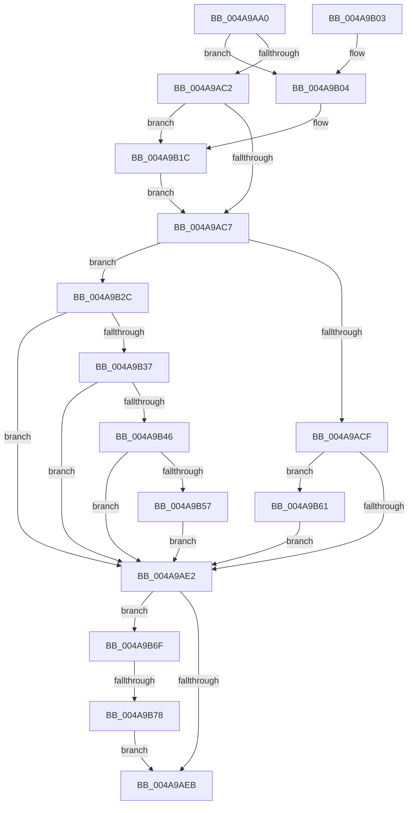

# ExTryAcquireAutoExpandPushLockExclusive

- RVA: `0x004A9AA0`–`0x004A9B88` (길이 `232` bytes)
- VA: `0x00000001404A9AA0`
- 실행 섹션: `.text`
- PDB 이름 있음: `예`; PDB Function 태그: `예`
- unwind 정보 RVA: `0x000B7B3C`
- 디코드: `69`개 명령, `232/232` bytes 표시
- 미해석 바이트: `0` (있으면 어셈블리에 `.byte`로 보존)

> 이 문서는 커널 이미지의 기계어와 PDB 기호를 분석해 생성했습니다. 4번과 5번은 함수 원형과 자료형을 바이너리 사용 방식에서 추정한 C 해석이며 원본 소스 복구 결과는 아닙니다.

## 1. Dependencies

- 직접 호출 지점: **5**; 고유 호출 대상: **5**
- 직접 호출자로 확인된 함수: **0**
- RIP 상대 이미지 참조: **0**

### Outgoing calls
- `0x004A9B16` → [KeBugCheckEx](../4F/KeBugCheckEx_function_004FD660.md) (function, `0x004FD660`)
- `0x004A9B22` → [KeAbPreAcquire](../21/KeAbPreAcquire_function_00210230.md) (function, `0x00210230`)
- `0x004A9B3A` → [ExpTryAcquireFannedOutPushLockExclusive](ExpTryAcquireFannedOutPushLockExclusive_function_004A1270.md) (function, `0x004A1270`)
- `0x004A9B5A` → [ExfTryToWakePushLock](../26/ExfTryToWakePushLock_function_00265DD0.md) (function, `0x00265DD0`)
- `0x004A9B7E` → [KeAbPostReleaseEx](../26/KeAbPostReleaseEx_function_00262210.md) (function, `0x00262210`)

### Direct callers
- 이 함수 시작 RVA로 연결되는 직접 call은 확인되지 않았습니다. 간접 호출은 완전히 역산할 수 없습니다.

### Static image references
- 디코드된 RIP-relative 메모리 참조가 없습니다.

## 2. Other-region calls and transfers

- 다른 실행 섹션으로 향하는 call: **0**
- call이 아닌 외부 분기/꼬리 이동: **1**
  - `0x004A9B72` → [sub_006FA004](../6F/Unknown_function_006FA004.md) (`tail-transfer`)

## 3. Assembly (complete function range)

```asm
004A9AA0  48 89 5C 24 08                  mov qword ptr [rsp + 8], rbx
004A9AA5  48 89 6C 24 10                  mov qword ptr [rsp + 0x10], rbp
004A9AAA  48 89 74 24 18                  mov qword ptr [rsp + 0x18], rsi
004A9AAF  57                              push rdi
004A9AB0  48 83 EC 30                     sub rsp, 0x30
004A9AB4  33 F6                           xor esi, esi
004A9AB6  BD F8 FF FF FF                  mov ebp, 0xfffffff8
004A9ABB  48 8B D9                        mov rbx, rcx
004A9ABE  85 D5                           test ebp, edx
004A9AC0  75 42                           jne 0x1404a9b04
004A9AC2  F6 C2 02                        test dl, 2
004A9AC5  74 55                           je 0x1404a9b1c
004A9AC7  F0 48 0F BA 2B 00               lock bts qword ptr [rbx], 0
004A9ACD  73 5D                           jae 0x1404a9b2c
004A9ACF  8B 4B 0C                        mov ecx, dword ptr [rbx + 0xc]
004A9AD2  BA 00 00 0F 00                  mov edx, 0xf0000
004A9AD7  8B C1                           mov eax, ecx
004A9AD9  40 32 FF                        xor dil, dil
004A9ADC  23 C2                           and eax, edx
004A9ADE  3B C2                           cmp eax, edx
004A9AE0  72 7F                           jb 0x1404a9b61
004A9AE2  48 85 F6                        test rsi, rsi
004A9AE5  0F 85 84 00 00 00               jne 0x1404a9b6f
004A9AEB  48 8B 5C 24 40                  mov rbx, qword ptr [rsp + 0x40]
004A9AF0  40 8A C7                        mov al, dil
004A9AF3  48 8B 6C 24 48                  mov rbp, qword ptr [rsp + 0x48]
004A9AF8  48 8B 74 24 50                  mov rsi, qword ptr [rsp + 0x50]
004A9AFD  48 83 C4 30                     add rsp, 0x30
004A9B01  5F                              pop rdi
004A9B02  C3                              ret
004A9B03  CC                              int3
004A9B04  48 21 74 24 20                  and qword ptr [rsp + 0x20], rsi
004A9B09  45 33 C9                        xor r9d, r9d
004A9B0C  8B D2                           mov edx, edx
004A9B0E  4C 8B C3                        mov r8, rbx
004A9B11  B9 52 01 00 00                  mov ecx, 0x152
004A9B16  E8 45 3B 05 00                  call 0x1404fd660
004A9B1B  CC                              int3
004A9B1C  33 D2                           xor edx, edx
004A9B1E  44 8D 42 01                     lea r8d, [rdx + 1]
004A9B22  E8 09 67 D6 FF                  call 0x140210230
004A9B27  48 8B F0                        mov rsi, rax
004A9B2A  EB 9B                           jmp 0x1404a9ac7
004A9B2C  8B 4B 08                        mov ecx, dword ptr [rbx + 8]
004A9B2F  40 B7 01                        mov dil, 1
004A9B32  40 84 CF                        test dil, cl
004A9B35  74 AB                           je 0x1404a9ae2
004A9B37  48 23 CD                        and rcx, rbp
004A9B3A  E8 31 77 FF FF                  call 0x1404a1270
004A9B3F  40 8A F8                        mov dil, al
004A9B42  84 C0                           test al, al
004A9B44  75 9C                           jne 0x1404a9ae2
004A9B46  48 83 C9 FF                     or rcx, 0xffffffffffffffff
004A9B4A  F0 48 0F C1 0B                  lock xadd qword ptr [rbx], rcx
004A9B4F  80 E1 06                        and cl, 6
004A9B52  80 F9 02                        cmp cl, 2
004A9B55  75 8B                           jne 0x1404a9ae2
004A9B57  48 8B CB                        mov rcx, rbx
004A9B5A  E8 71 C2 DB FF                  call 0x140265dd0
004A9B5F  EB 81                           jmp 0x1404a9ae2
004A9B61  81 C1 00 00 01 00               add ecx, 0x10000
004A9B67  89 4B 0C                        mov dword ptr [rbx + 0xc], ecx
004A9B6A  E9 73 FF FF FF                  jmp 0x1404a9ae2
004A9B6F  40 84 FF                        test dil, dil
004A9B72  0F 85 8C 04 25 00               jne 0x1406fa004
004A9B78  48 8B D6                        mov rdx, rsi
004A9B7B  48 8B CB                        mov rcx, rbx
004A9B7E  E8 8D 86 DB FF                  call 0x140262210
004A9B83  E9 63 FF FF FF                  jmp 0x1404a9aeb
```

## 4. C-style interpretation (structured pseudocode)

```c
__int64 __fastcall ExTryAcquireAutoExpandPushLockExclusive(__int64 a1, int a2, __int64 a3, int a4)
{
    __int64 result;
    __int64 v_rdi;
    __int64 v_rsi;
    __int64 v_rsp;
    unsigned __int64 v_stack_p10;
    unsigned __int64 v_stack_p18;
    unsigned __int64 v_stack_p20;
    unsigned __int64 v_stack_p8;

    v_stack_p8 = v_rbx;
    v_stack_p10 = v_rbp;
    v_stack_p18 = v_rsi;
    v_rsp = (v_rsp) - (48);
    v_rsi = 0;
    if ((((unsigned int)((unsigned int)(0xFFFFFFF8ULL))) & (a2)) != 0) goto loc_004A9B04;
    if ((((unsigned __int8)(a2)) & (2)) == 0) goto loc_004A9B1C;
loc_004A9AC7:
    if (condition_is_above_or_equal) goto loc_004A9B2C;
    v_rdi = 0;
    result = (unsigned int)(((unsigned int)((unsigned int)((unsigned int)(*(unsigned int *)(a1 + 12))))) & ((unsigned int)((unsigned int)(0xF0000ULL))));
    if (((unsigned int)(result)) < ((unsigned int)((unsigned int)(0xF0000ULL)))) goto loc_004A9B61;
loc_004A9AE2:
    if (0 != 0) goto loc_004A9B6F;
loc_004A9AEB:
    v_rsp = (v_rsp) + (48);
    return 0;
loc_004A9B04:
    a4 = 0;
    result = KeBugCheckEx(338, (unsigned int)((unsigned int)((unsigned int)(0xF0000ULL))), v_stack_p8, a4);
loc_004A9B1C:
    a2 = 0;
    result = KeAbPreAcquire(338, a2, a2 + 1, a4);
    goto loc_004A9AC7;
loc_004A9B2C:
    if (((1) & ((unsigned __int8)((unsigned int)(*(unsigned int *)(v_stack_p8 + 8))))) == 0) goto loc_004A9AE2;
    a1 = ((unsigned int)(*(unsigned int *)(v_stack_p8 + 8))) & (v_stack_p10);
    result = ExpTryAcquireFannedOutPushLockExclusive(a1, a2, a2 + 1, a4);
    if ((unsigned __int8)(result) != 0) goto loc_004A9AE2;
    a1 = (a1) | (-1);
    a1 = (unsigned __int8)((a1) & (6));
    if (((unsigned __int8)(a1)) != 2) goto loc_004A9AE2;
    result = ExfTryToWakePushLock(v_stack_p8, a2, a2 + 1, a4);
    goto loc_004A9AE2;
loc_004A9B61:
    a1 = (unsigned int)((v_stack_p8) + (0x10000ULL));
    *(unsigned int *)(v_stack_p8 + 12) = (unsigned int)(a1);
    goto loc_004A9AE2;
loc_004A9B6F:
    result = KeAbPostReleaseEx(v_stack_p8, result, a2 + 1, a4);
    goto loc_004A9AEB;
}
```

## 5. (Beta) C Style

```c
int64_t ExTryAcquireAutoExpandPushLockExclusive(void *Arg1, int32_t Arg2, int64_t Arg3, int32_t Arg4)
{
    uint8_t *arg1 = (uint8_t *)Arg1;

    int64_t result;
    int64_t local_rdi;
    int64_t local_rsi;
    int64_t local_rsp;
    uint64_t v_stack_p10;
    uint64_t v_stack_p18;
    uint64_t v_stack_p20;
    uint64_t v_stack_p8;

    v_stack_p8 = local_rbx;
    v_stack_p10 = local_rbp;
    v_stack_p18 = local_rsi;
    local_rsp = (local_rsp) - (48);
    local_rsi = 0;
    if ((((uint32_t)((uint32_t)(0xFFFFFFF8ULL))) & (Arg2)) != 0) goto loc_004A9B04;
    if ((((uint8_t)(Arg2)) & (2)) == 0) goto loc_004A9B1C;
loc_004A9AC7:
    if (condition_is_above_or_equal) goto loc_004A9B2C;
    local_rdi = 0;
    result = (uint32_t)(((uint32_t)((uint32_t)((uint32_t)(*(uint32_t *)(arg1 + 0xC))))) & ((uint32_t)((uint32_t)(0xF0000ULL))));
    if (((uint32_t)(result)) < ((uint32_t)((uint32_t)(0xF0000ULL)))) goto loc_004A9B61;
loc_004A9AE2:
    if (0 != 0) goto loc_004A9B6F;
loc_004A9AEB:
    local_rsp = (local_rsp) + (48);
    return 0;
loc_004A9B04:
    Arg4 = 0;
    result = KeBugCheckEx(338, (uint32_t)((uint32_t)((uint32_t)(0xF0000ULL))), v_stack_p8, Arg4);
loc_004A9B1C:
    Arg2 = 0;
    result = KeAbPreAcquire(338, Arg2, Arg2 + 1, Arg4);
    goto loc_004A9AC7;
loc_004A9B2C:
    if (((1) & ((uint8_t)((uint32_t)(*(uint32_t *)(v_stack_p8 + 0x8))))) == 0) goto loc_004A9AE2;
    Arg1 = ((uint32_t)(*(uint32_t *)(v_stack_p8 + 0x8))) & (v_stack_p10);
    result = ExpTryAcquireFannedOutPushLockExclusive(Arg1, Arg2, Arg2 + 1, Arg4);
    if ((uint8_t)(result) != 0) goto loc_004A9AE2;
    Arg1 = (Arg1) | (-1);
    Arg1 = (uint8_t)((Arg1) & (6));
    if (((uint8_t)(Arg1)) != 2) goto loc_004A9AE2;
    result = ExfTryToWakePushLock(v_stack_p8, Arg2, Arg2 + 1, Arg4);
    goto loc_004A9AE2;
loc_004A9B61:
    Arg1 = (uint32_t)((v_stack_p8) + (0x10000ULL));
    *(uint32_t *)(v_stack_p8 + 0xC) = (uint32_t)(Arg1);
    goto loc_004A9AE2;
loc_004A9B6F:
    result = KeAbPostReleaseEx(v_stack_p8, result, Arg2 + 1, Arg4);
    goto loc_004A9AEB;
}
```

### 관측된 메모리 오프셋

구조체 형식이 확인되지 않은 접근은 인자 기준의 오프셋으로만 기록했습니다.

| 기준 인자 | 오프셋 표현 | 폭 (bit) | 접근 |
|---|---:|---:|---|
| `Arg1` | `+ 0x0` | `64` | `R/W` |
| `Arg1` | `+ 0x8` | `32` | `R` |
| `Arg1` | `+ 0xC` | `32` | `R` |
| `Arg1` | `+ 0xC` | `32` | `W` |

## 6. Execution-region graph

[열기: 2D/3D 그래프와 함수 탐색 컨트롤 패널](../../../control-panel.html?section=text&rva=0x004A9AA0&view=graph)

- 2D 그래프는 위에서 아래로 흐르고, 3D 그래프는 빈 공간을 드래그해 회전합니다. Shift+드래그는 이동, 휠은 확대·축소, 함수 노드 선택은 대상 보고서 이동입니다.

### Static fallback


