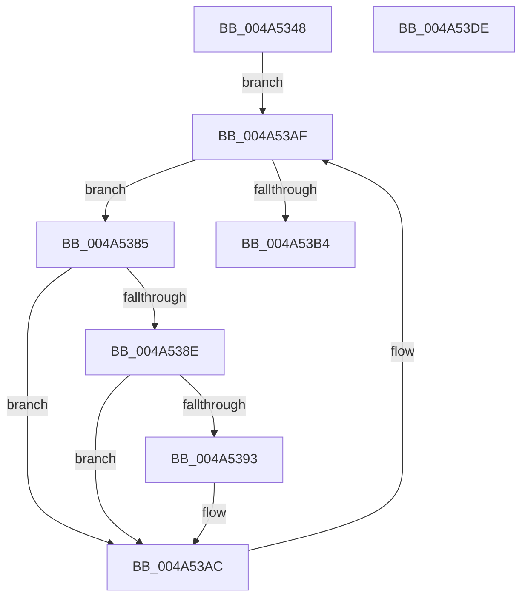

# ExpCheckForLookasideList

- RVA: `0x004A5348`–`0x004A53DF` (길이 `151` bytes)
- VA: `0x00000001404A5348`
- 실행 섹션: `.text`
- PDB 이름 있음: `예`; PDB Function 태그: `아니요`
- unwind 정보 RVA: `0x000847EC`
- 디코드: `47`개 명령, `151/151` bytes 표시
- 미해석 바이트: `0` (있으면 어셈블리에 `.byte`로 보존)

> 이 문서는 커널 이미지의 기계어와 PDB 기호를 분석해 생성했습니다. 4번과 5번은 함수 원형과 자료형을 바이너리 사용 방식에서 추정한 C 해석이며 원본 소스 복구 결과는 아닙니다.

## 1. Dependencies

- 직접 호출 지점: **3**; 고유 호출 대상: **3**
- 직접 호출자로 확인된 함수: **1**
- RIP 상대 이미지 참조: **1**

### Outgoing calls
- `0x004A5378` → [KeAcquireSpinLockRaiseToDpc](../20/KeAcquireSpinLockRaiseToDpc_function_00208470.md) (function, `0x00208470`)
- `0x004A53A6` → [DbgPrintEx](../35/DbgPrintEx_function_00359290.md) (function, `0x00359290`)
- `0x004A53BA` → [KeReleaseSpinLock](../39/KeReleaseSpinLock_function_00392BA0.md) (function, `0x00392BA0`)

### Direct callers
- [ExpCheckForLookaside](ExpCheckForLookaside_function_004A52DC.md) at `0x004A5321`
- [ExpCheckForLookaside](ExpCheckForLookaside_function_004A52DC.md) at `0x004A533A`

### Static image references
- `0x004A539B` → RVA `0x006D03A0` (` ?? ::FNODOBFM::`string'`; read)

## 2. Other-region calls and transfers

- 다른 실행 섹션으로 향하는 call: **0**
- 별도 외부 분기/꼬리 이동을 확인하지 못했습니다.

## 3. Assembly (complete function range)

```asm
004A5348  48 8B C4                        mov rax, rsp
004A534B  48 89 58 08                     mov qword ptr [rax + 8], rbx
004A534F  48 89 68 10                     mov qword ptr [rax + 0x10], rbp
004A5353  48 89 70 18                     mov qword ptr [rax + 0x18], rsi
004A5357  48 89 78 20                     mov qword ptr [rax + 0x20], rdi
004A535B  41 54                           push r12
004A535D  41 56                           push r14
004A535F  41 57                           push r15
004A5361  48 83 EC 30                     sub rsp, 0x30
004A5365  48 8B F9                        mov rdi, rcx
004A5368  4C 8D 24 11                     lea r12, [rcx + rdx]
004A536C  49 8B C9                        mov rcx, r9
004A536F  49 8B E9                        mov rbp, r9
004A5372  49 8B F0                        mov rsi, r8
004A5375  4C 8B FA                        mov r15, rdx
004A5378  E8 F3 30 D6 FF                  call 0x140208470
004A537D  48 8B 1E                        mov rbx, qword ptr [rsi]
004A5380  44 8A F0                        mov r14b, al
004A5383  EB 2A                           jmp 0x1404a53af
004A5385  4C 8D 4B C0                     lea r9, [rbx - 0x40]
004A5389  4C 3B CF                        cmp r9, rdi
004A538C  72 1E                           jb 0x1404a53ac
004A538E  4D 3B CC                        cmp r9, r12
004A5391  73 19                           jae 0x1404a53ac
004A5393  4C 8B CF                        mov r9, rdi
004A5396  4C 89 7C 24 20                  mov qword ptr [rsp + 0x20], r15
004A539B  4C 8D 05 FE AF 22 00            lea r8, [rip + 0x22affe]
004A53A2  33 D2                           xor edx, edx
004A53A4  33 C9                           xor ecx, ecx
004A53A6  E8 E5 3E EB FF                  call 0x140359290
004A53AB  CC                              int3
004A53AC  48 8B 1B                        mov rbx, qword ptr [rbx]
004A53AF  48 3B DE                        cmp rbx, rsi
004A53B2  75 D1                           jne 0x1404a5385
004A53B4  41 8A D6                        mov dl, r14b
004A53B7  48 8B CD                        mov rcx, rbp
004A53BA  E8 E1 D7 EE FF                  call 0x140392ba0
004A53BF  48 8B 5C 24 50                  mov rbx, qword ptr [rsp + 0x50]
004A53C4  48 8B 6C 24 58                  mov rbp, qword ptr [rsp + 0x58]
004A53C9  48 8B 74 24 60                  mov rsi, qword ptr [rsp + 0x60]
004A53CE  48 8B 7C 24 68                  mov rdi, qword ptr [rsp + 0x68]
004A53D3  48 83 C4 30                     add rsp, 0x30
004A53D7  41 5F                           pop r15
004A53D9  41 5E                           pop r14
004A53DB  41 5C                           pop r12
004A53DD  C3                              ret
004A53DE  CC                              int3
```

## 4. C-style interpretation (structured pseudocode)

```c
__int64 __fastcall ExpCheckForLookasideList(__int64 a1, __int64 a2, __int64 a3, __int64 a4)
{
    __int64 result;
    __int64 v_rsp;
    unsigned __int64 v_stack_m28;
    unsigned __int64 v_stack_p10;
    unsigned __int64 v_stack_p18;
    unsigned __int64 v_stack_p20;
    unsigned __int64 v_stack_p8;

    *(unsigned __int64 *)(v_rsp + 8) = v_rbx;
    *(unsigned __int64 *)(v_rsp + 16) = v_rbp;
    *(unsigned __int64 *)(v_rsp + 24) = v_rsi;
    *(unsigned __int64 *)(v_rsp + 32) = v_rdi;
    v_rsp = (v_rsp) - (48);
    result = KeAcquireSpinLockRaiseToDpc(a4, a2, a3, a4);
    goto loc_004A53AF;
loc_004A5385:
    if ((*(unsigned __int64 *)(a3) - 64) < a1) goto loc_004A53AC;
    if ((*(unsigned __int64 *)(a3) - 64) < (a1 + a2 * 1)) {
        a4 = a1;
        v_stack_m28 = a2;
        a3 = v_rip + 2273278;
        a2 = 0;
        a1 = 0;
        result = DbgPrintEx(a1, a2, a3, a4);
    }
loc_004A53AF:
    if ((*(unsigned __int64 *)(*(unsigned __int64 *)(a3))) != a3) goto loc_004A5385;
    result = KeReleaseSpinLock(a4, (unsigned __int8)((unsigned __int8)(result)), a3, a4);
    v_rsp = (v_rsp) + (48);
    return result;
}
```

## 5. (Beta) C Style

```c
int64_t ExpCheckForLookasideList(void *Arg1, int64_t Arg2, void *Arg3, int64_t Arg4)
{
    uint8_t *arg1 = (uint8_t *)Arg1;
    uint8_t *arg3 = (uint8_t *)Arg3;

    int64_t result;
    int64_t local_rsp;
    uint64_t v_stack_m28;
    uint64_t v_stack_p10;
    uint64_t v_stack_p18;
    uint64_t v_stack_p20;
    uint64_t v_stack_p8;

    *(uint64_t *)(local_rsp + 0x8) = local_rbx;
    *(uint64_t *)(local_rsp + 0x10) = local_rbp;
    *(uint64_t *)(local_rsp + 0x18) = local_rsi;
    *(uint64_t *)(local_rsp + 0x20) = local_rdi;
    local_rsp = (local_rsp) - (48);
    result = KeAcquireSpinLockRaiseToDpc(Arg4, Arg2, Arg3, Arg4);
    goto loc_004A53AF;
loc_004A5385:
    if ((*(uint64_t *)(arg3) - 64) < Arg1) goto loc_004A53AC;
    if ((*(uint64_t *)(arg3) - 64) < (Arg1 + Arg2 * 1)) {
        Arg4 = Arg1;
        v_stack_m28 = Arg2;
        Arg3 = v_rip + 2273278;
        Arg2 = 0;
        Arg1 = 0;
        result = DbgPrintEx(Arg1, Arg2, Arg3, Arg4);
    }
loc_004A53AF:
    if ((*(uint64_t *)(*(uint64_t *)(arg3))) != Arg3) goto loc_004A5385;
    result = KeReleaseSpinLock(Arg4, (uint8_t)((uint8_t)(result)), Arg3, Arg4);
    local_rsp = (local_rsp) + (48);
    return result;
}
```

### 관측된 메모리 오프셋

구조체 형식이 확인되지 않은 접근은 인자 기준의 오프셋으로만 기록했습니다.

| 기준 인자 | 오프셋 표현 | 폭 (bit) | 접근 |
|---|---:|---:|---|
| `Arg1` | `+ 0x0 + rdx*1` | `64` | `R` |
| `Arg3` | `+ 0x0` | `64` | `R` |

## 6. Execution-region graph

[열기: 2D/3D 그래프와 함수 탐색 컨트롤 패널](../../../control-panel.html?section=text&rva=0x004A5348&view=graph)

- 2D 그래프는 위에서 아래로 흐르고, 3D 그래프는 빈 공간을 드래그해 회전합니다. Shift+드래그는 이동, 휠은 확대·축소, 함수 노드 선택은 대상 보고서 이동입니다.

### Static fallback


