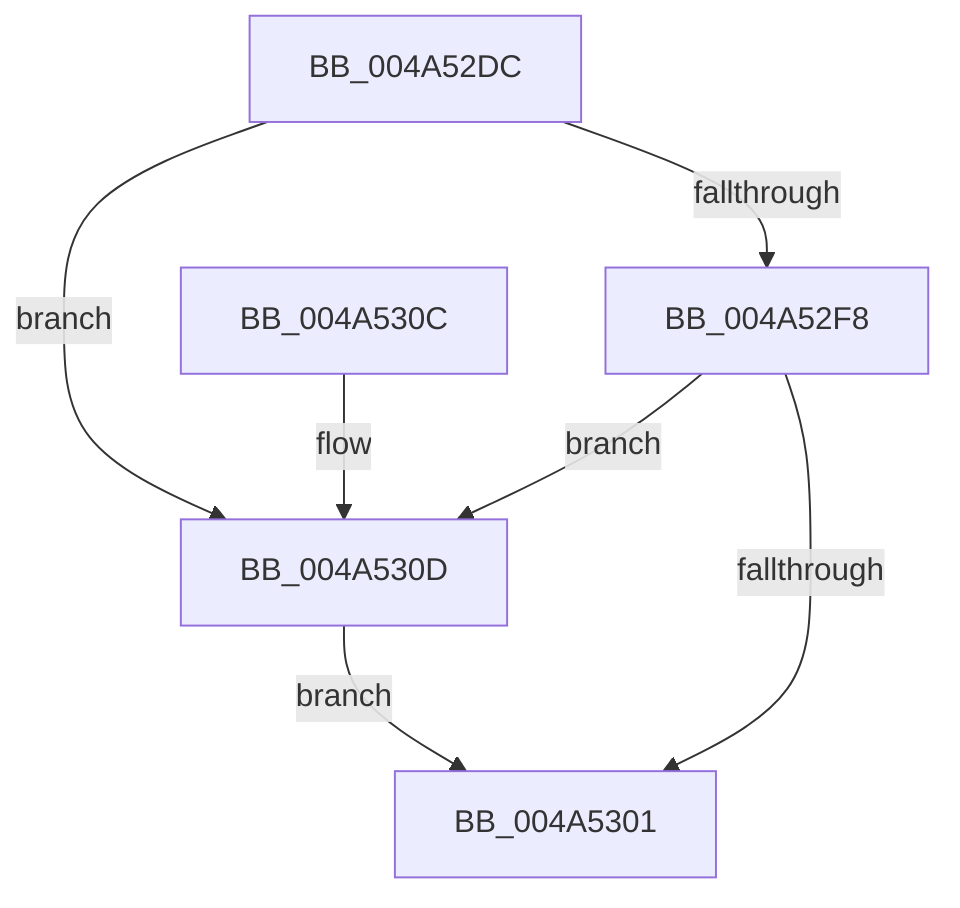

# ExpCheckForLookaside

- RVA: `0x004A52DC`–`0x004A5341` (길이 `101` bytes)
- VA: `0x00000001404A52DC`
- 실행 섹션: `.text`
- PDB 이름 있음: `예`; PDB Function 태그: `아니요`
- unwind 정보 RVA: `0x0008E1C0`
- 디코드: `26`개 명령, `101/101` bytes 표시
- 미해석 바이트: `0` (있으면 어셈블리에 `.byte`로 보존)

> 이 문서는 커널 이미지의 기계어와 PDB 기호를 분석해 생성했습니다. 4번과 5번은 함수 원형과 자료형을 바이너리 사용 방식에서 추정한 C 해석이며 원본 소스 복구 결과는 아닙니다.

## 1. Dependencies

- 직접 호출 지점: **3**; 고유 호출 대상: **2**
- 직접 호출자로 확인된 함수: **4**
- RIP 상대 이미지 참조: **5**

### Outgoing calls
- `0x004A52F8` → [VfCheckForLookaside](../../pagevrfy/BB/VfCheckForLookaside_function_00BB7C80.md) (function, `0x00BB7C80`)
- `0x004A5321` → [ExpCheckForLookasideList](ExpCheckForLookasideList_function_004A5348.md) (function, `0x004A5348`)
- `0x004A533A` → [ExpCheckForLookasideList](ExpCheckForLookasideList_function_004A5348.md) (function, `0x004A5348`)

### Direct callers
- [ExAllocateHeapPool](../35/ExAllocateHeapPool_function_0035BA30.md) at `0x0035E649`
- [ExpFreePoolChecks](../35/ExpFreePoolChecks_function_0035F4F0.md) at `0x0035F559`
- [sub_00360968](../36/Unknown_function_00360968.md) at `0x00360D62`
- [sub_00B8371E](../../poolcode/B8/Unknown_function_00B8371E.md) at `0x00B83B18`

### Static image references
- `0x004A52E6` → RVA `0x00F04A20` (`.data`; read)
- `0x004A530D` → RVA `0x00EFABC0` (`.data`; read)
- `0x004A5317` → RVA `0x00EFABF0` (`.data`; read)
- `0x004A5326` → RVA `0x00EFABE0` (`.data`; read)
- `0x004A5330` → RVA `0x00EFABB0` (`.data`; read)

## 2. Other-region calls and transfers

- 다른 실행 섹션으로 향하는 call: **1**
  - `0x004A52F8` → [VfCheckForLookaside](../../pagevrfy/BB/VfCheckForLookaside_function_00BB7C80.md) (`.text` → `PAGEVRFY`)
- 별도 외부 분기/꼬리 이동을 확인하지 못했습니다.

## 3. Assembly (complete function range)

```asm
004A52DC  48 89 5C 24 08                  mov qword ptr [rsp + 8], rbx
004A52E1  57                              push rdi
004A52E2  48 83 EC 20                     sub rsp, 0x20
004A52E6  F7 05 30 F7 A5 00 00 08 00 00   test dword ptr [rip + 0xa5f730], 0x800
004A52F0  48 8B DA                        mov rbx, rdx
004A52F3  48 8B F9                        mov rdi, rcx
004A52F6  74 15                           je 0x1404a530d
004A52F8  E8 83 29 71 00                  call 0x140bb7c80
004A52FD  85 C0                           test eax, eax
004A52FF  74 0C                           je 0x1404a530d
004A5301  48 8B 5C 24 30                  mov rbx, qword ptr [rsp + 0x30]
004A5306  48 83 C4 20                     add rsp, 0x20
004A530A  5F                              pop rdi
004A530B  C3                              ret
004A530C  CC                              int3
004A530D  4C 8D 0D AC 58 A5 00            lea r9, [rip + 0xa558ac]
004A5314  48 8B D3                        mov rdx, rbx
004A5317  4C 8D 05 D2 58 A5 00            lea r8, [rip + 0xa558d2]
004A531E  48 8B CF                        mov rcx, rdi
004A5321  E8 22 00 00 00                  call 0x1404a5348
004A5326  4C 8D 0D B3 58 A5 00            lea r9, [rip + 0xa558b3]
004A532D  48 8B D3                        mov rdx, rbx
004A5330  4C 8D 05 79 58 A5 00            lea r8, [rip + 0xa55879]
004A5337  48 8B CF                        mov rcx, rdi
004A533A  E8 09 00 00 00                  call 0x1404a5348
004A533F  EB C0                           jmp 0x1404a5301
```

## 4. C-style interpretation (structured pseudocode)

```c
__int64 __fastcall ExpCheckForLookaside(__int64 a1, __int64 a2)
{
    __int64 result;
    __int64 v_rsp;
    unsigned __int64 v_stack_p8;

    v_stack_p8 = v_rbx;
    v_rsp = (v_rsp) - (32);
    if (((*(unsigned int *)(v_rip + 10876720)) & (0x800ULL)) == 0) goto loc_004A530D;
    result = VfCheckForLookaside(a1, a2, a3, a4);
    if ((unsigned int)(result) == 0) goto loc_004A530D;
loc_004A5301:
    v_rsp = (v_rsp) + (32);
    return result;
loc_004A530D:
    result = ExpCheckForLookasideList(a1, v_stack_p8, v_rip + 10836178, v_rip + 10836140);
    result = ExpCheckForLookasideList(a1, v_stack_p8, v_rip + 10836089, v_rip + 10836147);
    goto loc_004A5301;
}
```

## 5. (Beta) C Style

```c
int64_t ExpCheckForLookaside(int64_t Arg1, int64_t Arg2)
{
    int64_t result;
    int64_t local_rsp;
    uint64_t v_stack_p8;

    v_stack_p8 = local_rbx;
    local_rsp = (local_rsp) - (32);
    if (((*(uint32_t *)(v_rip + 0xA5F730)) & (0x800ULL)) == 0) goto loc_004A530D;
    result = VfCheckForLookaside(Arg1, Arg2, a3, a4);
    if ((uint32_t)(result) == 0) goto loc_004A530D;
loc_004A5301:
    local_rsp = (local_rsp) + (32);
    return result;
loc_004A530D:
    result = ExpCheckForLookasideList(Arg1, v_stack_p8, v_rip + 10836178, v_rip + 10836140);
    result = ExpCheckForLookasideList(Arg1, v_stack_p8, v_rip + 10836089, v_rip + 10836147);
    goto loc_004A5301;
}
```

## 6. Execution-region graph

[열기: 2D/3D 그래프와 함수 탐색 컨트롤 패널](../../../control-panel.html?section=text&rva=0x004A52DC&view=graph)

- 2D 그래프는 위에서 아래로 흐르고, 3D 그래프는 빈 공간을 드래그해 회전합니다. Shift+드래그는 이동, 휠은 확대·축소, 함수 노드 선택은 대상 보고서 이동입니다.

### Static fallback


