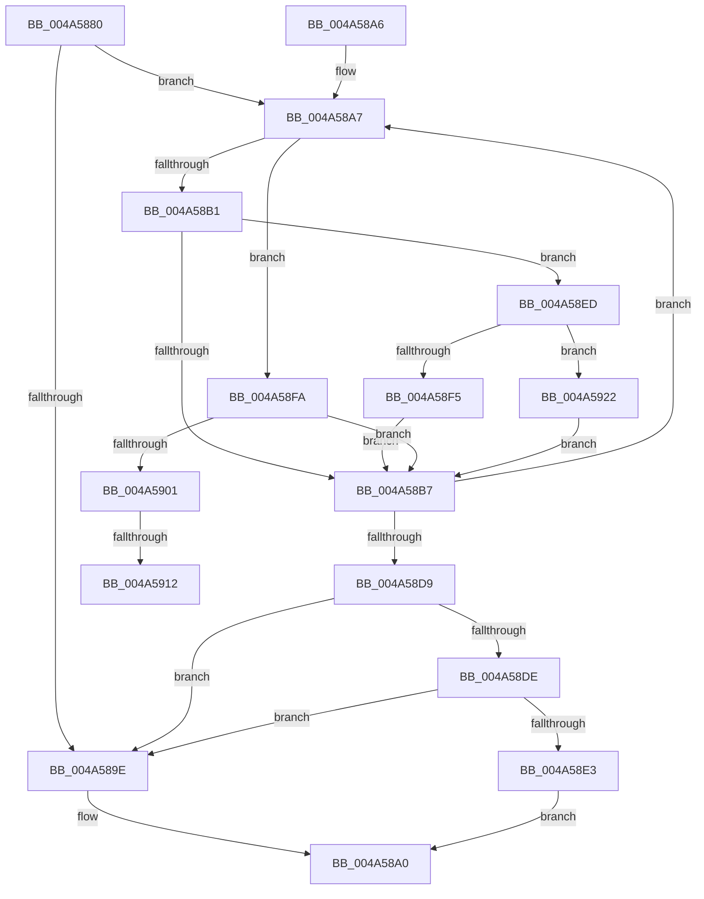

# ExpIsDevicePathForRemovableMedia

- RVA: `0x004A5880`–`0x004A592A` (길이 `170` bytes)
- VA: `0x00000001404A5880`
- 실행 섹션: `.text`
- PDB 이름 있음: `예`; PDB Function 태그: `예`
- unwind 정보 RVA: `0x000B69EC`
- 디코드: `54`개 명령, `170/170` bytes 표시
- 미해석 바이트: `0` (있으면 어셈블리에 `.byte`로 보존)

> 이 문서는 커널 이미지의 기계어와 PDB 기호를 분석해 생성했습니다. 4번과 5번은 함수 원형과 자료형을 바이너리 사용 방식에서 추정한 C 해석이며 원본 소스 복구 결과는 아닙니다.

## 1. Dependencies

- 직접 호출 지점: **0**; 고유 호출 대상: **0**
- 직접 호출자로 확인된 함수: **1**
- RIP 상대 이미지 참조: **2**

### Outgoing calls
- 직접 디코드된 call 명령이 없습니다.

### Direct callers
- [NtEnumerateBootEntries](../../page/A2/NtEnumerateBootEntries_function_00A25040.md) at `0x00A25497`

### Static image references
- `0x004A5905` → RVA `0x00E0EBB0` (`.data`; read)
- `0x004A5916` → RVA `0x00E0EBB8` (`.data`; read)

## 2. Other-region calls and transfers

- 다른 실행 섹션으로 향하는 call: **0**
- call이 아닌 외부 분기/꼬리 이동: **2**
  - `0x004A590C` → [sub_006F984A](../6F/Unknown_function_006F984A.md) (`tail-transfer`)
  - `0x004A591D` → [sub_006F984A](../6F/Unknown_function_006F984A.md) (`tail-transfer`)

## 3. Assembly (complete function range)

```asm
004A5880  48 89 5C 24 08                  mov qword ptr [rsp + 8], rbx
004A5885  44 8A 09                        mov r9b, byte ptr [rcx]
004A5888  33 D2                           xor edx, edx
004A588A  41 8A C1                        mov al, r9b
004A588D  4C 8B C1                        mov r8, rcx
004A5890  24 7F                           and al, 0x7f
004A5892  8B DA                           mov ebx, edx
004A5894  44 8B DA                        mov r11d, edx
004A5897  44 8B D2                        mov r10d, edx
004A589A  3C 7F                           cmp al, 0x7f
004A589C  75 09                           jne 0x1404a58a7
004A589E  33 C0                           xor eax, eax
004A58A0  48 8B 5C 24 08                  mov rbx, qword ptr [rsp + 8]
004A58A5  C3                              ret
004A58A6  CC                              int3
004A58A7  41 80 E1 7F                     and r9b, 0x7f
004A58AB  41 80 F9 01                     cmp r9b, 1
004A58AF  74 49                           je 0x1404a58fa
004A58B1  41 80 F9 04                     cmp r9b, 4
004A58B5  74 36                           je 0x1404a58ed
004A58B7  41 0F B6 48 03                  movzx ecx, byte ptr [r8 + 3]
004A58BC  41 0F B6 40 02                  movzx eax, byte ptr [r8 + 2]
004A58C1  48 C1 E1 08                     shl rcx, 8
004A58C5  48 0B C8                        or rcx, rax
004A58C8  4C 03 C1                        add r8, rcx
004A58CB  45 8A 08                        mov r9b, byte ptr [r8]
004A58CE  41 8A C9                        mov cl, r9b
004A58D1  80 E1 7F                        and cl, 0x7f
004A58D4  80 F9 7F                        cmp cl, 0x7f
004A58D7  75 CE                           jne 0x1404a58a7
004A58D9  48 85 DB                        test rbx, rbx
004A58DC  74 C0                           je 0x1404a589e
004A58DE  4D 85 DB                        test r11, r11
004A58E1  75 BB                           jne 0x1404a589e
004A58E3  4D 85 D2                        test r10, r10
004A58E6  0F 94 C2                        sete dl
004A58E9  8B C2                           mov eax, edx
004A58EB  EB B3                           jmp 0x1404a58a0
004A58ED  41 8A 40 01                     mov al, byte ptr [r8 + 1]
004A58F1  3C 01                           cmp al, 1
004A58F3  75 2D                           jne 0x1404a5922
004A58F5  4D 8B D8                        mov r11, r8
004A58F8  EB BD                           jmp 0x1404a58b7
004A58FA  41 80 78 01 04                  cmp byte ptr [r8 + 1], 4
004A58FF  75 B6                           jne 0x1404a58b7
004A5901  49 8B 48 04                     mov rcx, qword ptr [r8 + 4]
004A5905  48 2B 0D A4 92 96 00            sub rcx, qword ptr [rip + 0x9692a4]
004A590C  0F 85 38 3F 25 00               jne 0x1406f984a
004A5912  49 8B 48 0C                     mov rcx, qword ptr [r8 + 0xc]
004A5916  48 2B 0D 9B 92 96 00            sub rcx, qword ptr [rip + 0x96929b]
004A591D  E9 28 3F 25 00                  jmp 0x1406f984a
004A5922  3C 04                           cmp al, 4
004A5924  4D 0F 44 D0                     cmove r10, r8
004A5928  EB 8D                           jmp 0x1404a58b7
```

## 4. C-style interpretation (structured pseudocode)

```c
__int64 __fastcall ExpIsDevicePathForRemovableMedia(__int64 a1, int a2)
{
    __int64 result;
    __int64 v_r10;
    unsigned __int64 v_stack_p8;

    v_stack_p8 = v_rbx;
    a2 = 0;
    result = (unsigned __int8)(((unsigned __int8)(*(unsigned __int8 *)(a1))) & (127));
    if (((unsigned __int8)(result)) != 127) goto loc_004A58A7;
loc_004A589E:
    result = 0;
loc_004A58A0:
    return result;
loc_004A58A7:
    a4 = (unsigned __int8)((*(unsigned __int8 *)(a1)) & (127));
    if (((unsigned __int8)(a4)) == 1) goto loc_004A58FA;
    if (((unsigned __int8)(a4)) == 4) goto loc_004A58ED;
loc_004A58B7:
    a1 = (*(unsigned __int8 *)(a1 + 3)) << (8);
    a1 = (a1) | (*(unsigned __int8 *)(a1 + 2));
    a3 = (a1) + (a1);
    a1 = (unsigned __int8)(((unsigned __int8)(*(unsigned __int8 *)(a3))) & (127));
    if (((unsigned __int8)(a1)) != 127) goto loc_004A58A7;
    if (v_stack_p8 == 0) goto loc_004A589E;
    if (0 != 0) goto loc_004A589E;
    a2 = (0 == 0) ? 1 : 0;
    goto loc_004A58A0;
loc_004A58ED:
    if (((unsigned __int8)(*(unsigned __int8 *)(a3 + 1))) != 1) goto loc_004A5922;
    goto loc_004A58B7;
loc_004A58FA:
    if ((*(unsigned __int8 *)(a3 + 1)) != 4) goto loc_004A58B7;
    a1 = (*(unsigned __int64 *)(a3 + 4)) - (*(unsigned __int64 *)(v_rip + 9867940));
    a1 = (*(unsigned __int64 *)(a3 + 12)) - (*(unsigned __int64 *)(v_rip + 9867931));
loc_004A5922:
    v_r10 = 0;
    if (((unsigned __int8)(*(unsigned __int8 *)(a3 + 1))) == 4) { v_r10 = a3; }
    goto loc_004A58B7;
}
```

## 5. (Beta) C Style

```c
int64_t ExpIsDevicePathForRemovableMedia(void *Arg1, int32_t Arg2)
{
    uint8_t *arg1 = (uint8_t *)Arg1;

    int64_t result;
    int64_t local_r10;
    uint64_t v_stack_p8;

    v_stack_p8 = local_rbx;
    Arg2 = 0;
    result = (uint8_t)(((uint8_t)(*(uint8_t *)(arg1))) & (127));
    if (((uint8_t)(result)) != 127) goto loc_004A58A7;
loc_004A589E:
    result = 0;
loc_004A58A0:
    return result;
loc_004A58A7:
    a4 = (uint8_t)((*(uint8_t *)(arg1)) & (127));
    if (((uint8_t)(a4)) == 1) goto loc_004A58FA;
    if (((uint8_t)(a4)) == 4) goto loc_004A58ED;
loc_004A58B7:
    Arg1 = (*(uint8_t *)(arg1 + 0x3)) << (8);
    Arg1 = (Arg1) | (*(uint8_t *)(arg1 + 0x2));
    a3 = (Arg1) + (Arg1);
    Arg1 = (uint8_t)(((uint8_t)(*(uint8_t *)(a3))) & (127));
    if (((uint8_t)(Arg1)) != 127) goto loc_004A58A7;
    if (v_stack_p8 == 0) goto loc_004A589E;
    if (0 != 0) goto loc_004A589E;
    Arg2 = (0 == 0) ? 1 : 0;
    goto loc_004A58A0;
loc_004A58ED:
    if (((uint8_t)(*(uint8_t *)(a3 + 0x1))) != 1) goto loc_004A5922;
    goto loc_004A58B7;
loc_004A58FA:
    if ((*(uint8_t *)(a3 + 0x1)) != 4) goto loc_004A58B7;
    Arg1 = (*(uint64_t *)(a3 + 0x4)) - (*(uint64_t *)(v_rip + 0x9692A4));
    Arg1 = (*(uint64_t *)(a3 + 0xC)) - (*(uint64_t *)(v_rip + 0x96929B));
loc_004A5922:
    local_r10 = 0;
    if (((uint8_t)(*(uint8_t *)(a3 + 0x1))) == 4) { local_r10 = a3; }
    goto loc_004A58B7;
}
```

### 관측된 메모리 오프셋

구조체 형식이 확인되지 않은 접근은 인자 기준의 오프셋으로만 기록했습니다.

| 기준 인자 | 오프셋 표현 | 폭 (bit) | 접근 |
|---|---:|---:|---|
| `Arg1` | `+ 0x0` | `8` | `R` |
| `Arg1` | `+ 0x1` | `8` | `R` |
| `Arg1` | `+ 0x2` | `8` | `R` |
| `Arg1` | `+ 0x3` | `8` | `R` |
| `Arg1` | `+ 0x4` | `64` | `R` |
| `Arg1` | `+ 0xC` | `64` | `R` |

## 6. Execution-region graph

[열기: 2D/3D 그래프와 함수 탐색 컨트롤 패널](../../../control-panel.html?section=text&rva=0x004A5880&view=graph)

- 2D 그래프는 위에서 아래로 흐르고, 3D 그래프는 빈 공간을 드래그해 회전합니다. Shift+드래그는 이동, 휠은 확대·축소, 함수 노드 선택은 대상 보고서 이동입니다.

### Static fallback


