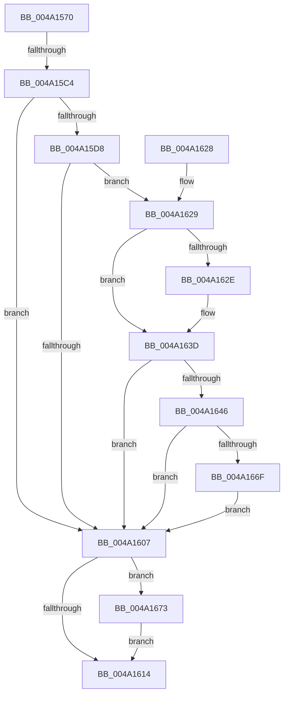

# ExpTimerDpcRoutine

- RVA: `0x004A1570`–`0x004A1682` (길이 `274` bytes)
- VA: `0x00000001404A1570`
- 실행 섹션: `.text`
- PDB 이름 있음: `예`; PDB Function 태그: `예`
- unwind 정보 RVA: `0x000B5B74`
- 디코드: `72`개 명령, `274/274` bytes 표시
- 미해석 바이트: `0` (있으면 어셈블리에 `.byte`로 보존)

> 이 문서는 커널 이미지의 기계어와 PDB 기호를 분석해 생성했습니다. 4번과 5번은 함수 원형과 자료형을 바이너리 사용 방식에서 추정한 C 해석이며 원본 소스 복구 결과는 아닙니다.

## 1. Dependencies

- 직접 호출 지점: **7**; 고유 호출 대상: **7**
- 직접 호출자로 확인된 함수: **0**
- RIP 상대 이미지 참조: **0**

### Outgoing calls
- `0x004A15AB` → [memset](../6C/memset_function_006C6C40.md) (function, `0x006C6C40`)
- `0x004A15CA` → [KeAcquireSpinLockAtDpcLevel](../20/KeAcquireSpinLockAtDpcLevel_function_00208430.md) (function, `0x00208430`)
- `0x004A15F3` → [KeInsertQueueApc](../20/KeInsertQueueApc_function_00203F10.md) (function, `0x00203F10`)
- `0x004A160B` → [KxReleaseSpinLock](../20/KxReleaseSpinLock_function_00206670.md) (function, `0x00206670`)
- `0x004A1636` → [ObfReferenceObjectWithTag](../21/ObfReferenceObjectWithTag_function_00210710.md) (function, `0x00210710`)
- `0x004A1666` → [KeSetCoalescableTimer](../22/KeSetCoalescableTimer_function_0022FFD0.md) (function, `0x0022FFD0`)
- `0x004A167B` → [ObfDereferenceObjectWithTag](../2F/ObfDereferenceObjectWithTag_function_002F78E0.md) (function, `0x002F78E0`)

### Direct callers
- 이 함수 시작 RVA로 연결되는 직접 call은 확인되지 않았습니다. 간접 호출은 완전히 역산할 수 없습니다.

### Static image references
- 디코드된 RIP-relative 메모리 참조가 없습니다.

## 2. Other-region calls and transfers

- 다른 실행 섹션으로 향하는 call: **0**
- call이 아닌 외부 분기/꼬리 이동: **1**
  - `0x004A15BE` → [sub_006F86C0](../6F/Unknown_function_006F86C0.md) (`tail-transfer`)

## 3. Assembly (complete function range)

```asm
004A1570  48 8B C4                        mov rax, rsp
004A1573  48 89 58 18                     mov qword ptr [rax + 0x18], rbx
004A1577  48 89 50 10                     mov qword ptr [rax + 0x10], rdx
004A157B  48 89 48 08                     mov qword ptr [rax + 8], rcx
004A157F  56                              push rsi
004A1580  57                              push rdi
004A1581  41 56                           push r14
004A1583  48 81 EC 90 01 00 00            sub rsp, 0x190
004A158A  48 89 A4 24 80 01 00 00         mov qword ptr [rsp + 0x180], rsp
004A1592  4D 8B F1                        mov r14, r9
004A1595  49 8B F0                        mov rsi, r8
004A1598  48 8B DA                        mov rbx, rdx
004A159B  48 8B F9                        mov rdi, rcx
004A159E  33 D2                           xor edx, edx
004A15A0  44 8D 42 59                     lea r8d, [rdx + 0x59]
004A15A4  48 8D 88 68 FF FF FF            lea rcx, [rax - 0x98]
004A15AB  E8 90 56 22 00                  call 0x1406c6c40
004A15B0  48 8B C3                        mov rax, rbx
004A15B3  48 C1 F8 2F                     sar rax, 0x2f
004A15B7  48 FF C0                        inc rax
004A15BA  48 83 F8 01                     cmp rax, 1
004A15BE  0F 87 FC 70 25 00               ja 0x1406f86c0
004A15C4  33 F6                           xor esi, esi
004A15C6  48 8D 4B 40                     lea rcx, [rbx + 0x40]
004A15CA  E8 61 6E D6 FF                  call 0x140208430
004A15CF  F6 83 30 01 00 00 01            test byte ptr [rbx + 0x130], 1
004A15D6  74 2F                           je 0x1404a1607
004A15D8  49 B8 14 00 00 00 80 F7 FF FF   movabs r8, 0xfffff78000000014
004A15E2  4D 8B 00                        mov r8, qword ptr [r8]
004A15E5  41 8B D0                        mov edx, r8d
004A15E8  49 C1 E8 20                     shr r8, 0x20
004A15EC  48 8D 4B 48                     lea rcx, [rbx + 0x48]
004A15F0  45 33 C9                        xor r9d, r9d
004A15F3  E8 18 29 D6 FF                  call 0x140203f10
004A15F8  84 C0                           test al, al
004A15FA  40 0F 94 C6                     sete sil
004A15FE  83 BB F0 00 00 00 00            cmp dword ptr [rbx + 0xf0], 0
004A1605  75 22                           jne 0x1404a1629
004A1607  48 8D 4B 40                     lea rcx, [rbx + 0x40]
004A160B  E8 60 50 D6 FF                  call 0x140206670
004A1610  85 F6                           test esi, esi
004A1612  75 5F                           jne 0x1404a1673
004A1614  48 8B 9C 24 C0 01 00 00         mov rbx, qword ptr [rsp + 0x1c0]
004A161C  48 81 C4 90 01 00 00            add rsp, 0x190
004A1623  41 5E                           pop r14
004A1625  5F                              pop rdi
004A1626  5E                              pop rsi
004A1627  C3                              ret
004A1628  CC                              int3
004A1629  83 EE 01                        sub esi, 1
004A162C  79 0F                           jns 0x1404a163d
004A162E  BA 44 66 6C 74                  mov edx, 0x746c6644
004A1633  48 8B CB                        mov rcx, rbx
004A1636  E8 D5 F0 D6 FF                  call 0x140210710
004A163B  33 F6                           xor esi, esi
004A163D  F6 83 30 01 00 00 02            test byte ptr [rbx + 0x130], 2
004A1644  75 C1                           jne 0x1404a1607
004A1646  48 63 83 F0 00 00 00            movsxd rax, dword ptr [rbx + 0xf0]
004A164D  48 69 D0 F0 D8 FF FF            imul rdx, rax, -0x2710
004A1654  48 89 7C 24 20                  mov qword ptr [rsp + 0x20], rdi
004A1659  44 8B 8B 40 01 00 00            mov r9d, dword ptr [rbx + 0x140]
004A1660  45 33 C0                        xor r8d, r8d
004A1663  48 8B CB                        mov rcx, rbx
004A1666  E8 65 E9 D8 FF                  call 0x14022ffd0
004A166B  84 C0                           test al, al
004A166D  74 98                           je 0x1404a1607
004A166F  FF C6                           inc esi
004A1671  EB 94                           jmp 0x1404a1607
004A1673  BA 44 66 6C 74                  mov edx, 0x746c6644
004A1678  48 8B CB                        mov rcx, rbx
004A167B  E8 60 62 E5 FF                  call 0x1402f78e0
004A1680  EB 92                           jmp 0x1404a1614
```

## 4. C-style interpretation (structured pseudocode)

```c
__int64 __fastcall ExpTimerDpcRoutine(__int64 a1, __int64 a2, __int64 a3, __int64 a4)
{
    __int64 result;
    __int64 v_rsi;
    __int64 v_rsp;
    unsigned __int64 v_stack_m28;
    unsigned __int64 v_stack_p18;
    unsigned __int64 v_stack_p20;

    *(unsigned __int64 *)(v_rsp + 24) = v_rbx;
    *(unsigned __int64 *)(v_rsp + 16) = a2;
    *(unsigned __int64 *)(v_rsp + 8) = a1;
    v_rsp = (v_rsp) - (400);
    v_stack_m28 = v_rsp;
    a2 = 0;
    result = memset(v_rsp - 152, a2, a2 + 89, a4);
    result = (0) >> (47);
    result = (result) + 1;
    v_rsi = 0;
    result = KeAcquireSpinLockAtDpcLevel(a2 + 64, a2, a2 + 89, a4);
    if (((*(unsigned __int8 *)(a2 + 304)) & (1)) == 0) goto loc_004A1607;
    a3 = (*(unsigned __int64 *)(a2 + 89)) >> (32);
    a4 = 0;
    result = KeInsertQueueApc(a2 + 72, (unsigned int)((unsigned int)(*(unsigned __int64 *)(a2 + 89))), a3, a4);
    v_rsi = ((unsigned __int8)(result) == 0) ? 1 : 0;
    if ((*(unsigned int *)(a2 + 240)) != 0) goto loc_004A1629;
loc_004A1607:
    result = KxReleaseSpinLock(a2 + 64, (unsigned int)((unsigned int)(*(unsigned __int64 *)(a2 + 89))), a3, a4);
    if ((unsigned int)(v_rsi) != 0) goto loc_004A1673;
loc_004A1614:
    v_rsp = (v_rsp) + (400);
    return result;
loc_004A1629:
    v_rsi = (unsigned int)((v_rsi) - (1));
    if (sign_flag) {
        a2 = 0x746C6644ULL;
        a1 = v_stack_p18;
        result = ObfReferenceObjectWithTag(a1, a2, a3, a4);
        v_rsi = 0;
    }
    if (((*(unsigned __int8 *)(v_stack_p18 + 304)) & (2)) != 0) goto loc_004A1607;
    a2 = (a2) * ((int)(*(unsigned int *)(v_stack_p18 + 240)));
    v_stack_p20 = a1;
    a3 = 0;
    result = KeSetCoalescableTimer(v_stack_p18, a2, a3, (unsigned int)(*(unsigned int *)(v_stack_p18 + 320)));
    if ((unsigned __int8)(result) == 0) goto loc_004A1607;
    v_rsi = (unsigned int)((v_rsi) + 1);
    goto loc_004A1607;
loc_004A1673:
    result = ObfDereferenceObjectWithTag(v_stack_p18, (unsigned int)(0x746C6644ULL), a3, (unsigned int)(*(unsigned int *)(v_stack_p18 + 320)));
    goto loc_004A1614;
}
```

## 5. (Beta) C Style

```c
int64_t ExpTimerDpcRoutine(int64_t Arg1, void *Arg2, int64_t Arg3, int64_t Arg4)
{
    uint8_t *arg2 = (uint8_t *)Arg2;

    int64_t result;
    int64_t local_rsi;
    int64_t local_rsp;
    uint64_t v_stack_m28;
    uint64_t v_stack_p18;
    uint64_t v_stack_p20;

    *(uint64_t *)(local_rsp + 0x18) = local_rbx;
    *(void **)(local_rsp + 0x10) = Arg2;
    *(uint64_t *)(local_rsp + 0x8) = Arg1;
    local_rsp = (local_rsp) - (400);
    v_stack_m28 = local_rsp;
    Arg2 = 0;
    result = memset(local_rsp - 152, Arg2, Arg2 + 89, Arg4);
    result = (0) >> (47);
    result = (result) + 1;
    local_rsi = 0;
    result = KeAcquireSpinLockAtDpcLevel(Arg2 + 64, Arg2, Arg2 + 89, Arg4);
    if (((*(uint8_t *)(arg2 + 0x130)) & (1)) == 0) goto loc_004A1607;
    Arg3 = (*(uint64_t *)(arg2 + 0x59)) >> (32);
    Arg4 = 0;
    result = KeInsertQueueApc(Arg2 + 72, (uint32_t)((uint32_t)(*(uint64_t *)(arg2 + 0x59))), Arg3, Arg4);
    local_rsi = ((uint8_t)(result) == 0) ? 1 : 0;
    if ((*(uint32_t *)(arg2 + 0xF0)) != 0) goto loc_004A1629;
loc_004A1607:
    result = KxReleaseSpinLock(Arg2 + 64, (uint32_t)((uint32_t)(*(uint64_t *)(arg2 + 0x59))), Arg3, Arg4);
    if ((uint32_t)(local_rsi) != 0) goto loc_004A1673;
loc_004A1614:
    local_rsp = (local_rsp) + (400);
    return result;
loc_004A1629:
    local_rsi = (uint32_t)((local_rsi) - (1));
    if (sign_flag) {
        Arg2 = 0x746C6644ULL;
        Arg1 = v_stack_p18;
        result = ObfReferenceObjectWithTag(Arg1, Arg2, Arg3, Arg4);
        local_rsi = 0;
    }
    if (((*(uint8_t *)(v_stack_p18 + 0x130)) & (2)) != 0) goto loc_004A1607;
    Arg2 = (Arg2) * ((int32_t)(*(uint32_t *)(v_stack_p18 + 0xF0)));
    v_stack_p20 = Arg1;
    Arg3 = 0;
    result = KeSetCoalescableTimer(v_stack_p18, Arg2, Arg3, (uint32_t)(*(uint32_t *)(v_stack_p18 + 0x140)));
    if ((uint8_t)(result) == 0) goto loc_004A1607;
    local_rsi = (uint32_t)((local_rsi) + 1);
    goto loc_004A1607;
loc_004A1673:
    result = ObfDereferenceObjectWithTag(v_stack_p18, (uint32_t)(0x746C6644ULL), Arg3, (uint32_t)(*(uint32_t *)(v_stack_p18 + 0x140)));
    goto loc_004A1614;
}
```

### 관측된 메모리 오프셋

구조체 형식이 확인되지 않은 접근은 인자 기준의 오프셋으로만 기록했습니다.

| 기준 인자 | 오프셋 표현 | 폭 (bit) | 접근 |
|---|---:|---:|---|
| `Arg2` | `+ 0x40` | `64` | `R` |
| `Arg2` | `+ 0x48` | `64` | `R` |
| `Arg2` | `+ 0xF0` | `32` | `R` |
| `Arg2` | `+ 0x130` | `8` | `R` |
| `Arg2` | `+ 0x140` | `32` | `R` |

## 6. Execution-region graph

[열기: 2D/3D 그래프와 함수 탐색 컨트롤 패널](../../../control-panel.html?section=text&rva=0x004A1570&view=graph)

- 2D 그래프는 위에서 아래로 흐르고, 3D 그래프는 빈 공간을 드래그해 회전합니다. Shift+드래그는 이동, 휠은 확대·축소, 함수 노드 선택은 대상 보고서 이동입니다.

### Static fallback


