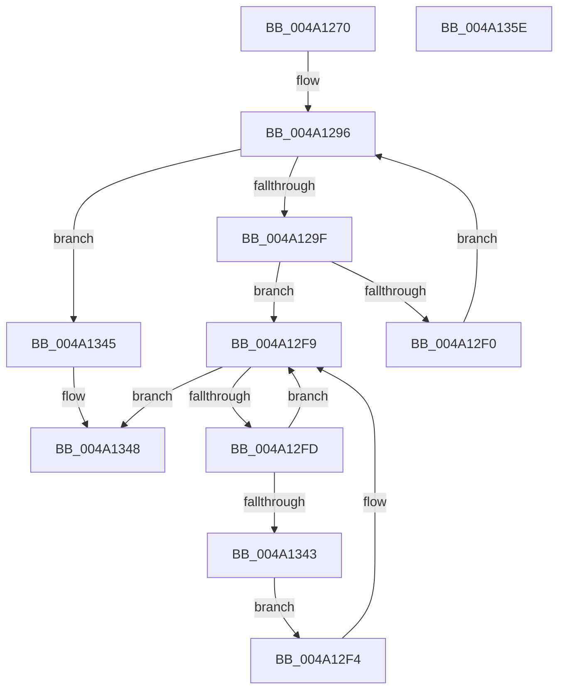

# ExpTryAcquireFannedOutPushLockExclusive

- RVA: `0x004A1270`–`0x004A135F` (길이 `239` bytes)
- VA: `0x00000001404A1270`
- 실행 섹션: `.text`
- PDB 이름 있음: `예`; PDB Function 태그: `아니요`
- unwind 정보 RVA: `0x000B5B20`
- 디코드: `70`개 명령, `239/239` bytes 표시
- 미해석 바이트: `0` (있으면 어셈블리에 `.byte`로 보존)

> 이 문서는 커널 이미지의 기계어와 PDB 기호를 분석해 생성했습니다. 4번과 5번은 함수 원형과 자료형을 바이너리 사용 방식에서 추정한 C 해석이며 원본 소스 복구 결과는 아닙니다.

## 1. Dependencies

- 직접 호출 지점: **2**; 고유 호출 대상: **2**
- 직접 호출자로 확인된 함수: **1**
- RIP 상대 이미지 참조: **1**

### Outgoing calls
- `0x004A128A` → [KeQueryMaximumProcessorCountEx](../26/KeQueryMaximumProcessorCountEx_function_00264D60.md) (function, `0x00264D60`)
- `0x004A12F4` → [ExfTryToWakePushLock](../26/ExfTryToWakePushLock_function_00265DD0.md) (function, `0x00265DD0`)

### Direct callers
- [ExTryAcquireAutoExpandPushLockExclusive](ExTryAcquireAutoExpandPushLockExclusive_function_004A9AA0.md) at `0x004A9B3A`

### Static image references
- `0x004A129F` → RVA `0x00EFA278` (`.data`; read)

## 2. Other-region calls and transfers

- 다른 실행 섹션으로 향하는 call: **0**
- 별도 외부 분기/꼬리 이동을 확인하지 못했습니다.

## 3. Assembly (complete function range)

```asm
004A1270  48 89 5C 24 08                  mov qword ptr [rsp + 8], rbx
004A1275  48 89 6C 24 20                  mov qword ptr [rsp + 0x20], rbp
004A127A  56                              push rsi
004A127B  57                              push rdi
004A127C  41 56                           push r14
004A127E  48 83 EC 20                     sub rsp, 0x20
004A1282  48 8B E9                        mov rbp, rcx
004A1285  B9 FF FF 00 00                  mov ecx, 0xffff
004A128A  E8 D1 3A DC FF                  call 0x140264d60
004A128F  33 FF                           xor edi, edi
004A1291  44 8B D0                        mov r10d, eax
004A1294  8B DF                           mov ebx, edi
004A1296  41 3B DA                        cmp ebx, r10d
004A1299  0F 83 A6 00 00 00               jae 0x1404a1345
004A129F  48 8B 05 D2 8F A5 00            mov rax, qword ptr [rip + 0xa58fd2]
004A12A6  44 8B F5                        mov r14d, ebp
004A12A9  41 C1 EE 0D                     shr r14d, 0xd
004A12AD  8B F5                           mov esi, ebp
004A12AF  41 81 E6 FF FF 03 00            and r14d, 0x3ffff
004A12B6  8B D3                           mov edx, ebx
004A12B8  41 0F BD CE                     bsr ecx, r14d
004A12BC  4C 8B 04 D0                     mov r8, qword ptr [rax + rdx*8]
004A12C0  B8 01 00 00 00                  mov eax, 1
004A12C5  D3 E0                           shl eax, cl
004A12C7  89 4C 24 48                     mov dword ptr [rsp + 0x48], ecx
004A12CB  48 C1 EE 04                     shr rsi, 4
004A12CF  44 8D 49 FE                     lea r9d, [rcx - 2]
004A12D3  81 E6 FF 01 00 00               and esi, 0x1ff
004A12D9  8B C8                           mov ecx, eax
004A12DB  4B 8B 04 C8                     mov rax, qword ptr [r8 + r9*8]
004A12DF  49 33 CE                        xor rcx, r14
004A12E2  48 8B 54 C8 08                  mov rdx, qword ptr [rax + rcx*8 + 8]
004A12E7  F0 48 0F BA 2C F2 00            lock bts qword ptr [rdx + rsi*8], 0
004A12EE  72 09                           jb 0x1404a12f9
004A12F0  FF C3                           inc ebx
004A12F2  EB A2                           jmp 0x1404a1296
004A12F4  E8 D7 4A DC FF                  call 0x140265dd0
004A12F9  85 DB                           test ebx, ebx
004A12FB  74 4B                           je 0x1404a1348
004A12FD  41 0F BD CE                     bsr ecx, r14d
004A1301  8D 43 FF                        lea eax, [rbx - 1]
004A1304  8B D0                           mov edx, eax
004A1306  8B D8                           mov ebx, eax
004A1308  48 8B 05 69 8F A5 00            mov rax, qword ptr [rip + 0xa58f69]
004A130F  89 4C 24 50                     mov dword ptr [rsp + 0x50], ecx
004A1313  44 8D 49 FE                     lea r9d, [rcx - 2]
004A1317  4C 8B 04 D0                     mov r8, qword ptr [rax + rdx*8]
004A131B  B8 01 00 00 00                  mov eax, 1
004A1320  D3 E0                           shl eax, cl
004A1322  8B C8                           mov ecx, eax
004A1324  49 33 CE                        xor rcx, r14
004A1327  4B 8B 04 C8                     mov rax, qword ptr [r8 + r9*8]
004A132B  48 8B 4C C8 08                  mov rcx, qword ptr [rax + rcx*8 + 8]
004A1330  48 83 C8 FF                     or rax, 0xffffffffffffffff
004A1334  48 8D 0C F1                     lea rcx, [rcx + rsi*8]
004A1338  F0 48 0F C1 01                  lock xadd qword ptr [rcx], rax
004A133D  24 06                           and al, 6
004A133F  3C 02                           cmp al, 2
004A1341  75 B6                           jne 0x1404a12f9
004A1343  EB AF                           jmp 0x1404a12f4
004A1345  40 B7 01                        mov dil, 1
004A1348  48 8B 5C 24 40                  mov rbx, qword ptr [rsp + 0x40]
004A134D  40 8A C7                        mov al, dil
004A1350  48 8B 6C 24 58                  mov rbp, qword ptr [rsp + 0x58]
004A1355  48 83 C4 20                     add rsp, 0x20
004A1359  41 5E                           pop r14
004A135B  5F                              pop rdi
004A135C  5E                              pop rsi
004A135D  C3                              ret
004A135E  CC                              int3
```

## 4. C-style interpretation (structured pseudocode)

```c
__int64 __fastcall ExpTryAcquireFannedOutPushLockExclusive(__int64 a1)
{
    __int64 result;
    __int64 v_r14;
    __int64 v_rbx;
    __int64 v_rdi;
    __int64 v_rsi;
    __int64 v_rsp;
    unsigned int v_stack_p10;
    unsigned int v_stack_p18;
    unsigned __int64 v_stack_p20;
    unsigned __int64 v_stack_p8;

    v_stack_p8 = v_rbx;
    v_stack_p20 = v_rbp;
    v_rsp = (v_rsp) - (32);
    result = KeQueryMaximumProcessorCountEx((unsigned int)(0xFFFFULL), a2, a3, a4);
    v_rdi = 0;
loc_004A1296:
    if (0 >= ((unsigned int)((unsigned int)((unsigned int)(result))))) goto loc_004A1345;
    v_r14 = (unsigned int)(((unsigned int)((unsigned int)(a1))) >> (13));
    v_r14 = (unsigned int)((v_r14) & (0x3FFFFULL));
    result = (unsigned int)((1) << ((unsigned __int8)((unsigned int)(0xFFFFULL))));
    v_stack_p10 = (unsigned int)((unsigned int)(0xFFFFULL));
    v_rsi = ((unsigned int)((unsigned int)(a1))) >> (4);
    v_rsi = (unsigned int)((v_rsi) & (511));
    a1 = ((unsigned int)((unsigned int)(result))) ^ (v_r14);
    if (condition_is_below) goto loc_004A12F9;
    v_rbx = (unsigned int)((0) + 1);
    goto loc_004A1296;
loc_004A12F4:
    result = ExfTryToWakePushLock(a1, *(unsigned __int64 *)(*(unsigned __int64 *)(*(unsigned __int64 *)(*(unsigned __int64 *)(v_rip + 10850258) + 0 * 8) + (unsigned int)(0xFFFFULL) - 2 * 8) + a1 * 8 + 8), *(unsigned __int64 *)(*(unsigned __int64 *)(v_rip + 10850258) + 0 * 8), (unsigned int)(0xFFFFULL) - 2);
loc_004A12F9:
    if ((unsigned int)(v_rbx) == 0) goto loc_004A1348;
    v_stack_p18 = (unsigned int)(a1);
    result = (unsigned int)((1) << ((unsigned __int8)(a1)));
    a1 = ((unsigned int)((unsigned int)(result))) ^ (v_r14);
    result = (*(unsigned __int64 *)(*(unsigned __int64 *)(*(unsigned __int64 *)(v_rip + 10850153) + (unsigned int)((unsigned int)(v_rbx - 1)) * 8) + a1 - 2 * 8)) | (-1);
    result = (unsigned __int8)((result) & (6));
    if (((unsigned __int8)(result)) != 2) goto loc_004A12F9;
    goto loc_004A12F4;
loc_004A1345:
loc_004A1348:
    v_rsp = (v_rsp) + (32);
    return 1;
}
```

## 5. (Beta) C Style

```c
int64_t ExpTryAcquireFannedOutPushLockExclusive(int64_t Arg1)
{
    int64_t result;
    int64_t local_r14;
    int64_t local_rbx;
    int64_t local_rdi;
    int64_t local_rsi;
    int64_t local_rsp;
    uint32_t v_stack_p10;
    uint32_t v_stack_p18;
    uint64_t v_stack_p20;
    uint64_t v_stack_p8;

    v_stack_p8 = local_rbx;
    v_stack_p20 = local_rbp;
    local_rsp = (local_rsp) - (32);
    result = KeQueryMaximumProcessorCountEx((uint32_t)(0xFFFFULL), a2, a3, a4);
    local_rdi = 0;
loc_004A1296:
    if (0 >= ((uint32_t)((uint32_t)((uint32_t)(result))))) goto loc_004A1345;
    local_r14 = (uint32_t)(((uint32_t)((uint32_t)(Arg1))) >> (13));
    local_r14 = (uint32_t)((local_r14) & (0x3FFFFULL));
    result = (uint32_t)((1) << ((uint8_t)((uint32_t)(0xFFFFULL))));
    v_stack_p10 = (uint32_t)((uint32_t)(0xFFFFULL));
    local_rsi = ((uint32_t)((uint32_t)(Arg1))) >> (4);
    local_rsi = (uint32_t)((local_rsi) & (511));
    Arg1 = ((uint32_t)((uint32_t)(result))) ^ (local_r14);
    if (condition_is_below) goto loc_004A12F9;
    local_rbx = (uint32_t)((0) + 1);
    goto loc_004A1296;
loc_004A12F4:
    result = ExfTryToWakePushLock(Arg1, *(uint64_t *)(*(uint64_t *)(*(uint64_t *)(*(uint64_t *)(v_rip + 0xA58FD2) + 0x0 * 8) + (uint32_t)(0xFFFFULL) - 0x2 * 8) + Arg1 * 8 + 0x8), *(uint64_t *)(*(uint64_t *)(v_rip + 0xA58FD2) + 0x0 * 8), (uint32_t)(0xFFFFULL) - 2);
loc_004A12F9:
    if ((uint32_t)(local_rbx) == 0) goto loc_004A1348;
    v_stack_p18 = (uint32_t)(Arg1);
    result = (uint32_t)((1) << ((uint8_t)(Arg1)));
    Arg1 = ((uint32_t)((uint32_t)(result))) ^ (local_r14);
    result = (*(uint64_t *)(*(uint64_t *)(*(uint64_t *)(v_rip + 0xA58F69) + (uint32_t)((uint32_t)(local_rbx - 0x1)) * 8) + Arg1 - 0x2 * 8)) | (-1);
    result = (uint8_t)((result) & (6));
    if (((uint8_t)(result)) != 2) goto loc_004A12F9;
    goto loc_004A12F4;
loc_004A1345:
loc_004A1348:
    local_rsp = (local_rsp) + (32);
    return 1;
}
```

## 6. Execution-region graph

[열기: 2D/3D 그래프와 함수 탐색 컨트롤 패널](../../../control-panel.html?section=text&rva=0x004A1270&view=graph)

- 2D 그래프는 위에서 아래로 흐르고, 3D 그래프는 빈 공간을 드래그해 회전합니다. Shift+드래그는 이동, 휠은 확대·축소, 함수 노드 선택은 대상 보고서 이동입니다.

### Static fallback


