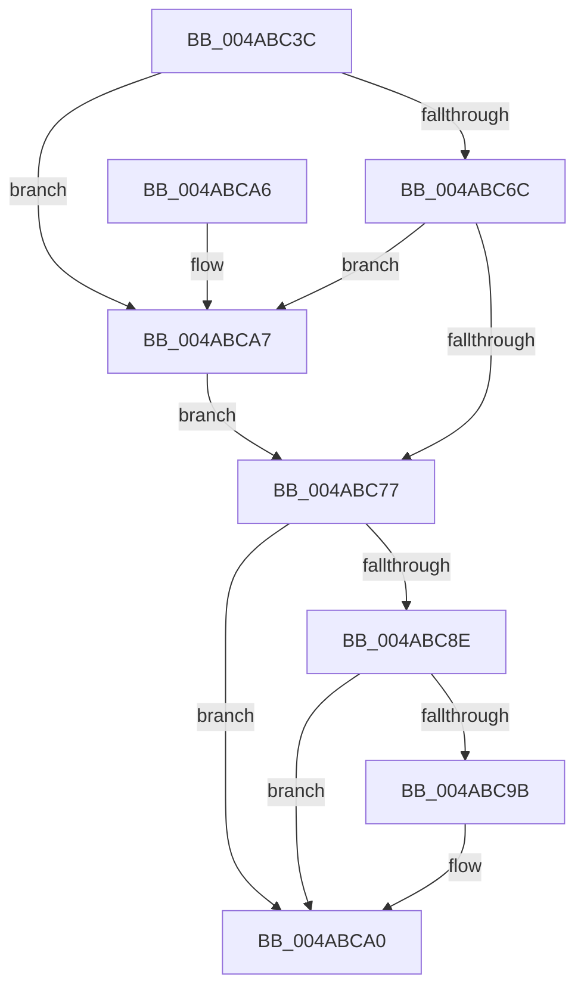

# ExpUnlockCallbackListShared

- RVA: `0x004ABC3C`–`0x004ABCB5` (길이 `121` bytes)
- VA: `0x00000001404ABC3C`
- 실행 섹션: `.text`
- PDB 이름 있음: `예`; PDB Function 태그: `아니요`
- unwind 정보 RVA: `0x000704F4`
- 디코드: `32`개 명령, `121/121` bytes 표시
- 미해석 바이트: `0` (있으면 어셈블리에 `.byte`로 보존)

> 이 문서는 커널 이미지의 기계어와 PDB 기호를 분석해 생성했습니다. 4번과 5번은 함수 원형과 자료형을 바이너리 사용 방식에서 추정한 C 해석이며 원본 소스 복구 결과는 아닙니다.

## 1. Dependencies

- 직접 호출 지점: **3**; 고유 호출 대상: **3**
- 직접 호출자로 확인된 함수: **1**
- RIP 상대 이미지 참조: **1**

### Outgoing calls
- `0x004ABC7E` → [KeAbPostRelease](../2E/KeAbPostRelease_function_002E1600.md) (function, `0x002E1600`)
- `0x004ABC9B` → [KiCheckForKernelApcDelivery](../2E/KiCheckForKernelApcDelivery_function_002E2C80.md) (function, `0x002E2C80`)
- `0x004ABCAE` → [ExfReleasePushLock](../26/ExfReleasePushLock_function_002638D0.md) (function, `0x002638D0`)

### Direct callers
- [ExpGetNextCallback](../../page/A7/ExpGetNextCallback_function_00A77380.md) at `0x00A773EA`

### Static image references
- `0x004ABC45` → RVA `0x00EFACC0` (`.data`; read)

## 2. Other-region calls and transfers

- 다른 실행 섹션으로 향하는 call: **0**
- 별도 외부 분기/꼬리 이동을 확인하지 못했습니다.

## 3. Assembly (complete function range)

```asm
004ABC3C  40 53                           push rbx
004ABC3E  48 83 EC 20                     sub rsp, 0x20
004ABC42  48 8B D9                        mov rbx, rcx
004ABC45  0F 0D 0D 74 F0 A4 00            prefetchw byte ptr [rip + 0xa4f074]
004ABC4C  48 8B 05 6D F0 A4 00            mov rax, qword ptr [rip + 0xa4f06d]
004ABC53  33 C9                           xor ecx, ecx
004ABC55  48 8B D0                        mov rdx, rax
004ABC58  48 83 E2 F0                     and rdx, 0xfffffffffffffff0
004ABC5C  48 83 FA 10                     cmp rdx, 0x10
004ABC60  4C 8D 40 F0                     lea r8, [rax - 0x10]
004ABC64  4C 0F 46 C1                     cmovbe r8, rcx
004ABC68  A8 02                           test al, 2
004ABC6A  75 3B                           jne 0x1404abca7
004ABC6C  F0 4C 0F B1 05 4B F0 A4 00      lock cmpxchg qword ptr [rip + 0xa4f04b], r8
004ABC75  75 30                           jne 0x1404abca7
004ABC77  48 8D 0D 42 F0 A4 00            lea rcx, [rip + 0xa4f042]
004ABC7E  E8 7D 59 E3 FF                  call 0x1402e1600
004ABC83  90                              nop
004ABC84  66 83 83 E6 01 00 00 01         add word ptr [rbx + 0x1e6], 1
004ABC8C  75 12                           jne 0x1404abca0
004ABC8E  48 8D 83 98 00 00 00            lea rax, [rbx + 0x98]
004ABC95  90                              nop
004ABC96  48 39 00                        cmp qword ptr [rax], rax
004ABC99  74 05                           je 0x1404abca0
004ABC9B  E8 E0 6F E3 FF                  call 0x1402e2c80
004ABCA0  48 83 C4 20                     add rsp, 0x20
004ABCA4  5B                              pop rbx
004ABCA5  C3                              ret
004ABCA6  CC                              int3
004ABCA7  48 8D 0D 12 F0 A4 00            lea rcx, [rip + 0xa4f012]
004ABCAE  E8 1D 7C DB FF                  call 0x1402638d0
004ABCB3  EB C2                           jmp 0x1404abc77
```

## 4. C-style interpretation (structured pseudocode)

```c
__int64 __fastcall ExpUnlockCallbackListShared(__int64 a1)
{
    __int64 result;
    __int64 v_rsp;

    v_rsp = (v_rsp) - (32);
    a1 = 0;
    a2 = (*(unsigned __int64 *)(v_rip + 10809453)) & (-16);
    a3 = *(unsigned __int64 *)(v_rip + 10809453) - 16;
    if (a2 <= 16) { a3 = 0; }
    if ((((unsigned __int8)(*(unsigned __int64 *)(v_rip + 10809453))) & (2)) != 0) goto loc_004ABCA7;
    if ((((unsigned __int8)(*(unsigned __int64 *)(v_rip + 10809453))) & (2)) != 0) goto loc_004ABCA7;
loc_004ABC77:
    result = KeAbPostRelease(v_rip + 10809410, a2, a3, a4);
    if ((((unsigned __int8)(*(unsigned __int64 *)(v_rip + 10809453))) & (2)) != 0) goto loc_004ABCA0;
    result = a1 + 152;
    if ((*(unsigned __int64 *)(a1 + 152)) != (a1 + 152)) {
        result = KiCheckForKernelApcDelivery(v_rip + 10809410, a2, a3, a4);
    }
    v_rsp = (v_rsp) + (32);
    return result;
loc_004ABCA7:
    result = ExfReleasePushLock(v_rip + 10809362, a2, a3, a4);
    goto loc_004ABC77;
}
```

## 5. (Beta) C Style

```c
int64_t ExpUnlockCallbackListShared(void *Arg1)
{
    uint8_t *arg1 = (uint8_t *)Arg1;

    int64_t result;
    int64_t local_rsp;

    local_rsp = (local_rsp) - (32);
    Arg1 = 0;
    a2 = (*(uint64_t *)(v_rip + 0xA4F06D)) & (-16);
    a3 = *(uint64_t *)(v_rip + 0xA4F06D) - 16;
    if (a2 <= 16) { a3 = 0; }
    if ((((uint8_t)(*(uint64_t *)(v_rip + 0xA4F06D))) & (2)) != 0) goto loc_004ABCA7;
    if ((((uint8_t)(*(uint64_t *)(v_rip + 0xA4F06D))) & (2)) != 0) goto loc_004ABCA7;
loc_004ABC77:
    result = KeAbPostRelease(v_rip + 10809410, a2, a3, a4);
    if ((((uint8_t)(*(uint64_t *)(v_rip + 0xA4F06D))) & (2)) != 0) goto loc_004ABCA0;
    result = Arg1 + 152;
    if ((*(uint64_t *)(arg1 + 0x98)) != (Arg1 + 152)) {
        result = KiCheckForKernelApcDelivery(v_rip + 10809410, a2, a3, a4);
    }
    local_rsp = (local_rsp) + (32);
    return result;
loc_004ABCA7:
    result = ExfReleasePushLock(v_rip + 10809362, a2, a3, a4);
    goto loc_004ABC77;
}
```

### 관측된 메모리 오프셋

구조체 형식이 확인되지 않은 접근은 인자 기준의 오프셋으로만 기록했습니다.

| 기준 인자 | 오프셋 표현 | 폭 (bit) | 접근 |
|---|---:|---:|---|
| `Arg1` | `+ 0x0` | `64` | `R` |
| `Arg1` | `+ 0x98` | `64` | `R` |
| `Arg1` | `+ 0x1E6` | `16` | `R/W` |

## 6. Execution-region graph

[열기: 2D/3D 그래프와 함수 탐색 컨트롤 패널](../../../control-panel.html?section=text&rva=0x004ABC3C&view=graph)

- 2D 그래프는 위에서 아래로 흐르고, 3D 그래프는 빈 공간을 드래그해 회전합니다. Shift+드래그는 이동, 휠은 확대·축소, 함수 노드 선택은 대상 보고서 이동입니다.

### Static fallback


