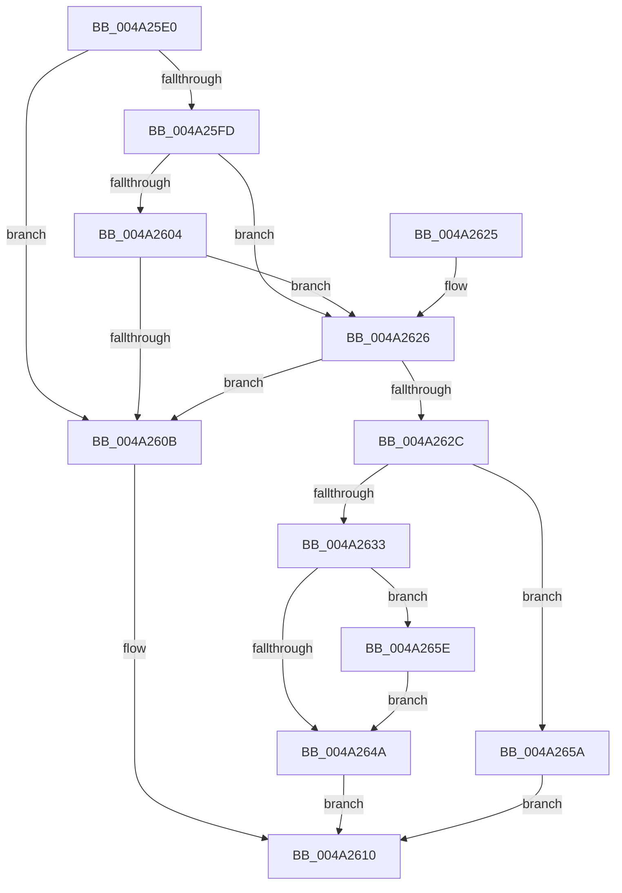

# FsRtlCheckLockForOplockRequest

- RVA: `0x004A25E0`–`0x004A2663` (길이 `131` bytes)
- VA: `0x00000001404A25E0`
- 실행 섹션: `.text`
- PDB 이름 있음: `예`; PDB Function 태그: `아니요`
- unwind 정보 RVA: `0x0007A380`
- 디코드: `41`개 명령, `131/131` bytes 표시
- 미해석 바이트: `0` (있으면 어셈블리에 `.byte`로 보존)

> 이 문서는 커널 이미지의 기계어와 PDB 기호를 분석해 생성했습니다. 4번과 5번은 함수 원형과 자료형을 바이너리 사용 방식에서 추정한 C 해석이며 원본 소스 복구 결과는 아닙니다.

## 1. Dependencies

- 직접 호출 지점: **2**; 고유 호출 대상: **2**
- 직접 호출자로 확인된 함수: **0**
- RIP 상대 이미지 참조: **0**

### Outgoing calls
- `0x004A2640` → [KeAcquireSpinLockRaiseToDpc](../20/KeAcquireSpinLockRaiseToDpc_function_00208470.md) (function, `0x00208470`)
- `0x004A2650` → [KeReleaseSpinLock](../39/KeReleaseSpinLock_function_00392BA0.md) (function, `0x00392BA0`)

### Direct callers
- 이 함수 시작 RVA로 연결되는 직접 call은 확인되지 않았습니다. 간접 호출은 완전히 역산할 수 없습니다.

### Static image references
- 디코드된 RIP-relative 메모리 참조가 없습니다.

## 2. Other-region calls and transfers

- 다른 실행 섹션으로 향하는 call: **0**
- 별도 외부 분기/꼬리 이동을 확인하지 못했습니다.

## 3. Assembly (complete function range)

```asm
004A25E0  48 89 5C 24 08                  mov qword ptr [rsp + 8], rbx
004A25E5  48 89 6C 24 10                  mov qword ptr [rsp + 0x10], rbp
004A25EA  48 89 74 24 18                  mov qword ptr [rsp + 0x18], rsi
004A25EF  57                              push rdi
004A25F0  48 83 EC 20                     sub rsp, 0x20
004A25F4  48 8B 71 18                     mov rsi, qword ptr [rcx + 0x18]
004A25F8  48 85 F6                        test rsi, rsi
004A25FB  74 0E                           je 0x1404a260b
004A25FD  48 83 7E 20 00                  cmp qword ptr [rsi + 0x20], 0
004A2602  75 22                           jne 0x1404a2626
004A2604  48 83 7E 28 00                  cmp qword ptr [rsi + 0x28], 0
004A2609  75 1B                           jne 0x1404a2626
004A260B  B8 01 00 00 00                  mov eax, 1
004A2610  48 8B 5C 24 30                  mov rbx, qword ptr [rsp + 0x30]
004A2615  48 8B 6C 24 38                  mov rbp, qword ptr [rsp + 0x38]
004A261A  48 8B 74 24 40                  mov rsi, qword ptr [rsp + 0x40]
004A261F  48 83 C4 20                     add rsp, 0x20
004A2623  5F                              pop rdi
004A2624  C3                              ret
004A2625  CC                              int3
004A2626  48 83 3A 00                     cmp qword ptr [rdx], 0
004A262A  74 DF                           je 0x1404a260b
004A262C  8B 41 58                        mov eax, dword ptr [rcx + 0x58]
004A262F  85 C0                           test eax, eax
004A2631  75 27                           jne 0x1404a265a
004A2633  48 8B 1A                        mov rbx, qword ptr [rdx]
004A2636  8D 78 01                        lea edi, [rax + 1]
004A2639  48 8D 4E 18                     lea rcx, [rsi + 0x18]
004A263D  48 2B DF                        sub rbx, rdi
004A2640  E8 2B 5E D6 FF                  call 0x140208470
004A2645  48 3B 1E                        cmp rbx, qword ptr [rsi]
004A2648  73 14                           jae 0x1404a265e
004A264A  8A D0                           mov dl, al
004A264C  48 8D 4E 18                     lea rcx, [rsi + 0x18]
004A2650  E8 4B 05 EF FF                  call 0x140392ba0
004A2655  40 8A C7                        mov al, dil
004A2658  EB B6                           jmp 0x1404a2610
004A265A  32 C0                           xor al, al
004A265C  EB B2                           jmp 0x1404a2610
004A265E  40 32 FF                        xor dil, dil
004A2661  EB E7                           jmp 0x1404a264a
```

## 4. C-style interpretation (structured pseudocode)

```c
__int64 __fastcall FsRtlCheckLockForOplockRequest(__int64 a1, __int64 a2)
{
    __int64 result;
    __int64 v_rbx;
    __int64 v_rdi;
    __int64 v_rsp;
    unsigned __int64 v_stack_p10;
    unsigned __int64 v_stack_p18;
    unsigned __int64 v_stack_p8;

    v_stack_p8 = v_rbx;
    v_stack_p10 = v_rbp;
    v_stack_p18 = v_rsi;
    v_rsp = (v_rsp) - (32);
    if (*(unsigned __int64 *)(a1 + 24) == 0) goto loc_004A260B;
    if ((*(unsigned __int64 *)(*(unsigned __int64 *)(a1 + 24) + 32)) != 0) goto loc_004A2626;
    if ((*(unsigned __int64 *)(*(unsigned __int64 *)(a1 + 24) + 40)) != 0) goto loc_004A2626;
loc_004A260B:
loc_004A2610:
    v_rsp = (v_rsp) + (32);
    return 1;
loc_004A2626:
    if ((*(unsigned __int64 *)(a2)) == 0) goto loc_004A260B;
    if ((unsigned int)((unsigned int)(*(unsigned int *)(a1 + 88))) != 0) goto loc_004A265A;
    v_rbx = (*(unsigned __int64 *)(a2)) - ((unsigned int)(*(unsigned int *)(a1 + 88)) + 1);
    result = KeAcquireSpinLockRaiseToDpc(v_stack_p18 + 24, a2, a3, a4);
    if (v_rbx >= (*(unsigned __int64 *)(v_stack_p18))) goto loc_004A265E;
loc_004A264A:
    result = KeReleaseSpinLock(v_stack_p18 + 24, (unsigned __int8)(result), a3, a4);
    goto loc_004A2610;
loc_004A265A:
    result = 0;
    goto loc_004A2610;
loc_004A265E:
    v_rdi = 0;
    goto loc_004A264A;
}
```

## 5. (Beta) C Style

```c
int64_t FsRtlCheckLockForOplockRequest(void *Arg1, void *Arg2)
{
    uint8_t *arg1 = (uint8_t *)Arg1;
    uint8_t *arg2 = (uint8_t *)Arg2;

    int64_t result;
    int64_t local_rbx;
    int64_t local_rdi;
    int64_t local_rsp;
    uint64_t v_stack_p10;
    uint64_t v_stack_p18;
    uint64_t v_stack_p8;

    v_stack_p8 = local_rbx;
    v_stack_p10 = local_rbp;
    v_stack_p18 = local_rsi;
    local_rsp = (local_rsp) - (32);
    if (*(uint64_t *)(arg1 + 0x18) == 0) goto loc_004A260B;
    if ((*(uint64_t *)(*(uint64_t *)(arg1 + 0x18) + 0x20)) != 0) goto loc_004A2626;
    if ((*(uint64_t *)(*(uint64_t *)(arg1 + 0x18) + 0x28)) != 0) goto loc_004A2626;
loc_004A260B:
loc_004A2610:
    local_rsp = (local_rsp) + (32);
    return 1;
loc_004A2626:
    if ((*(uint64_t *)(arg2)) == 0) goto loc_004A260B;
    if ((uint32_t)((uint32_t)(*(uint32_t *)(arg1 + 0x58))) != 0) goto loc_004A265A;
    local_rbx = (*(uint64_t *)(arg2)) - ((uint32_t)(*(uint32_t *)(arg1 + 0x58)) + 1);
    result = KeAcquireSpinLockRaiseToDpc(v_stack_p18 + 24, Arg2, a3, a4);
    if (local_rbx >= (*(uint64_t *)(v_stack_p18))) goto loc_004A265E;
loc_004A264A:
    result = KeReleaseSpinLock(v_stack_p18 + 24, (uint8_t)(result), a3, a4);
    goto loc_004A2610;
loc_004A265A:
    result = 0;
    goto loc_004A2610;
loc_004A265E:
    local_rdi = 0;
    goto loc_004A264A;
}
```

### 관측된 메모리 오프셋

구조체 형식이 확인되지 않은 접근은 인자 기준의 오프셋으로만 기록했습니다.

| 기준 인자 | 오프셋 표현 | 폭 (bit) | 접근 |
|---|---:|---:|---|
| `Arg1` | `+ 0x18` | `64` | `R` |
| `Arg1` | `+ 0x58` | `32` | `R` |
| `Arg2` | `+ 0x0` | `64` | `R` |

## 6. Execution-region graph

[열기: 2D/3D 그래프와 함수 탐색 컨트롤 패널](../../../control-panel.html?section=text&rva=0x004A25E0&view=graph)

- 2D 그래프는 위에서 아래로 흐르고, 3D 그래프는 빈 공간을 드래그해 회전합니다. Shift+드래그는 이동, 휠은 확대·축소, 함수 노드 선택은 대상 보고서 이동입니다.

### Static fallback


