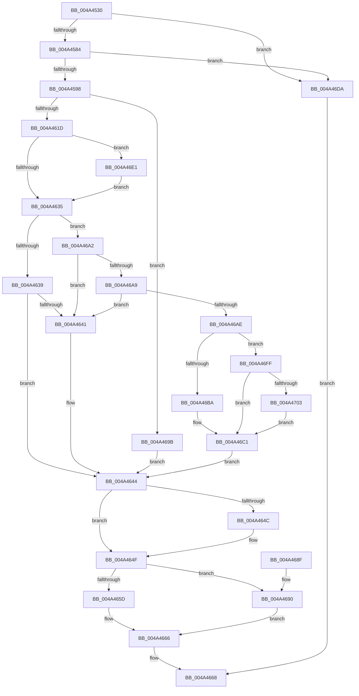

# FsRtlGetVirtualDiskNestingLevel

- RVA: `0x004A4530`–`0x004A4707` (길이 `471` bytes)
- VA: `0x00000001404A4530`
- 실행 섹션: `.text`
- PDB 이름 있음: `예`; PDB Function 태그: `아니요`
- unwind 정보 RVA: `0x000B66F0`
- 디코드: `127`개 명령, `471/471` bytes 표시
- 미해석 바이트: `0` (있으면 어셈블리에 `.byte`로 보존)

> 이 문서는 커널 이미지의 기계어와 PDB 기호를 분석해 생성했습니다. 4번과 5번은 함수 원형과 자료형을 바이너리 사용 방식에서 추정한 C 해석이며 원본 소스 복구 결과는 아닙니다.

## 1. Dependencies

- 직접 호출 지점: **6**; 고유 호출 대상: **5**
- 직접 호출자로 확인된 함수: **0**
- RIP 상대 이미지 참조: **1**

### Outgoing calls
- `0x004A4613` → [IoBuildDeviceIoControlRequest](../20/IoBuildDeviceIoControlRequest_function_00204FD0.md) (function, `0x00204FD0`)
- `0x004A4623` → [IofCallDriver](../29/IofCallDriver_function_0029B4B0.md) (function, `0x0029B4B0`)
- `0x004A466F` → [_security_check_cookie](../6A/_security_check_cookie_function_006AC640.md) (function, `0x006AC640`)
- `0x004A46AE` → [FsRtlQueryMaximumVirtualDiskNestingLevel](FsRtlQueryMaximumVirtualDiskNestingLevel_function_004A4710.md) (function, `0x004A4710`)
- `0x004A46BA` → [FsRtlQueryMaximumVirtualDiskNestingLevel](FsRtlQueryMaximumVirtualDiskNestingLevel_function_004A4710.md) (function, `0x004A4710`)
- `0x004A46F2` → [KeWaitForSingleObject](../20/KeWaitForSingleObject_function_0020E6B0.md) (function, `0x0020E6B0`)

### Direct callers
- 이 함수 시작 RVA로 연결되는 직접 call은 확인되지 않았습니다. 간접 호출은 완전히 역산할 수 없습니다.

### Static image references
- `0x004A454C` → RVA `0x00E0A740` (`.data`; read)

## 2. Other-region calls and transfers

- 다른 실행 섹션으로 향하는 call: **0**
- 별도 외부 분기/꼬리 이동을 확인하지 못했습니다.

## 3. Assembly (complete function range)

```asm
004A4530  48 89 5C 24 20                  mov qword ptr [rsp + 0x20], rbx
004A4535  55                              push rbp
004A4536  56                              push rsi
004A4537  57                              push rdi
004A4538  41 54                           push r12
004A453A  41 55                           push r13
004A453C  41 56                           push r14
004A453E  41 57                           push r15
004A4540  48 8D 6C 24 D9                  lea rbp, [rsp - 0x27]
004A4545  48 81 EC A0 00 00 00            sub rsp, 0xa0
004A454C  48 8B 05 ED 61 96 00            mov rax, qword ptr [rip + 0x9661ed]
004A4553  48 33 C4                        xor rax, rsp
004A4556  48 89 45 1F                     mov qword ptr [rbp + 0x1f], rax
004A455A  8B 41 48                        mov eax, dword ptr [rcx + 0x48]
004A455D  45 33 ED                        xor r13d, r13d
004A4560  44 88 6D DA                     mov byte ptr [rbp - 0x26], r13b
004A4564  0F 57 C0                        xorps xmm0, xmm0
004A4567  4D 8B F0                        mov r14, r8
004A456A  4C 8B FA                        mov r15, rdx
004A456D  48 8B D9                        mov rbx, rcx
004A4570  41 8B F5                        mov esi, r13d
004A4573  41 8D 7D 01                     lea edi, [r13 + 1]
004A4577  0F 11 45 F7                     movups xmmword ptr [rbp - 9], xmm0
004A457B  83 F8 24                        cmp eax, 0x24
004A457E  0F 87 56 01 00 00               ja 0x1404a46da
004A4584  48 B9 8C 01 00 00 10 00 00 00   movabs rcx, 0x100000018c
004A458E  48 0F A3 C1                     bt rcx, rax
004A4592  0F 83 42 01 00 00               jae 0x1404a46da
004A4598  66 44 89 6D D7                  mov word ptr [rbp - 0x29], r13w
004A459D  48 8D 45 DF                     lea rax, [rbp - 0x21]
004A45A1  48 89 45 E7                     mov qword ptr [rbp - 0x19], rax
004A45A5  45 8D 4D 08                     lea r9d, [r13 + 8]
004A45A9  C6 45 D9 06                     mov byte ptr [rbp - 0x27], 6
004A45AD  48 8D 45 DF                     lea rax, [rbp - 0x21]
004A45B1  48 89 45 DF                     mov qword ptr [rbp - 0x21], rax
004A45B5  4C 8D 45 EF                     lea r8, [rbp - 0x11]
004A45B9  44 89 6D DB                     mov dword ptr [rbp - 0x25], r13d
004A45BD  48 8B D3                        mov rdx, rbx
004A45C0  65 48 8B 04 25 88 01 00 00      mov rax, qword ptr gs:[0x188]
004A45C9  B9 90 11 2D 00                  mov ecx, 0x2d1190
004A45CE  F0 0F BA A8 A0 05 00 00 04      lock bts dword ptr [rax + 0x5a0], 4
004A45D7  4C 89 6D EF                     mov qword ptr [rbp - 0x11], r13
004A45DB  41 0F 92 C4                     setb r12b
004A45DF  89 7D EF                        mov dword ptr [rbp - 0x11], edi
004A45E2  33 C0                           xor eax, eax
004A45E4  89 45 17                        mov dword ptr [rbp + 0x17], eax
004A45E7  48 8D 45 F7                     lea rax, [rbp - 9]
004A45EB  48 89 44 24 40                  mov qword ptr [rsp + 0x40], rax
004A45F0  48 8D 45 D7                     lea rax, [rbp - 0x29]
004A45F4  48 89 44 24 38                  mov qword ptr [rsp + 0x38], rax
004A45F9  48 8D 45 07                     lea rax, [rbp + 7]
004A45FD  44 88 6C 24 30                  mov byte ptr [rsp + 0x30], r13b
004A4602  C7 44 24 28 14 00 00 00         mov dword ptr [rsp + 0x28], 0x14
004A460A  48 89 44 24 20                  mov qword ptr [rsp + 0x20], rax
004A460F  0F 11 45 07                     movups xmmword ptr [rbp + 7], xmm0
004A4613  E8 B8 09 D6 FF                  call 0x140204fd0
004A4618  48 85 C0                        test rax, rax
004A461B  74 7E                           je 0x1404a469b
004A461D  48 8B D0                        mov rdx, rax
004A4620  48 8B CB                        mov rcx, rbx
004A4623  E8 88 6E DF FF                  call 0x14029b4b0
004A4628  8B D8                           mov ebx, eax
004A462A  3D 03 01 00 00                  cmp eax, 0x103
004A462F  0F 84 AC 00 00 00               je 0x1404a46e1
004A4635  85 DB                           test ebx, ebx
004A4637  79 69                           jns 0x1404a46a2
004A4639  81 FB 9A 00 00 C0               cmp ebx, 0xc000009a
004A463F  74 03                           je 0x1404a4644
004A4641  41 8B DD                        mov ebx, r13d
004A4644  41 89 37                        mov dword ptr [r15], esi
004A4647  4D 85 F6                        test r14, r14
004A464A  74 03                           je 0x1404a464f
004A464C  41 89 3E                        mov dword ptr [r14], edi
004A464F  65 48 8B 04 25 88 01 00 00      mov rax, qword ptr gs:[0x188]
004A4658  45 84 E4                        test r12b, r12b
004A465B  75 33                           jne 0x1404a4690
004A465D  F0 0F BA B0 A0 05 00 00 04      lock btr dword ptr [rax + 0x5a0], 4
004A4666  8B C3                           mov eax, ebx
004A4668  48 8B 4D 1F                     mov rcx, qword ptr [rbp + 0x1f]
004A466C  48 33 CC                        xor rcx, rsp
004A466F  E8 CC 7F 20 00                  call 0x1406ac640
004A4674  48 8B 9C 24 F8 00 00 00         mov rbx, qword ptr [rsp + 0xf8]
004A467C  48 81 C4 A0 00 00 00            add rsp, 0xa0
004A4683  41 5F                           pop r15
004A4685  41 5E                           pop r14
004A4687  41 5D                           pop r13
004A4689  41 5C                           pop r12
004A468B  5F                              pop rdi
004A468C  5E                              pop rsi
004A468D  5D                              pop rbp
004A468E  C3                              ret
004A468F  CC                              int3
004A4690  F0 0F BA A8 A0 05 00 00 04      lock bts dword ptr [rax + 0x5a0], 4
004A4699  EB CB                           jmp 0x1404a4666
004A469B  BB 9A 00 00 C0                  mov ebx, 0xc000009a
004A46A0  EB A2                           jmp 0x1404a4644
004A46A2  48 83 7D FF 14                  cmp qword ptr [rbp - 1], 0x14
004A46A7  72 98                           jb 0x1404a4641
004A46A9  39 7D 07                        cmp dword ptr [rbp + 7], edi
004A46AC  75 93                           jne 0x1404a4641
004A46AE  E8 5D 00 00 00                  call 0x1404a4710
004A46B3  8B 4D 17                        mov ecx, dword ptr [rbp + 0x17]
004A46B6  3B C8                           cmp ecx, eax
004A46B8  76 45                           jbe 0x1404a46ff
004A46BA  E8 51 00 00 00                  call 0x1404a4710
004A46BF  8B F0                           mov esi, eax
004A46C1  44 38 6D 0B                     cmp byte ptr [rbp + 0xb], r13b
004A46C5  41 0F 45 FD                     cmovne edi, r13d
004A46C9  8B D7                           mov edx, edi
004A46CB  83 CF 02                        or edi, 2
004A46CE  F6 45 13 02                     test byte ptr [rbp + 0x13], 2
004A46D2  0F 44 FA                        cmove edi, edx
004A46D5  E9 6A FF FF FF                  jmp 0x1404a4644
004A46DA  B8 10 00 00 C0                  mov eax, 0xc0000010
004A46DF  EB 87                           jmp 0x1404a4668
004A46E1  45 33 C9                        xor r9d, r9d
004A46E4  4C 89 6C 24 20                  mov qword ptr [rsp + 0x20], r13
004A46E9  45 33 C0                        xor r8d, r8d
004A46EC  48 8D 4D D7                     lea rcx, [rbp - 0x29]
004A46F0  33 D2                           xor edx, edx
004A46F2  E8 B9 9F D6 FF                  call 0x14020e6b0
004A46F7  8B 5D F7                        mov ebx, dword ptr [rbp - 9]
004A46FA  E9 36 FF FF FF                  jmp 0x1404a4635
004A46FF  85 C9                           test ecx, ecx
004A4701  74 BE                           je 0x1404a46c1
004A4703  8B F1                           mov esi, ecx
004A4705  EB BA                           jmp 0x1404a46c1
```

## 4. C-style interpretation (structured pseudocode)

```c
__int64 __fastcall FsRtlGetVirtualDiskNestingLevel(__int64 a1, __int64 a2, __int64 a3)
{
    __int64 result;
    __int64 v_r12;
    __int64 v_r13;
    __int64 v_rbx;
    __int64 v_rdi;
    __int64 v_rsp;
    unsigned __int64 v_stack_m40;
    unsigned int v_stack_m48;
    unsigned __int8 v_stack_m4C;
    unsigned __int8 v_stack_m54;
    unsigned __int64 v_stack_m58;
    unsigned __int64 v_stack_m5F;
    unsigned __int64 v_stack_m60;
    unsigned __int64 v_stack_m68;
    unsigned __int64 v_stack_m70;
    unsigned __int64 v_stack_m78;
    unsigned __int64 v_stack_m80;
    unsigned int v_stack_m84;
    unsigned __int8 v_stack_m85;
    unsigned __int8 v_stack_m86;
    unsigned __int16 v_stack_m88;
    unsigned __int64 v_stack_m98;
    unsigned __int64 v_stack_mA0;
    unsigned __int8 v_stack_mA8;
    unsigned int v_stack_mB0;
    unsigned __int64 v_stack_mB8;
    unsigned __int64 v_stack_p20;

    v_stack_p20 = v_rbx;
    v_rsp = (v_rsp) - (160);
    result = (*(unsigned __int64 *)(v_rip + 9855469)) ^ (v_rsp);
    v_stack_m40 = result;
    v_r13 = 0;
    v_stack_m85 = 0;
    v_stack_m68 = v_xmm0;
    if (((unsigned int)((unsigned int)(*(unsigned int *)(a1 + 72)))) > 36) goto loc_004A46DA;
    if (((unsigned int)((unsigned int)(*(unsigned int *)(a1 + 72)))) >= 36) goto loc_004A46DA;
    v_stack_m88 = 0;
    v_stack_m78 = v_stack_m80;
    v_stack_m86 = 6;
    v_stack_m80 = v_stack_m80;
    v_stack_m84 = 0;
    v_stack_m70 = 0;
    v_r12 = (((unsigned int)((unsigned int)(*(unsigned int *)(a1 + 72)))) < 36) ? 1 : 0;
    v_stack_m70 = (unsigned int)(v_r13 + 1);
    result = 0;
    v_stack_m48 = 0;
    v_stack_m98 = v_stack_m68;
    v_stack_mA0 = v_stack_m88;
    v_stack_mA8 = 0;
    v_stack_mB0 = 20;
    v_stack_mB8 = v_stack_m58;
    v_stack_m58 = v_xmm0;
    result = IoBuildDeviceIoControlRequest((unsigned int)(0x2D1190ULL), a1, v_stack_m70, v_r13 + 8);
    if (result == 0) goto loc_004A469B;
    result = IofCallDriver(a1, result, v_stack_m70, v_r13 + 8);
    if (((unsigned int)(result)) == 259) goto loc_004A46E1;
loc_004A4635:
    if (!sign_flag) goto loc_004A46A2;
    v_rbx = (unsigned int)((unsigned int)(result));
    if (((unsigned int)((unsigned int)((unsigned int)(result)))) != 0xC000009AULL) {
        v_rbx = 0;
    }
    *(unsigned int *)(a2) = 0;
    if (a3 != 0) {
        *(unsigned int *)(a3) = (unsigned int)(v_r13 + 1);
    }
    if ((unsigned __int8)(v_r12) != 0) goto loc_004A4690;
loc_004A4666:
loc_004A4668:
    a1 = (v_stack_m40) ^ (v_rsp);
    result = _security_check_cookie(a1, result, v_stack_m70, v_r13 + 8);
    v_rsp = (v_rsp) + (160);
    return result;
loc_004A4690:
    goto loc_004A4666;
loc_004A469B:
    goto loc_004A4644;
loc_004A46A2:
    if (v_stack_m60 < 20) goto loc_004A4641;
    if (v_stack_m58 != ((unsigned int)(v_r13 + 1))) goto loc_004A4641;
    result = FsRtlQueryMaximumVirtualDiskNestingLevel(a1, result, v_stack_m70, v_r13 + 8);
    if (((unsigned int)((unsigned int)(v_stack_m48))) <= ((unsigned int)(result))) goto loc_004A46FF;
    result = FsRtlQueryMaximumVirtualDiskNestingLevel((unsigned int)(v_stack_m48), result, v_stack_m70, v_r13 + 8);
loc_004A46C1:
    v_rdi = v_r13 + 1;
    if (v_stack_m54 != 0) { v_rdi = 0; }
    v_rdi = (unsigned int)((v_rdi) | (2));
    if (((v_stack_m4C) & (2)) == 0) { v_rdi = (unsigned int)((unsigned int)((unsigned int)(v_rdi))); }
    goto loc_004A4644;
loc_004A46DA:
    goto loc_004A4668;
loc_004A46E1:
    a4 = 0;
    v_stack_p20 = 0;
    a3 = 0;
    a2 = 0;
    result = KeWaitForSingleObject(v_stack_m88, a2, a3, a4);
    goto loc_004A4635;
loc_004A46FF:
    if ((unsigned int)(v_stack_m88) == 0) goto loc_004A46C1;
    goto loc_004A46C1;
}
```

## 5. (Beta) C Style

```c
int64_t FsRtlGetVirtualDiskNestingLevel(void *Arg1, void *Arg2, int64_t Arg3)
{
    uint8_t *arg1 = (uint8_t *)Arg1;
    uint8_t *arg2 = (uint8_t *)Arg2;

    int64_t result;
    int64_t local_r12;
    int64_t local_r13;
    int64_t local_rbx;
    int64_t local_rdi;
    int64_t local_rsp;
    uint64_t v_stack_m40;
    uint32_t v_stack_m48;
    uint8_t v_stack_m4C;
    uint8_t v_stack_m54;
    uint64_t v_stack_m58;
    uint64_t v_stack_m5F;
    uint64_t v_stack_m60;
    uint64_t v_stack_m68;
    uint64_t v_stack_m70;
    uint64_t v_stack_m78;
    uint64_t v_stack_m80;
    uint32_t v_stack_m84;
    uint8_t v_stack_m85;
    uint8_t v_stack_m86;
    uint16_t v_stack_m88;
    uint64_t v_stack_m98;
    uint64_t v_stack_mA0;
    uint8_t v_stack_mA8;
    uint32_t v_stack_mB0;
    uint64_t v_stack_mB8;
    uint64_t v_stack_p20;

    v_stack_p20 = local_rbx;
    local_rsp = (local_rsp) - (160);
    result = (*(uint64_t *)(v_rip + 0x9661ED)) ^ (local_rsp);
    v_stack_m40 = result;
    local_r13 = 0;
    v_stack_m85 = 0;
    v_stack_m68 = v_xmm0;
    if (((uint32_t)((uint32_t)(*(uint32_t *)(arg1 + 0x48)))) > 36) goto loc_004A46DA;
    if (((uint32_t)((uint32_t)(*(uint32_t *)(arg1 + 0x48)))) >= 36) goto loc_004A46DA;
    v_stack_m88 = 0;
    v_stack_m78 = v_stack_m80;
    v_stack_m86 = 6;
    v_stack_m80 = v_stack_m80;
    v_stack_m84 = 0;
    v_stack_m70 = 0;
    local_r12 = (((uint32_t)((uint32_t)(*(uint32_t *)(arg1 + 0x48)))) < 36) ? 1 : 0;
    v_stack_m70 = (uint32_t)(local_r13 + 1);
    result = 0;
    v_stack_m48 = 0;
    v_stack_m98 = v_stack_m68;
    v_stack_mA0 = v_stack_m88;
    v_stack_mA8 = 0;
    v_stack_mB0 = 20;
    v_stack_mB8 = v_stack_m58;
    v_stack_m58 = v_xmm0;
    result = IoBuildDeviceIoControlRequest((uint32_t)(0x2D1190ULL), Arg1, v_stack_m70, local_r13 + 8);
    if (result == 0) goto loc_004A469B;
    result = IofCallDriver(Arg1, result, v_stack_m70, local_r13 + 8);
    if (((uint32_t)(result)) == 259) goto loc_004A46E1;
loc_004A4635:
    if (!sign_flag) goto loc_004A46A2;
    local_rbx = (uint32_t)((uint32_t)(result));
    if (((uint32_t)((uint32_t)((uint32_t)(result)))) != 0xC000009AULL) {
        local_rbx = 0;
    }
    *(uint32_t *)(arg2) = 0;
    if (Arg3 != 0) {
        *(uint32_t *)(Arg3) = (uint32_t)(local_r13 + 1);
    }
    if ((uint8_t)(local_r12) != 0) goto loc_004A4690;
loc_004A4666:
loc_004A4668:
    Arg1 = (v_stack_m40) ^ (local_rsp);
    result = _security_check_cookie(Arg1, result, v_stack_m70, local_r13 + 8);
    local_rsp = (local_rsp) + (160);
    return result;
loc_004A4690:
    goto loc_004A4666;
loc_004A469B:
    goto loc_004A4644;
loc_004A46A2:
    if (v_stack_m60 < 20) goto loc_004A4641;
    if (v_stack_m58 != ((uint32_t)(local_r13 + 1))) goto loc_004A4641;
    result = FsRtlQueryMaximumVirtualDiskNestingLevel(Arg1, result, v_stack_m70, local_r13 + 8);
    if (((uint32_t)((uint32_t)(v_stack_m48))) <= ((uint32_t)(result))) goto loc_004A46FF;
    result = FsRtlQueryMaximumVirtualDiskNestingLevel((uint32_t)(v_stack_m48), result, v_stack_m70, local_r13 + 8);
loc_004A46C1:
    local_rdi = local_r13 + 1;
    if (v_stack_m54 != 0) { local_rdi = 0; }
    local_rdi = (uint32_t)((local_rdi) | (2));
    if (((v_stack_m4C) & (2)) == 0) { local_rdi = (uint32_t)((uint32_t)((uint32_t)(local_rdi))); }
    goto loc_004A4644;
loc_004A46DA:
    goto loc_004A4668;
loc_004A46E1:
    a4 = 0;
    v_stack_p20 = 0;
    Arg3 = 0;
    Arg2 = 0;
    result = KeWaitForSingleObject(v_stack_m88, Arg2, Arg3, a4);
    goto loc_004A4635;
loc_004A46FF:
    if ((uint32_t)(v_stack_m88) == 0) goto loc_004A46C1;
    goto loc_004A46C1;
}
```

### 관측된 메모리 오프셋

구조체 형식이 확인되지 않은 접근은 인자 기준의 오프셋으로만 기록했습니다.

| 기준 인자 | 오프셋 표현 | 폭 (bit) | 접근 |
|---|---:|---:|---|
| `Arg1` | `+ 0x48` | `32` | `R` |
| `Arg2` | `+ 0x0` | `32` | `W` |

## 6. Execution-region graph

[열기: 2D/3D 그래프와 함수 탐색 컨트롤 패널](../../../control-panel.html?section=text&rva=0x004A4530&view=graph)

- 2D 그래프는 위에서 아래로 흐르고, 3D 그래프는 빈 공간을 드래그해 회전합니다. Shift+드래그는 이동, 휠은 확대·축소, 함수 노드 선택은 대상 보고서 이동입니다.

### Static fallback


