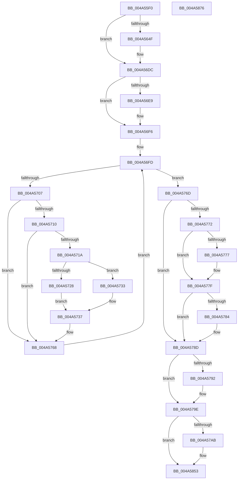

# FsRtlpCancelOplockRHIrp

- RVA: `0x004A55F0`–`0x004A5877` (길이 `647` bytes)
- VA: `0x00000001404A55F0`
- 실행 섹션: `.text`
- PDB 이름 있음: `예`; PDB Function 태그: `아니요`
- unwind 정보 RVA: `0x000B69A8`
- 디코드: `140`개 명령, `647/647` bytes 표시
- 미해석 바이트: `0` (있으면 어셈블리에 `.byte`로 보존)

> 이 문서는 커널 이미지의 기계어와 PDB 기호를 분석해 생성했습니다. 4번과 5번은 함수 원형과 자료형을 바이너리 사용 방식에서 추정한 C 해석이며 원본 소스 복구 결과는 아닙니다.

## 1. Dependencies

- 직접 호출 지점: **10**; 고유 호출 대상: **9**
- 직접 호출자로 확인된 함수: **2**
- RIP 상대 이미지 참조: **4**

### Outgoing calls
- `0x004A563D` → [KeReleaseQueuedSpinLock](../27/KeReleaseQueuedSpinLock_function_00272540.md) (function, `0x00272540`)
- `0x004A56D7` → [tlgWriteTransfer_EtwWriteTransfer](../42/tlgWriteTransfer_EtwWriteTransfer_function_004260E0.md) (function, `0x004260E0`)
- `0x004A56F0` → [ExAcquireFastMutex](../20/ExAcquireFastMutex_function_0020E5A0.md) (function, `0x0020E5A0`)
- `0x004A572C` → [FsRtlpOplockPerfSendData](../../page/6F/FsRtlpOplockPerfSendData_function_006FDB80.md) (function, `0x006FDB80`)
- `0x004A575B` → [FsRtlpRemoveAndCompleteRHIrp](../42/FsRtlpRemoveAndCompleteRHIrp_function_00425964.md) (function, `0x00425964`)
- `0x004A577A` → [FsRtlpReleaseIrpsWaitingForRH](../42/FsRtlpReleaseIrpsWaitingForRH_function_00425CBC.md) (function, `0x00425CBC`)
- `0x004A5787` → [FsRtlpComputeShareableOplockState](../42/FsRtlpComputeShareableOplockState_function_004256EC.md) (function, `0x004256EC`)
- `0x004A5799` → [ExReleaseFastMutex](../25/ExReleaseFastMutex_function_002519C0.md) (function, `0x002519C0`)
- `0x004A584E` → [tlgWriteTransfer_EtwWriteTransfer](../42/tlgWriteTransfer_EtwWriteTransfer_function_004260E0.md) (function, `0x004260E0`)
- `0x004A585E` → [_security_check_cookie](../6A/_security_check_cookie_function_006AC640.md) (function, `0x006AC640`)

### Direct callers
- [FsRtlpOplockRHIrpCancelRoutine](FsRtlpOplockRHIrpCancelRoutine_function_004A55D0.md) at `0x004A55DC`
- [FsRtlpRequestShareableOplock](../4E/FsRtlpRequestShareableOplock_function_004E6EC8.md) at `0x004E7578`

### Static image references
- `0x004A560B` → RVA `0x00E0A740` (`.data`; read)
- `0x004A5642` → RVA `0x00E06C50` (`.data`; read)
- `0x004A56C9` → RVA `0x00044351` (`.rdata`; read)
- `0x004A5840` → RVA `0x000444E6` (`.rdata`; read)

## 2. Other-region calls and transfers

- 다른 실행 섹션으로 향하는 call: **1**
  - `0x004A572C` → [FsRtlpOplockPerfSendData](../../page/6F/FsRtlpOplockPerfSendData_function_006FDB80.md) (`.text` → `PAGE`)
- 별도 외부 분기/꼬리 이동을 확인하지 못했습니다.

## 3. Assembly (complete function range)

```asm
004A55F0  44 88 44 24 18                  mov byte ptr [rsp + 0x18], r8b
004A55F5  88 54 24 10                     mov byte ptr [rsp + 0x10], dl
004A55F9  53                              push rbx
004A55FA  56                              push rsi
004A55FB  57                              push rdi
004A55FC  41 54                           push r12
004A55FE  41 55                           push r13
004A5600  41 56                           push r14
004A5602  41 57                           push r15
004A5604  48 81 EC 30 01 00 00            sub rsp, 0x130
004A560B  48 8B 05 2E 51 96 00            mov rax, qword ptr [rip + 0x96512e]
004A5612  48 33 C4                        xor rax, rsp
004A5615  48 89 84 24 20 01 00 00         mov qword ptr [rsp + 0x120], rax
004A561D  45 8A F8                        mov r15b, r8b
004A5620  44 8A E2                        mov r12b, dl
004A5623  48 8B 79 38                     mov rdi, qword ptr [rcx + 0x38]
004A5627  48 89 7C 24 60                  mov qword ptr [rsp + 0x60], rdi
004A562C  45 33 ED                        xor r13d, r13d
004A562F  41 8B C5                        mov eax, r13d
004A5632  48 87 41 68                     xchg qword ptr [rcx + 0x68], rax
004A5636  8A 51 45                        mov dl, byte ptr [rcx + 0x45]
004A5639  41 8D 4D 07                     lea ecx, [r13 + 7]
004A563D  E8 FE CE DC FF                  call 0x140272540
004A5642  83 3D 07 16 96 00 05            cmp dword ptr [rip + 0x961607], 5
004A5649  0F 86 8D 00 00 00               jbe 0x1404a56dc
004A564F  44 88 7C 24 43                  mov byte ptr [rsp + 0x43], r15b
004A5654  48 8D 44 24 43                  lea rax, [rsp + 0x43]
004A5659  48 89 84 24 F0 00 00 00         mov qword ptr [rsp + 0xf0], rax
004A5661  48 C7 84 24 F8 00 00 00 01 00 00 00  mov qword ptr [rsp + 0xf8], 1
004A566D  48 89 7C 24 68                  mov qword ptr [rsp + 0x68], rdi
004A5672  48 8D 44 24 68                  lea rax, [rsp + 0x68]
004A5677  48 89 84 24 00 01 00 00         mov qword ptr [rsp + 0x100], rax
004A567F  48 C7 84 24 08 01 00 00 08 00 00 00  mov qword ptr [rsp + 0x108], 8
004A568B  8B 87 90 00 00 00               mov eax, dword ptr [rdi + 0x90]
004A5691  89 44 24 48                     mov dword ptr [rsp + 0x48], eax
004A5695  48 8D 44 24 48                  lea rax, [rsp + 0x48]
004A569A  48 89 84 24 10 01 00 00         mov qword ptr [rsp + 0x110], rax
004A56A2  48 C7 84 24 18 01 00 00 04 00 00 00  mov qword ptr [rsp + 0x118], 4
004A56AE  48 8D 84 24 D0 00 00 00         lea rax, [rsp + 0xd0]
004A56B6  48 89 44 24 28                  mov qword ptr [rsp + 0x28], rax
004A56BB  C7 44 24 20 05 00 00 00         mov dword ptr [rsp + 0x20], 5
004A56C3  45 33 C9                        xor r9d, r9d
004A56C6  45 33 C0                        xor r8d, r8d
004A56C9  48 8D 15 81 EC B9 FF            lea rdx, [rip - 0x46137f]
004A56D0  48 8D 0D 79 15 96 00            lea rcx, [rip + 0x961579]
004A56D7  E8 04 0A F8 FF                  call 0x1404260e0
004A56DC  45 8A F5                        mov r14b, r13b
004A56DF  44 88 6C 24 42                  mov byte ptr [rsp + 0x42], r13b
004A56E4  45 84 E4                        test r12b, r12b
004A56E7  75 0D                           jne 0x1404a56f6
004A56E9  48 8B 8F 98 00 00 00            mov rcx, qword ptr [rdi + 0x98]
004A56F0  E8 AB 8E D6 FF                  call 0x14020e5a0
004A56F5  90                              nop
004A56F6  48 8D 77 38                     lea rsi, [rdi + 0x38]
004A56FA  48 8B 1E                        mov rbx, qword ptr [rsi]
004A56FD  48 89 5C 24 58                  mov qword ptr [rsp + 0x58], rbx
004A5702  48 3B DE                        cmp rbx, rsi
004A5705  74 66                           je 0x1404a576d
004A5707  48 8B CB                        mov rcx, rbx
004A570A  4C 39 6B 38                     cmp qword ptr [rbx + 0x38], r13
004A570E  75 58                           jne 0x1404a5768
004A5710  48 8B 43 10                     mov rax, qword ptr [rbx + 0x10]
004A5714  44 38 68 44                     cmp byte ptr [rax + 0x44], r13b
004A5718  74 4E                           je 0x1404a5768
004A571A  48 8B 5B 08                     mov rbx, qword ptr [rbx + 8]
004A571E  48 89 5C 24 58                  mov qword ptr [rsp + 0x58], rbx
004A5723  45 84 FF                        test r15b, r15b
004A5726  74 0B                           je 0x1404a5733
004A5728  48 83 C1 48                     add rcx, 0x48
004A572C  E8 4F 84 25 00                  call 0x1406fdb80
004A5731  EB 04                           jmp 0x1404a5737
004A5733  4C 89 69 58                     mov qword ptr [rcx + 0x58], r13
004A5737  44 88 6C 24 38                  mov byte ptr [rsp + 0x38], r13b
004A573C  66 44 89 6C 24 30               mov word ptr [rsp + 0x30], r13w
004A5742  44 89 6C 24 28                  mov dword ptr [rsp + 0x28], r13d
004A5747  44 89 6C 24 20                  mov dword ptr [rsp + 0x20], r13d
004A574C  45 33 C9                        xor r9d, r9d
004A574F  41 B8 20 01 00 C0               mov r8d, 0xc0000120
004A5755  48 8B D7                        mov rdx, rdi
004A5758  48 8B 0B                        mov rcx, qword ptr [rbx]
004A575B  E8 04 02 F8 FF                  call 0x140425964
004A5760  41 B6 01                        mov r14b, 1
004A5763  44 88 74 24 42                  mov byte ptr [rsp + 0x42], r14b
004A5768  48 8B 1B                        mov rbx, qword ptr [rbx]
004A576B  EB 90                           jmp 0x1404a56fd
004A576D  45 84 F6                        test r14b, r14b
004A5770  74 1B                           je 0x1404a578d
004A5772  45 84 FF                        test r15b, r15b
004A5775  74 08                           je 0x1404a577f
004A5777  48 8B CF                        mov rcx, rdi
004A577A  E8 3D 05 F8 FF                  call 0x140425cbc
004A577F  48 39 36                        cmp qword ptr [rsi], rsi
004A5782  75 09                           jne 0x1404a578d
004A5784  48 8B CF                        mov rcx, rdi
004A5787  E8 60 FF F7 FF                  call 0x1404256ec
004A578C  90                              nop
004A578D  45 84 E4                        test r12b, r12b
004A5790  75 0C                           jne 0x1404a579e
004A5792  48 8B 8F 98 00 00 00            mov rcx, qword ptr [rdi + 0x98]
004A5799  E8 22 C2 DA FF                  call 0x1402519c0
004A579E  83 3D AB 14 96 00 05            cmp dword ptr [rip + 0x9614ab], 5
004A57A5  0F 86 A8 00 00 00               jbe 0x1404a5853
004A57AB  44 88 7C 24 40                  mov byte ptr [rsp + 0x40], r15b
004A57B0  48 8D 44 24 40                  lea rax, [rsp + 0x40]
004A57B5  48 89 84 24 90 00 00 00         mov qword ptr [rsp + 0x90], rax
004A57BD  48 C7 84 24 98 00 00 00 01 00 00 00  mov qword ptr [rsp + 0x98], 1
004A57C9  44 88 74 24 41                  mov byte ptr [rsp + 0x41], r14b
004A57CE  48 8D 44 24 41                  lea rax, [rsp + 0x41]
004A57D3  48 89 84 24 A0 00 00 00         mov qword ptr [rsp + 0xa0], rax
004A57DB  48 C7 84 24 A8 00 00 00 01 00 00 00  mov qword ptr [rsp + 0xa8], 1
004A57E7  48 89 7C 24 50                  mov qword ptr [rsp + 0x50], rdi
004A57EC  48 8D 44 24 50                  lea rax, [rsp + 0x50]
004A57F1  48 89 84 24 B0 00 00 00         mov qword ptr [rsp + 0xb0], rax
004A57F9  48 C7 84 24 B8 00 00 00 08 00 00 00  mov qword ptr [rsp + 0xb8], 8
004A5805  8B 87 90 00 00 00               mov eax, dword ptr [rdi + 0x90]
004A580B  89 44 24 44                     mov dword ptr [rsp + 0x44], eax
004A580F  48 8D 44 24 44                  lea rax, [rsp + 0x44]
004A5814  48 89 84 24 C0 00 00 00         mov qword ptr [rsp + 0xc0], rax
004A581C  48 C7 84 24 C8 00 00 00 04 00 00 00  mov qword ptr [rsp + 0xc8], 4
004A5828  48 8D 44 24 70                  lea rax, [rsp + 0x70]
004A582D  48 89 44 24 28                  mov qword ptr [rsp + 0x28], rax
004A5832  C7 44 24 20 06 00 00 00         mov dword ptr [rsp + 0x20], 6
004A583A  45 33 C9                        xor r9d, r9d
004A583D  45 33 C0                        xor r8d, r8d
004A5840  48 8D 15 9F EC B9 FF            lea rdx, [rip - 0x461361]
004A5847  48 8D 0D 02 14 96 00            lea rcx, [rip + 0x961402]
004A584E  E8 8D 08 F8 FF                  call 0x1404260e0
004A5853  48 8B 8C 24 20 01 00 00         mov rcx, qword ptr [rsp + 0x120]
004A585B  48 33 CC                        xor rcx, rsp
004A585E  E8 DD 6D 20 00                  call 0x1406ac640
004A5863  48 81 C4 30 01 00 00            add rsp, 0x130
004A586A  41 5F                           pop r15
004A586C  41 5E                           pop r14
004A586E  41 5D                           pop r13
004A5870  41 5C                           pop r12
004A5872  5F                              pop rdi
004A5873  5E                              pop rsi
004A5874  5B                              pop rbx
004A5875  C3                              ret
004A5876  CC                              int3
```

## 4. C-style interpretation (structured pseudocode)

```c
__int64 __fastcall FsRtlpCancelOplockRHIrp(__int64 a1, unsigned __int8 a2, int a3, int a4)
{
    __int64 result;
    __int64 v_r13;
    __int64 v_rsp;
    unsigned __int64 v_stack_m100;
    unsigned __int64 v_stack_m108;
    unsigned __int64 v_stack_m110;
    unsigned __int64 v_stack_m118;
    unsigned int v_stack_m120;
    unsigned int v_stack_m124;
    unsigned __int8 v_stack_m125;
    unsigned __int8 v_stack_m126;
    unsigned __int8 v_stack_m127;
    unsigned __int8 v_stack_m128;
    unsigned __int8 v_stack_m130;
    unsigned __int16 v_stack_m138;
    unsigned __int64 v_stack_m140;
    unsigned int v_stack_m148;
    unsigned __int64 v_stack_m48;
    unsigned __int64 v_stack_m50;
    unsigned __int64 v_stack_m58;
    unsigned __int64 v_stack_m60;
    unsigned __int64 v_stack_m68;
    unsigned __int64 v_stack_m70;
    unsigned __int64 v_stack_m78;
    unsigned __int64 v_stack_m98;
    unsigned __int64 v_stack_mA0;
    unsigned __int64 v_stack_mA8;
    unsigned __int64 v_stack_mB0;
    unsigned __int64 v_stack_mB8;
    unsigned __int64 v_stack_mC0;
    unsigned __int64 v_stack_mC8;
    unsigned __int64 v_stack_mD0;
    unsigned __int64 v_stack_mD8;
    unsigned __int64 v_stack_mF8;
    unsigned __int8 v_stack_p10;
    unsigned __int8 v_stack_p18;

    v_stack_p18 = (unsigned __int8)(a3);
    v_stack_p10 = a2;
    v_rsp = (v_rsp) - (304);
    result = (*(unsigned __int64 *)(v_rip + 9851182)) ^ (v_rsp);
    v_stack_m48 = result;
    v_stack_m108 = *(unsigned __int64 *)(a1 + 56);
    v_r13 = 0;
    result = KeReleaseQueuedSpinLock(v_r13 + 7, *(unsigned __int8 *)(a1 + 69), a3, a4);
    if ((*(unsigned int *)(v_rip + 9836039)) >= = 5) {
        v_stack_m125 = (unsigned __int8)((unsigned __int8)(a3));
        result = v_stack_m125;
        v_stack_m78 = result;
        v_stack_m70 = 1;
        v_stack_m100 = *(unsigned __int64 *)(a1 + 56);
        result = v_stack_m100;
        v_stack_m68 = result;
        v_stack_m60 = 8;
        result = *(unsigned int *)(*(unsigned __int64 *)(a1 + 56) + 144);
        v_stack_m120 = (unsigned int)(result);
        result = v_stack_m120;
        v_stack_m58 = result;
        v_stack_m50 = 4;
        result = v_stack_m98;
        v_stack_m140 = result;
        v_stack_m148 = 5;
        a4 = 0;
        a3 = 0;
        a2 = v_rip - 4592511;
        a1 = v_rip + 9835897;
        result = tlgWriteTransfer_EtwWriteTransfer(a1, a2, a3, a4);
    }
    v_stack_m126 = 0;
    if (a2 == 0) {
        a1 = *(unsigned __int64 *)(*(unsigned __int64 *)(a1 + 56) + 152);
        result = ExAcquireFastMutex(a1, a2, a3, a4);
    }
loc_004A56FD:
    v_stack_m110 = *(unsigned __int64 *)(*(unsigned __int64 *)(a1 + 56) + 56);
    if ((*(unsigned __int64 *)(*(unsigned __int64 *)(a1 + 56) + 56)) == (*(unsigned __int64 *)(a1 + 56) + 56)) goto loc_004A576D;
    if ((*(unsigned __int64 *)(*(unsigned __int64 *)(*(unsigned __int64 *)(a1 + 56) + 56) + 56)) != 0) goto loc_004A5768;
    if ((*(unsigned __int8 *)(*(unsigned __int64 *)(*(unsigned __int64 *)(*(unsigned __int64 *)(a1 + 56) + 56) + 16) + 68)) == 0) goto loc_004A5768;
    v_stack_m110 = *(unsigned __int64 *)(*(unsigned __int64 *)(*(unsigned __int64 *)(a1 + 56) + 56) + 8);
    if ((unsigned __int8)((unsigned __int8)(a3)) == 0) goto loc_004A5733;
    a1 = (*(unsigned __int64 *)(*(unsigned __int64 *)(a1 + 56) + 56)) + (72);
    result = FsRtlpOplockPerfSendData(a1, a2, a3, a4);
    goto loc_004A5737;
loc_004A5733:
    *(unsigned __int64 *)(a1 + 88) = 0;
loc_004A5737:
    v_stack_m130 = 0;
    v_stack_m138 = 0;
    v_stack_m140 = 0;
    v_stack_m148 = 0;
    a4 = 0;
    result = FsRtlpRemoveAndCompleteRHIrp(*(unsigned __int64 *)(*(unsigned __int64 *)(*(unsigned __int64 *)(*(unsigned __int64 *)(a1 + 56) + 56) + 8)), *(unsigned __int64 *)(a1 + 56), (unsigned int)(0xC0000120ULL), a4);
    v_stack_m126 = 1;
loc_004A5768:
    goto loc_004A56FD;
loc_004A576D:
    if (1 == 0) goto loc_004A578D;
    if ((unsigned __int8)((unsigned __int8)(a3)) != 0) {
        a1 = *(unsigned __int64 *)(a1 + 56);
        result = FsRtlpReleaseIrpsWaitingForRH(a1, *(unsigned __int64 *)(a1 + 56), (unsigned int)(0xC0000120ULL), a4);
    }
    if ((*(unsigned __int64 *)(*(unsigned __int64 *)(a1 + 56) + 56)) == (*(unsigned __int64 *)(a1 + 56) + 56)) {
        a1 = *(unsigned __int64 *)(a1 + 56);
        result = FsRtlpComputeShareableOplockState(a1, *(unsigned __int64 *)(a1 + 56), (unsigned int)(0xC0000120ULL), a4);
    }
    if (a2 == 0) {
        a1 = *(unsigned __int64 *)(*(unsigned __int64 *)(a1 + 56) + 152);
        result = ExReleaseFastMutex(a1, *(unsigned __int64 *)(a1 + 56), (unsigned int)(0xC0000120ULL), a4);
    }
    if ((*(unsigned int *)(v_rip + 9835691)) >= = 5) {
        v_stack_m128 = (unsigned __int8)((unsigned __int8)(a3));
        result = v_stack_m128;
        v_stack_mD8 = result;
        v_stack_mD0 = 1;
        v_stack_m127 = 1;
        result = v_stack_m127;
        v_stack_mC8 = result;
        v_stack_mC0 = 1;
        v_stack_m118 = *(unsigned __int64 *)(a1 + 56);
        result = v_stack_m118;
        v_stack_mB8 = result;
        v_stack_mB0 = 8;
        result = *(unsigned int *)(*(unsigned __int64 *)(a1 + 56) + 144);
        v_stack_m124 = (unsigned int)(result);
        result = v_stack_m124;
        v_stack_mA8 = result;
        v_stack_mA0 = 4;
        result = v_stack_mF8;
        v_stack_m140 = result;
        v_stack_m148 = 6;
        a4 = 0;
        a3 = 0;
        a2 = v_rip - 4592481;
        a1 = v_rip + 9835522;
        result = tlgWriteTransfer_EtwWriteTransfer(a1, a2, a3, a4);
    }
    a1 = (v_stack_m48) ^ (v_rsp);
    result = _security_check_cookie(a1, a2, a3, a4);
    v_rsp = (v_rsp) + (304);
    return result;
}
```

## 5. (Beta) C Style

```c
int64_t FsRtlpCancelOplockRHIrp(void *Arg1, uint8_t Arg2, int32_t Arg3, int32_t Arg4)
{
    uint8_t *arg1 = (uint8_t *)Arg1;

    int64_t result;
    int64_t local_r13;
    int64_t local_rsp;
    uint64_t v_stack_m100;
    uint64_t v_stack_m108;
    uint64_t v_stack_m110;
    uint64_t v_stack_m118;
    uint32_t v_stack_m120;
    uint32_t v_stack_m124;
    uint8_t v_stack_m125;
    uint8_t v_stack_m126;
    uint8_t v_stack_m127;
    uint8_t v_stack_m128;
    uint8_t v_stack_m130;
    uint16_t v_stack_m138;
    uint64_t v_stack_m140;
    uint32_t v_stack_m148;
    uint64_t v_stack_m48;
    uint64_t v_stack_m50;
    uint64_t v_stack_m58;
    uint64_t v_stack_m60;
    uint64_t v_stack_m68;
    uint64_t v_stack_m70;
    uint64_t v_stack_m78;
    uint64_t v_stack_m98;
    uint64_t v_stack_mA0;
    uint64_t v_stack_mA8;
    uint64_t v_stack_mB0;
    uint64_t v_stack_mB8;
    uint64_t v_stack_mC0;
    uint64_t v_stack_mC8;
    uint64_t v_stack_mD0;
    uint64_t v_stack_mD8;
    uint64_t v_stack_mF8;
    uint8_t v_stack_p10;
    uint8_t v_stack_p18;

    v_stack_p18 = (uint8_t)(Arg3);
    v_stack_p10 = Arg2;
    local_rsp = (local_rsp) - (304);
    result = (*(uint64_t *)(v_rip + 0x96512E)) ^ (local_rsp);
    v_stack_m48 = result;
    v_stack_m108 = *(uint64_t *)(arg1 + 0x38);
    local_r13 = 0;
    result = KeReleaseQueuedSpinLock(local_r13 + 7, *(uint8_t *)(arg1 + 0x45), Arg3, Arg4);
    if ((*(uint32_t *)(v_rip + 0x961607)) >= = 5) {
        v_stack_m125 = (uint8_t)((uint8_t)(Arg3));
        result = v_stack_m125;
        v_stack_m78 = result;
        v_stack_m70 = 1;
        v_stack_m100 = *(uint64_t *)(arg1 + 0x38);
        result = v_stack_m100;
        v_stack_m68 = result;
        v_stack_m60 = 8;
        result = *(uint32_t *)(*(uint64_t *)(arg1 + 0x38) + 0x90);
        v_stack_m120 = (uint32_t)(result);
        result = v_stack_m120;
        v_stack_m58 = result;
        v_stack_m50 = 4;
        result = v_stack_m98;
        v_stack_m140 = result;
        v_stack_m148 = 5;
        Arg4 = 0;
        Arg3 = 0;
        Arg2 = v_rip - 4592511;
        Arg1 = v_rip + 9835897;
        result = tlgWriteTransfer_EtwWriteTransfer(Arg1, Arg2, Arg3, Arg4);
    }
    v_stack_m126 = 0;
    if (Arg2 == 0) {
        Arg1 = *(uint64_t *)(*(uint64_t *)(arg1 + 0x38) + 0x98);
        result = ExAcquireFastMutex(Arg1, Arg2, Arg3, Arg4);
    }
loc_004A56FD:
    v_stack_m110 = *(uint64_t *)(*(uint64_t *)(arg1 + 0x38) + 0x38);
    if ((*(uint64_t *)(*(uint64_t *)(arg1 + 0x38) + 0x38)) == (*(uint64_t *)(arg1 + 0x38) + 56)) goto loc_004A576D;
    if ((*(uint64_t *)(*(uint64_t *)(*(uint64_t *)(arg1 + 0x38) + 0x38) + 0x38)) != 0) goto loc_004A5768;
    if ((*(uint8_t *)(*(uint64_t *)(*(uint64_t *)(*(uint64_t *)(arg1 + 0x38) + 0x38) + 0x10) + 0x44)) == 0) goto loc_004A5768;
    v_stack_m110 = *(uint64_t *)(*(uint64_t *)(*(uint64_t *)(arg1 + 0x38) + 0x38) + 0x8);
    if ((uint8_t)((uint8_t)(Arg3)) == 0) goto loc_004A5733;
    Arg1 = (*(uint64_t *)(*(uint64_t *)(arg1 + 0x38) + 0x38)) + (72);
    result = FsRtlpOplockPerfSendData(Arg1, Arg2, Arg3, Arg4);
    goto loc_004A5737;
loc_004A5733:
    *(uint64_t *)(arg1 + 0x58) = 0;
loc_004A5737:
    v_stack_m130 = 0;
    v_stack_m138 = 0;
    v_stack_m140 = 0;
    v_stack_m148 = 0;
    Arg4 = 0;
    result = FsRtlpRemoveAndCompleteRHIrp(*(uint64_t *)(*(uint64_t *)(*(uint64_t *)(*(uint64_t *)(arg1 + 0x38) + 0x38) + 0x8)), *(uint64_t *)(arg1 + 0x38), (uint32_t)(0xC0000120ULL), Arg4);
    v_stack_m126 = 1;
loc_004A5768:
    goto loc_004A56FD;
loc_004A576D:
    if (1 == 0) goto loc_004A578D;
    if ((uint8_t)((uint8_t)(Arg3)) != 0) {
        Arg1 = *(uint64_t *)(arg1 + 0x38);
        result = FsRtlpReleaseIrpsWaitingForRH(Arg1, *(uint64_t *)(arg1 + 0x38), (uint32_t)(0xC0000120ULL), Arg4);
    }
    if ((*(uint64_t *)(*(uint64_t *)(arg1 + 0x38) + 0x38)) == (*(uint64_t *)(arg1 + 0x38) + 56)) {
        Arg1 = *(uint64_t *)(arg1 + 0x38);
        result = FsRtlpComputeShareableOplockState(Arg1, *(uint64_t *)(arg1 + 0x38), (uint32_t)(0xC0000120ULL), Arg4);
    }
    if (Arg2 == 0) {
        Arg1 = *(uint64_t *)(*(uint64_t *)(arg1 + 0x38) + 0x98);
        result = ExReleaseFastMutex(Arg1, *(uint64_t *)(arg1 + 0x38), (uint32_t)(0xC0000120ULL), Arg4);
    }
    if ((*(uint32_t *)(v_rip + 0x9614AB)) >= = 5) {
        v_stack_m128 = (uint8_t)((uint8_t)(Arg3));
        result = v_stack_m128;
        v_stack_mD8 = result;
        v_stack_mD0 = 1;
        v_stack_m127 = 1;
        result = v_stack_m127;
        v_stack_mC8 = result;
        v_stack_mC0 = 1;
        v_stack_m118 = *(uint64_t *)(arg1 + 0x38);
        result = v_stack_m118;
        v_stack_mB8 = result;
        v_stack_mB0 = 8;
        result = *(uint32_t *)(*(uint64_t *)(arg1 + 0x38) + 0x90);
        v_stack_m124 = (uint32_t)(result);
        result = v_stack_m124;
        v_stack_mA8 = result;
        v_stack_mA0 = 4;
        result = v_stack_mF8;
        v_stack_m140 = result;
        v_stack_m148 = 6;
        Arg4 = 0;
        Arg3 = 0;
        Arg2 = v_rip - 4592481;
        Arg1 = v_rip + 9835522;
        result = tlgWriteTransfer_EtwWriteTransfer(Arg1, Arg2, Arg3, Arg4);
    }
    Arg1 = (v_stack_m48) ^ (local_rsp);
    result = _security_check_cookie(Arg1, Arg2, Arg3, Arg4);
    local_rsp = (local_rsp) + (304);
    return result;
}
```

### 관측된 메모리 오프셋

구조체 형식이 확인되지 않은 접근은 인자 기준의 오프셋으로만 기록했습니다.

| 기준 인자 | 오프셋 표현 | 폭 (bit) | 접근 |
|---|---:|---:|---|
| `Arg1` | `+ 0x38` | `64` | `R` |
| `Arg1` | `+ 0x45` | `8` | `R` |
| `Arg1` | `+ 0x68` | `64` | `R/W` |

## 6. Execution-region graph

[열기: 2D/3D 그래프와 함수 탐색 컨트롤 패널](../../../control-panel.html?section=text&rva=0x004A55F0&view=graph)

- 2D 그래프는 위에서 아래로 흐르고, 3D 그래프는 빈 공간을 드래그해 회전합니다. Shift+드래그는 이동, 휠은 확대·축소, 함수 노드 선택은 대상 보고서 이동입니다.

### Static fallback


