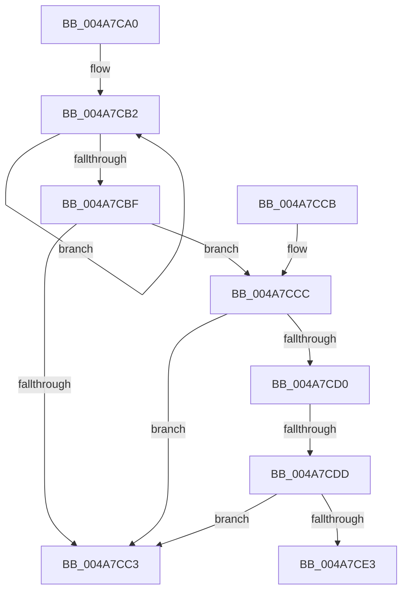

# HalCancelAdapterChannelDmaThin

- RVA: `0x004A7CA0`–`0x004A7CF4` (길이 `84` bytes)
- VA: `0x00000001404A7CA0`
- 실행 섹션: `.text`
- PDB 이름 있음: `예`; PDB Function 태그: `예`
- unwind 정보 RVA: `0x0007FC80`
- 디코드: `28`개 명령, `84/84` bytes 표시
- 미해석 바이트: `0` (있으면 어셈블리에 `.byte`로 보존)

> 이 문서는 커널 이미지의 기계어와 PDB 기호를 분석해 생성했습니다. 4번과 5번은 함수 원형과 자료형을 바이너리 사용 방식에서 추정한 C 해석이며 원본 소스 복구 결과는 아닙니다.

## 1. Dependencies

- 직접 호출 지점: **1**; 고유 호출 대상: **1**
- 직접 호출자로 확인된 함수: **0**
- RIP 상대 이미지 참조: **0**

### Outgoing calls
- `0x004A7CE9` → [ExFreePoolWithTag](../../poolcode/B8/ExFreePoolWithTag_function_00B82870.md) (function, `0x00B82870`)

### Direct callers
- 이 함수 시작 RVA로 연결되는 직접 call은 확인되지 않았습니다. 간접 호출은 완전히 역산할 수 없습니다.

### Static image references
- 디코드된 RIP-relative 메모리 참조가 없습니다.

## 2. Other-region calls and transfers

- 다른 실행 섹션으로 향하는 call: **1**
  - `0x004A7CE9` → [ExFreePoolWithTag](../../poolcode/B8/ExFreePoolWithTag_function_00B82870.md) (`.text` → `POOLCODE`)
- call이 아닌 외부 분기/꼬리 이동: **2**
  - `0x004A7CD7` → [sub_006F9BD4 + 0x16](../6F/Unknown_function_006F9BD4.md) (`tail-transfer`)
  - `0x004A7CEF` → [sub_006F9BD4 + 0xF](../6F/Unknown_function_006F9BD4.md) (`tail-transfer`)

## 3. Assembly (complete function range)

```asm
004A7CA0  40 53                           push rbx
004A7CA2  48 83 EC 20                     sub rsp, 0x20
004A7CA6  48 8B D9                        mov rbx, rcx
004A7CA9  41 0F 0D 48 08                  prefetchw byte ptr [r8 + 8]
004A7CAE  41 8B 40 08                     mov eax, dword ptr [r8 + 8]
004A7CB2  8B D0                           mov edx, eax
004A7CB4  83 CA 02                        or edx, 2
004A7CB7  F0 41 0F B1 50 08               lock cmpxchg dword ptr [r8 + 8], edx
004A7CBD  75 F3                           jne 0x1404a7cb2
004A7CBF  A8 01                           test al, 1
004A7CC1  74 09                           je 0x1404a7ccc
004A7CC3  32 C0                           xor al, al
004A7CC5  48 83 C4 20                     add rsp, 0x20
004A7CC9  5B                              pop rbx
004A7CCA  C3                              ret
004A7CCB  CC                              int3
004A7CCC  A8 04                           test al, 4
004A7CCE  74 F3                           je 0x1404a7cc3
004A7CD0  49 8B 48 58                     mov rcx, qword ptr [r8 + 0x58]
004A7CD4  48 85 C9                        test rcx, rcx
004A7CD7  0F 84 0D 1F 25 00               je 0x1406f9bea
004A7CDD  80 79 61 00                     cmp byte ptr [rcx + 0x61], 0
004A7CE1  74 E0                           je 0x1404a7cc3
004A7CE3  48 8B 49 50                     mov rcx, qword ptr [rcx + 0x50]
004A7CE7  33 D2                           xor edx, edx
004A7CE9  E8 82 AB 6D 00                  call 0x140b82870
004A7CEE  90                              nop
004A7CEF  E9 EF 1E 25 00                  jmp 0x1406f9be3
```

## 4. C-style interpretation (structured pseudocode)

```c
__int64 __fastcall HalCancelAdapterChannelDmaThin(__int64 a1, __int64 a2, __int64 a3)
{
    __int64 result;
    __int64 v_rsp;

    v_rsp = (v_rsp) - (32);
loc_004A7CB2:
    a2 = (unsigned int)(((unsigned int)((unsigned int)((unsigned int)(*(unsigned int *)(a3 + 8))))) | (2));
    if (condition_is_not_equal) goto loc_004A7CB2;
    if ((((unsigned __int8)((unsigned int)(*(unsigned int *)(a3 + 8)))) & (1)) == 0) goto loc_004A7CCC;
loc_004A7CC3:
    result = 0;
    v_rsp = (v_rsp) + (32);
    return result;
loc_004A7CCC:
    if (((0) & (4)) == 0) goto loc_004A7CC3;
    if ((*(unsigned __int8 *)(*(unsigned __int64 *)(a3 + 88) + 97)) == 0) goto loc_004A7CC3;
    a2 = 0;
    result = ExFreePoolWithTag(*(unsigned __int64 *)(*(unsigned __int64 *)(a3 + 88) + 80), a2, a3, a4);
}
```

## 5. (Beta) C Style

```c
int64_t HalCancelAdapterChannelDmaThin(int64_t Arg1, int64_t Arg2, void *Arg3)
{
    uint8_t *arg3 = (uint8_t *)Arg3;

    int64_t result;
    int64_t local_rsp;

    local_rsp = (local_rsp) - (32);
loc_004A7CB2:
    Arg2 = (uint32_t)(((uint32_t)((uint32_t)((uint32_t)(*(uint32_t *)(arg3 + 0x8))))) | (2));
    if (condition_is_not_equal) goto loc_004A7CB2;
    if ((((uint8_t)((uint32_t)(*(uint32_t *)(arg3 + 0x8)))) & (1)) == 0) goto loc_004A7CCC;
loc_004A7CC3:
    result = 0;
    local_rsp = (local_rsp) + (32);
    return result;
loc_004A7CCC:
    if (((0) & (4)) == 0) goto loc_004A7CC3;
    if ((*(uint8_t *)(*(uint64_t *)(arg3 + 0x58) + 0x61)) == 0) goto loc_004A7CC3;
    Arg2 = 0;
    result = ExFreePoolWithTag(*(uint64_t *)(*(uint64_t *)(arg3 + 0x58) + 0x50), Arg2, Arg3, a4);
}
```

### 관측된 메모리 오프셋

구조체 형식이 확인되지 않은 접근은 인자 기준의 오프셋으로만 기록했습니다.

| 기준 인자 | 오프셋 표현 | 폭 (bit) | 접근 |
|---|---:|---:|---|
| `Arg3` | `+ 0x8` | `8` | `R` |
| `Arg3` | `+ 0x8` | `32` | `R` |
| `Arg3` | `+ 0x58` | `64` | `R` |

## 6. Execution-region graph

[열기: 2D/3D 그래프와 함수 탐색 컨트롤 패널](../../../control-panel.html?section=text&rva=0x004A7CA0&view=graph)

- 2D 그래프는 위에서 아래로 흐르고, 3D 그래프는 빈 공간을 드래그해 회전합니다. Shift+드래그는 이동, 휠은 확대·축소, 함수 노드 선택은 대상 보고서 이동입니다.

### Static fallback


