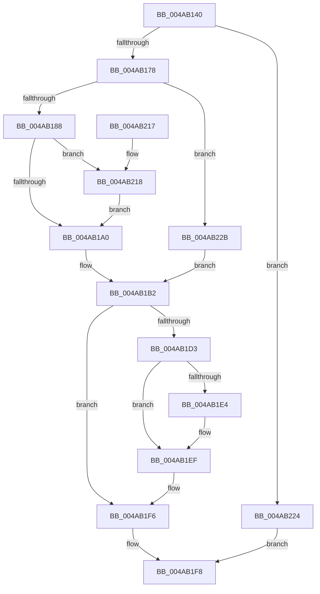

# HalConfigureAdapterChannel

- RVA: `0x004AB140`–`0x004AB237` (길이 `247` bytes)
- VA: `0x00000001404AB140`
- 실행 섹션: `.text`
- PDB 이름 있음: `예`; PDB Function 태그: `아니요`
- unwind 정보 RVA: `0x000B7ED8`
- 디코드: `64`개 명령, `247/247` bytes 표시
- 미해석 바이트: `0` (있으면 어셈블리에 `.byte`로 보존)

> 이 문서는 커널 이미지의 기계어와 PDB 기호를 분석해 생성했습니다. 4번과 5번은 함수 원형과 자료형을 바이너리 사용 방식에서 추정한 C 해석이며 원본 소스 복구 결과는 아닙니다.

## 1. Dependencies

- 직접 호출 지점: **5**; 고유 호출 대상: **5**
- 직접 호출자로 확인된 함수: **0**
- RIP 상대 이미지 참조: **1**

### Outgoing calls
- `0x004AB1AA` → [KeAcquireSpinLockAtDpcLevel](../20/KeAcquireSpinLockAtDpcLevel_function_00208430.md) (function, `0x00208430`)
- `0x004AB1C7` → [guard_dispatch_icall](../6B/guard_dispatch_icall_function_006BAAD0.md) (function, `0x006BAAD0`)
- `0x004AB1D6` → [KxReleaseSpinLock](../20/KxReleaseSpinLock_function_00206670.md) (function, `0x00206670`)
- `0x004AB1EA` → [KiLowerIrqlProcessIrqlFlags](../4F/KiLowerIrqlProcessIrqlFlags_function_004F5698.md) (function, `0x004F5698`)
- `0x004AB21A` → [KiRaiseIrqlProcessIrqlFlags](../4F/KiRaiseIrqlProcessIrqlFlags_function_004F56FC.md) (function, `0x004F56FC`)

### Direct callers
- 이 함수 시작 RVA로 연결되는 직접 call은 확인되지 않았습니다. 간접 호출은 완전히 역산할 수 없습니다.

### Static image references
- `0x004AB197` → RVA `0x00FC6D20` (`ALMOSTRO`; read)

## 2. Other-region calls and transfers

- 다른 실행 섹션으로 향하는 call: **0**
- 별도 외부 분기/꼬리 이동을 확인하지 못했습니다.

## 3. Assembly (complete function range)

```asm
004AB140  48 8B C4                        mov rax, rsp
004AB143  48 89 58 08                     mov qword ptr [rax + 8], rbx
004AB147  48 89 68 10                     mov qword ptr [rax + 0x10], rbp
004AB14B  48 89 70 18                     mov qword ptr [rax + 0x18], rsi
004AB14F  48 89 78 20                     mov qword ptr [rax + 0x20], rdi
004AB153  41 54                           push r12
004AB155  41 56                           push r14
004AB157  41 57                           push r15
004AB159  48 83 EC 30                     sub rsp, 0x30
004AB15D  48 8B B9 70 01 00 00            mov rdi, qword ptr [rcx + 0x170]
004AB164  4D 8B F8                        mov r15, r8
004AB167  44 8B E2                        mov r12d, edx
004AB16A  4C 8B F1                        mov r14, rcx
004AB16D  48 83 7F 70 00                  cmp qword ptr [rdi + 0x70], 0
004AB172  0F 84 AC 00 00 00               je 0x1404ab224
004AB178  44 0F 20 C3                     mov rbx, cr8
004AB17C  40 32 ED                        xor bpl, bpl
004AB17F  80 FB 0F                        cmp bl, 0xf
004AB182  0F 84 A3 00 00 00               je 0x1404ab22b
004AB188  0F B6 97 B0 00 00 00            movzx edx, byte ptr [rdi + 0xb0]
004AB18F  44 0F 20 C3                     mov rbx, cr8
004AB193  44 0F 22 C2                     mov cr8, rdx
004AB197  83 3D 82 BB B1 00 00            cmp dword ptr [rip + 0xb1bb82], 0
004AB19E  75 78                           jne 0x1404ab218
004AB1A0  48 8D B7 A8 00 00 00            lea rsi, [rdi + 0xa8]
004AB1A7  48 8B CE                        mov rcx, rsi
004AB1AA  E8 81 D2 D5 FF                  call 0x140208430
004AB1AF  40 B5 01                        mov bpl, 1
004AB1B2  48 8B 47 70                     mov rax, qword ptr [rdi + 0x70]
004AB1B6  4D 8B CF                        mov r9, r15
004AB1B9  41 8B 96 7C 01 00 00            mov edx, dword ptr [r14 + 0x17c]
004AB1C0  45 8B C4                        mov r8d, r12d
004AB1C3  48 8B 4F 40                     mov rcx, qword ptr [rdi + 0x40]
004AB1C7  E8 04 F9 20 00                  call 0x1406baad0
004AB1CC  8B F8                           mov edi, eax
004AB1CE  40 84 ED                        test bpl, bpl
004AB1D1  74 23                           je 0x1404ab1f6
004AB1D3  48 8B CE                        mov rcx, rsi
004AB1D6  E8 95 B4 D5 FF                  call 0x140206670
004AB1DB  83 3D 3E BB B1 00 00            cmp dword ptr [rip + 0xb1bb3e], 0
004AB1E2  74 0B                           je 0x1404ab1ef
004AB1E4  44 0F 20 C1                     mov rcx, cr8
004AB1E8  8A D3                           mov dl, bl
004AB1EA  E8 A9 A4 04 00                  call 0x1404f5698
004AB1EF  0F B6 C3                        movzx eax, bl
004AB1F2  44 0F 22 C0                     mov cr8, rax
004AB1F6  8B C7                           mov eax, edi
004AB1F8  48 8B 5C 24 50                  mov rbx, qword ptr [rsp + 0x50]
004AB1FD  48 8B 6C 24 58                  mov rbp, qword ptr [rsp + 0x58]
004AB202  48 8B 74 24 60                  mov rsi, qword ptr [rsp + 0x60]
004AB207  48 8B 7C 24 68                  mov rdi, qword ptr [rsp + 0x68]
004AB20C  48 83 C4 30                     add rsp, 0x30
004AB210  41 5F                           pop r15
004AB212  41 5E                           pop r14
004AB214  41 5C                           pop r12
004AB216  C3                              ret
004AB217  CC                              int3
004AB218  8A CB                           mov cl, bl
004AB21A  E8 DD A4 04 00                  call 0x1404f56fc
004AB21F  E9 7C FF FF FF                  jmp 0x1404ab1a0
004AB224  B8 02 00 00 C0                  mov eax, 0xc0000002
004AB229  EB CD                           jmp 0x1404ab1f8
004AB22B  48 8D B7 A8 00 00 00            lea rsi, [rdi + 0xa8]
004AB232  E9 7B FF FF FF                  jmp 0x1404ab1b2
```

## 4. C-style interpretation (structured pseudocode)

```c
__int64 __fastcall HalConfigureAdapterChannel(__int64 a1, int a2, __int64 a3)
{
    __int64 result;
    __int64 v_rbp;
    __int64 v_rsp;
    unsigned __int64 v_stack_p10;
    unsigned __int64 v_stack_p18;
    unsigned __int64 v_stack_p20;
    unsigned __int64 v_stack_p8;

    *(unsigned __int64 *)(v_rsp + 8) = v_rbx;
    *(unsigned __int64 *)(v_rsp + 16) = v_rbp;
    *(unsigned __int64 *)(v_rsp + 24) = v_rsi;
    *(unsigned __int64 *)(v_rsp + 32) = v_rdi;
    v_rsp = (v_rsp) - (48);
    if ((*(unsigned __int64 *)(*(unsigned __int64 *)(a1 + 368) + 112)) == 0) goto loc_004AB224;
    v_rbp = 0;
    if (((unsigned __int8)(v_cr8)) == 15) goto loc_004AB22B;
    if ((*(unsigned int *)(v_rip + 11647874)) != 0) goto loc_004AB218;
loc_004AB1A0:
    result = KeAcquireSpinLockAtDpcLevel(*(unsigned __int64 *)(a1 + 368) + 168, *(unsigned __int8 *)(*(unsigned __int64 *)(a1 + 368) + 176), a3, a4);
loc_004AB1B2:
    result = guard_dispatch_icall(*(unsigned __int64 *)(*(unsigned __int64 *)(a1 + 368) + 64), (unsigned int)(*(unsigned int *)(a1 + 380)), (unsigned int)((unsigned int)((unsigned int)(a2))), a3);
    if (1 == 0) goto loc_004AB1F6;
    result = KxReleaseSpinLock(*(unsigned __int64 *)(a1 + 368) + 168, (unsigned int)(*(unsigned int *)(a1 + 380)), (unsigned int)((unsigned int)((unsigned int)(a2))), a3);
    if ((*(unsigned int *)(v_rip + 11647806)) != 0) {
        a1 = *(unsigned __int8 *)(*(unsigned __int64 *)(a1 + 368) + 176);
        a2 = (unsigned __int8)(v_cr8);
        result = KiLowerIrqlProcessIrqlFlags(a1, a2, (unsigned int)((unsigned int)((unsigned int)(a2))), a3);
    }
loc_004AB1F6:
loc_004AB1F8:
    v_rsp = (v_rsp) + (48);
    return (unsigned int)((unsigned int)((unsigned int)((unsigned int)(result))));
loc_004AB218:
    result = KiRaiseIrqlProcessIrqlFlags((unsigned __int8)(v_stack_p8), a2, (unsigned int)((unsigned int)((unsigned int)(a2))), a3);
    goto loc_004AB1A0;
loc_004AB224:
    goto loc_004AB1F8;
loc_004AB22B:
    goto loc_004AB1B2;
}
```

## 5. (Beta) C Style

```c
int64_t HalConfigureAdapterChannel(void *Arg1, int32_t Arg2, int64_t Arg3)
{
    uint8_t *arg1 = (uint8_t *)Arg1;

    int64_t result;
    int64_t local_rbp;
    int64_t local_rsp;
    uint64_t v_stack_p10;
    uint64_t v_stack_p18;
    uint64_t v_stack_p20;
    uint64_t v_stack_p8;

    *(uint64_t *)(local_rsp + 0x8) = local_rbx;
    *(uint64_t *)(local_rsp + 0x10) = local_rbp;
    *(uint64_t *)(local_rsp + 0x18) = local_rsi;
    *(uint64_t *)(local_rsp + 0x20) = local_rdi;
    local_rsp = (local_rsp) - (48);
    if ((*(uint64_t *)(*(uint64_t *)(arg1 + 0x170) + 0x70)) == 0) goto loc_004AB224;
    local_rbp = 0;
    if (((uint8_t)(v_cr8)) == 15) goto loc_004AB22B;
    if ((*(uint32_t *)(v_rip + 0xB1BB82)) != 0) goto loc_004AB218;
loc_004AB1A0:
    result = KeAcquireSpinLockAtDpcLevel(*(uint64_t *)(arg1 + 0x170) + 168, *(uint8_t *)(*(uint64_t *)(arg1 + 0x170) + 0xB0), Arg3, a4);
loc_004AB1B2:
    result = guard_dispatch_icall(*(uint64_t *)(*(uint64_t *)(arg1 + 0x170) + 0x40), (uint32_t)(*(uint32_t *)(arg1 + 0x17C)), (uint32_t)((uint32_t)((uint32_t)(Arg2))), Arg3);
    if (1 == 0) goto loc_004AB1F6;
    result = KxReleaseSpinLock(*(uint64_t *)(arg1 + 0x170) + 168, (uint32_t)(*(uint32_t *)(arg1 + 0x17C)), (uint32_t)((uint32_t)((uint32_t)(Arg2))), Arg3);
    if ((*(uint32_t *)(v_rip + 0xB1BB3E)) != 0) {
        Arg1 = *(uint8_t *)(*(uint64_t *)(arg1 + 0x170) + 0xB0);
        Arg2 = (uint8_t)(v_cr8);
        result = KiLowerIrqlProcessIrqlFlags(Arg1, Arg2, (uint32_t)((uint32_t)((uint32_t)(Arg2))), Arg3);
    }
loc_004AB1F6:
loc_004AB1F8:
    local_rsp = (local_rsp) + (48);
    return (uint32_t)((uint32_t)((uint32_t)((uint32_t)(result))));
loc_004AB218:
    result = KiRaiseIrqlProcessIrqlFlags((uint8_t)(v_stack_p8), Arg2, (uint32_t)((uint32_t)((uint32_t)(Arg2))), Arg3);
    goto loc_004AB1A0;
loc_004AB224:
    goto loc_004AB1F8;
loc_004AB22B:
    goto loc_004AB1B2;
}
```

### 관측된 메모리 오프셋

구조체 형식이 확인되지 않은 접근은 인자 기준의 오프셋으로만 기록했습니다.

| 기준 인자 | 오프셋 표현 | 폭 (bit) | 접근 |
|---|---:|---:|---|
| `Arg1` | `+ 0x170` | `64` | `R` |
| `Arg1` | `+ 0x17C` | `32` | `R` |

## 6. Execution-region graph

[열기: 2D/3D 그래프와 함수 탐색 컨트롤 패널](../../../control-panel.html?section=text&rva=0x004AB140&view=graph)

- 2D 그래프는 위에서 아래로 흐르고, 3D 그래프는 빈 공간을 드래그해 회전합니다. Shift+드래그는 이동, 휠은 확대·축소, 함수 노드 선택은 대상 보고서 이동입니다.

### Static fallback


