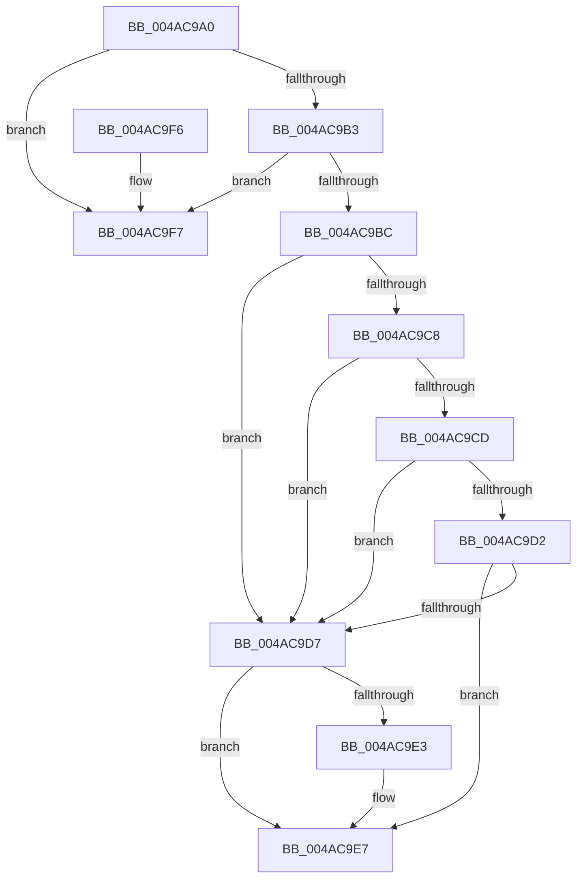

# HalQueryMaximumProcessorCount

- RVA: `0x004AC9A0`–`0x004ACA32` (길이 `146` bytes)
- VA: `0x00000001404AC9A0`
- 실행 섹션: `.text`
- PDB 이름 있음: `예`; PDB Function 태그: `아니요`
- unwind 정보 RVA: `0x00076AF4`
- 디코드: `40`개 명령, `146/146` bytes 표시
- 미해석 바이트: `0` (있으면 어셈블리에 `.byte`로 보존)

> 이 문서는 커널 이미지의 기계어와 PDB 기호를 분석해 생성했습니다. 4번과 5번은 함수 원형과 자료형을 바이너리 사용 방식에서 추정한 C 해석이며 원본 소스 복구 결과는 아닙니다.

## 1. Dependencies

- 직접 호출 지점: **3**; 고유 호출 대상: **3**
- 직접 호출자로 확인된 함수: **21**
- RIP 상대 이미지 참조: **5**

### Outgoing calls
- `0x004AC9BC` → [HalpInterruptModel](HalpInterruptModel_function_004ACA38.md) (function, `0x004ACA38`)
- `0x004ACA0F` → [HalpInterruptSetProblemEx](../48/HalpInterruptSetProblemEx_function_0048AC8C.md) (function, `0x0048AC8C`)
- `0x004ACA2C` → [KeBugCheckEx](../4F/KeBugCheckEx_function_004FD660.md) (function, `0x004FD660`)

### Direct callers
- [sub_002D6BD6](../2D/Unknown_function_002D6BD6.md) at `0x002D6BD6`
- [HalpEfiLockOutRuntimeCallsForSystemSleep](HalpEfiLockOutRuntimeCallsForSystemSleep_function_004AC91C.md) at `0x004AC924`
- [HalpTimerInitSystem](../53/HalpTimerInitSystem_function_0053CB70.md) at `0x0053CD94`
- [HalpQueryMaximumRegisteredProcessorCount](../54/HalpQueryMaximumRegisteredProcessorCount_function_00543BE8.md) at `0x00543C23`
- [HalpMmAllocatePerProcessorMemory](../54/HalpMmAllocatePerProcessorMemory_function_00544AA8.md) at `0x00544AB4`
- [HalpMmReservePageTablePages](../54/HalpMmReservePageTablePages_function_00544C1C.md) at `0x00544C3A`
- [HalpEfiBugCheckAddPagesCallback](../54/HalpEfiBugCheckAddPagesCallback_function_0054E250.md) at `0x0054E2AA`
- [HalpInterruptAllocateCacheDomainTable](../55/HalpInterruptAllocateCacheDomainTable_function_0055A41C.md) at `0x0055A42B`
- [HalpHvDiscover](../56/HalpHvDiscover_function_005606A0.md) at `0x00560774`
- [HalpHvTimerInitialize](../56/HalpHvTimerInitialize_function_00560810.md) at `0x005608A4`
- [HalpTimerRegister](../56/HalpTimerRegister_function_005616BC.md) at `0x005617F1`
- [HvlStartBootLogicalProcessors](../58/HvlStartBootLogicalProcessors_function_00584E18.md) at `0x00584EDF`
- [KiComputeEstimatedMaximumProcessors](../5B/KiComputeEstimatedMaximumProcessors_function_005B7800.md) at `0x005B782B`
- [RtlpHpHeapCreate](../60/RtlpHpHeapCreate_function_00602FDC.md) at `0x0060302A`
- [HalpInterruptGetIrtInfo](../../page/70/HalpInterruptGetIrtInfo_function_00707784.md) at `0x007077A7`
- [HalpInterruptGetIrtInfo](../../page/70/HalpInterruptGetIrtInfo_function_00707784.md) at `0x00707800`
- [HalpInterruptGetIrtInfo](../../page/70/HalpInterruptGetIrtInfo_function_00707784.md) at `0x0070781D`
- [HalpInterruptGetIrtInfo](../../page/70/HalpInterruptGetIrtInfo_function_00707784.md) at `0x0070783B`
- [HalpQueryAcpiResourceRequirements](../../page/70/HalpQueryAcpiResourceRequirements_function_0070BE28.md) at `0x0070BE8C`
- [EtwpInitLoggerContext](../../page/A7/EtwpInitLoggerContext_function_00A7154C.md) at `0x00A71824`
- [VfAvlInitializeTreeEx](../../pagevrfy/B9/VfAvlInitializeTreeEx_function_00B93CC8.md) at `0x00B93D21`
- [InitBootProcessor](../../init/C1/InitBootProcessor_function_00C1B1C8.md) at `0x00C1BD27`
- [HalpInitializeInterrupts](../../init/C1/HalpInitializeInterrupts_function_00C1E4F8.md) at `0x00C1E56E`
- [HalpInitializeInterrupts](../../init/C1/HalpInitializeInterrupts_function_00C1E4F8.md) at `0x00C1E90C`
- [HalpInitializePmcCounterSetInfo](../../init/C1/HalpInitializePmcCounterSetInfo_function_00C1EEC4.md) at `0x00C1EECE`

### Static image references
- `0x004AC9A4` → RVA `0x00E1020C` (`.data`; read)
- `0x004AC9B3` → RVA `0x00F90664` (`.data`; read)
- `0x004AC9D7` → RVA `0x00F90658` (`.data`; read)
- `0x004ACA02` → RVA `0x00023AE0` (`.rdata`; read)
- `0x004ACA14` → RVA `0x00F90694` (`.data`; read)

## 2. Other-region calls and transfers

- 다른 실행 섹션으로 향하는 call: **0**
- 별도 외부 분기/꼬리 이동을 확인하지 못했습니다.

## 3. Assembly (complete function range)

```asm
004AC9A0  48 83 EC 38                     sub rsp, 0x38
004AC9A4  44 8B 05 61 38 96 00            mov r8d, dword ptr [rip + 0x963861]
004AC9AB  45 33 D2                        xor r10d, r10d
004AC9AE  45 85 C0                        test r8d, r8d
004AC9B1  74 44                           je 0x1404ac9f7
004AC9B3  44 38 15 AA 3C AE 00            cmp byte ptr [rip + 0xae3caa], r10b
004AC9BA  74 3B                           je 0x1404ac9f7
004AC9BC  E8 77 00 00 00                  call 0x1404aca38
004AC9C1  8B D0                           mov edx, eax
004AC9C3  83 EA 01                        sub edx, 1
004AC9C6  74 0F                           je 0x1404ac9d7
004AC9C8  83 EA 01                        sub edx, 1
004AC9CB  74 0A                           je 0x1404ac9d7
004AC9CD  83 EA 01                        sub edx, 1
004AC9D0  74 05                           je 0x1404ac9d7
004AC9D2  83 FA 01                        cmp edx, 1
004AC9D5  75 10                           jne 0x1404ac9e7
004AC9D7  48 8B 05 7A 3C AE 00            mov rax, qword ptr [rip + 0xae3c7a]
004AC9DE  48 85 C0                        test rax, rax
004AC9E1  74 04                           je 0x1404ac9e7
004AC9E3  44 8B 50 3C                     mov r10d, dword ptr [rax + 0x3c]
004AC9E7  45 3B D0                        cmp r10d, r8d
004AC9EA  45 0F 42 D0                     cmovb r10d, r8d
004AC9EE  41 8B C2                        mov eax, r10d
004AC9F1  48 83 C4 38                     add rsp, 0x38
004AC9F5  C3                              ret
004AC9F6  CC                              int3
004AC9F7  45 33 C0                        xor r8d, r8d
004AC9FA  C7 44 24 20 D6 02 00 00         mov dword ptr [rsp + 0x20], 0x2d6
004ACA02  4C 8D 0D D7 70 B7 FF            lea r9, [rip - 0x488f29]
004ACA09  33 C9                           xor ecx, ecx
004ACA0B  41 8D 50 0B                     lea edx, [r8 + 0xb]
004ACA0F  E8 78 E2 FD FF                  call 0x14048ac8c
004ACA14  4C 63 05 79 3C AE 00            movsxd r8, dword ptr [rip + 0xae3c79]
004ACA1B  45 33 C9                        xor r9d, r9d
004ACA1E  BA 00 80 00 00                  mov edx, 0x8000
004ACA23  4C 89 54 24 20                  mov qword ptr [rsp + 0x20], r10
004ACA28  41 8D 49 5C                     lea ecx, [r9 + 0x5c]
004ACA2C  E8 2F 0C 05 00                  call 0x1404fd660
004ACA31  CC                              int3
```

## 4. C-style interpretation (structured pseudocode)

```c
__int64 __fastcall HalQueryMaximumProcessorCount(int a1)
{
    __int64 result;
    __int64 v_r10;
    __int64 v_rsp;
    unsigned int v_stack_p20;

    v_rsp = (v_rsp) - (56);
    v_r10 = 0;
    if ((unsigned int)((unsigned int)(*(unsigned int *)(v_rip + 9844833))) == 0) goto loc_004AC9F7;
    if ((*(unsigned __int8 *)(v_rip + 11418794)) == 0) goto loc_004AC9F7;
    result = HalpInterruptModel(a1, a2, (unsigned int)(*(unsigned int *)(v_rip + 9844833)), a4);
    a2 = (unsigned int)(((unsigned int)((unsigned int)(result))) - (1));
    if (condition_is_equal) goto loc_004AC9D7;
    a2 = (unsigned int)((a2) - (1));
    if (condition_is_equal) goto loc_004AC9D7;
    a2 = (unsigned int)((a2) - (1));
    if (condition_is_equal) goto loc_004AC9D7;
    if (((unsigned int)(a2)) != 1) goto loc_004AC9E7;
loc_004AC9D7:
    if (*(unsigned __int64 *)(v_rip + 11418746) != 0) {
        v_r10 = *(unsigned int *)(*(unsigned __int64 *)(v_rip + 11418746) + 60);
    }
    if (((unsigned int)(v_r10)) < ((unsigned int)((unsigned int)(*(unsigned int *)(v_rip + 9844833))))) { v_r10 = (unsigned int)((unsigned int)(*(unsigned int *)(v_rip + 9844833))); }
    v_rsp = (v_rsp) + (56);
    return (unsigned int)((unsigned int)(v_r10));
loc_004AC9F7:
    a3 = 0;
    v_stack_p20 = 726;
    a1 = 0;
    result = HalpInterruptSetProblemEx(a1, a3 + 11, a3, v_rip - 4755241);
    a4 = 0;
    v_stack_p20 = v_r10;
    result = KeBugCheckEx(a4 + 92, (unsigned int)(0x8000ULL), (int)(*(unsigned int *)(v_rip + 11418745)), a4);
    return result;
}
```

## 5. (Beta) C Style

```c
int64_t HalQueryMaximumProcessorCount(int32_t Arg1)
{
    int64_t result;
    int64_t local_r10;
    int64_t local_rsp;
    uint32_t v_stack_p20;

    local_rsp = (local_rsp) - (56);
    local_r10 = 0;
    if ((uint32_t)((uint32_t)(*(uint32_t *)(v_rip + 0x963861))) == 0) goto loc_004AC9F7;
    if ((*(uint8_t *)(v_rip + 0xAE3CAA)) == 0) goto loc_004AC9F7;
    result = HalpInterruptModel(Arg1, a2, (uint32_t)(*(uint32_t *)(v_rip + 0x963861)), a4);
    a2 = (uint32_t)(((uint32_t)((uint32_t)(result))) - (1));
    if (condition_is_equal) goto loc_004AC9D7;
    a2 = (uint32_t)((a2) - (1));
    if (condition_is_equal) goto loc_004AC9D7;
    a2 = (uint32_t)((a2) - (1));
    if (condition_is_equal) goto loc_004AC9D7;
    if (((uint32_t)(a2)) != 1) goto loc_004AC9E7;
loc_004AC9D7:
    if (*(uint64_t *)(v_rip + 0xAE3C7A) != 0) {
        local_r10 = *(uint32_t *)(*(uint64_t *)(v_rip + 0xAE3C7A) + 0x3C);
    }
    if (((uint32_t)(local_r10)) < ((uint32_t)((uint32_t)(*(uint32_t *)(v_rip + 0x963861))))) { local_r10 = (uint32_t)((uint32_t)(*(uint32_t *)(v_rip + 0x963861))); }
    local_rsp = (local_rsp) + (56);
    return (uint32_t)((uint32_t)(local_r10));
loc_004AC9F7:
    a3 = 0;
    v_stack_p20 = 726;
    Arg1 = 0;
    result = HalpInterruptSetProblemEx(Arg1, a3 + 11, a3, v_rip - 4755241);
    a4 = 0;
    v_stack_p20 = local_r10;
    result = KeBugCheckEx(a4 + 92, (uint32_t)(0x8000ULL), (int32_t)(*(uint32_t *)(v_rip + 0xAE3C79)), a4);
    return result;
}
```

## 6. Execution-region graph

[열기: 2D/3D 그래프와 함수 탐색 컨트롤 패널](../../../control-panel.html?section=text&rva=0x004AC9A0&view=graph)

- 2D 그래프는 위에서 아래로 흐르고, 3D 그래프는 빈 공간을 드래그해 회전합니다. Shift+드래그는 이동, 휠은 확대·축소, 함수 노드 선택은 대상 보고서 이동입니다.

### Static fallback


