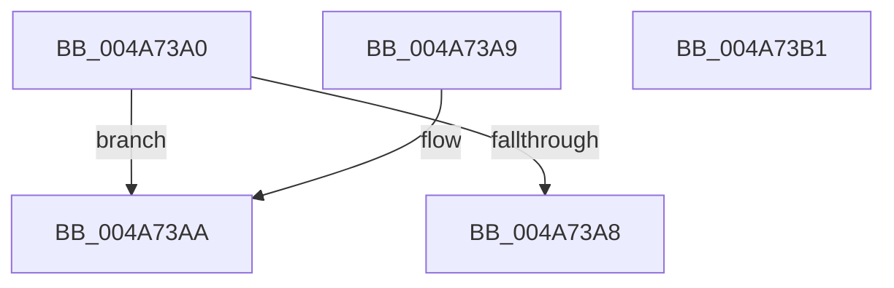

# HaliSetMaxLegacyPciBusNumber

- RVA: `0x004A73A0`–`0x004A73B2` (길이 `18` bytes)
- VA: `0x00000001404A73A0`
- 실행 섹션: `.text`
- PDB 이름 있음: `예`; PDB Function 태그: `아니요`
- unwind 정보 RVA: `0x000DB714`
- 디코드: `7`개 명령, `18/18` bytes 표시
- 미해석 바이트: `0` (있으면 어셈블리에 `.byte`로 보존)

> 이 문서는 커널 이미지의 기계어와 PDB 기호를 분석해 생성했습니다. 4번과 5번은 함수 원형과 자료형을 바이너리 사용 방식에서 추정한 C 해석이며 원본 소스 복구 결과는 아닙니다.

## 1. Dependencies

- 직접 호출 지점: **0**; 고유 호출 대상: **0**
- 직접 호출자로 확인된 함수: **0**
- RIP 상대 이미지 참조: **2**

### Outgoing calls
- 직접 디코드된 call 명령이 없습니다.

### Direct callers
- 이 함수 시작 RVA로 연결되는 직접 call은 확인되지 않았습니다. 간접 호출은 완전히 역산할 수 없습니다.

### Static image references
- `0x004A73A0` → RVA `0x00E103FC` (`.data`; read)
- `0x004A73AA` → RVA `0x00E103FC` (`.data`; write)

## 2. Other-region calls and transfers

- 다른 실행 섹션으로 향하는 call: **0**
- 별도 외부 분기/꼬리 이동을 확인하지 못했습니다.

## 3. Assembly (complete function range)

```asm
004A73A0  3B 0D 56 90 96 00               cmp ecx, dword ptr [rip + 0x969056]
004A73A6  77 02                           ja 0x1404a73aa
004A73A8  C3                              ret
004A73A9  CC                              int3
004A73AA  89 0D 4C 90 96 00               mov dword ptr [rip + 0x96904c], ecx
004A73B0  C3                              ret
004A73B1  CC                              int3
```

## 4. C-style interpretation (structured pseudocode)

```c
void __fastcall HaliSetMaxLegacyPciBusNumber(int a1)
{
    if (a1 > (*(unsigned int *)(v_rip + 9867350))) goto loc_004A73AA;
    return;
loc_004A73AA:
    *(unsigned int *)(v_rip + 9867340) = a1;
    return;
}
```

## 5. (Beta) C Style

```c
void HaliSetMaxLegacyPciBusNumber(int32_t Arg1)
{
    if (Arg1 > (*(uint32_t *)(v_rip + 0x969056))) goto loc_004A73AA;
    return;
loc_004A73AA:
    *(uint32_t *)(v_rip + 0x96904C) = Arg1;
    return;
}
```

## 6. Execution-region graph

[열기: 2D/3D 그래프와 함수 탐색 컨트롤 패널](../../../control-panel.html?section=text&rva=0x004A73A0&view=graph)

- 2D 그래프는 위에서 아래로 흐르고, 3D 그래프는 빈 공간을 드래그해 회전합니다. Shift+드래그는 이동, 휠은 확대·축소, 함수 노드 선택은 대상 보고서 이동입니다.

### Static fallback


