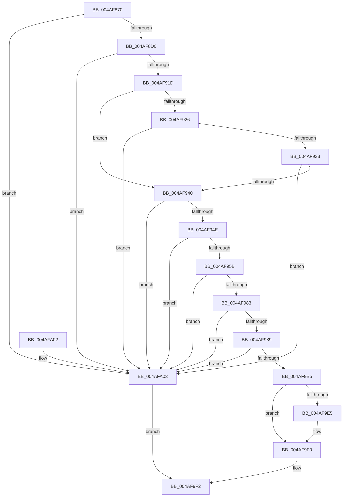

# HalpArtAvailable

- RVA: `0x004AF870`–`0x004AFA07` (길이 `407` bytes)
- VA: `0x00000001404AF870`
- 실행 섹션: `.text`
- PDB 이름 있음: `예`; PDB Function 태그: `아니요`
- unwind 정보 RVA: `0x000B8824`
- 디코드: `103`개 명령, `407/407` bytes 표시
- 미해석 바이트: `0` (있으면 어셈블리에 `.byte`로 보존)

> 이 문서는 커널 이미지의 기계어와 PDB 기호를 분석해 생성했습니다. 4번과 5번은 함수 원형과 자료형을 바이너리 사용 방식에서 추정한 C 해석이며 원본 소스 복구 결과는 아닙니다.

## 1. Dependencies

- 직접 호출 지점: **8**; 고유 호출 대상: **3**
- 직접 호출자로 확인된 함수: **2**
- RIP 상대 이미지 참조: **2**

### Outgoing calls
- `0x004AF8C3` → [guard_dispatch_icall](../6B/guard_dispatch_icall_function_006BAAD0.md) (function, `0x006BAAD0`)
- `0x004AF8EB` → [guard_dispatch_icall](../6B/guard_dispatch_icall_function_006BAAD0.md) (function, `0x006BAAD0`)
- `0x004AF90E` → [guard_dispatch_icall](../6B/guard_dispatch_icall_function_006BAAD0.md) (function, `0x006BAAD0`)
- `0x004AF91D` → [HalpIsHvPresent](HalpIsHvPresent_function_004AFA10.md) (function, `0x004AFA10`)
- `0x004AF933` → [HalpIsMicrosoftCompatibleHvLoaded](HalpIsMicrosoftCompatibleHvLoaded_function_004AFAAC.md) (function, `0x004AFAAC`)
- `0x004AF974` → [guard_dispatch_icall](../6B/guard_dispatch_icall_function_006BAAD0.md) (function, `0x006BAAD0`)
- `0x004AF9A7` → [guard_dispatch_icall](../6B/guard_dispatch_icall_function_006BAAD0.md) (function, `0x006BAAD0`)
- `0x004AF9D3` → [guard_dispatch_icall](../6B/guard_dispatch_icall_function_006BAAD0.md) (function, `0x006BAAD0`)

### Direct callers
- [HalpArtInitialize](HalpArtInitialize_function_004AF7E0.md) at `0x004AF81C`
- [HalpArtDiscover](../56/HalpArtDiscover_function_00561DB4.md) at `0x00561DE8`

### Static image references
- `0x004AF882` → RVA `0x00003A70` (`.rdata`; read)
- `0x004AF926` → RVA `0x00FC1ED0` (`.data`; read)

## 2. Other-region calls and transfers

- 다른 실행 섹션으로 향하는 call: **0**
- 별도 외부 분기/꼬리 이동을 확인하지 못했습니다.

## 3. Assembly (complete function range)

```asm
004AF870  48 89 5C 24 08                  mov qword ptr [rsp + 8], rbx
004AF875  48 89 74 24 10                  mov qword ptr [rsp + 0x10], rsi
004AF87A  55                              push rbp
004AF87B  48 8B EC                        mov rbp, rsp
004AF87E  48 83 EC 60                     sub rsp, 0x60
004AF882  0F 10 05 E7 41 B5 FF            movups xmm0, xmmword ptr [rip - 0x4abe19]
004AF889  83 65 E0 00                     and dword ptr [rbp - 0x20], 0
004AF88D  48 8B F2                        mov rsi, rdx
004AF890  83 65 D0 00                     and dword ptr [rbp - 0x30], 0
004AF894  48 8B D9                        mov rbx, rcx
004AF897  83 65 D8 00                     and dword ptr [rbp - 0x28], 0
004AF89B  83 65 DC 00                     and dword ptr [rbp - 0x24], 0
004AF89F  83 65 D4 00                     and dword ptr [rbp - 0x2c], 0
004AF8A3  83 65 E4 00                     and dword ptr [rbp - 0x1c], 0
004AF8A7  83 65 28 00                     and dword ptr [rbp + 0x28], 0
004AF8AB  0F 11 45 E8                     movups xmmword ptr [rbp - 0x18], xmm0
004AF8AF  C6 45 20 00                     mov byte ptr [rbp + 0x20], 0
004AF8B3  66 48 0F 7E C0                  movq rax, xmm0
004AF8B8  4C 8D 4D 20                     lea r9, [rbp + 0x20]
004AF8BC  45 33 C0                        xor r8d, r8d
004AF8BF  33 D2                           xor edx, edx
004AF8C1  33 C9                           xor ecx, ecx
004AF8C3  E8 08 B2 20 00                  call 0x1406baad0
004AF8C8  84 C0                           test al, al
004AF8CA  0F 84 33 01 00 00               je 0x1404afa03
004AF8D0  48 8D 45 28                     lea rax, [rbp + 0x28]
004AF8D4  33 C9                           xor ecx, ecx
004AF8D6  48 89 44 24 20                  mov qword ptr [rsp + 0x20], rax
004AF8DB  4C 8D 4D 28                     lea r9, [rbp + 0x28]
004AF8DF  48 8B 45 F0                     mov rax, qword ptr [rbp - 0x10]
004AF8E3  4C 8D 45 28                     lea r8, [rbp + 0x28]
004AF8E7  48 8D 55 D8                     lea rdx, [rbp - 0x28]
004AF8EB  E8 E0 B1 20 00                  call 0x1406baad0
004AF8F0  48 8D 45 28                     lea rax, [rbp + 0x28]
004AF8F4  B9 00 00 00 80                  mov ecx, 0x80000000
004AF8F9  48 89 44 24 20                  mov qword ptr [rsp + 0x20], rax
004AF8FE  4C 8D 4D 28                     lea r9, [rbp + 0x28]
004AF902  48 8B 45 F0                     mov rax, qword ptr [rbp - 0x10]
004AF906  4C 8D 45 28                     lea r8, [rbp + 0x28]
004AF90A  48 8D 55 DC                     lea rdx, [rbp - 0x24]
004AF90E  E8 BD B1 20 00                  call 0x1406baad0
004AF913  80 7D 20 02                     cmp byte ptr [rbp + 0x20], 2
004AF917  0F 85 E6 00 00 00               jne 0x1404afa03
004AF91D  E8 EE 00 00 00                  call 0x1404afa10
004AF922  84 C0                           test al, al
004AF924  74 1A                           je 0x1404af940
004AF926  80 3D A3 25 B1 00 00            cmp byte ptr [rip + 0xb125a3], 0
004AF92D  0F 84 D0 00 00 00               je 0x1404afa03
004AF933  E8 74 01 00 00                  call 0x1404afaac
004AF938  84 C0                           test al, al
004AF93A  0F 84 C3 00 00 00               je 0x1404afa03
004AF940  B9 15 00 00 00                  mov ecx, 0x15
004AF945  39 4D D8                        cmp dword ptr [rbp - 0x28], ecx
004AF948  0F 82 B5 00 00 00               jb 0x1404afa03
004AF94E  81 7D DC 07 00 00 80            cmp dword ptr [rbp - 0x24], 0x80000007
004AF955  0F 82 A8 00 00 00               jb 0x1404afa03
004AF95B  48 8D 45 28                     lea rax, [rbp + 0x28]
004AF95F  48 89 44 24 20                  mov qword ptr [rsp + 0x20], rax
004AF964  4C 8D 4D 28                     lea r9, [rbp + 0x28]
004AF968  48 8B 45 F0                     mov rax, qword ptr [rbp - 0x10]
004AF96C  4C 8D 45 D4                     lea r8, [rbp - 0x2c]
004AF970  48 8D 55 D0                     lea rdx, [rbp - 0x30]
004AF974  E8 57 B1 20 00                  call 0x1406baad0
004AF979  83 7D D4 00                     cmp dword ptr [rbp - 0x2c], 0
004AF97D  0F 84 80 00 00 00               je 0x1404afa03
004AF983  83 7D D0 00                     cmp dword ptr [rbp - 0x30], 0
004AF987  74 7A                           je 0x1404afa03
004AF989  48 8D 45 E0                     lea rax, [rbp - 0x20]
004AF98D  B9 07 00 00 80                  mov ecx, 0x80000007
004AF992  48 89 44 24 20                  mov qword ptr [rsp + 0x20], rax
004AF997  4C 8D 4D 28                     lea r9, [rbp + 0x28]
004AF99B  48 8B 45 F0                     mov rax, qword ptr [rbp - 0x10]
004AF99F  4C 8D 45 28                     lea r8, [rbp + 0x28]
004AF9A3  48 8D 55 28                     lea rdx, [rbp + 0x28]
004AF9A7  E8 24 B1 20 00                  call 0x1406baad0
004AF9AC  F7 45 E0 00 01 00 00            test dword ptr [rbp - 0x20], 0x100
004AF9B3  74 4E                           je 0x1404afa03
004AF9B5  48 8D 45 28                     lea rax, [rbp + 0x28]
004AF9B9  B9 01 00 00 00                  mov ecx, 1
004AF9BE  48 89 44 24 20                  mov qword ptr [rsp + 0x20], rax
004AF9C3  4C 8D 4D 28                     lea r9, [rbp + 0x28]
004AF9C7  48 8B 45 F0                     mov rax, qword ptr [rbp - 0x10]
004AF9CB  4C 8D 45 E4                     lea r8, [rbp - 0x1c]
004AF9CF  48 8D 55 28                     lea rdx, [rbp + 0x28]
004AF9D3  E8 F8 B0 20 00                  call 0x1406baad0
004AF9D8  8B 4D E4                        mov ecx, dword ptr [rbp - 0x1c]
004AF9DB  C1 E9 18                        shr ecx, 0x18
004AF9DE  89 0E                           mov dword ptr [rsi], ecx
004AF9E0  48 85 DB                        test rbx, rbx
004AF9E3  74 0B                           je 0x1404af9f0
004AF9E5  8B 4D D0                        mov ecx, dword ptr [rbp - 0x30]
004AF9E8  89 0B                           mov dword ptr [rbx], ecx
004AF9EA  8B 4D D4                        mov ecx, dword ptr [rbp - 0x2c]
004AF9ED  89 4B 04                        mov dword ptr [rbx + 4], ecx
004AF9F0  B0 01                           mov al, 1
004AF9F2  48 8B 5C 24 70                  mov rbx, qword ptr [rsp + 0x70]
004AF9F7  48 8B 74 24 78                  mov rsi, qword ptr [rsp + 0x78]
004AF9FC  48 83 C4 60                     add rsp, 0x60
004AFA00  5D                              pop rbp
004AFA01  C3                              ret
004AFA02  CC                              int3
004AFA03  32 C0                           xor al, al
004AFA05  EB EB                           jmp 0x1404af9f2
```

## 4. C-style interpretation (structured pseudocode)

```c
__int64 __fastcall HalpArtAvailable(__int64 a1, __int64 a2, int a3)
{
    __int64 result;
    __int64 v_rsp;
    unsigned __int64 v_stack_m18;
    unsigned __int64 v_stack_m20;
    unsigned int v_stack_m24;
    unsigned int v_stack_m28;
    unsigned int v_stack_m2C;
    unsigned int v_stack_m30;
    unsigned int v_stack_m34;
    unsigned int v_stack_m38;
    unsigned __int64 v_stack_m48;
    unsigned __int64 v_stack_p10;
    unsigned __int8 v_stack_p18;
    unsigned int v_stack_p20;
    unsigned __int64 v_stack_p8;

    v_stack_p8 = v_rbx;
    v_stack_p10 = v_rsi;
    v_rsp = (v_rsp) - (96);
    v_stack_m20 = v_xmm0;
    v_stack_p18 = 0;
    a3 = 0;
    a2 = 0;
    a1 = 0;
    result = guard_dispatch_icall(a1, a2, a3, v_stack_p18);
    if ((unsigned __int8)(result) == 0) goto loc_004AFA03;
    a1 = 0;
    v_stack_m48 = v_stack_p20;
    result = guard_dispatch_icall(a1, v_stack_m30, v_stack_p20, v_stack_p20);
    v_stack_m48 = v_stack_p20;
    result = guard_dispatch_icall((unsigned int)(0x80000000ULL), v_stack_m2C, v_stack_p20, v_stack_p20);
    if (v_stack_p18 != 2) goto loc_004AFA03;
    result = HalpIsHvPresent((unsigned int)(0x80000000ULL), v_stack_m2C, v_stack_p20, v_stack_p20);
    if ((unsigned __int8)(result) == 0) goto loc_004AF940;
    if ((*(unsigned __int8 *)(v_rip + 11609507)) == 0) goto loc_004AFA03;
    result = HalpIsMicrosoftCompatibleHvLoaded((unsigned int)(0x80000000ULL), v_stack_m2C, v_stack_p20, v_stack_p20);
    if ((unsigned __int8)(result) == 0) goto loc_004AFA03;
loc_004AF940:
    if (v_stack_m30 < 21) goto loc_004AFA03;
    if (v_stack_m2C < 0x80000007ULL) goto loc_004AFA03;
    v_stack_m48 = v_stack_p20;
    result = guard_dispatch_icall(21, v_stack_m38, v_stack_m34, v_stack_p20);
    if (v_stack_m34 == 0) goto loc_004AFA03;
    if (v_stack_m38 == 0) goto loc_004AFA03;
    v_stack_m48 = v_stack_m28;
    result = guard_dispatch_icall((unsigned int)(0x80000007ULL), v_stack_p20, v_stack_p20, v_stack_p20);
    if (((v_stack_m28) & (256)) == 0) goto loc_004AFA03;
    v_stack_m48 = v_stack_p20;
    result = guard_dispatch_icall(1, v_stack_p20, v_stack_m24, v_stack_p20);
    a1 = (unsigned int)(((unsigned int)(v_stack_m24)) >> (24));
    *(unsigned int *)(a2) = (unsigned int)(a1);
    if (a1 != 0) {
        a1 = v_stack_m38;
        *(unsigned int *)(a1) = (unsigned int)(a1);
        a1 = v_stack_m34;
        *(unsigned int *)(a1 + 4) = (unsigned int)(a1);
    }
loc_004AF9F2:
    v_rsp = (v_rsp) + (96);
    return 1;
loc_004AFA03:
    result = 0;
    goto loc_004AF9F2;
}
```

## 5. (Beta) C Style

```c
int64_t HalpArtAvailable(int64_t Arg1, void *Arg2, int32_t Arg3)
{
    uint8_t *arg2 = (uint8_t *)Arg2;

    int64_t result;
    int64_t local_rsp;
    uint64_t v_stack_m18;
    uint64_t v_stack_m20;
    uint32_t v_stack_m24;
    uint32_t v_stack_m28;
    uint32_t v_stack_m2C;
    uint32_t v_stack_m30;
    uint32_t v_stack_m34;
    uint32_t v_stack_m38;
    uint64_t v_stack_m48;
    uint64_t v_stack_p10;
    uint8_t v_stack_p18;
    uint32_t v_stack_p20;
    uint64_t v_stack_p8;

    v_stack_p8 = local_rbx;
    v_stack_p10 = local_rsi;
    local_rsp = (local_rsp) - (96);
    v_stack_m20 = v_xmm0;
    v_stack_p18 = 0;
    Arg3 = 0;
    Arg2 = 0;
    Arg1 = 0;
    result = guard_dispatch_icall(Arg1, Arg2, Arg3, v_stack_p18);
    if ((uint8_t)(result) == 0) goto loc_004AFA03;
    Arg1 = 0;
    v_stack_m48 = v_stack_p20;
    result = guard_dispatch_icall(Arg1, v_stack_m30, v_stack_p20, v_stack_p20);
    v_stack_m48 = v_stack_p20;
    result = guard_dispatch_icall((uint32_t)(0x80000000ULL), v_stack_m2C, v_stack_p20, v_stack_p20);
    if (v_stack_p18 != 2) goto loc_004AFA03;
    result = HalpIsHvPresent((uint32_t)(0x80000000ULL), v_stack_m2C, v_stack_p20, v_stack_p20);
    if ((uint8_t)(result) == 0) goto loc_004AF940;
    if ((*(uint8_t *)(v_rip + 0xB125A3)) == 0) goto loc_004AFA03;
    result = HalpIsMicrosoftCompatibleHvLoaded((uint32_t)(0x80000000ULL), v_stack_m2C, v_stack_p20, v_stack_p20);
    if ((uint8_t)(result) == 0) goto loc_004AFA03;
loc_004AF940:
    if (v_stack_m30 < 21) goto loc_004AFA03;
    if (v_stack_m2C < 0x80000007ULL) goto loc_004AFA03;
    v_stack_m48 = v_stack_p20;
    result = guard_dispatch_icall(21, v_stack_m38, v_stack_m34, v_stack_p20);
    if (v_stack_m34 == 0) goto loc_004AFA03;
    if (v_stack_m38 == 0) goto loc_004AFA03;
    v_stack_m48 = v_stack_m28;
    result = guard_dispatch_icall((uint32_t)(0x80000007ULL), v_stack_p20, v_stack_p20, v_stack_p20);
    if (((v_stack_m28) & (256)) == 0) goto loc_004AFA03;
    v_stack_m48 = v_stack_p20;
    result = guard_dispatch_icall(1, v_stack_p20, v_stack_m24, v_stack_p20);
    Arg1 = (uint32_t)(((uint32_t)(v_stack_m24)) >> (24));
    *(uint32_t *)(arg2) = (uint32_t)(Arg1);
    if (Arg1 != 0) {
        Arg1 = v_stack_m38;
        *(uint32_t *)(Arg1) = (uint32_t)(Arg1);
        Arg1 = v_stack_m34;
        *(uint32_t *)(Arg1 + 0x4) = (uint32_t)(Arg1);
    }
loc_004AF9F2:
    local_rsp = (local_rsp) + (96);
    return 1;
loc_004AFA03:
    result = 0;
    goto loc_004AF9F2;
}
```

### 관측된 메모리 오프셋

구조체 형식이 확인되지 않은 접근은 인자 기준의 오프셋으로만 기록했습니다.

| 기준 인자 | 오프셋 표현 | 폭 (bit) | 접근 |
|---|---:|---:|---|
| `Arg2` | `+ 0x0` | `32` | `W` |

## 6. Execution-region graph

[열기: 2D/3D 그래프와 함수 탐색 컨트롤 패널](../../../control-panel.html?section=text&rva=0x004AF870&view=graph)

- 2D 그래프는 위에서 아래로 흐르고, 3D 그래프는 빈 공간을 드래그해 회전합니다. Shift+드래그는 이동, 휠은 확대·축소, 함수 노드 선택은 대상 보고서 이동입니다.

### Static fallback


